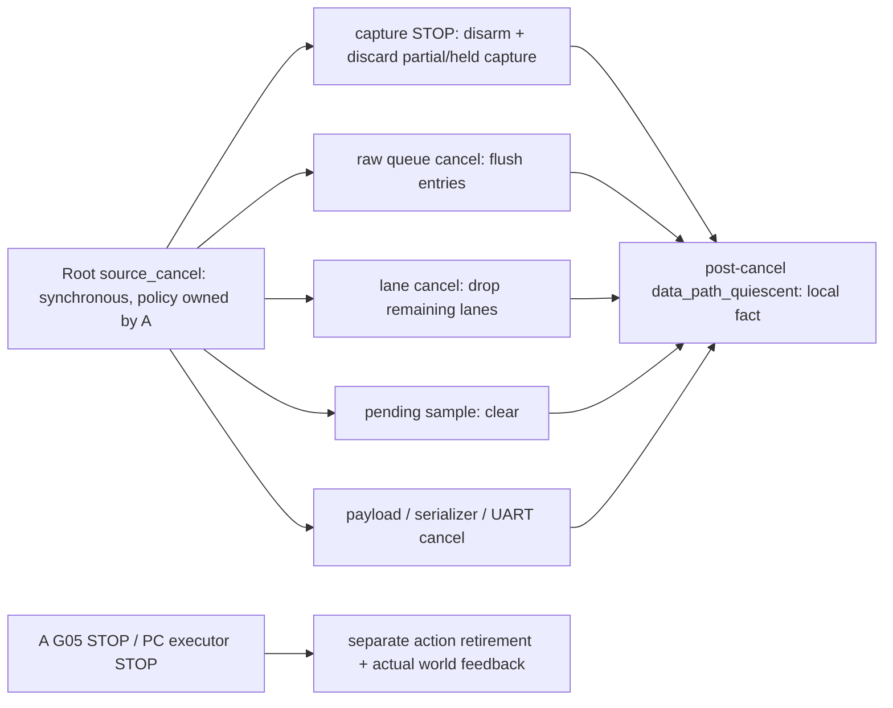

# Additive50 data-path cancellation source proposal

Task `DEEPEYE-IMPLEMENTATION-20261014/v1`; work
`B-ADDITIVE50-CONTINUATION-20261030-73`; B owner
`01a18824-4172-74e2-a13f-f3e3d1e3ed99`. This continues A's original
`B-DEEPEYE-G05-ADDITIVE50-INTEGRATION-SOURCE-20261029-63` source/design-only
decision. No test, simulation, compilation, build, clock setting, board
operation, public ABI, control route or execution release follows.

H01-H15 remain binding at contract
`f5989cd5defce561f9ba98e6b18fc2682945f0a2`, requirements SHA256
`c229834bfc2292f5fe4411fc9f12c68487008f9d1adaf31f0144ee7a98173804`,
freeze `1011259415a0916054eb580687612580bc1e5f09`. Full game3D/UI,
edge-only cube/solid collisions/free camera/layout/faces/equal gates/complete
passage, hidden truth/causal observations/online3D/substantive PC AI and both
H12 paths are preserved. Original100MHz and final1pct/100ms gates remain.

## Concrete source change

The minimum top gains a same-clock active-high `source_cancel` input. Root
must drive it explicitly in the proposed fabric clock domain; it is not a
new MMIO register or an external asynchronous input synchronizer.

| Stage | Connection in the proposed top | Local consequence after a cancelling edge |
| --- | --- | --- |
| raw capture | `stop = capture_stop || source_cancel` | STOP takes priority over rearm; disarms and drops partial/held scan |
| raw queue | `cancel = queue_cancel || source_cancel` | buffered entries are aborted |
| lane stream | `cancel = lane_cancel || source_cancel` | remaining lanes are dropped |
| association/sample | match is gated off; cancellation clears pending sample | no new descriptor/sample handshake during cancellation |
| TRACE composition | `cancel = source_cancel` | payload, serializer and UART cancel via their existing common input |

Existing `capture_stop`, `queue_cancel` and `lane_cancel` retain their local
meanings. `source_cancel` provides one explicit data-path abort across them.
It does **not** drive G05 STOP, revoke a PC action, or prove a simulator/world
has stopped. No ACK receiver, Root receipt protocol or retry is implemented.

## Local indication and recovery

`data_path_quiescent` is qualified by a latch set only after a cancelling
clock edge. It also requires reset released, no rearm request, capture
disarmed/partial-empty, queue empty, no queue output, no lane output, no
pending raw sample and TRACE not busy. Without the post-cancel latch a
disarmed capture could still hold an internal completed scan that has not
entered the raw queue; ordinary idle or fault state must not be called empty.
Reset and a fresh rearm revoke this indication.

This Boolean is a local structural observation. It is not a health flag,
transport delivery/ACK, command retirement, acquisition/source authenticity,
physical motion STOP or either H12 acceptance. Its behavior remains
unexecuted and unverified. The default `SOURCE_REVIEW_HOLD=1` also holds this
indication false.

Releasing `source_cancel` does not rearm capture. Root must make a separate
explicit rearm/tag and resolve all old operation/source/frame records. No
old descriptor, sample, action or unknown result is retried automatically.
Root must invalidate the cancelled binding/receipt and provide an explicitly
associated fresh private transport view before later admission. The actual
Root policy, retained records and cross-component confirmation are absent.

Cancellation cannot recall bytes already emitted or a complete frame already
received. UART returns to idle through its existing cancellation behavior;
the receiver must discard partial frames and Root must reject cancelled
operation/frame identities even if a full CRC-valid frame arrived earlier.
Root must preserve prior error/status evidence before clearing local state.
This proposal creates no authentication or protocol BOOT.

## Adapter producer-valid correction

The R2 adapter computed `payload_cfg_valid` by reading `blk_ready` before
assigning `blk_ready` later in the same `always_comb` block. A procedural
combinational block need not run again for changes to a variable it itself
writes. When inflight state clears and a new descriptor is already valid,
that ordering can expose ready while the forwarded valid still uses an old
ready value. The UART wrapper currently serializes descriptors, which limits
reachability in this minimum top; the generic adapter interface should not
rely on that accidental spacing.

The proposed equation is `blk_valid && !inflight_q && cfg_block_ok`.
Producer-valid no longer depends on ready. Inner cfg_ready still determines
acceptance; bad metadata is consumed through the existing explicit refusal
path. This is static source reasoning, not a reproduced simulator failure
or proof of all handshake timing.

The sensitivity rule is also discussed in the primary
[Accellera SV-BC archive](https://accellera.org/images/eda/sv-bc/1859.html).
Its application to this adapter is main's static inference. No simulator
result is claimed.

## Independent finding F1: implicit gate withdrawal

The independent audit examined unchanged72 base `b01d9fdb...`. Main accepts
the specific scenario where profile/transport permission withdraws **before
the pending raw sample handshake**. The UART wrapper cancels without a normal
result, so the earlier top could retain a pending sample and block all later
associations. The report's broader before-REPORT wording is not sufficient:
once the raw sample has transferred, the top has already cleared that slot.
The present top is default-closed; this is a latent activation-path concern.

The wrapper now exports its actual `cancel_active` level, including explicit
cancel, profile/transport withdrawal or invalid clock/baud. The top uses the
same level to suppress descriptor admission and clear pending state at the
cancelling edge. Raw queues are globally flushed only by explicit
`source_cancel`; implicit wrapper cancellation is not called global STOP.

The wrapper also records `transaction_aborted` as one registered local pulse
when non-reset cancellation finds an accepted, outstanding transaction. An
active latch is cleared by a consumed normal result or cancellation, so held
cancel does not repeatedly report the same transaction. Reset clears this
local account without an abort pulse; Root must invalidate reset context.
The top exposes the pulse as `trace_transaction_aborted`. Root must retain
the full identity from the original accepted association and correlate this
local event with that single outstanding descriptor. It is not a wire ACK,
delivery claim, source authentication, action retirement or automatic retry.
All of these transition expectations remain unexecuted static reasoning.

## Remaining work

A must review the new ports, actual common-clock/reset topology and real
Root cancellation/receipt/retirement policy before any bounded execution.
Both H12 paths, global motion STOP/ACK, aggregation, actual source/QPC/full
identity/quality/calibration/pose/action/admission records, physical link
and final timing/compression/latency remain unaccepted. Handwritten cancel
scenarios are proposed future checks only; every runtime stage is not_run.
