# Additive50 source/design proposal — unexecuted

This continues A's original `B-DEEPEYE-G05-ADDITIVE50-INTEGRATION-SOURCE-20261029-63` request, read back from [decision6500172372](https://github.com/carolwjade/CarlandFPGA/pull/30#issuecomment-6500172372). It supplies separately named candidate sources and static vectors for review. It authorizes no simulation, unit tests, synthesis, route, clock setter, board operation, ABI activation or movement. 50MHz is a proposed integration profile; the original100MHz final gate remains.

Task `DEEPEYE-IMPLEMENTATION-20261014/v1`; current B main `01a18824-4172-74e2-a13f-f3e3d1e3ed99`. Contract H01–H15 is pinned at `f5989cd5defce561f9ba98e6b18fc2682945f0a2`, requirements SHA256 `c229834bfc2292f5fe4411fc9f12c68487008f9d1adaf31f0144ee7a98173804`, frozen design `1011259415a0916054eb580687612580bc1e5f09`. Full game-grade3D/UI, hollow edge cube/solid collisions, free camera/layout/faces, equal gates/complete passage, hidden truth, device-bounded causal observations, online3D decisions, substantive PC AI and both complete H12 routes remain required. Source review is not product acceptance.

## Selected sources and dimensional contract

`rtl/deepeye_g05_profile_50mhz.sv` declares proposed dimensions only. Read the package before the mapper/engine in any separately authorized future elaboration. No Tcl/XDC or PS clock setter is supplied. `deepeye_g05_command_map_50mhz` retains the original100MHz mapper's64-bit square math, legality and identical ROM; the experimental32-bit mapper is not selected. `deepeye_g05_capture_engine_50mhz` and its private PWM module have separate names. Existing100MHz mapper, engine, build entrypoint, profiles and vectors remain unchanged.

| Quantity | Original100MHz | Proposed50MHz | Meaning |
| --- | --- | --- | --- |
| tick | 10ns | 20ns | assumed input clock; not measured |
| frame | 2000000 | 1000000 | 20ms |
| yaw/pitch high | 250000+16q | 125000+8q | same dimensional pulse |
| speed high | 50000+1000code | 25000+500code | same dimensional pulse |
| TTL | 100000×ms | 50000×ms | actual applying-edge origin retained |
| first/later watchdog | 3P+16 /2P+16 | 3P+8 /2P+8 | 60.00016ms /40.00016ms at the production frame |
| nominal tolerance | 2ticks | 1tick | 20ns; physical propagation/skew unknown |
| synchronizer | 3FF | 3FF | only external-to-first-D may be excepted in a future reviewed build |
| maximum mapper TTL window | 1200000000ticks | 600000000ticks | 12s;32-bit local witness remains sufficient |

Original profile1/2, signed q±15000, speed0..20, zero-speed rule, TTL bounds3000/12000ms and curvature ROM remain. An angle inside±15000 can still fail curvature. Illegal mappings emit zero period/high/TTL outputs. Minimum count-level period remains32ticks; its physical duration therefore changes from320ns to640ns outside the fixed production-frame contract. All overflow/nonwrap, stop/expiry, sequence, fault and capture qualification rules remain explicit; no guard is mechanically halved without dimensional reasoning.

The applying edge is A. Its registered primitive flag is observed by the engine at A+1. Loading rearm countdown5 there gives4/3/2/1 after A+2/3/4/5; the rearm baseline is sampled at A+6 and capture enable changes after that edge. A+7 is the earliest newly eligible clean edge. This is a source/NBA timeline, not a measured CDC or physical timing result. Three synchronizer stages, a nominal one-tick external skew and a capture sampling edge motivate the additional guard. A STOP/expiry at A+6 wins the existing control branch. The unused fallback constant6 in the source package is an alternative for review, not automatic recovery or an enabled second policy. Actual flight time/skew may invalidate the nominal assumption and require A review.

## One encoder and one proposed fabric clock

```mermaid
flowchart LR
  ROOT["A Root: actual source/context/QPC/poses/action registry"] --> RAW["same-clock raw source interface: uint16 + uint8 + original QPC"]
  RAW --> CAP["buffered_scan_capture: bounded raw scans"]
  CAP --> LANE["scan_lane_stream: unchanged raw lane"]
  LANE --> ASSOC["Root association + minimum singleton latch"]
  ASSOC --> TRACE["trace_payload_candidate: one encoder"]
  TRACE --> PRIV["private E4 / payload revision2 / relative1us"]
  PRIV --> SER["wire_serializer + CRC"]
  SER --> UART["UART: baud/pins unset; default closed"]
  UART --> DEC["pinned code-section parser + strict original-record companion"]
  DEC --> C29["A Root supplies exact C29 candidate and association; C29 target not called here"]
  C29 --> PC["PC_DIRECT proposal / A executor"]
  C29 --> AXI["FPGA route proposal / A AXI admission"]
  AXI --> G05["separate50MHz AXI + mapper + engine"]
  G05 --> PWM["external PWM/capture connector: A only"]
  PWM --> ROOT
  PC --> ROOT
```

The chosen encoder composition is **raw acquisition → trace_payload_candidate**. `buffered_block_stream` already encodes and is bypassed completely. The source uses existing raw scan capture/lane modules, not a second encoder or fabricated native ADC source. The incoming sample strobe/data/QPC/quality interface must already meet the common clock contract; an asynchronous ADC frontend is not supplied or qualified here.

`fclk50_candidate` drives acquisition, lane, payload, serializer, UART and the G05 AXI candidate. The selected top has no second AXI clock input. Root must connect the PS master/interconnect clock to this same proposed clock. External active-low reset asserts asynchronously and releases through the existing two-stage reset structures. The top's `SOURCE_REVIEW_HOLD=1` holds source/G05 paths in reset; TRACE profile/transport gates are additionally fixed0, and BAUD defaults0/unset. These are disabled review sources, not a ready live build. AXI aperture, PS clock/reset generation, pins, IO delays, transport electrical medium and actual baud remain A-owned inputs. The new private G05 signature and new module names must never relabel an old image/HWH.

The top's actual minimum data contract is one lane/sample per frame. Its pending sample latch cannot be overwritten while the sample awaits the encoder. The UART source now feeds raw samples during WAIT_ACCEPT; FEED transfers encoded bytes only. The scan queue ready signal has one driver from the lane component. Capture order/overrun/sequence-exhaust and discarded-sample outputs are exposed. Invalid or full source paths cannot be replaced by invented healthy samples. Generic wrapper support for up to3 samples is not an accepted aggregate top/host contract.

Backpressure is bounded by the existing scan queue, lane, one pending sample, payload storage and full serialized-frame storage. Cancel/stop/reset discard or retire their documented transactions; already emitted UART bytes cannot be recalled and the receiver must discard partial frames. UART completion is byte drain, ACK is transport correlation, G05 accepted/applied/captured events are digital facts, and none alone establishes physical movement, behavioral STOP or a native world action.

At100Hz and four singleton lanes, worst-case46-byte frames alone need184000bit/s for8N1, before additional companion/control traffic. This is a dimensional budget, not a measured link result or selected baud. The minimum singleton prototype does not meet final1% compression or prove100ms latency. Block aggregation, complete byte accounting, resources and final timing remain open; the source is offered for A's chain-first review.

## Explicit new time and identity representation

The proposal is `TRACE-PAYLOAD-1US-PRIVATE-v2`, outer opaque version3/type0xE4 and payload revision2. Legacy type7/FORCE8 and old revision1 inputs are rejected by the proposed host boundary. The fixed legacy decoder is reused only for unchanged coding fields on an internal local payload copy, with exact SHA256; no caller module or hash placeholder is accepted. This turn did not import or call it. None of these identifiers is approved as public ABI.

Root supplies a fixed original `origin_qpc_ns` receipt. Transport tick is floor((original acquisition QPC−origin)/1000), with nonnegative/nonwrapping checked integers. Raw10ms becomes10000units, fitting the16-bit stride. Original uint63 QPC, origin and each remainder0..999 are retained, including values above2^53. Exact source-age checks use original QPC and the unchanged100000000ns bound; transport receive time and a PL latch are never substituted for acquisition time. The original C29 source clock/anchor/index is not reset or rebased by this separate transport representation.

Quality/held origin, index/tick stride, original timestamp nonlinearity or payload-budget changes require a block split or explicit refusal. Singleton long-held encoding can fit21+8+2=31bytes. Metadata25bytes is the multi-point case, not a consequence of64-bit ticks. A held gap that collapses to the same integer microsecond must be refused. A changed timestamp remainder cannot be hidden by a uniform reconstructed grid. The selected host requires the complete original per-point values/indices/timestamps and a matching companion hash; there is no UNBOUND shortcut.

The existing uint32 session/uint8 epoch/uint16 sequence fields are opaque physical fields only. Root must explicitly issue a **new private transport binding** linking separate local handles to full original operation/request/commit/build/kernel-boot/string-session/tag/generation/trigger/request/capture/source-admission identities. This companion is not injected into C29's strict ABI as extra fields. Never hash/truncate a string session, take generation low8, fill a missing epoch constant, relabel Linux kernel boot as protocol BOOT, or promote a frame sequence into an acquisition index. A matching JSON/hash is structural correlation, not authentication.

## CPU and control ownership

C29 target is exact source `2210ca5f32e4e806651a6b06d0e2d9710d78e773`, manifest `0936cae30ac1a6fcbcc651c889f4e3ab24c7a9cd7c9ebbbce2ac51242701903c`. Its one frozen C28 code object remains C-owned. The source-only host provides a decoded transport view and a reference to that boundary; it never calls the planner. A Root must supply its exact original candidate, configuration, admissions, ADC/EM own poses, native held origin, current pose and occurred-action registry. These records are not supplied by the current A candidate. Missing records remain unavailable/STOP/core_ran=false.

Transport preserves uint16 values and opaque uint8 quality. C29 requires null/uint12 counts, exact uint63 QPC, original admissions0..31 with no omissions/rebase/sliding window, and bounded retained history/actions. Values32769/65280 cannot be clipped into C29. Even in-range counts and a matching checksum establish neither calibration nor quality semantics. Rice E>0 decoded values may differ from the original; the source view records that fact and supplies no native-observation admission. Root must preserve the original counts and approved error/source policy; all sidecar/control bytes count toward any later compression/latency measurement.

| Boundary | Owner and required record | Missing or invalid outcome |
| --- | --- | --- |
| clock/reset/build | A: actual chosen profile, same-fabric clock/reset and same-build hash/HWH | no execution or clock assumption promoted to measurement |
| source/trigger/index | A: original admission, capture/request/trigger and complete retained source lineage | unavailable; never synthesize a native sample |
| BOOT/session | A: original full identities and separately reviewed transport binding | unavailable; Linux boot is not protocol BOOT |
| ticks/age | A: actual original acquisition QPC/origin/remainders and receiver/now association | refuse substitution, truncation, wrap or stale source |
| quality/held | A/C: actual raw encoding, approved mapping and retained native origin/pose | preserve opaque/null data; no fabricated health |
| ACK/STOP | A: exact request/frame/source/action retirement and actual executor/board evidence | transport ACK or STOP advice is not behavioral completion |
| CPU advice | C fixed core after A's actual association gates | no core invocation by this source-only handoff |
| PC_DIRECT / FPGA | A: separate explicit route admission and actual world/executor feedback | source selector returns routeNONE/commandNone |

## Review and recovery evidence

Two original Flash source jobs were interrupted at2026-10-30T02:15:59Z. Their22 partial files, authoring scripts and partial vectors are retained with hashes; they are not relabelled as completed work. Main's explicit recoveryR1 selected/corrected new sources in a new owned directory. The unselected duplicate engine/mapper/host prototypes remain archival inputs. One new disjoint Flash assignment performs static port/document review only.

Main's named-port/AST inspection reads12 instance sites and the selected9 source files. It is not a SystemVerilog compiler, elaborator, simulator, width proof, CDC check or functional test. Its first parser could not handle a committed no-port testbench declaration; failed parser versions remain retained before the read-only parser correction. Handwritten vectors are proposed expected values, not PASS evidence. Original100MHz files are compared to exact committed bytes, without rerunning old suites or builds.

A must review the concrete shared-clock/profile, framing/decoder, Root binding, resource/topology and physical unknowns before any new bounded simulation/build release. FullG05/B06, both complete H12 routes, final1%/100ms and all29 formal gates remain unaccepted. B's source-only preparation does not close those gates.

## Post-review source revision R2

The independent static port review inspected the exact R1 source commit
`9f1bec003733ce582db21df326590f89e957da36`. Its finding that producer
`trace_blk_valid` depended on downstream ready is corrected here: valid now
equals the joined association match, independently of ready. Root must keep
`assoc_valid` and all `assoc_*` metadata stable until its handshake, or cancel
the transaction; the lane component holds its corresponding raw lane. There
is no automatic mismatch timeout. This is a text correction, not behavioral
verification. The original R1 snapshot and review remain preserved.

The other gaps remain explicit. At R2, trace cancel was tied low in the disabled
minimum top; capture STOP and G05 STOP did not implement a common system STOP.
Source73 below adds local data-path cancellation; motion STOP remains separate.
No host/Root receipt ACK or retry is connected, and a local result is consumed
without that end-to-end acknowledgement. Raw quality needs Root's actual
mapping; no payload quality field establishes health. Exact 100ms freshness
is a proposed host-side check, without actual Root observations. Only a
singleton is associated end to end. Full Root identity/time/source/pose/action
records, control admission, both H12 paths and physical topology are absent.
These gaps need A review and further authorized implementation; they are not
closed by this static handoff.

## Source73 cancellation and adapter lifetime update

The new [data-path cancellation contract](CANCEL_CONTRACT.md) specifies a
Root-owned synchronous `source_cancel` input across raw capture, queue,
lane, pending sample and payload/serializer/UART. Its post-cancel
`data_path_quiescent` output describes an empty/disarmed local data path.
Reset and rearm revoke that indication. It is not motion STOP, source health,
host ACK, action retirement, delivery or product acceptance. Already emitted
bytes/full frames require Root invalidation of cancelled identities.

The adapter's producer-valid equation no longer reads a ready variable that
is assigned later in the same combinational procedure. Legal cfg_valid is
independent of ready; refusal remains explicit. This is a source correction,
not a reproduced test pass or liveness proof. The independent Flash audit
inspected the exact unchanged72 base; main adjudicates its findings and the
new source separately. New cancel scenarios are handwritten and unexecuted.

The wrapper also exports the same cancellation level to the top pending
state, addressing the audit's pre-sample-transfer gate-withdrawal finding.
A local `trace_transaction_aborted` pulse records a non-reset cancellation
of one accepted outstanding descriptor. It is not ACK/delivery/retirement;
Root retains the accepted full identity. Reset invalidates context separately.

All review hold/profile/transport/baud defaults remain closed. Global motion
STOP/ACK/Root receipt/retry, complete source/QPC/identity/quality/pose/action
context, both H12 routes and final physical/system gates remain open. A must
review new ports and actual Root policy before any execution release.
