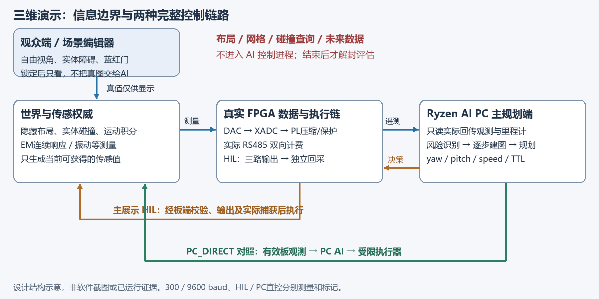

# 矿脉深瞳｜最终任务书完整版

> **完整阅读版，非摘要。** 下文收录冻结终稿的全部18章正文、29张根任务卡、H01–H15人类合同、所有规范附录，以及最终发布包中的完整文本证据与校验脚本。原件逐文件保留，正文没有删节；附录中的相对链接只为本单文件阅读位置作重定位。

项目：2026年中国大学生嵌入式竞赛FPGA创新设计，AMD Ryzen AI PC＋任意AMD FPGA方向；作品“矿脉深瞳”。文档任务 `COMP-20261013-DEEPEYE`，**版本5／技术修订1**。实施任务 `DEEPEYE-IMPLEMENTATION-20261014/version1`。

冻结源提交：[`1011259415a0916054eb580687612580bc1e5f09`](https://github.com/carolwjade/CarlandFPGA/tree/1011259415a0916054eb580687612580bc1e5f09/docs/competition/deepeye-2026)。人类合同 `DEEPEYE-HUMAN-LOCK-20261014/revision1`，规范 SHA-256：`c229834bfc2292f5fe4411fc9f12c68487008f9d1adaf31f0144ee7a98173804`。

阅读入口：[原版PDF（正文29页）](deepeye_taskbook_final.pdf) · [独立正文原件](taskbook_final.md) · [全部原件目录](.) · [本次发布完整性清单](publication_manifest.json) · [只读完整性检查](verify_publication.py)。

**规范优先级。** 人类新明确指令及H01–H15最高；本终稿正文与最终机器契约决定实施要求。后半部分原始评审、冻结记录和检查回执完整保留供追溯，其中候选意见、旧版本参数及历史状态不能覆盖终稿。C方专项验收门须连同正文第17章融合修正理解。

**状态与接管说明。** 本次仅独立发布已冻结任务书，不变更产品设计或重新派工。原件中的 `not_run`、时间、交接计划、检查结果是冻结当时的记录，不是对当前进展的重置或完成声明。文档、哈希及排版检查不能替代软件、AI、RTL、实板和正式验收。后续人类已要求更换A实施主会话；由已经接管的桌面实施主继续推进，阅读本书不得再建立第二个总主或用mesh调用占用其写入权。实际实施状态以该主会话的当前证据为准；本条只补充会话接管操作，不改变任何H条、职责、指标或产品验收门。

## 完整阅读目录

1. [完整正文：18章与29张任务卡](#source-01) — 原件 [taskbook_final.md](taskbook_final.md)
2. [人类不可删改合同：原话、H01–H15与验收映射](#source-02) — 原件 [immutable_scope.md](immutable_scope.md)
3. [人类不可删改合同：机器可读原件](#source-03) — 原件 [immutable_scope.json](immutable_scope.json)
4. [分阶段、分工、依赖和验收门：完整任务DAG](#source-04) — 原件 [execution_plan_final.json](execution_plan_final.json)
5. [三维演示、传感、运动及控制接口：完整参数契约](#source-05) — 原件 [simulation_contract_final.json](simulation_contract_final.json)
6. [三机主会话、工作会话与并行实施编排](#source-06) — 原件 [execution_orchestration_v5.md](execution_orchestration_v5.md)
7. [自动化执行契约](#source-07) — 原件 [automation_contract.md](automation_contract.md)
8. [三机综合评析与最终取舍](#source-08) — 原件 [fusion_review_final.md](fusion_review_final.md)
9. [三机来源及取舍：机器可读证据](#source-09) — 原件 [fusion_review_final.json](fusion_review_final.json)
10. [真实案例、传感依据与技术来源](#source-10) — 原件 [research_final.md](research_final.md)
11. [C方人类范围与同伴意见补充](#source-11) — 原件 [round3/c/scope_and_peer_addendum.md](round3/c/scope_and_peer_addendum.md)
12. [C方专项验收门完整定义（以正文融合修正为准）](#source-12) — 原件 [v5/c/acceptance.json](v5/c/acceptance.json)
13. [.gitattributes](#source-13) — 原件 [.gitattributes](.gitattributes)
14. [build_taskbook_final.py](#source-14) — 原件 [build_taskbook_final.py](build_taskbook_final.py)
15. [checks_final.json](#source-15) — 原件 [checks_final.json](checks_final.json)
16. [readme.md](#source-16) — 原件 [readme.md](readme.md)
17. [release_manifest_final.json](#source-17) — 原件 [release_manifest_final.json](release_manifest_final.json)
18. [reviews/v5/b/.gitattributes](#source-18) — 原件 [reviews/v5/b/.gitattributes](reviews/v5/b/.gitattributes)
19. [reviews/v5/b/README.md](#source-19) — 原件 [reviews/v5/b/README.md](reviews/v5/b/README.md)
20. [reviews/v5/b/assets_and_acceptance.md](#source-20) — 原件 [reviews/v5/b/assets_and_acceptance.md](reviews/v5/b/assets_and_acceptance.md)
21. [reviews/v5/b/check_planning.py](#source-21) — 原件 [reviews/v5/b/check_planning.py](reviews/v5/b/check_planning.py)
22. [reviews/v5/b/comparison_v4.md](#source-22) — 原件 [reviews/v5/b/comparison_v4.md](reviews/v5/b/comparison_v4.md)
23. [reviews/v5/b/evidence.md](#source-23) — 原件 [reviews/v5/b/evidence.md](reviews/v5/b/evidence.md)
24. [reviews/v5/b/freeze.json](#source-24) — 原件 [reviews/v5/b/freeze.json](reviews/v5/b/freeze.json)
25. [reviews/v5/b/handoff.md](#source-25) — 原件 [reviews/v5/b/handoff.md](reviews/v5/b/handoff.md)
26. [reviews/v5/b/planning_checks.json](#source-26) — 原件 [reviews/v5/b/planning_checks.json](reviews/v5/b/planning_checks.json)
27. [reviews/v5/b/protocol.md](#source-27) — 原件 [reviews/v5/b/protocol.md](reviews/v5/b/protocol.md)
28. [reviews/v5/b/review.md](#source-28) — 原件 [reviews/v5/b/review.md](reviews/v5/b/review.md)
29. [reviews/v5/b/sources.json](#source-29) — 原件 [reviews/v5/b/sources.json](reviews/v5/b/sources.json)
30. [reviews/v5/b/validation.json](#source-30) — 原件 [reviews/v5/b/validation.json](reviews/v5/b/validation.json)
31. [round3/b/.gitattributes](#source-31) — 原件 [round3/b/.gitattributes](round3/b/.gitattributes)
32. [round3/b/README.md](#source-32) — 原件 [round3/b/README.md](round3/b/README.md)
33. [round3/b/check_research.py](#source-33) — 原件 [round3/b/check_research.py](round3/b/check_research.py)
34. [round3/b/checks.json](#source-34) — 原件 [round3/b/checks.json](round3/b/checks.json)
35. [round3/b/corrections.md](#source-35) — 原件 [round3/b/corrections.md](round3/b/corrections.md)
36. [round3/b/evidence.md](#source-36) — 原件 [round3/b/evidence.md](round3/b/evidence.md)
37. [round3/b/freeze.json](#source-37) — 原件 [round3/b/freeze.json](round3/b/freeze.json)
38. [round3/b/fusion_review.md](#source-38) — 原件 [round3/b/fusion_review.md](round3/b/fusion_review.md)
39. [round3/b/sources.json](#source-39) — 原件 [round3/b/sources.json](round3/b/sources.json)
40. [round3/c/.gitattributes](#source-40) — 原件 [round3/c/.gitattributes](round3/c/.gitattributes)
41. [round3/c/README.md](#source-41) — 原件 [round3/c/README.md](round3/c/README.md)
42. [round3/c/acceptance.json](#source-42) — 原件 [round3/c/acceptance.json](round3/c/acceptance.json)
43. [round3/c/freeze_manifest.json](#source-43) — 原件 [round3/c/freeze_manifest.json](round3/c/freeze_manifest.json)
44. [round3/c/research_checks.json](#source-44) — 原件 [round3/c/research_checks.json](round3/c/research_checks.json)
45. [round3/c/review.md](#source-45) — 原件 [round3/c/review.md](round3/c/review.md)
46. [round3/c/scope_addendum_manifest.json](#source-46) — 原件 [round3/c/scope_addendum_manifest.json](round3/c/scope_addendum_manifest.json)
47. [round3/c/sources.json](#source-47) — 原件 [round3/c/sources.json](round3/c/sources.json)
48. [round3/c/verify_review.py](#source-48) — 原件 [round3/c/verify_review.py](round3/c/verify_review.py)
49. [sources/provenance.json](#source-49) — 原件 [sources/provenance.json](sources/provenance.json)
50. [v5/c/.gitattributes](#source-50) — 原件 [v5/c/.gitattributes](v5/c/.gitattributes)
51. [v5/c/freeze_manifest.json](#source-51) — 原件 [v5/c/freeze_manifest.json](v5/c/freeze_manifest.json)
52. [v5/c/research_checks.json](#source-52) — 原件 [v5/c/research_checks.json](v5/c/research_checks.json)
53. [v5/c/review.md](#source-53) — 原件 [v5/c/review.md](v5/c/review.md)
54. [v5/c/sources.json](#source-54) — 原件 [v5/c/sources.json](v5/c/sources.json)
55. [v5/c/verify_review.py](#source-55) — 原件 [v5/c/verify_review.py](v5/c/verify_review.py)
56. [verification_final.txt](#source-56) — 原件 [verification_final.txt](verification_final.txt)
57. [verify_immutable_scope.py](#source-57) — 原件 [verify_immutable_scope.py](verify_immutable_scope.py)
58. [verify_taskbook_final.py](#source-58) — 原件 [verify_taskbook_final.py](verify_taskbook_final.py)
59. [visual_qa_final.json](#source-59) — 原件 [visual_qa_final.json](visual_qa_final.json)

## 非文本原件

- [原版任务书PDF](deepeye_taskbook_final.pdf)
- [三维演示信息边界与协同控制图](architecture_v4.png)

以下每节均为对应原件的完整内容。文本源的字节哈希和内嵌区间记录在 `publication_manifest.json`；PDF及PNG按原始字节独立保存。

---

<a id="source-01"></a>

## 完整原件 01｜完整正文：18章与29张任务卡

原件：[taskbook_final.md](taskbook_final.md)；源文件 SHA-256：`7f5c94f7fc73698236be954ae7818266d6dfe8b4949d1752dd045d76f4b71f18`。

# 矿脉深瞳 FPGA参赛项目任务书

基于Ryzen AI与PYNQ Z2的低带宽随钻感知、游戏级三维演示与协同控制

任务COMP-20261013-DEEPEYE，版本5／最终融合版，统筹A。技术修订1，完成日期2026年10月15日。计划期2026年10月14日至11月4日；11月4日12时冻结交付包，18时为官方提交截止。

本版为三机既有独立五案、内部融合、跨机逐模块融合之后，按人类最新不可删改范围形成的唯一实施任务书。v1至v4及原始候选保留为历史。人类锁定合同DEEPEYE-HUMAN-LOCK-20261014/revision1，规范SHA256 c229834bfc2292f5fe4411fc9f12c68487008f9d1adaf31f0144ee7a98173804，全部H01-H15优先于本书技术选择、时间表、评分和后续AI讨论。任何AI无权删减；只有人类后续明确指令可修改。正文第16节逐条固化，17节记录本轮三机评析，18节指定新会话交接。全部29张产品任务卡初始not_run；文档校验及数值复算不等于产品已实现或实测。

## 1 最终目标与作品范围

本项目参加2026全国大学生嵌入式芯片与系统设计竞赛FPGA创新设计赛道AMD Ryzen AI PC＋任意AMD FPGA方向；对应当前官件3.2，应用自主选题。采用真实传感输入、PYNQ-Z2自研数据处理和通信逻辑、AMD本地AI与游戏级三维软件，实现“传感→板端采集/压缩→受限上传→PC AI感知建图规划→合规执行→状态反馈”的可验证闭环。标准展示以PC AI经FPGA输出的硬件在环为主，同时允许经真实板观测后PC AI直控模拟器的明确模式。工程目标是通过同条件对比、真实板级证据、清楚的演示和可复现交付争取奖项。

本届不配置真实电机、舵机或钻头执行机构。为兼顾真实物理任务，推荐增加传感前端真实自动量程调节：AI依据窄带观测选择有限增益，PL控制可编程模拟放大器，ADC独立测得实际增益和输出变化；这是测量仪器调节，不是实物钻头运动。其赛道认定须按R01核已有赛事资料，未获明确依据时不得宣称资格门已通过。虚拟钻头在完整三维软件中运动；HIL模式须用FPGA实际捕获状态，PC_DIRECT模式须用受限broker确认的PC AI命令与新鲜板端观测，二者分别记录，不能互相冒充。传感器实采、公开井日志回放、数字场景真值和FPGA实板结果各自标记来源。校内传感器和软件模拟含水区不构成煤矿含水层识别、现场超前探测或矿用安全认证证据。

最终融合采用“事件优先多速率遥测、独立可逆块与RAW退化、本地完整档案、PC AI感知与在线三维规划、多拓扑因果执行”。基础层保证正确工程；参赛标准层首先关闭ROCm与真实物理任务两资格门，再增加可选真实NPU、误差受限档位和完整消融；强化层按预算余量加入渐进细节和更复杂场景。学习式编码器、复杂字典、压缩感知及强化学习不进入本届关键路径。

现有三机协作程序提供开发和交接能力，参赛产品单独放competition/deepeye/。已有协作平台或旧BRAM验收不能替代本产品新Overlay的验证。



## 2 官方规则与人类约束

官方AMD指南共28页，原始SHA256为c6ad82acd4f7bdcd13bd412e232ed85d05f2a87dd5e2cdd04f9d219f88b569fc；第一轮通知7页，SHA256为c17611b45a66121cd93f421e7fdee50f1743b1eb0cb5d9f930c57578d480ef9f。A从官方列表取得原件依据，再独立获取同字节文件核对。源文件和provenance.json保存在本研究目录sources/，正式引用入口为[赛事官方下载中心](http://www.fpgachina.cn/?page=download)。

最新人类原话明确“AMD Ryzen AI PC＋任意AMD FPGA，无进一步细分和分组，按该赛道自主选题”。这与官件文件页13至21的3.2节对应；此前把“应用自主选择”理解成3.3是版本2研究判断，现纠正。3.3另有学历分组，其权重和豁免不用于本终版。保留首轮与第二轮冻结原件，防止把事后修订写成事前已知。

3.2必须采用AMD Ryzen AI PC及AMD FPGA/Zynq，板卡须承担真实硬件功能；AI本地参与感知/决策；至少一项真实物理任务，机械可简化，但AI到物理执行必须完整。软件栈须ROCm7.14.0或以上；必须实板跑通并提供五类核心指标、至少两类专项指标、完整工程与原始证据。PYNQ-Z2允许；NPU不是单独硬门槛，Ryzen AI Software不能替代ROCm。R01登记已完成报名/资格资料，不重新报名或替人类改方向。

|3.2官方评价项|权重|本作品对应证据|
|---|---:|---|
|具身智能系统完整度|20|传感前端真实调节闭环、成功率和物理响应；虚拟导向单列|
|AI PC端侧AI能力|20|ROCm实际项目推断、岩性/代理任务、batch1分段时延与离线运行|
|FPGA/Zynq设计质量|25|同步采集、编码仲裁、安全逻辑、真实IO及资源/时序/吞吐|
|AI PC与FPGA/Zynq协同|20|受限双向通信、实物调节回读、同步误差与异常恢复|
|工程完成度与创新|15|同条件消融、稳定性、演示、复建与可复用Skill|

有两个资格风险必须独立关闭：现有8845H的实际ROCm项目路径尚未验证；仅传感、GPIO回采和数字孪生不能自动算真实物理执行。推荐最小实际任务是传感器自动量程；该任务的赛事认可属于规则判断，物理成功属于实测，两者分别登记。若坚持完全不改变任何真实物理量且无正式允许依据，本作品可完成工程展示，但不得宣称已满足3.2完整闭环或保证获奖。不得悄悄换成3.3，也不再向已休息的人类追问细节。

人类的工程约束为PYNQ-Z2、11月4日提交、传感器输入加数字孪生、物料由三机自主选择、适度预算、基础至强化分级、全工作链路尽量由agent执行。只在真实接线、无法代办的账号/管理员交互或正式提交等必须人类参与时集中报告。

## 3 两轮择优和最终取舍

三机第一轮各形成五套完整架构，在分享设计前分别封存。A本地两项研究子代理只负责官方规则和技术取证，均有reserve/validate/complete；它们归A，不计为B/C。原始候选中的赛道及实物假设保留为版本1历史，版本3按最新已核对人类赛道更新统一调整，不回改初轮原件。

|节点|五套完整候选|内部融合骨架|封存证据|
|---|---|---|---|
|A|无损预测、有界趋势、多分辨率、摘要事件、学习式编码|定长摘要事件加独立无损块及本地保护|16:23:34 UTC；best d9716026…11416；commit1412d6d70985848fff1332479c98a8be54f15e87|
|B|全曲线无损、双时间尺度事件、近无损、本地模型监督、学习式遥测|事件优先与独立无损块、命令时效及恢复状态机|16:12:22 UTC；best6088bb2d…439c8；PR13 head ec0675dfb2f1f86c6201b2d1e2ea27d3f5a04ff8|
|C|事件多速率、关键点渐进、任务驱动AI、无损档案、压缩感知|多速率事件、有界Rice、包络/年龄/缺失与置信门控|16:05:55 UTC；best5243500c…1889af；commitab527e20eb7bc8a0cdeab0409943ec17510830fe|

A封存前仅检查收件身份和消息类型，封存后才读取B设计摘要。A独立核验B的17项清单及六工况预算；C五案/最佳正文哈希匹配，预算JSON的Git LF与原CRLF有字节差异，换行定位和只读数值复算一致，分别记录。C采用不同内部权重，三机内部总分不能直接排名。B第二轮PR16 head43068749dc62435aadd94724064b08985dc2420c、C第二轮PR15 head11ecdc42cf1aad66624eb37c301700599cb9e62a均已实际完成；A逐项核对封存15/8项哈希，并读完B针对根稿的三处P0反馈。版本3闭合接口并更新赛道，属于当时A统筹工程选择；本轮三机最新评审来源另见第17节。第二轮按以下模块重新评析和融合，不简单取一个总分最高方案。

|模块|原方案的不足|融合采用的优点|最终处理及重验|
|---|---|---|---|
|实时观测|A摘要不足以完整重建；B全曲线遇噪声超额|C多速率与事件；A固定预算|核心定长状态，选择性独立样本块；原始全量留PS；线上缺段显式标记|
|编码|字典/学习式硬件成本高，固定压缩比无依据|B独立块/RAW；C闭环量化与Rice界|无损E=0为基础，E=1/2/4/8为标准档；各档独立黄金及任务损失测试|
|调度|单方向或平均预算漏ACK、换向、洪泛|A共享线速；C滑窗、短帧；B有限重传|双向统一记账，事件优先不饿死状态；容量/丢弃/年龄均回读|
|模型|NPU解码不合适；低维摘要和原曲线分布不同|C因果窗口、mask、分井；B真实落点日志|CPU解码，ROCm小CNN与可选NPU；按实际回传信息训练，CPU同条件保留|
|控制|旧命令、重复包或PC崩溃使状态不一致|B会话/TTL/幂等；A边界生效|新会话、观察序号、TTL、影子配置；重复包不续期；断链保持停止，显式重新使能|
|展示软件|旧稿画质/交互/三维体积不明确，且把合法PC AI直控一律禁止|人类新要求、C真值隔离、B电气因果|最终第8节必交游戏级3D；主链PC AI→FPGA回采→模拟器，PC直控明确来源；三模式均禁止真值泄漏|
|资源|A/B初轮默认新PC，机械台架额外拖期|A实际设备盘点；人类无执行器约束|复用A的Ryzen8845H/32GB；传感和可编程输入夹具，去除机械执行器|
|交付|仅成功展示无法复现|三机原始证据、C盲场景、B恢复步骤|全链路流水线、故障矩阵、三级交付、通用PYNQ Skill和交互自纠错记录|

最终选择A内部A6的任务信息优先骨架，形成融合版F2；用B的独立块和可靠命令状态机替换薄弱模块，用C的多速率、误差/缺失/年龄语义及模型评估改进数据路径。移除不符合人类范围的现实执行器；保留真正FPGA采集、编码、仲裁、物理测量量程调节和独立输出回采；钻头运动仍是孪生。获奖主张只使用后续真实测量结果。

## 4 硬件 软件和三级交付

A实际设备为MECHREVO Yilong15Pro，AMD Ryzen7 8845H、约32GB内存、Radeon780M、Windows11 Home build26200；NPU设备present/OK，驱动32.0.203.240。优先复用此机作为AMD主站。另有NVIDIA显卡可用于开发训练，但不能把其训练/推断成绩冒充AMD NPU效果。B为Lenovo82WM、Ryzen9 7945HX、16GiB、RTX4060，无已识别AMD NPU；C为i7-14650HX、16GB、RTX4050，无AMD AI PC。B/C承担开发与训练，正式AMD执行优先A。

主栈选择ROCm7.14.1的官方支持组合，先在A只读核SKU/OS/驱动及磁盘，再隔离安装并用项目CNN实际推断。AMD当前矩阵列Radeon780M/gfx1103及相应OS，但系列列表未直接逐名保证8845H；不能只凭同gfx认定整机兼容。R02实测是复用A的必要退出条件，失败优先借用/短租受支持HX370/32GB整机，不默认购买Max+395；具体OS/驱动按官方矩阵锁定，不直接升级现有系统。本轮未见RyzenAI1.7.x/1.8.0安装目录，未跑项目模型。优先验证[AMD Ryzen AI1.7.1的PHX/HPT X1流程](https://ryzenai.docs.amd.com/en/1.7.1/inst.html)，固定形状INT8 CNN使用X1及对应phoenix xclbin；当前驱动低于所查SDK要求，R02准备OEM/AMD签名驱动升级及可审阅安装方案，再实测。版本与算子分配以实际成功运行后锁定；不因一个quicktest或NPU硬件存在宣称模型已在NPU运行。1.8的默认quicktest针对较新设备，不直接套到HPT。

FPGA使用xc7z020clg400-1；Vivado2026.1为主构建工具，PYNQ沿用实际兼容的3.1.1环境。PYNQ4.0移除Z2支持，不升级到该版本。bit/hwh同次构建。A唯一准备、加载和运行板卡，B/C提交脚本和哈希，通过A获取真实输出。

|层级|工时参考 机器工作日|必含内容|新增外设规划上限 不含已有PC和板卡|
|---|---|---|---|
|基础 开发里程碑|7至10|真实传感/XADC、无损Overlay、限速、CPU基线、可操作3D灰盒、自动验证；不是最终展示替代|800元|
|标准 参赛主交付|14至18|实际ROCm项目AI、物理量程调节与回读、游戏级3D编辑/碰撞/在线规划/两种完整导向拓扑、盲测/消融/Skill；NPU可选|1500元|
|强化|18至21及后续|有界趋势/渐进细节、更多数据域、功耗测量与复用案例|2500元；增购PC须单独有理由与授权|

金额为设计支出上限，不是商家报价；脚本采购清单先核实际含税/到货条件再选同规格常见模块。增加人力和工时优先提高测量、鲁棒性和可复现性，不无限叠加功能。基础层也需完整FPGA实板证据；NPU失败可删增强，ROCm或物理任务资格门失败须明确阻塞参赛完整交付。

|物料|选型和数量|用途与核对|
|---|---|---|
|PYNQ-Z2与MicroSD|现有1套|兼容镜像、512MB DDR、实际板卡修订和电源|
|模拟传感器|FSR402压力、3.3V电容式土壤湿度、TEMT6000光照各1；第4通道前端调节前参考输入|XADC A0至A3，板卡允许0至3.3V的具体电路和接线先核；标明代理单位|
|传感可调前端|MCP6S21或同规格SPI PGA1块，3.3V供电，基础增益1/2/4/8|物理量程调节，A0放大后、A3同源放大前；输入保护、滤波和负载稳定性由R04实测；不驱动钻头|
|自动输入夹具|MCP4728四路DAC或等价3.3V可编程源1套|给ADC产生可重放阶跃/斜坡/噪声，不是钻头执行器；实传感与DAC模式分别标记|
|串行链路|3.3V逻辑兼容RS485收发模块2块、PC USB-RS485适配器1|A核电平、方向和终端；实测300/1200/9600baud；无高速业务旁路|
|逻辑分析仪|现有优先，否则常见8通道USB款1|统一测串口位宽、换向、PL调试标记和反馈时刻|
|接线和固定|共地、限流保护、线材/底板1套|不直接接超过允许电平，ADC分辨率、实测ENOB和容器位宽分别记录|

外设最初接线必须由能接触实物的人完成；之后校准、DAC激励、采集、回归、构建、加载、测量和报告均交agent脚本。需要管理员确认的驱动交互集中一次处理，不要求人类逐条执行普通命令。

## 5 数据与AI任务

三种模式必须分开。sensor_live记录实际压力/湿度/光照等代理信号及12bit XADC原码；geo_replay将有许可的GR、RHOB、NPHI、RDEP井曲线经PS/DMA送入实际PL，用于编码和岩性任务；twin_fixture通过独立真值/传感服务及DAC产生四通道模拟工况，评测三维导向；数字注入另标software_fixture，不冒充实物ADC。界面和每条日志都带source_mode。

FORCE数据锁定具体文件、井列表、SHA和许可。按井划分训练/验证/测试；插补、缩放、对数变换、量化校准只拟合训练井。同一井或同一完整模拟运行的原始、压缩及增广版本不得跨集合；模型窗口只读当前及历史。真实传感器数据按采集批次/日期隔离。公开岩性标签不直接生成含水层或断层真值。

候选小CNN固定输入[1,8,128,1]，四通道值与四mask；Conv2D小核、ReLU、池化、Flatten/Gemm，先冻结ROCm/PyTorch支持的固定图，再训练；NPU增强另核X1算子。CPU规则/轻量树、ROCm浮点CNN、INT8 CPU和NPU分别对照。在线模型只读取真正经过受限链路的信息，禁止从调试以太网读取全量或未来曲线；必要时训练摘要模型与稀疏曲线模型两个明确profile，不能向原曲线模型悄悄灌不同分布。

摘要profile固定[1,13,32,1]，四均值、四极差、四valid mask和归一化age；曲线profile使用上述[1,8,128,1]。两profile分别训练/校准并绑定模型哈希，启动历史不足用mask标记。事件峰值经同通道特征适配器进入当前窗口，不生成未来样本。基础实时传感任务用摘要profile；公开岩性主指标用曲线profile，摘要岩性另报效果，不将两种分布混算。物理量程profile以传感采集批次及完整扰动场次独立划分，输出gain_code与风险置信；标签由独立标定规则生成，不用未见场次训练。AI只有建议权，PL禁止非法增益并保留本地过量程降至1倍。

主指标为公开岩性Macro-F1、每类Recall、压缩相对原始信息的损失；模拟风险另列事件Recall、误报及盲场景任务成功率。FORCE原始Macro-F1目标0.60，回传信息下降不超过0.03；模拟危险Recall目标90%、误报不超过每10分钟1次。未达标时先修数据/输入与任务，不删失败样本。NPU不保证比CPU更快；报告相同batch1条件的效果、时延、冷编译及1000次热推断。

## 6 采样 编码与低带宽守恒

基础采样为4通道100Hz、uint16容器，XADC标称转换分辨率12bit；公开日志量化16bit另标。实际ENOB须测量，未测不宣称12位有效精度。每帧带来源/质量/序号和采样tick。4×100×16=6400bps是容器速率，12位打包4800bps另列，不是源熵测量。8倍容器压缩仍800bps，超过300baud8N1的30byte/s，不能保证全量实时上传。PL/PS保存完整原值；低速曲线是明确选择后的在线信息。

核心编码采用独立锚点的差分ZigZag/Rice，k按块选择，unary有长度上限，不如RAW时整块旁路。E=0逐位无损；标准层闭环预测量化步长Δ=2E+1，编码器以自己的重建值更新预测，E取1/2/4/8。差分中间位宽至少17bit有符号，饱和/极端跳变均测。每块从绝对锚点开始，坏块不污染下一块。

E只保证已编码且完整收到的点。未发区间另显示包络、GAP和年龄，不用平滑插值冒充真实曲线。码率不足时降低趋势选择率、暂停历史细节、合并最新事件，同时保留原始历史及合并计数。FIFO仅吸收有限突发，PS环形区初始16MiB，容量与覆盖策略在运行日志中核算，不作为无限断连承诺。

## 7 统一接口与双线速调度预算

最终实施采用abi_v3。v3任务书的abi_v2保留为历史，不能把旧单轴命令当三维命令执行。公共帧仍为magic2、version1、type1、payload_len1、config_epoch1、seq2、tick_ms4、payload和CRC2，固定14B、payload≤32B、整帧≤46B，多字节小端；magic线字节A5 5A，version=3。CRC16/CCITT-FALSE，poly0x1021、init0xFFFF、不反射、xorout0，覆盖version至payload末，CRC小端；123456789向量0x29B1。解析器拒绝旧版本、非法长度、坏CRC及不匹配profile，有界重同步。

|类型|总长|负载与意义|
|---|---:|---|
|TELEM 0x01|32B|四均值8、四极差8、quality_flags2；来源、单位及四通道解释由当前profile/epoch固定|
|EVENT 0x02|20B|bitmap2、channel1、severity1、peak2，不夹带障碍坐标/标签|
|CONTROL 0x03 / ACK 0x04|28B / 32B|仅旧单轴诊断，保留可解析但三维运行模式必须拒绝；不能偷偷代替CONTROL3D|
|CONFIG 0x05|24B|session4、profile1、E1、rate1、threshold2、apply_block1|
|HELLO 0x06|18B|session4；重新握手前不ENABLE|
|TRACE 0x07|≤46B|独立块/锚点/选择tick/mask/padding全部计入≤32B负载|
|STATE 0x08|32B|物理GAIN或PC_DIRECT心跳；session/phase/TTL/fault等沿用冻结18B结构，不声称PC动作来自板输出|
|CONFIG_ACK 0x09|32B|session4、request_seq2、request_type1、phase1、profile1、E1、rate1、threshold2、apply_block1、quality1、applied_epoch1、first_sample_index_low2|
|GAIN 0x0a / GAIN_ACK 0x0b|24B / 32B|物理量程结构不变，gain_code有限档；回读actual ratio/quality及当前TTL，不能占用同窗3D运动槽|
|BOOT 0x0c / BOOT_ACK 0x0d|41B / 41B|session4、mode1、slot_profile_sha128共16、guard_total_ms2、primary_slot_ms2、config_slot_ms2，仅停止状态握手|
|CONTROL3D 0x0e|30B|session4、cmd_id2、action1、yaw_q2、pitch_q2、speed_code1、ttl_ms2、observed_seq2，共16B|
|ACK3D 0x0f|34B|session4、request_seq2、request_type1、phase1、captured_yaw2、captured_pitch2、captured_speed1、remaining_ttl_ms2、fault_flags1、capture_seq2、control_epoch1、capture_quality1，共20B|
|STATE3D 0x10|34B|session4、last_control_seq2、captured_yaw2、captured_pitch2、captured_speed1、phase1、remaining_ttl_ms2、fault_flags2、capture_seq2、control_epoch1、capture_quality1，共20B|

GAIN/GAIN_ACK和STATE的每字段长度沿用v3修订1，R03须在interface.json展开，独立向量比对，不能只凭总长度声称兼容。所有请求唯一键为(session,request_type,header.seq)，CONTROL3D.cmd_id必须等于header.seq。同键同负载只缓存事务结果与首次应用时刻，每次应答重新取当前phase/capture/fault/remaining_ttl、发送tick和CRC；同键不同负载拒绝。重复不重新应用或续期；被更新命令覆盖的旧请求回superseded/rejected；过期回stopped。旧会话拒绝，seq/epoch回绕前停止换新会话。

CONFIG在块边界原子生效，CONFIG_ACK给实际profile/E/rate/threshold、applied_epoch及首个生效采样序号；采样低16位只能在小于半周期关联范围内比较。phase为accepted/applied/captured/rejected/stopped，由interface.json冻结数值；accepted或写寄存器不等于电气执行。BOOT的slot_profile_sha128为完整规范SHA256前16B，覆盖ABI、topology、线速、所有槽/重试偏移、响应时限、通道单位、速度映射、TTL和运动学约束；完整SHA在host证据保存，不仅哈希一张槽表。不一致不得ENABLE，切模式必须停止、新session和BOOT回读。

CONTROL3D中yaw_q和pitch_q均为有符号int16、0.001°/s每码，各±15000；speed_code0–20。FAST_9600每码0.0125m/s、最高0.25m/s、TTL≤3000ms；STRESS_300每码0.0001m/s、最高0.002m/s、TTL≤12000ms。两个映射不得混用，profile匹配先于执行。PC、PL和world均校验量化后的合成曲率与profile。码值表示在本命令目标速度v_target处的角速度参考；v_target>0时κcmd=(yaw_q,pitch_q)×π/(180000×v_target)，要求其范数≤0.5/m；v_target=0须两角速码=0。PL按profile/speed_code ROM的保守整数阈值判yaw_q²+pitch_q²≤floor((v_target×180000/(2π))²)，64bit中间量，越界拒绝而非偷偷clip。执行器保持κcmd，按加速度界更新v_actual，每物理步ω_actual=v_actual×κcmd；减速直至0时角速度同时归0，禁止原地转向，换命令同样先校验。三路电气捕获证明目标参考/速度码，实际运动学另留轨迹，不能把目标码当瞬时实际角速。完整障碍几何只在合法信念图及world各自边界内检查，PL不读取隐藏障碍。

HIL三路yaw/pitch/speed GPIO/PWM均经真实物理短线回到独立捕获逻辑。两角速参考的30001个合法码候选以20ms周期、100MHz计数时钟、high_ticks=10000+16×(q+15000)表示，高电平0.1–4.9ms；speed high_ticks=50000+1000×speed_code，即0.5–0.7ms，周期相同。R03/G05须证明实际IO稳定、捕获计数、码型/定时容差并写入BOOT规范；周期/高电平不匹配则capture无效，不把粗舵机PWM冒充此精度。独立捕获按最近合法高电平计数解码，角速捕获候选容差≤2tick，严格小于半码8tick，实测成立才允许ENABLE；若实物抖动不能满足必须优化电气编码并重冻结ABI规范，不放宽曲率或伪造量化精度。ACK3D/STATE3D的34B在线短帧只返回表内解码yaw/pitch/speed、capture_seq/control_epoch/quality，不能免费附加三路原始period/count；原始周期、计数和边沿tick留PL寄存器与本地取证，不进入AI旁路。不能只回读写寄存器伪称真实IO捕获。断任一路即capture无效，运动停止。A在R02选实际可用且不冲突的引脚/电平；PGA量程另走GAIN，measured_ratio来自调节前后ADC标定读数，不伪造MCP6S21不存在的SO读回。HIL电气因果、PC_DIRECT host命令因果和真实PGA物理响应三类证据分报。

TTL从PL首次应用起计；ACK/STATE头tick为首字节发送时刻，remaining_ttl为该次当前值。TELEM.tick_ms为最后纳入摘要的样本采样tick，不能以发送tick冒充新样本；摘要跨度在profile固定。host保存first_send_monotonic与original_ttl，重试不重置；截止=min(first_send+original_ttl, receipt+max(0,current_remaining_ttl−frame_serial_time−USB/处理延迟上界−时钟误差界))。每个物理步检查截止、会话和capture；首次ACK丢失、8秒后同键重试且STATE/EVENT持续丢失时，不得在首次成功收到晚ACK后重新给12秒。USB/时钟界无法建立即停止，不以新TELEM/重复ACK复活旧动作。

固定帧预算按半双工8N1的10线bit/byte计，normal含TELEM32+STATE3D34+CONTROL3D30+ACK3D34+EVENT20=150B；每窗只允许一个主事务，EVENT无发生也按预留计。CONFIG24+CONFIG_ACK32另56B；同键一次控制重试另64B；二者互斥。单EVENT重传另20B，仅无CONFIG/主事务重试的普通窗预留，洪泛进入故障/合并计数，不能无限队列。物理GAIN窗140B，PC_DIRECT无运动下行时TELEM32+STATE32+EVENT20=84B，均单列模式而非把省下字节赠给其它工况。

|工况|最坏帧字节|300baud 8s窗，累计guard规划0.2s|9600baud 0.5s窗，累计guard规划0.04s|
|---|---:|---|---|
|HIL正常|150|5.200s，65.00%|0.19625s，39.25%|
|HIL有配置|206|7.0667s，88.33%|0.25458s，50.92%|
|HIL一次控制重试|214|7.3333s，91.67%|0.26292s，52.58%|
|HIL一次事件重传|170|5.8667s，73.33%|0.21708s，43.42%|
|物理GAIN正常|140|4.8667s，60.83%|不与3D运动并行计费|
|PC_DIRECT正常|84|3.0000s，37.50%|0.12750s，25.50%|

表中是线字节加累计guard下限，不含空等/AI计算/槽保留的全部占用；不能只据百分比宣称调度已可行。BOOT/BOOT_ACK额外82B，仅停止状态发送并单独计费。guard为待测规划值，R02/B04/G05须测真实USB延迟/换向/抖动并纳入slot profile；不够就重排，保存失败和指标影响，不用调试网旁路补帧。

FAST_9600初始候选槽相对每500ms窗起点：EVENT上行0ms（≤20B）、TELEM上行35ms（32B）、主请求下行210ms（≤30B）、主ACK上行255ms（≤34B）、STATE上行305ms（≤34B）、重试请求365ms/重试ACK410ms；配置改用365ms CONFIG与405ms CONFIG_ACK，不能与重试叠加。最长重试ACK至445.42ms，余下54.58ms留测得抖动和下一窗边界。TELEM末约68.33ms至主请求210ms的空等用于传输到host、≤100ms推断和规划/打包；感知加规划超过可用槽则不发送本槽并停止/等下次，不偷偷延长或追帧。FAST端到端2s目标包含错过一次正常槽的统计，故障工况另报。

STRESS_300保留8s主窗与事件优先调度。每次授予主事务前先做剩余时隙可行性检查，最多保留两次≤30B请求/≤34B回复；将TELEM结束后的AI等待、response_slot、retry_offset及超时边界完整冻结在BOOT profile。未授权不发、每槽最多一次、首ACK有效则第二槽不发。质量位bit15为主槽授权、bit14配置授权、bit13同窗一次重试预授权；bit13只与bit15同置且bit14=0。第二槽偏移不能以已丢失ACK的结束时刻定位；无bit13只能延期到下一合法槽。已授事务不被插入EVENT破坏，授予前由FPGA安排事件优先，R03离散事件调度须证明正常/单次重传及全部空等不越窗。

最坏不可抢占的主请求/ACK共64B，在300baud占2.133s；EVENT20B再0.667s，加累计guard0.2s为3.0s量级，3秒事件目标已无宽裕，不作为未经实测的保证。无错告警P99≤3s、一次事件重传≤6s仅针对独立事件间隔≥8s、无洪泛、无配置/主事务错误叠加的冻结包络；若测得USB/授槽使其失约，必须保留失败、重算调度或收紧已公开工况，经质量主重新验收，不能沿用v3成绩。新种类/更严重风险先PL停止并另报故障统计。

B04/G05验证固定窗、任意滑窗、空等、失联、迟到、坏CRC、grant丢失、第一次ACK丢失后第二槽、重传/配置互斥及首ACK成功后不重发。常规系统目标分别FAST P99≤1.5s/max≤2s与STRESS P99≤12s/max≤16s，必须真实测1000自动事件；不从500ms/8s刷新直接推出同等控制延迟。

128点曲线profile为128个实际选择点，tick/mask明确，不冒充100Hz连续曲线。TRACE只用于余量/离线；当前AI不从本地AXI queue或调试以太网偷取高频全量。模拟EM的原生更新、DAC保持、ADC采样及摘要周期分别打时标。

HWH是寄存器实际地址唯一依据。沿用0x00–0x5c的ID/ABI/CTRL/STATUS、影子配置、queue/overflow、yaw/speed、session/sample tick、捕获质量及gain/ratio；ABI3新增0x60 applied_pitch、0x64 pitch_capture_period、0x68 speed_capture_period、0x6c motion_profile_id、0x70 last_observed_seq。R03展开registers.csv和独立向量；A只操作匹配新bit/hwh的地址，上电未使能、stop优先、clear_fault与enable分离，不向旧Overlay试写。


## 8 游戏级三维钻进演示软件 必交重点

本节完整替代v3第8节，并覆盖其他段落中“仅板端输出能驱动”“只有yaw”“默认前视50mm”“3D可退2D”的旧限制。最终展示必须是可独立启动的小型三维游戏品质应用；三维建模、材质灯光、实体碰撞、交互编辑、自由视角、隐藏场景下的在线感知规划都属于标准交付。2D只作开发诊断，不能作为最终展示替代。这里的钻进是有明确假设的缩尺交互仿真；真实PGA任务、实板测量和赛事认定继续单独验收。

### 8.1 引擎 建模和视觉质量

选择Godot4.7.2稳定版的桌面Windows x64导出，G01锁定引擎、匹配导出模板和SHA256，开发与发布用同一补丁；不追开发快照。采用Forward+、经实机验证的D3D12或Vulkan之一，PBR金属/粗糙度材质、法线细节、主光/补光/轮廓光、接触阴影和抗锯齿。Godot官方已提供[标准PBR材质](https://docs.godotengine.org/en/4.7/tutorials/3d/standard_material_3d.html)、[3D碰撞体](https://docs.godotengine.org/en/4.7/tutorials/physics/collision_shapes_3d.html)与[桌面导出](https://docs.godotengine.org/en/4.7/tutorials/export/exporting_for_windows.html)；这是选型依据，不能替代本项目实机画质和性能验收。

比较过三条工程路线：Godot桌面原生3D最适合本轮周期、离线交付和可脚本化验收，作为主选；Unity URP可实现同等目标，但迁移工具链及插件管理没有当前收益；自制WebGL界面会增加编辑器、碰撞和导出工作。引擎选择不降低用户要求；替换引擎须达到同一验收线。导航使用自研三维体积地图与有转弯半径的规划，不能把引擎供地面角色使用的表面NavMesh当成三维钻进规划器，见[官方导航边界](https://docs.godotengine.org/en/4.7/tutorials/navigation/navigation_using_navigationmeshes.html)。

中央视窗不少于1080p界面可用面积的60%。地质工作区为30m×30m×30m立方体，1引擎单位=1m；仅显示12条边、角标和可关闭的坐标刻度，无不透明墙、玻璃面或默认填充体遮挡内部。六个面仅在选入口/出口时以淡色拾取高亮。背景为低亮度中性环境；障碍物是完整封闭网格和独立体积，不能用贴图、几张相交平面或彩色线框替代实体。

钻头包含有轮廓和刀翼的PDC风格切削头、金属胎体、接头和短钻铤，至少三类可区分材质；最大外径0.24m、刚性模型全长0.80m。精细刀翼只供视觉，碰撞采用保守胶囊/多凸体并包住全部刚性模型，不能只检测钻尖中心。短钻铤之后的轨迹管表示已经钻出的孔道，明确不模拟整根真实钻杆弹性、摩阻和泥浆；视觉旋转不等于物理推进。模型源可由脚本及有许可资产建立，保留可编辑源、glTF/GLB、贴图和许可清单。不得用单一圆柱充当最终钻头。

最低画面资产预算：钻头约1万至3万三角面，单障碍500至5000三角面，最多30个对象，总可见面数目标≤30万；纹理最高2K并复用材质。以上为性能预算，不以堆面数代替效果。标准成片须呈现真实光照层次、金属与岩石材质差别、稳定阴影、清晰轮廓和无穿插的工具选框。审阅保存六向及两个斜视角、近看钻头、障碍重叠和窗口缩放的真实导出程序截图，不用设计图冒充完成截图。

### 8.2 交互界面与操作流程

界面采用左侧场景工具栏、中央3D主视窗、右侧AI与链路状态面板、底部传感曲线/事件时间线。顶栏固定显示工况来源、控制拓扑、实际baud、数据年龄、运行/暂停/故障状态。普通操作用中文可读名称；协议字段、原始码和调试地址只在工程抽屉显示。按钮有悬停、选中、禁用及执行反馈，长操作有进度，破坏当前布局可撤销。

鼠标左键选择，拖拽平移工具摆放，R旋转、S缩放，支持轴锁定、0.25m网格吸附、数值输入、复制、删除、撤销/重做至少50步；滚轮缩放，右键拖动绕目标旋转，中键平移，双击聚焦。提供顶/底/前/后/左/右六向、一键等轴测、自由环绕和钻头跟随视角；相机操作在运行和暂停时都可用。面板和相机输入互不抢占，支持1080p和1440p及125%/150%系统缩放，关键信息不被裁切。

演示者可添加、任意移动/旋转/缩放五类地质体，在允许范围内修改属性，或一键随机生成/重置。随机布局记录种子与场景hash供后验复现；控制器只得到不含种子的承诺hash。提供空场、上下绕行、左右绕行、混合障碍、低可观测和封路六类预设。自由模式允许设置很难或不可达的布局；不得悄悄搬动障碍或修改出口以保证成功。重叠体按固定材料优先级解析并在编辑器警告；强制禁入优先，低优先体不能把它变为可穿越。

编辑→锁定布局→选择控制模式与线速→初始化板卡/模型→开始→暂停/继续→结束评估→回放是明确状态机。运行中禁止编辑地质和移动入口/出口；如需改场景，先停止并生成新run_id，清空旧规划/命令租期和观测地图。只旋转相机、开关图层和查看曲线不改变世界或传感器。急停按钮和Esc在任意面板均可用；断板/模型进程退出/过期命令有明确可见反馈，不能只在日志报错。

### 8.3 自由入口 出口与三维运动

六面均可选作进入或离开面，包含同面不同位置的U形任务；演示者点击面确定圈心，也可输入面内坐标。蓝色进入圈与红色离开圈的直径均为0.30m，即钻头最大外径的1.25倍；二者保持等径、贴合面平面，并带文字/方向箭头，避免只靠颜色区分。圈不能跨边界或重叠；圈心距面边至少0.15m，起止端内侧1m的初始化/对准空间须不与禁入体重叠。编辑器显示几何有效性，不把离线全图路线交给控制器。

状态为位置p、姿态四元数q、前向速度v、yaw_rate和pitch_rate；前向为钻体局部+Z，右手系+X右/+Y上，正yaw绕局部+Y使+Z向+X，正pitch绕局部−X使+Z向+Y，body角速度ω=(−pitch,yaw,0)。q按xyzw保存，body侧右乘增量并归一化；模型/碰撞/传感瓣/箭头统一。Godot导入轴转换只在资产适配层完成，避免摄像机-Z约定混入控制。命令含水平及俯仰两轴，最大各±15°/s，并施加合成曲率≤1/2m、最小演示转弯半径2m和加减速上限0.25m/s²；v=0时不得原地改变钻体方向。该半径是交互仿真的明确假设，不能宣称真实钻具可在2m半径内导向。

按100Hz固定物理步积分与传感采样，渲染独立刷新；不允许侧移、瞬移或按一条预置贝塞尔曲线无条件走完。0.80m钻具的旋转也须分步检查完整扫掠体；每子步最大转角0.05°或更小，初始重叠用独立overlap检测，不能只依赖可能忽略既有重叠的运动cast。胶囊/凸体扫掠覆盖每个子步，检测侧擦、尾部碰撞、薄层和相邻帧穿越。 对绕刚体中心旋转，保守包围半径R_body=0.80/2+0.12=0.52m；用子步起始姿态做平移cast时，将形状额外膨胀至少2R_body×sin(δθ/2)，δθ=0.05°时约0.454mm，采用0.5mm加引擎实测数值容差。G01必须从实际完整模型和真实pivot测得Rb；0.52m仅适用本中心原点包络，若实际Rb更大须收紧子步或增加膨胀并重验圈余量。另加平移弧线相对cast线段的偏离界（有曲率上界时可保守取κΔs²/8并验证适用条件）及数值误差，不能把0.5mm全预算用完后忽略其它项。不得把首末两次overlap当完整旋转扫掠。接触/扫掠碰撞尝试即失败，不能靠引擎阻止穿透后仍把“侵入0”算成功。

出发点在蓝圈外侧，轴线对准进入面内法线；必须以正确方向经过蓝圈，钻体完全进入后才记entered。只在钻具全截面通过指定红圈且钻体完全离开指定面后记arrived；过圈径向误差、倾角≤5°与完整体积通过分别检查。钻尖接近出口、碰到红圈、从其它面离开或超圈穿墙都不算成功。边界默认不可越过，只有本次两个合法门洞放行；无合法路径/证据不足时允许停住并说明原因，但停止不计为到达。

### 8.4 障碍库 体积与性质

下列尺寸是可编辑包围盒边长或明确的直径/长度，均为项目仿真参数，不冒充具体矿区测量。属性从范围抽样且按整次场景隔离训练/测试；颜色/材质只供人类观察，控制器不接收类型标签和精确边界。

|地质体|实体建模和默认尺寸|允许尺寸与体积|物理/传感与任务含义|
|---|---|---|---|
|含水砂层/富水透镜体|蓝色封闭起伏椭球，表面流纹；默认6×4×2m|三全轴3–10、2–8、1–4m；体积πabc/6，默认25.13m³|禁入；电阻率可能降低，但低盐水/低对比样本可能不明显。不能输出“蓝色物体坐标”|
|硬岩结核/岩脉|灰褐粗糙度、裂纹法线和不规则多凸体；默认3×3×3m|三轴各1–6m；碰撞体数值积分给实际体积，默认包围盒27m³不冒充实体体积|高代价可钻体；接触负载/振动上升，满足限值时允许低速穿越。超硬子类型为禁入，电性不一定可区分|
|破碎/断层带|橙褐色有厚度倾斜板状地质体与裂面；默认8×1×6m|长度4–15、厚0.5–2、宽3–10m；默认规则体48m³，变形后重算|禁入或高风险缓冲；电性响应依裂隙/充填，不能必然被超前识别|
|溶洞/采空区|暗色封闭洞腔外壳和清晰轮廓；默认4×3×3m|三全轴2–8m；椭球默认18.85m³|禁入；空气与充水洞分属性，可能有不同电性响应；接触失载只用于失败/保守响应，不能先知洞口|
|旧井筒/金属套管|金属圆筒、环带和端盖；默认外径0.8m、长8m|外径0.5–1.5、长3–20m；碰撞按整圆柱外包体，默认4.02m³|强制禁入；有可能产生强电磁扰动/饱和，标不确定，不能把饱和解释为精确距离|

所有地质体均有稳定object_id、变换、封闭渲染网格、碰撞体、材料属性和优先级；editor与world_authority持有这些字段，AI只持有自己的估计地图。背景可钻介质有纹理提示但默认不填满透明工作区。岩石被允许钻穿时通过钻掘状态机处理接触/消耗，不能出现刚体弹飞；禁入体触碰按失败记录，不先用真值自动转向绕开。可关闭颗粒/流纹等效果提高性能，但不能去掉实体、体积和碰撞。

### 8.5 真实传感依据与可观测性

超前感知采用“真实EM随钻技术启发的简化响应模型”，不采购也不宣称复刻商用整套探测仪。真实依据有[Halliburton EarthStar3DX](https://www.halliburton.com/en/about-us/press-release/halliburton-launches-earthstar-3dx-horizontal-look-ahead-resistivity-service)所述前方最多50ft=15.24m，以及[SLB IriSphere](https://www.slb.com/resource-library/interview/drl/irisphere-see-ahead-bit)约100ft且依赖仪器布置、地层对比和建模。前者给出适用量级，后者明确真实应用需建模/反演；不能将宣传最大量程当所有岩石、水层或本模拟器的保证。

供G03初始验证的EM快速代理候选为支持半径R=8m、前向主瓣半角30°、方向差分瓣偏转±20°，20Hz更新、100ms一阶响应、0.03个log10单位白噪声及随机游走增量标准差0.002√Δt单位（Δt以秒计）为公开工程假设，先写入候选sensor_profile.json；通过G03独立三维正演适用域/误差门后才能冻结正式profile，未通过须修改代理和重训。厂家未公开这些精度、角分辨率和更新率，本书不将它们归于厂商。8m低于所查15.24m量级，但是否能有效探测仍由对比度/方向/噪声决定。调整这些假设要更新模型版本、盲集和检测率，不能只为通过场景而放宽。

EM场由材料导电率连续加权，不以“钻头距离某物体小于阈值”直接返回物体类别。初始未校准原型可在0–8m锥体内以0.25m步长作确定性体积积分，权重w=cos²θ·exp(−r/4)/(r+0.25)²·ΔV，原型暂在主瓣外及r>8m置0；正式版只有独立正演证明被省略响应低于冻结噪声/误差预算时才允许这种裁切，否则必须改模型/profile，不能当作已获物理依据。σ_app=Σ(w·σ)/Σw，ρ_app=1/σ_app，背景介质与对象一起归一化。左右/上下差分来自对应两瓣的log10ρ之差，再经一阶响应、噪声、饱和与量化。该经验场核不等于Maxwell全波求解，也不支持把合成成绩解释成真实地下探测准确率。材料电阻率0.2–2000Ω·m与差分±2的范围是本项目合成包络；不同地质体允许电性范围重叠。

四个传输通道固定为C0 log10表观电阻率、C1左右瓣差分、C2上下瓣差分、C3近钻头振动RMS。EM通道20Hz原生模型值通过保留原更新时间的零阶保持送100Hz DAC/XADC，不伪造100Hz独立EM观测；现有TELEM四均值/四极差可复用。各通道单位、归一化和保持/失效规则在profile表固定，quality/age包含保持和饱和。 TELEM.tick是窗口末样本采样tick；FAST摘要为50个100Hz ADC样本、STRESS为800个，均保留原生EM样本时间。quality低位0–3为各通道valid，4–7为各通道saturated，8–11为各通道held，12为source_fault；13–15仍按授槽定义。held表示包含零阶保持值，不计作额外独立EM观测；摘要极差和均值的窗口起止可由profile与tick还原。EVENT.tick为触发ADC样本tick。源心跳100ms超时即fault。控制器不能请求任意空间坐标测量，改变朝向后才形成新的方向观测；需要扫描时通过合法小曲率运动完成，不能原地拿到全景。

振动参考[ADI ADXL355 RevD](https://www.analog.com/media/en/technical-documentation/data-sheets/adxl354_adxl355.pdf)：±2/4/8g、20bit及±2g档22.5µg/√Hz噪声密度。首版只模拟±2g、带限振动和100ms RMS，选25Hz等效噪声带宽时标准差约112.5µg；随后12bit DAC/XADC量化、增益和实际前端噪声另计。它只因钻体接触/负载变化而响应，提前探测距离为0m；不能靠振动穿岩看见远处硬岩。真实代理传感器与此模型分模式，不因型号参数相似就称采到了井下振动。

可选压力profile引用[Honeywell ABP2](https://automation.honeywell.com/us/en/products/sensing-solutions/sensors/pressure-sensors/board-mount-pressure-amplified/basic-abp2-series-board-mount-pressure-sensor)系列范围2.5mbar–20bar、约200Hz、具体型号TEB±1.5%–4.5%；它只在流体耦合/接触成立时有响应，前视为0m。该profile替换已冻结的一个通道并重训重验，不能免费增加第五通道。ABP2及ADXL355是参数参考，不加入必购物料或冒充耐高温高压井下仪器。

模拟器不输出障碍距离或“已发现物体”标签给板卡。报警触发由算法对观测与不确定性判定。分开记录d_source与d_detect_online。d_source是独立传感正演试验中满足冻结阈值、连续3个原生20Hz观测与SNR≥3时，钻具最近外表面到边界的距离；它只测源模型。实际用于速度门的d_detect_online必须在DAC/XADC→PL摘要/事件→当前线速→PC AI→该拓扑执行链真实运行时测，以PC首次有效风险判定时刻的真值距离作后验统计，取独立工况的保守下界，同时另记执行时刻距离；仅评估器可计算真距离，在线算法只能用已校准下界/自身信念，不能收到真距离oracle。不能将源端三连当成三次已收遥测。FAST为2Hz摘要、STRESS为0.125Hz摘要，若判定要求3次遥测，等待时间必须据实纳入，不能沿用150ms。阈值只用无事件训练/验证集校准；profile/模型/链路/拓扑变化后重测在线视距。G03在0/2/4/6/8/10m、不同对比/方位/厚度和多目标条件各至少30次测检测率、误报及95%区间；10m为远场对照，其响应是否低于噪声须由独立正演决定，不能强行置0。8m仅为待验证支持候选，不是硬保证的探测距离；盲测按实测有效距离制定速度。

安全速度满足v·T_bound+v²/(2a)+m_geometry+m_uncertainty+m_turn≤d_detect_online_lower。以PC判定时刻的d_detect_online为起点时，T_bound只计其后排槽/命令/回采/执行及watchdog延迟，不重复加入已耗源响应/摘要/串口/AI延迟；前段单列用于源到决策统计。若用源端距离，则另设d_source口径并纳入全部前段，不混用两个起点。m_turn由候选弧线和最小半径给出，不能靠几何真值估计。示例v=0.25m/s、a=0.25m/s²、假设合计T_bound=2s时，前两项为0.625m；实际总延迟更大时必须重算，还须加入完整钻具、估计误差和转弯空间。起点绑定独立ADC可观测变化或源事件时刻，不以AI首次报阳性重置计时；漏检/超时也入总数。PL可用实际ADC的冻结阈值触发优先EVENT并保守停止，只有经实际传感形成的峰值/通道/质量可上传，不能从truth触发“发现障碍”；若选择事件流加速PC决策，也须按相同在线链重新测量。估计视距不足即减速/停止，停止不算绕开。不可观测、屏蔽/薄层和错误自信均保留为负例，不保证任意摆放场景必然成功。

### 8.6 真值隔离 传感输入和防作弊

运行分四个独立进程：world_authority掌握场景真值、传感生成、物理积分和后验评分；viewer_editor掌握观众渲染及停止状态编辑；hardware_bridge只接四通道样本并驱动DAC/采集串口；ai_controller只读真实FPGA回传的观测、已执行动作、任务起终点和里程计。前两者可以交换真值供显示，后两者的接口schema明确拒绝object_id、障碍位置/尺寸/标签、碰撞查询、地图seed、最短路及未发生的传感值。

控制进程独立工作目录和依赖，采用受限进程令牌/文件ACL或可审计的等价隔离，不挂载真值文件/共享内存；仅开白名单本地管道。模型推理进程无桌面抓屏、视觉识别、编辑事件订阅、Godot远程调试及任意文件工具。所有合法输入字节保存；正式盲测禁用调试后门。进程分离本身只防意外混用，不能宣称对拥有管理员权限的人具有密码学防作弊能力。

开始时只向控制器公开立方体边界、钻具运动学、已选蓝/红圈和初始位姿；位姿为带明示误差的里程计，不含环境图。truth由演示者实时摆放或模型启动后生成，用nonce盐化承诺hash封存；种子和明细保留在authority私有日志，任务结束才交评估器。观众可全览实体，也能切换“算法已知”层：灰色未知、风险概率体、已观测轨迹、当前候选和已执行路径；两层有固定标识。观众旋转相机不改变算法观测。

正式硬件闭环传感路径为世界模型→四通道电压适配/实际MCP4728 DAC→真实XADC→PL处理/压缩→实际RS485→PC。DAC写入侧只允许传感样本和时间戳，禁止携带动作或布局。调试以太网仅作输入注入/取证，不能让AI借它读取全量数据或传控制旁路；PS数字注入只作单独software_fixture模式，须显示“数字激励”，不能冒充ADC物理采集。DAC延迟、通道更新偏斜、标定与XADC实际100Hz一并量测；不能要求板卡知道传感值背后的地质体。

world_authority真实碰撞只用于物理接触、已经发生的观测及后验评分，不能把下一步真值cast结果交给控制器避障。若禁入体碰撞，记录失败并冻结显示，不能沿边滑开、自动投影到安全点后继续算成功。完整真值oracle仅在结束后离线评估可达性、碰撞和参考路线，输出不得被同场控制器读取。

防泄漏必测：更换不可观测区布局而保持当前全部可获得传感输入/里程计/目标完全一致时，固定推理种子下控制器命令字节一致；只旋转/开关观众真值视图时结果一致；未进入支持域前不出现障碍坐标或针对具体对象的绕行；模型启动后由演示者新摆布局，控制器仍完成或按可观测性明确失败。比较未来不同布局时，必须先验证输入序列确实相同，不能把远场EM已经变化误判为泄漏。

### 8.7 Ryzen AI感知 在线建图与路径规划

PC AI是主链路的决策核心：依据实际回传摘要、缺失/年龄、历史动作和里程计，预测局部地层响应、风险与置信，逐步更新三维信念图，再计算到红圈的受约束路线。模型不直接回归真值障碍坐标。采用单独训练的sim_em_v2四通道摘要模型，保持[1,13,32,1]骨架及ROCm项目图；FORCE岩性模型、真实量程模型与本模型分别训练/统计。20Hz/100Hz原始值不能经旁路进入在线模型。冷启动不足32摘要时mask明确，不能等待16s/256s数据积累才开始保护。

初版地图为0.5m体素，60³=216000格；钻具附近局部0.25m细网格用于风险和曲率检查。 0.25m网格不能判定半径仅0.15m的门洞；已公开的蓝红门另用解析平面/圆盘与完整钻体连续扫掠约束，最终对准使用连续位姿优化，不能吸附体素中心或把钻头缩小以穿圈。门净径向余量0.15−0.12=0.03m，里程计误差、旋转包络和数值容差必须共同扣除；没有正余量不得判到达。未观测格保持未知和探索代价，不能默认为没有障碍。感知输出在自身里程计坐标中按方向灵敏核更新概率及不确定性，核外不更新。 四通道反演有多解性，地图保留多个材料/边界假设、未知与置信区间；异常不自动等于精确占据体，未触发也不自动等于自由空间。G03/G04采用与训练正演不同参数/形状/网格的独立正演反例，测试等效响应、混合介质与薄层，不能仅用同一个核生成训练和验证后称物理可信。里程计仅含自身位姿：每个摘要按采样窗口内的历史位姿/动作做运动补偿，禁止按接收时刻当前位置落图；没有可靠历史/时钟误差界时扩大不确定性或停止，不能用当前truth位姿补齐。局部电阻率异常只给“异常/风险”及可能材料，不能把低电阻一概判水层。

规划采用三维体积A*引导加带姿态的有限曲率局部运动基元搜索，yaw/pitch/速度联合约束；只在估计图上检查完整钻具包络，不对truth做免费射线。局部每0.5s或新风险事件更新一次；可保留2至3条候选并按观测重选，执行很短前缀，不能一次下发整条隐藏全图路径。代价J=1.0×归一化长度+0.5×时间+4.0×累计风险+0.5×曲率+1.0×不确定性，各项按冻结尺度归一化；禁入概率阈值初始0.65，验证集校准后冻结。未知区域仅在速度/视距约束成立时谨慎推进，无可信候选则停止并说明观测不足。

“最优解”在任务书中的可检验含义是：在当前已观测信念图、给定时间预算与运动基元集合内，选择满足硬约束的最小J候选，并随新信息重规划；不宣称未知全图的全局最优。用独立小图穷举核对局部代价选择，记录搜索截断/次优界。后验全图oracle只作为有先验优势的参考下界，报告成功率、轨迹长度、到达时间、最小间隙、风险代价、规划时延和未知区停滞；不能把因oracle事后可达而控制器失败的场景删去。

AI价值用同一传感/同一信息/同一规划器比较：固定规则感知、轻量树感知、ROCm学习感知；另比较只前视与有方向差分。报告每项实际收益与95%区间，模型未优于规则就如实保留结论，不能用更快线速或更简单布局制造AI增益。AI推断P95≤100ms目标须与3D渲染同时运行测1000次；另要求感知至生成规划命令P95≤150ms/P99≤250ms，超时的候选不应用。渲染与ROCm共用GPU的竞争必须纳入性能试验，不能拿无窗口离线数字替代现场效果。

### 8.8 三条合法控制链路与因果证据

|控制拓扑|分工及正式用途|允许驱动软件的证据|失效处理|
|---|---|---|---|
|HIL_PC_FPGA 主展示|FPGA采集/压缩上传；PC AI感知建图规划；命令回FPGA校验/输出；PC执行|有效会话的ACK3D/STATE3D，yaw/pitch/speed三路实际电气捕获；观测seq与命令/原TTL关联|拔回采线、板fault/TTL或断链必须停止；原TTL不得由晚ACK刷新|
|PC_DIRECT 必交对照|FPGA采集/压缩上传；PC AI直接向模拟执行器发指令，减少一次下行往返|经白名单broker校验的PC命令、对应已收板观测、run/session/seq/TTL和来源标记；不强求不存在的板端运动ACK|没有新鲜FPGA观测/心跳、AI停机或租期届满即停；不能自动切离板卡继续跑|
|FPGA_LOCAL 保守对照|板端在危险/过量程/过时状态快速停止或减速，可按方向差分有限偏转；PC记录和显示|实际板端输出捕获/状态，标local_rule；无PC高级路线规划时不宣称完整智能到达|用于响应/保护消融，默认不要求凭简单PL规则完成任意三维终点任务|

两种完整导向模式均由PC AI实际参与，FPGA仍承担不可省略的数据入口、压缩和链路。三条路径复用统一MotionCommand内部契约：run_id、session、cmd_seq、observed_seq、source、yaw_rate、pitch_rate、speed、ttl、model_hash和plan_id；wire只传冻结的紧凑字段，其他在host证据关联，不能当免费字节。运动执行只能来自启动时固定的一种拓扑；切换先停机/清租期/新握手，新run不继承上次动作。

HIL沿用v3的首次发送时刻上界、剩余TTL当前重算、幂等不续期及过期不复活；新增俯仰输出与独立回采。PC_DIRECT截止取命令首次发出＋TTL与最后有效采样时刻＋观测年龄限两者的较早值；FAST年龄限1500ms、STRESS12000ms，STATE心跳不刷新旧样本年龄。重放/同seq不续期；顶栏明确PC直控，不能伪装板端输出。硬件调试旁路、UI按钮、world碰撞oracle均无权替AI补路线。

### 8.9 两种线速 真实时间与质量门

标准现场使用实际9600baud8N1、0.5s遥测/控制周期，目标全链路采样事件至执行P99≤1.5s/max≤2s；速度0–0.25m/s，TTL≤3000ms。该速度是缩尺交互仿真参数，不是实际钻进速度，屏幕固定标注。300baud8N1压力工况保持8s窗、P99≤12s/max≤16s目标和0–2mm/s上限；约束更严格时继续降速。高速演示和300压力数据分别出报告，不能拿9600反应声称300同等性能。

两者都用相同30m几何和传感模型；300模式现场只演示风险减速/停止及局部调整，不承诺几分钟穿越30m。标准9600完整一次路线预计2至5分钟，取决于场景长度、停顿和速度限制；不能把固定时长当到达保证。正式现场实时钟倍率恒为1；录像回放/教学加速必须显眼标出倍率且不计硬件实时指标。

画面最低验收：在最终AMD主站、1920×1080、30个实体、曲线/事件面板打开、真实ROCm推断和串口同时工作，连续10分钟测帧时间，P50≤16.7ms、P95≤25ms、P99≤33.3ms；交互到可见反馈P95≤100ms，运行中无超过250ms的未解释主线程卡顿。100Hz物理/采样、20HzEM有效更新、2Hz规划/回传和60FPS渲染各自标记，不把画面帧率当控制频率。可优化材质复用、批处理、LOD、阴影实现和辅助特效，但全部H01-H15、上述画质与帧时验收线不变；不得因拖期、预算或硬件不足降低游戏品质或取消交互。

正式验收另含：30个封存可达布局×3次=90次，成功率目标≥90%、所有禁入接触/扫掠碰撞尝试/侵入0，完整记录安全停止/失败且不计成功；10个不可达/低可观测场景单列，不能从成功分母中事后剔除。HIL为主指标，PC_DIRECT在同场同信息规则下也做30布局×3独立统计，不能共享HIL的成功记录；所有随机布局是在模型/阈值冻结后生成。必须有上下/左右/组合绕行、相邻面/对面/同面U形、窄出口、擦边/尾部/薄层、任意视角、断板和首次ACK丢失过期反例。验收命令、归属和证据见G01至G08；本节所述软件和成绩当前均未实现/未测。

## 9 分工与文件归属

所有路径相对competition/deepeye/；每文件单一writer，公共接口由A维护，B/C提交PR建议。A是唯一板卡操作者，AMD主站实测也由A集成执行。

|节点|独占路径|职责|独立复核|
|---|---|---|---|
|A|docs/、hardware/、integration/、simulation/；simulator/下ui、viewer、editor、physics、export及project.godot/导出配置；其余公共tools和evidence/system/game|公共接口、真值/传感/运动权威、UI编辑与镜头、唯一实板/AMD主站、整合终验|B审协议/资产边界，C审观测及规划口径|
|B|fpga/、golden/、tests/rtl/、evidence/rtl/、simulator/world/、simulator/assets/及simulator/tests/test_asset_contract.gd；verify_codec/run_rtl/verify_link/check_build工具|采样/编码/调度/双轴执行及构建，三维模型/材质/碰撞资产|C独立解码，A核真实资产/板上反馈|
|C|ai_pc/、data/、tests/ai/、evidence/ai/；verify_data/verify_policy工具|数据/ROCm及可选NPU、因果风险模型、三维建图/规划、PC协议与控制broker|B查字节互操作，A查信息隔离/实机/执行因果|

三机各自分支提交，源码commit、输入哈希和测试证据进入清单；A接受精确PR head后反馈，发送方读回。共享top/接口/状态机不并行改写。纯status不提交模型、不升级版本、不夺权。

其他tools检查脚本由A唯一维护，调用B/C模块；表中仅简写文件名的工具仍位于tools/。根目录README、依赖锁文件和公共任务清单由A维护。每个阶段运行前pipeline将上述ownership展开为精确文件列表后做冲突检查。

execution_plan_final.json提供29卡owner、stage、产物及依赖DAG，全部初始not_run；G01至G09为本轮三维软件重点拆分，A/B/C单一writer和A实板独占不变。它是可机读计划，不会自行执行。R01规则收集与资格认定分开：资格门尚未确定时可继续无依赖开发，标准层交付仍需关闭该门。automation_contract.md只定位本书规范，不另设冲突标准。

## 10 自动化执行契约

工具入口为python tools/pipeline.py。plan/status只读取阶段和证据；run --stage s1 --task-version 5 --work-id stable-id创建有界执行；verify重算证据；resume首先核对暂停、任务版本、租约和原操作回执。每次合法stage都完成“检查先决条件→预订唯一文件/板资源→执行固定命令→独立黄金比较→收集原始输出→质量主会话签收→更新ledger→启动已具备条件的后继”。等待由原常驻程序和外部进程回调承担，不使用模型轮询。

执行优先DeepSeek Flash/max；需要原生浏览、工具上下文或视觉能力时按reserve/validate/complete使用Native，reason具体、ownership不重叠。决策、疑难修复和验收由质量主会话最高可用深度完成。日志记录实际provider/model/effort，不用配置名替代完成回合证据。

pipeline的ledger.json每任务记录task/version/work_id、owner、输入/源码/配置哈希、状态、命令/退出码、证据、已验证提交与下一依赖。状态为not_run/running/passed/failed/blocked；失败保留，未知板副作用只查原operation，不自动重烧。恢复失败保持停止状态并报告一次真实阻塞。新版本只重跑受影响任务，不能改变旧测量分母或原错误。

板卡加载和采集使用现有A单机工具，完整绑定operation_id/request_hash/tested_commit和bit/hwh哈希，覆盖准备、加载、运行和清理。不因任务书加入自动化就打开hardware_enabled队列、建立第二常驻服务、改凭据或新增云scope。资料下载/解包先哈希和许可检查；模型和工具安装使用隔离依赖及签名来源。

自动化可直接完成资料清单、黄金/仿真、Tcl构建、上传与实测、DAC激励、训练/量化/部署、盲场景、图表、报告与打包。包准备并通过校核后，agent可在本人账号和工具可用、已有明确提交授权时完成上传并读回回执。人类最少参与是首次接线/上电确认、必须由账号本人完成的交互或考核、购买审批；这些是物理/账号事实依赖，不把普通命令逐步交回人类。

## 11 日程与分步自验收

|阶段|最迟完成日|核心产出|退出条件|
|---|---|---|---|
|S0|10月15日|3.2规则/ROCm/物理任务门、ABI3/双线速/3D范围冻结|资格条件有依据；资源许可及新接口清楚|
|S1|10月17日|黄金/协议、采集输入、CPU基线、3D基础资产G01|基础路径和独立向量通过；三维灰盒可操作|
|S2|10月21日|采样/编码Overlay，G03传感模型19日、G02编辑20日、视觉资产21日|仿真/实现/模块实板分报；输入隔离与3D交互通过|
|S3|10月23日|因果模型/ROCm、G04建图规划、G05双轴、G09真实传感桥|真实落点、观测隔离、双轴互操作及ADC激励通过|
|S4|10月26日|G06三拓扑因果执行、A02三维盲试、A05真实量程|完整钻具体积/双圈通过、因果反例与两类任务分验|
|S5|10月30日|G07盲测/防泄漏/现场并发性能、消融与可靠性|核心3D质量与任务指标通过；NPU增强去留明确|
|S6|11月2日|G08独立3D发布、演示、报告/视频/海报/Skill|冷启动3次、离线导出及独立环境复建通过|
|S7|11月4日12时|最终字节包与提交准备|最终版本重测；agent有既有提交授权及账号时18时前提交并读回回执，人类仅必要本人交互|

以下命令是由各任务必须创建并验证的入口契约，当前不是已实现脚本。全部从competition/deepeye/运行；成功输出structured.json和原始日志，失败非零退出，不删失败样本。

### R01 规则 数据与既有报名登记

A执行读取sources原件和人类已确认报名资料，登记AMD Ryzen AI PC＋任意AMD FPGA方向、模板/考核状态、许可证及对应产物。输出docs/rules.json、requirements_trace.csv；python tools/check_rules.py要求每条3.2约束有来源/页码和责任任务，五核心/至少二专项指标完整，ROCm与真实物理任务认定单独标not_run/passed/blocked，不拿3.3权重代替，路径合规。已有资格只归档，不代改。任何最新规则变化形成版本差异记录。

### R02 设备和采集夹具

A只读预检各机CPU/OS/NPU及现有板环境，复用8845H；核四通道电平、传感、DAC/PGA及GPIO捕获接线，记录实际ADC精度。输出hardware/bom.csv、wiring.pdf、calibration.json与environment.json。python tools/preflight.py不得启动模型/烧板；python integration/input_calibrate.py --levels 8要求每通道至少8点标定、越界与饱和可识别、模式、标称分辨率和ENOB实测状态明示。ROCm7.14.1先核平台/驱动/隔离依赖和固定项目骨架的可行性；正式训练后项目图的真实HIP设备/版本/算子及并发证据由C03退出门签收，R02包版本/quicktest或CPU预检不能替代。NPU驱动/SDK另留增强证据，缺项不伪造通过。


本卡退出主责是设备/电平/资源/环境预检及可审阅安装方案；可用固定项目骨架图探测ROCm可行性，只有包版本/quicktest不等于正式项目通过。C03才负责冻结训练后项目图的实际设备/算子运行和并发退出门，R02预检通过不能代替C03。

### R03 协议 寄存器和编排器

A维护ABI和pipeline，B/C独立互操作。输出docs/interface.json、registers.csv、tests/vectors及tools/pipeline.py。python tools/check_interface.py核abi_v3及双轴长度/CRC/端序/会话/请求type＋seq关联/FAST与STRESS逐窗和滑窗预算；python tools/pipeline.py verify --selftest核status不发模型、重复work_id不重排、文件冲突拒绝、failed/unknown不重放。错误格式、有界长度、seq/epoch回绕全部有向量。


A同时交付simulator/project.godot、export_presets.cfg和最小启动入口，B的资产可先独立制作，G01可运行验收须等本骨架。公共ABI须包括新角速单位/编码/速度曲率ROM/摘要窗口/quality位/时标；三机互操作向量至少含STRESS(57,0)合法、(58,0)拒绝、(40,40)合法、(41,41)拒绝及零速非零拒绝，检查最终量化码而非仅浮点候选。


为避免150ms计算永远错过141.667ms空档，PC使用latest-completed有界邮箱：本槽未就绪的结果可在下一合法槽消费，但必须仍满足原观察年龄/会话/profile/epoch，旧完成不得覆盖更新结果；不能每窗无条件丢弃后从零重算。PL保存最近4项已发TELEM的seq/tick/session/profile/epoch，CONTROL3D可引用其中新鲜历史obs，不强制等于本窗最新seq；当前grant只授权槽，不把旧观察改标新。HIL与PC_DIRECT共同截止封顶于引用采样时刻+FAST1500ms/STRESS12000ms，任何重复ACK/STATE不续期。150/250ms固定计算、反序完成、过期和旧obs/丢ACK均有向量；以绝对candidate-ready截止扣USB/打包开销，超时延后或停并计入端到端分布。

### R04 最小真实任务和传感前端

A选型与标定，B实现SPI增益控制和独立ADC前后回读，C决定有限gain_code。输入[MCP6S21数据手册DS21117B](https://ww1.microchip.com/downloads/en/DeviceDoc/21117B.pdf)、传感分压/保护电路、R02实际量程。采用3.3V、G=1/2/4/8，对应器件gain_code=0/1/2/4（码3为5倍，禁止误用）；MCP6S21无SO读回，不假造SPI寄存器实读。A0调节后、A3同源调节前，目标有效ADC码20%–80%量程。python integration/gain_calibrate.py --gains 1,2,4,8 --levels 8要求各档至少8个不饱和点、测得模拟增益误差≤5%、越界可检测，负载稳定及接线记录完整。AI不控制刺激源，不偷读夹具真值。输出hardware/gain_calibration.json、真实波形/ADC字节。只有GPIO或寄存器变更不通过此卡；真实任务规则依据与工程证据由R01和本卡分别签收。失败保留基础开发，不称完成3.2参赛完整闭环。

### B01 编码和独立回解

B编码，C独立解码，A签收；输入固定uint16向量及ABI。覆盖静态/斜坡/窄峰/极值/随机噪声、E=0/1/2/4/8、RAW、块重启和饱和。python tools/verify_codec.py --samples 1000000 --seed 20261014要求E=0逐位一致、已编码点误差违规0、unary长度有界、不可压缩块无死锁；原始、编码及全线字节分别统计。输出golden/codec和反例日志。

### C01 因果数据和模型输入

C锁定FORCE版本、井/运行划分、许可和缩放；实传感、公开回放与三维合成数据分域；sim_em_v2按完整场景划分，几何/噪声增强不跨集合。python tools/verify_data.py要求井/整次运行交叉0、未来标签访问0、同轨迹增强不跨集合、预处理只拟合训练集。输出data/manifest.json、splits.json、label_schema.json、dataset_card.md与许可。没有真值的水害不建立真实性能指标。

### A01 自动激励和传感基线

A执行可编程源阶跃/斜坡/噪声及传感静态采集，不连接执行器。python integration/input_fixture.py --trials 100要求刺激种子/量程/回读同trace_id、DAC与sensor_live清楚区分、采集值有标定依据、全过程超时有停止输出/现场保留。输出原始ADC字节、校准曲线和接线照片；软件回放不当实传感pass。

### B02 实际采样与时间戳

B实现XADC/输入流、通道顺序、sample_id/tick/quality、DMA与PS原始记录。python tools/run_rtl.py --suite acquisition覆盖100Hz/通道、输入无效、饱和和重启；A运行python integration/board_acquisition.py --duration 600，通道错位、重复和静默丢样0。实际采样时序/偏斜与理想档位分报，12bit数据不能称16bit测量精度。

### B03 流水线 FIFO和复位

B实现独立编码块、有限队列、背压与跨域同步释放；明确单侧复位/停钟契约。python tools/run_rtl.py --suite stream_reset --seed 20261014覆盖满空、TLAST/长度、长背压、停止时钟、半帧复位、所有合法释放顺序；接收样本唯一去向、溢出计数一致。保存CDC/RDC和时序例外，仿真不能证明亚稳态可靠性。

### B04 线速 调度与恢复

B实现Q0事件/控制、Q1当前趋势、Q2历史；C对端独立收发。python tools/verify_link.py --baud 300 --duration 1800与--baud 9600分别覆盖正常、事件洪泛、5%损坏/丢帧、噪声RAW和断链，三维增量另验G05；长期队列有界、坏CRC拒绝、错误长度重同步、无静默历史丢失。A逻辑分析仪核真实8N1/换向/所有业务计费，含guard和重传；事件P99≤3s无错、≤6s一次重传。

### B05 控制确认与保守状态

B实现session/观察seq/TTL、影子配置、stop优先和上电未使能。python tools/run_rtl.py --suite control_state覆盖重复、旧会话、超范围、TTL、epoch回绕、首次ACK丢失后延迟重试且STATE/EVENT丢失、重启；重复不续期，重发应答的剩余TTL按当前值重算。A运行python integration/board_control.py --trials 100核GPIO/PWM捕获、CONFIG_ACK、GAIN_ACK及TTL反例，三轴捕获及3D新帧另由G05核，非法应用0，迟到旧ACK不得重开租期。已识别数字fault至PL停止标记≤2ms；100Hz模拟异常至识别/保守状态≤20ms，恢复新握手和enable。此为逻辑保护，非矿用安全认证。

### B06 实现和模块板测

B构建、A加载。vivado -mode batch -source fpga/build.tcl固定2026.1、xc7z020clg400-1、目标100MHz；python tools/check_build.py要求实现后WNS≥0/TNS=0、关键未约束0、错误DRC0，LUT/FF/BRAM/DSP各目标≤75%。A运行python integration/board_modules.py，配对bit/hwh、真实黄金一致，报告每模块周期/吞吐/背压影响。不用综合估计替实现，不用旧BRAM替新设计。

### C02 模型与公平基线

C先做规则/树模型、原始CNN，再做基于实际回传信息的CNN/摘要模型。python ai_pc/evaluate.py --split test --batch 1输出Macro-F1、每类Recall、混淆矩阵与置信区间；FORCE目标≥0.60，回传下降≤0.03。模拟风险至少100事件及30分钟无事件输入，Recall≥90%、误报≤1/10min。模型固定后再盲测，不以更易样本或相邻窗口泄漏达标。

### C03 ROCm主栈和NPU增强

C准备包，A在8845H执行。ROCm7.14.1项目CNN为参赛标准，须真实HIP设备/项目算子/离线1000次分布；同条件CPU对照。NPU为增强：先验证X1支持的小INT8图，再部署冻结项目模型；保存SDK/驱动/模型/输入和EP分配日志，核心CNN算子实际落NPU，CPU回退数量明示。python ai_pc/benchmark.py --batch 1 --warmup 100 --runs 1000目标P95≤100ms，报告P50/P95/P99/max、冷编译、CPU同条件与数值差异。不用INT8不支持的Analyzer功能作不存在的必交证据；NPU未通过可退出增强；ROCm项目运行未通过须登记标准交付blocked并执行R02的受支持借机备选，不能用CPU/NPU结果代替ROCm通过。

### C04 受约束反馈策略

C只在有限动作/通信档位内决策；输入为实际接收的信息、age、quality和置信；本地queue不进入首版在线模型，不读真值。三维风险感知/建图与规划按G04，PC AI是主规划端，FPGA负责受限执行与本地保护。python tools/verify_policy.py覆盖低置信/OOD、缺段、旧观察、参数越界、配置未ACK；所有非法回写拒绝。策略不能改硬限和TTL，E/采样/发送率在块边界生效。输出ai_pc/policy及独立决策轨迹，正常与退化分开计任务结果。

### C05 执行授权与时效公共模块

C负责ai_pc/control_broker/的会话、观测关联、幂等和租期，A实现独立运动执行器。python tools/verify_game.py --suite timing要求HIL只凭有效三路捕获、PC_DIRECT凭合法host命令及新鲜板观测，pending不冒充执行；断板/错误ACK/模型崩溃/重启均按模式停止。首次ACK丢失、原TTL12秒、8秒后重试且STATE/EVENT持续丢失反例必须在first_send＋12秒前停止，不能重新给12秒；FAST原TTL3秒同理。GAP/保持样本及误差不伪造连续新观测。完整UI、三维体积和性能由G01至G09分工，输出同trace反例。

### A02 盲场景全链路

A统测，C评估、B核字节，执行前须G01/G02/G03/G04/G05/G06/G09闭合。真值与控制进程隔离，模型冻结后封存30个可达布局及扰动，每布局3次共90次；几何可达由独立后验oracle验证，不把场景或路径交给控制器。蓝圈完整进入且红圈全体退出、禁入接触/扫掠碰撞尝试/侵入0、无人工干预为成功，停止/错面/碰圈不算成功。python integration/system_trials.py --layouts 30 --repeats 3 --profile fast_9600要求成功率≥90%、侵入0、采样事件至执行及首个对应渲染帧P99≤1.5s/max≤2s；--profile stress_300另测局部响应P99≤12s/max≤16s及≤2mm/s，不复用高速成绩。至少1000自动事件测尾延迟；90场次区间按30布局聚类，全部失败保留。G07复用同commit/hash的此记录再加UI/隔离/对照，不重复同批试次。

### A05 真实自动量程任务

A以独立DAC/人工传感变化激励，C运行真实AMD项目模型，B核PL及字节；R04通过后运行python integration/physical_trials.py --layouts 30 --repeats 3。冻结0.1–2.0V或实测可实现的输入包络，生成可达/不可达/饱和/噪声/断探头分组。成功定义：无人工干预，在16秒内经真实PGA调节达到ADC20%–80%量程且连续至少3个有效样本；输入反推误差≤5%，调节后饱和比例≤1%，非法档应用0。可达30工况各3次目标≥90%成功，全部失败及不可达组分别保存；不可达须在目标时限内标观测不足并退1倍，不删去。至少1000阶跃记录从实际输入变化至ADC测得物理响应的P50/P95/P99/max，目标正常P99≤12s/max≤16s。同逻辑分析仪触发/ADC标记测量或声明同步误差界；不能以ACK/渲染帧代替物理响应。断SPI或模拟输出线各10次，不能只因命令accepted判成功。成果不宣称井下钻进或真实水害控制。

### A03 消融 故障与持续运行

同一数据/场景/线速比较RAW低频保底、固定编码、事件优先、自适应；比较规则/CPU/NPU和原始/回传信息。物理量程另比较固定1倍、阈值量程规则、AI策略，初始状态/激励/信息/链路预算相同，报告成功率、饱和率、输入反推误差和恢复时延；传统AGC完成不能称AI增益，未优于规则就如实说明。python integration/ablation.py --trials-per-mode 30分别报任务效果/年龄/线字节/资源，不同时改条件归因。python integration/endurance.py --duration 7200要求2小时无未处理崩溃/无界队列/静默丢失/人工重启。坏CRC、重复、乱序/过期、断链、PC崩溃、FPGA复位各20次，100%符合预定义保守状态，恢复不自动执行旧动作。

### A04 复现 Skill与提交包

A整合，B/C在独立环境复核。python tools/verify_release.py核需求覆盖100%、证据哈希/源码/bit一致、英文小写路径、许可和无凭据/SQLite/私人板标识。冷启动3次均复现；第二环境软件重建与A实板重建分别留证。skill/至少含通用Overlay校验、黄金/指标采集、DMA/metadata错误定位和已验证复用例；report/含真实大模型提示/回答/纠错及两轮择优。11月4日12时冻结包；agent在既有明确提交授权、本人账号及工具可用时18时前代办提交并读回回执，人类仅必要本人认证/尚未授权动作。无该授权时仍先备齐可审阅包和提交操作卡，不擅自正式提交；上传文件不等于提交成功。

### G01 三维资产 渲染与碰撞原型

B负责simulator/world/和simulator/assets/，A维护project.godot与导出配置。先完成可编辑PDC钻头、五类封闭地质体、12边框空心立方体和蓝红等径圈，再对齐独立碰撞体及材质/灯光；以G01首个可启动程序作为资产集成基准。输出模型源/GLB/贴图/许可、scene_catalog.json和六向/斜视/近景真实截图。python tools/verify_game.py --suite assets要求五类网格封闭、尺寸/体积有来源、碰撞包络包含钻具、30实例可加载、无不透明立方体面；godot --headless --path simulator --script tests/test_asset_contract.gd非零退出表示失败。10月17日前完成基础3D，10月21日前视觉定稿；没有引擎或素材时先用可编辑程序化实体，正式钻头仍须有刀翼/胎体等轮廓。


资产制作可与R03并行；本卡可运行验收依赖R03的A-owned工程骨架。simulator/tests/test_asset_contract.gd明确由B唯一写，A的verify_game.py仅编排调用，避免无人负责或重复写。引擎锁Godot4.7.2稳定版及同版模板，官方archive已核；从v4维护分支改选当前稳定版是新产品未开工前的技术优化，不是删除展示要求。

### G02 场景编辑 镜头与游戏式UI

A负责simulator/ui/、simulator/viewer/和simulator/editor/；B只读复核模型拾取，C查算法视图边界。按8.2/8.3实现添加/拖放/数值改位、旋转缩放、随机、六面圈心选择、50步撤销重做、锁定后禁止编辑和急停；自由镜头/跟随镜头均在运行中可用。python tools/verify_game.py --suite editor --actions 200加真实UI脚本录制：200步可重放、保存/重开布局hash一致、六面共36种有向面配对交互可设置（几何无效给原因），36对由独立G02/G06几何套件覆盖；30盲布局只预先分层代表面类，不以3次重复冒充新配对、1440p/1080p及125%/150%缩放无裁切、相机不改变控制输入。输出实际截图/录像和状态机事件；10月20日前通过。截图不能替代完整交互验收。


双圈交互正负例固定：直径0.300m、蓝红等径误差≤0.00001m；贴面法向误差≤0.00001m，圈平面与面法线夹角≤0.01°；跨边/几何重叠/圈心距边不足0.15m/初始化禁入重叠均拒绝并给可读原因。同面两个不重叠圈允许，不能把同面任务全部禁止；六面组合均可设置，几何/运动学不可达另报而非改圈。几何容差只用于表示误差，不缩小碰撞体或放行擦边。

### G03 真值隔离与传感模拟服务

A负责simulation/authority/、simulation/sensors/和tests/simulation/，C只在ai_pc/实现白名单客户端。先实现连续材料场、EM定向核/响应/噪声/量化、振动接触模型和传感源时间，再实现四进程管道、真值承诺和受限控制器。python tools/verify_game.py --suite sensors --trials-per-cell 30验证8.5距离/对比/方向/多目标矩阵、10m支持外响应、20Hz有效更新和ADC保持；python tools/verify_game.py --suite secrecy验证schema拒绝、文件/截图/调试访问限制、相同观测不同远场布局命令一致。输出sensor_profile.json、sensor_card.md、响应曲线及不泄漏审计；10月19日前软件门通过，硬件激励桥另由G09验收。真实器件参数、工程假设、实测性能分别列。


输出source与online两类检测表，在线表至少按FAST/STRESS和HIL/PC_DIRECT分组；未实际过板的阶段明确software_fixture，不提前计正式在线通过。加入四标量相同/相近但障碍布局不同的多解反例、不同正演核的域外反例，验证地图保留未知和失败。传感厂商距离只是量级参照，不能把8m支持裁切称为真实8m校准。


正式传感profile为em_surrogate_v2：运行时可用快速代理，但必须先锁虚拟Tx/Rx位置/方向、频率、单位、噪声、材料域和0.80m可见工具内的天线孔径；来源未公开者逐项标项目假设。离线以独立三维FDEM正演（优先SimPEG TreeMesh）作参考并做网格收敛，不以轴对称计算代替任意水层/岩体。均匀、单界面、倾斜、双目标、低对比、薄层、屏蔽和饱和各至少30个未参与拟合配置；声明适用域内参考离散不确定性≤0.25个冻结噪声标准差、代理残差RMS≤0.5、绝对残差P95≤1.0个标准差。这些是工程门，当前未测。8m只作待证计算支持候选，须证明截去的远场响应在噪声/误差预算内；未证不能硬裁切，超域输出unknown/OOD并调整速度。不得隐放长天线或调强信号以救盲试，传感门未过即保持blocked，不能只写免责声明就通过。

### G09 模拟传感到真实ADC的硬件桥

A负责simulation/bridge/和integration/game_sensor_fixture.py，在G03软件模型、A01标定及B02采集模块通过后，将四通道工程单位映射到经实测允许的DAC/XADC输入包络；仅注入已发生的样本/源时间，不传动作或布局。PC经白名单输入通道把样本送PS有界队列，PS驱动真实I2C DAC再进XADC；该通道不向AI返回观测。PS仅在收到新鲜源样本时翻转sensor_valid心跳，PL超过100ms未见新翻转即置输入无效/停止；DAC保持旧值不得冒充源仍正常。python integration/game_sensor_fixture.py --duration 600要求4通道100Hz ADC无错序、EM20Hz更新/保持一致、电压重建误差≤标定满量程1%、通道偏斜≤5ms、模型生成至ADC采样P99≤50ms；杀传感/桥进程各20次必须按心跳停机。若总线/时序达不到先改桥并重验，不用数字注入冒充ADC通过。10月23日前通过，本卡为模拟硬件在环，真实PGA任务仍由A05单验。

### G04 因果建图与三维在线规划

C负责ai_pc/mapping/、ai_pc/planning/、tests/ai/planning/和sim_em_v2训练产物；输入只有G03定义的板端观测/里程计/任务门。先用小图独立穷举确认代价与转弯半径，再连学习感知/概率体素和有限曲率运动基元；不能调用真值碰撞空间或给控制器加载静态布局。python ai_pc/evaluate_planner.py --suite exhaustive --cases 100要求当前候选最小J选择一致、yaw/pitch合成曲率与加速度违规0；--suite online --layouts 30记录全部路径重规划、截断、置信和停止原因。感知加规划P95≤150ms/P99≤250ms，超时不应用。输出地图更新/规划输入输出trace与原始搜索统计；10月23日前通过。已知地图单元测试的最优不能外推为未知环境全局最优。


解析门约束不依赖全图oracle；按窗口历史位姿补偿实际收到摘要，多假设不确定性贯穿选路与速度。通过0.03m门净余量、斜入/尾部/局部格中心偏离等向量，连续优化不得改变圈心、钻径或使用truth校正。输出判定SNR、age/held/valid与在线可观测视距，低可观测场景保留。


每次承诺短前缀都须附可行制动尾段，包含观测年龄、TTL/watchdog和执行迟延，完整尾段在本次证据支持的风险/不确定性界内；无尾段不发动作。前进模式不假设倒车/侧移/原地转向来解死路。用1000个确定性反例测死胡同、减速转向、证据失效、门边停止和迟到候选，非法运动基元和非法授权前缀均0；安全结论只限已校准适用域，不保证任意未知地下。

### G05 双轴协议与板端执行反馈

B负责fpga/control3d/和golden/protocol3d/，A维护ABI3共同schema与唯一上板。实现CONTROL3D/ACK3D/STATE3D、三路yaw/pitch/speed输出及独立捕获、FAST_9600与STRESS_300握手profile；物理GAIN仍互斥不叠加。python tools/verify_link.py --profile fast_9600 --duration 1800及--profile stress_300 --duration 1800要求固定/滑窗账包含全部方向/事件/ACK/重试/空等，非法授权/旧profile拒绝；python tools/run_rtl.py --suite control3d覆盖双轴限值、曲率字段解释、TTL/重复/重启。A运行python integration/board_control3d.py --trials 100，断任一路回采/断串口/过期各20次，均进入约定停止；最大响应正常目标分别2s/16s，以实测证据为准。10月23日前完成，不用旧单yaw回采证明pitch通过。


新增双轴RTL纳入后，对包含全部新RTL的精确tested_commit重新执行B06同标准综合/实现/时序/DRC/资源检查并生成同次bit/hwh。此为本卡内构建子门，不把B06重新依赖G05构成环；未重建不得板测或继承旧B06通过。量化后合成曲率、加减速全程、两角速码边界/对角/零速、三路断线和0.001°/s有效捕获精度均给独立向量及实板记录；BOOT完整规范hash改变须重新握手。


三路PWM在同一帧边界原子更新，capture快照必须来自应用新cmd之后开始的同一个完整输出周期，绑定session/request_seq/control_epoch/capture_seq与采样周期；旧捕获不得重新贴新命令标签。FAST请求210–241.25ms后，255ms的ACK槽允许只报accepted；来不及完成捕获时不能假报captured，由后续305ms STATE或合法下一STATE提供真实完整捕获再推进。重试槽同理，保留所有空等/阶段与2s端到端门；未得有效捕获不执行。禁止用在本周期中途拼接的yaw/pitch/speed或写寄存器证明应用。

### G06 三拓扑执行与完整钻具体积通过

C负责ai_pc/control_broker/及命令关联；A负责simulation/authority/motion/和simulator/physics/，双方通过A冻结schema。C05负责公共幂等/时效，此卡检查HIL_PC_FPGA、PC_DIRECT、FPGA_LOCAL的实际权限与不同驱动证据。python tools/verify_game.py --suite motion_authority覆盖三拓扑禁止跨写、有效观察/会话/首次TTL、蓝圈完整进入/红圈全体退出、非指定面拒绝、初始重叠/擦边/尾部/薄层、低速不原地旋转及不可达停止。至少1000个几何与故障用例，非法推进0、错误到达0、相机变化控制输入0。输出同trace_id的命令源/观测/板捕获或host执行/物理步/渲染帧；10月26日前通过。


owner=C表示跨机验收协调，不授予C写A物理权威域：C仅ai_pc/control_broker/，A唯一写simulation/authority/、simulator/physics/和tools/verify_game.py。正负例含正确方向/错方向/错面/只钻尖进入/只中心退出/尾部未出/转动尾擦/薄层穿越/初始重叠/圈边相切/同面U形。解析判门体积误差≤0.0001m且不得超越保守包络；相切归接触失败。单独核postquantization与ω=v_actualκ的加减速轨迹、停止不转向。禁止接触尝试即失败，不能依靠world碰撞挡住再宣称0侵入成功。

### G07 盲测 防作弊与现场并发性能

A负责integration/game_trials.py、game_performance.py及evidence/game/；B独立核字节，C只提供冻结模型/规划包，不预读盲场景。python integration/game_trials.py --layouts 30 --repeats 3 --profile fast_9600 --topology hil核90次完整到达目标≥90%、禁入侵入0、失败不删；此脚本复用同commit/模型/场景/线速且已包含全部字段的A02原始记录，不重复做同一90次。不可达/低可观测10场另报。--topology pc_direct用同30布局各3次、同信息规则独立对照；300模式测局部响应和限速，不假装全路同时间完成。python integration/game_performance.py --duration 600 --objects 30 --resolution 1920x1080 --ai-active记录帧时间P50/P95/P99、输入反馈、ROCm推断/规划、ADC至动作1000事件及GPU争用；按8.9门槛判定。输出全部失败、封存承诺与后验真值解封、信息隔离对照、原始性能分布和实际程序录像；10月30日前通过。


PC_DIRECT与HIL分别绑定实际观测、命令和执行时标，在线d_detect及端到端事件从独立ADC/源标记起算，漏检/超时进入分母。画质、帧时和交互所有硬门不可下调；B机渲染/网络隔离可以作诊断/附加部署，但正式AMD主站3D与ROCm并发门仍须实测。


闭环拓扑对照固定世界/传感/数据入口和扰动规则，路线差异自然可能产生不同后续观测，不强迫伪造同一传感流；感知模型收益归因另做同一合法观测日志回放。实际控制/推断进程必须执行truth canary文件、共享纹理、抓屏、调试IPC的拒绝访问测试；100组白名单输入字节一致的远场世界验证命令一致。不能把四进程的结构图当实际隔离。


30布局×3=90的盲测分母不变，预先分层覆盖典型面类；完整36有向面配对（含6个同面）由G02/G06独立交互/几何正负套件测，不能要求30个独立布局覆盖36对或事后删除失败。C5-01至C5-10是根卡内补充验收映射，不能把root_cards反向变成前置依赖形成自环；公共ABI由A/R03唯一冻结，B提案/实现/独立向量核验。


HIL与PC_DIRECT各30布局×3次独立统计，完整到达率目标各≥90%，禁止接触/扫掠碰撞尝试/侵入均0；两拓扑不共享成功记录或分母，分别报告按布局聚类区间。

### G08 独立发布与答辩演示

A负责simulator/export/、report/demo_script.md和release/game/；B/C在各自开发机只验软件启动/交互，不代称A实板通过。导出Windows x64离线包、依赖与合法素材、版本/模型/场景hash、六类预设、日志入口和恢复操作，固定双击入口，正式包无编辑器依赖。5分钟脚本覆盖实时自由摆放、选择蓝红门、绕视角、观察算法未知区逐渐更新、PC AI规划经FPGA执行、断链停止和结果页；自由摆放演示可失败但须诚实说明，预录成功录像只作清晰标记的备援。python tools/verify_game_release.py要求新目录3次冷启动、无开发缓存/网络依赖、100%资产许可及证据清单、缺板时明确禁止HIL运动。11月2日前与A04整包汇合；三维游戏标准未达即标准层阻塞，不能用2D替交。


## 12 指标 失败与变更规则

metrics/summary.csv每项记录名称/值/单位、型号/模型/精度/输入、软件/时钟/功耗、起终点与同步误差、次数/时长、原日志、tested_commit和status。P99采用nearest-rank，1000样本取升序第990项；超时/错误不能静默剔除。成功率附二项比例区间，90场景不能夸为工业可靠率。

|项目|本版目标|证据|
|---|---|---|
|核心编码|100万样本E=0逐位一致；各E已编码点误差违规0|原始/码流/独立回解、最坏块|
|真实链路|300baud8N1共享预算，30min队列有界|位宽/换向波形、字节账、age和丢弃计数|
|FPGA实现|100MHz，WNS≥0/TNS=0，关键未约束0，DRC错误0|布局布线/CDC/RDC报告、配对bit/hwh|
|告警到达|无错P99≤3s；一次重传≤6s|同仪器时标或有同步误差界的trace|
|逻辑保护|已识别数字fault≤2ms；100Hz模拟异常至保守状态≤20ms，100次|真实PL标记/寄存器及异常用例|
|公开岩性|raw Macro-F1≥0.60，回传降幅≤0.03|分井盲集、类别/缺失统计|
|模拟危险|≥100事件Recall≥90%，误报≤1/10min|固定生成器/种子，控制无真值访问|
|AMD本地AI|ROCm≥7.14项目图真实运行；batch1 P95≤100ms；NPU可选|HIP设备/版本/项目算子，1000次分布和CPU对照；NPU另留EP证据|
|真实物理任务|量程90试次≥90%成功；真实输出误差≤5%；1000响应P99≤12s|max和失败保留、输入/输出ADC与PGA关联，赛事认定另核|
|三维完整导向|HIL 90试次≥90%成功、禁入0、双圈全体通过；FAST P99≤1.5s/max≤2s；STRESS局部P99≤12s/max≤16s|隐图传感→FPGA→AI规划→模式合法执行；完整失败与真值承诺/后验解封|
|游戏级3D|1080p/30实体/AI并发10min：帧P50≤16.7ms、P95≤25ms、P99≤33.3ms；输入P95≤100ms|实际导出程序截图/录像、帧时日志；2D不得替交|
|在线感知规划|模型推断P95≤100ms；感知加规划P95≤150ms/P99≤250ms；有限曲率、无真值访问|ROCm与游戏同时运行1000次、独立小图最小代价验证及泄漏反例|
|持续/恢复|2小时无未处理异常，每类故障20次全符合契约|完整日志、窗口账、恢复会话与状态|
|复现/协作|3次冷启动、独立软件环境、Skill复用及真实交互记录|构建和运行证据、需求映射与清单|

三维软件新增验收不能稀释R01/ROCm/R04/A05等旧门；它们仍是独立完成条件。所有采样、渲染、传感模型更新、遥测和控制频率分报。

这些是工程验收线，不是已测成绩或官方统一门槛。simulation、synthesis、implementation、board、system分别标not_run/failed/blocked/passed。变更输入规格、模型、阈值或硬件须更新版本并重验受影响任务；不得改结果分母来追认通过。

## 13 风险 分级降级与交付

10月23日后不换核心算法；10月30日未通过增强项退出当前参赛包；11月2日后只修可复现阻塞，修后重跑相关验收。队列过载先撤历史和增强，不隐性降低测量口径；NPU失败保留ROCm主栈，ROCm失败保留CPU开发并优先核受支持借机；物理任务认定或实测失败明确标准交付阻塞，不夸作已满足赛道；数据无水害真值就只输出地层变化/模拟风险；3D是人类明确的必交门，拖期只允许在全部H01-H15及既定画质/帧时门不变前提优化实现和辅助特效，不能退2D、去碰撞/编辑/真值隔离或改用预设动画；未达则标标准层阻塞。强层级只加测量和鲁棒性，不以新功能掩盖正确性缺口。

最终包包含产品源码、Tcl/XDC、bit/hwh/xsa、模型与许可、数据清单/划分、依赖锁定、BOM/接线/标定、指标原始证据、交互纠错/择优记录、Skill、报告、视频、英文海报与操作册。研究原件按来源存档，受限数据或第三方大包用合法下载清单，不混入凭据。参赛成绩只描述完成实测的能力，模拟和未来拓展标记明确。

任务书后续由pipeline从R01/R02/R03与G01开始推进，G02/G03在各自接口就绪后开展，G04/G05/G09并行，G06合流后进入A02/G07。B01/C01及原S2/S3并行，A串行板测；各卡准确依赖以execution_plan_final.json为准。阶段失败保存证据并自动分派明确归属的修复；每卡默认最多3轮确定性修复，超出后质量主定位根因、记录blocked及下一依赖，其他无依赖卡继续，不模型空转；只有必须人类参与的真实依赖才提出集中请求。

## 14 原始案例和技术来源

|来源|本项目采用的经验|适用边界|
|---|---|---|
|[CCSDS121.0-B-3](https://ccsds.org/Pubs/121x0b3.pdf)和[120.0-G-4](https://ccsds.org/Pubs/120x0g4.pdf)|预测残差、Rice、分块/RAW及有限缓冲|自研协议不宣称CCSDS合规，不保证固定压缩比|
|[NASA Rice原报告](https://ntrs.nasa.gov/citations/19790014634)|整数源编码与自适应思想|不能把其他硬件吞吐当Z2实测|
|[AMD Vitis压缩库](https://xilinx.github.io/Vitis_Libraries/data_compression/2022.1/source/overview.html)|L1模块和移植参考|Alveo Overlay不是Z2即用；许可证随实际借鉴模块保留|
|[TUL Z2手册](https://dpoauwgwqsy2x.cloudfront.net/Download/PYNQ_Z2_User_Manual_v1.1.pdf)和[UG480 XADC](https://docs.amd.com/r/en-US/ug480_7Series_XADC/Analog-to-Digital-Converter)|电平、共享引脚、ADC真实精度|以实物修订和实际XDC验证，不裸接超限电压|
|[FORCE官方仓库](https://github.com/bolgebrygg/Force-2020-Machine-Learning-competition)和[作者数据](https://zenodo.org/records/4351156)|分井岩性、缺失/置信与许可|北海油气日志不是煤矿现场，也没有自动水害真值|
|[SDT原论文](https://xk.sia.cn/en/article/id/2635)和[两阶段测井压缩研究](https://www.mdpi.com/1424-8220/25/14/4512)|趋势与下游任务保真评估|只借鉴思路，增强另测，不能套论文成绩|
|[SLB MWD案例](https://www.slb.com/-/media/files/oilfield-review/p44-54)|低速遥测与本地档案分层|特定油气泥浆脉冲，不证明所有煤矿线缆300bps|
|[Ryzen AI1.7.1部署](https://ryzenai.docs.amd.com/en/1.7.1/inst.html)和[模型分区](https://ryzenai.docs.amd.com/en/1.6/modelrun.html)|HPT X1、小CNN、CPU回退/实际落点日志|设备存在不等于本模型NPU执行，不以TOPS换算响应|
|[MCP6S21与官方传感应用](https://www.microchip.com/en-us/product/MCP6S21)和[AN990](https://www.microchip.com/en-us/application-notes/an990)|SPI可调增益、测量前端与光学/桥式传感调理的已有案例|只支持电路思路，不证明本项目AI增益或赛道认定|
|[ROCm7.14.1官方矩阵](https://rocm-handbook.amd.com/projects/amd-rocm-programming-guide/en/docs-7.14.1/compatibility/compatibility-matrix.html)|780M/gfx1103组合及对应OS/驱动范围|不从同gfx推断8845H整机已跑通；项目图实际验证后锁定|
|[A冻结源](https://github.com/carolwjade/CarlandFPGA/tree/1412d6d70985848fff1332479c98a8be54f15e87/docs/competition/deepeye-2026/round1/a)、[B PR13](https://github.com/carolwjade/CarlandFPGA/pull/13)、[C冻结源](https://github.com/Alan-xuan/CarlandFPGA/tree/ab527e20eb7bc8a0cdeab0409943ec17510830fe/docs/competition/mine_plan_20261013/c)|真实三机五案、内部融合、封存及第二轮输入|版本1历史假设不直接升级成版本2要求；新测量按实际提交归档|

## 15 三维重点与人类要求验收映射

本方案会话负责研究、三机融合、终稿发布和新会话交接；不在本旧会话启动产品实现。唯一实施规范是本最终版本5及锁定合同；v1至v4保留为历史，旧帧/单轴/2D降级规则不再生效。真实三机初轮/外轮研究见第3节，本轮B/C实际增量评审与A取舍见第17节。GitHub和飞书发布后，新实施主按第18节接管全部产品卡。

|人类新增要求|本版落实|负责卡与验收|
|---|---|---|
|小型游戏品质3D建模和渲染|Godot桌面、PBR钻头/地质体、灯光阴影、AI并发帧时|G01/G07/G08|
|中央中空透明立方体仅边框|30m立方体12条边、六面只拾取高亮、不渲染墙面|G01/G02|
|实体钻头/障碍与碰撞体|五类封闭网格、完整钻具包络/扫掠、薄层/尾部反例|G01/G06|
|任意视角和游戏交互|环绕/平移/六向/跟随、拖放/数值/撤销/随机和状态反馈|G02|
|自由摆水层/硬岩等|五类对象的尺寸/体积/性质/电性重叠、自由和封路模式|G02/G03|
|自由进入面和离开面及蓝红圈|六面含同面任务、等径0.30m圈、全体正确穿过才成功|G02/G06|
|地图先隐藏后随传感逐步发现|四进程/白名单/受限AI、真实ADC输入、未来一致性反例|G03/G09/G07|
|真实传感器参数决定性能与触发|真实厂商量程作边界、公开工程响应模型、测得d_detect及置信界|G03/G09|
|板卡与算法实时调整最优路线|PC AI风险建图与有限曲率候选最小J、2Hz滚动规划，未知图不作全局最优保证|G04/G05/G06|
|PC AI可直控或经板输出|HIL主展示、PC_DIRECT完整对照、FPGA_LOCAL保守响应；不同因果证据|C05/G05/G06|
|原其它工程要求保留|无损/近无损、实际链路、ROCm、真实PGA、赛事与证据门继续|原20卡并入29卡DAG|

新来源依据集中见research_final.md，具体机器可读参数见simulation_contract_final.json。以上为设计与待实施验收要求，不是已有软件截图或实测达标声明。


## 16 人类不可删改底层规则

合同ID DEEPEYE-HUMAN-LOCK-20261014/revision1，规范SHA256 c229834bfc2292f5fe4411fc9f12c68487008f9d1adaf31f0144ee7a98173804。完整原话及逐字文本保存在immutable_scope.md/json，AGENTS.md已追加入口要求。以下全部是最终硬门，只能优化技术细节，不能被评分、延期、预算、其它机意见或子会话方案抵消。

### H01 人类硬要求

最终展示必须有小型游戏级三维建模、渲染与UI交互，必须是可操作的完整三维应用；不能降为2D、图表页、视频或预设动画替交。

自验收映射：G01、G02、G07、G08。

### H02 人类硬要求

中央工作区为可立体观察的中空透明立方体，仅边框；不以不透明墙面遮挡内部，不能取消三维体积空间。

自验收映射：G01。

### H03 人类硬要求

钻头有实体视觉建模、完整刚性体积及碰撞；障碍也有实体视觉建模和碰撞体积，不能只检测钻尖中心或让实体互穿。

自验收映射：G01、G06。

### H04 人类硬要求

操作者可旋转和切换视角立体观察钻头及障碍，运行/暂停时可用；不能以固定相机或预录镜头替代。

自验收映射：G02。

### H05 人类硬要求

演示者能自由及随机摆放水层、硬岩等真实钻进可能遭遇的障碍，并编辑位置/方向/大小；其它种类、视觉造型、体积/性质由AI按真实依据细化，不删去水层与硬岩。

自验收映射：G01、G02。

### H06 人类硬要求

可自由选择立方体进入面和离开面及合法面内位置；不能把终点、入口或路线固定为唯一预置场景。合法几何与不可达场景要明确反馈。

自验收映射：G02、G06。

### H07 人类硬要求

进入面蓝圈、离开面红圈，大小相同且略大于钻头最大截面；钻头必须由蓝圈正确进入、由红圈正确离开，完整体积穿越才到达，不能错面/碰圈即成功。

自验收映射：G02、G06。

### H08 人类硬要求

初始布局对FPGA及PC控制算法均隐藏，不能提前揭露障碍位置/边界/类型、真图、地图种子、编辑历史、屏幕或精确碰撞oracle。观众可看完整场景，算法只能逐步获因果观测。

自验收映射：G03、G07。

### H09 人类硬要求

随模拟钻头下钻/接近障碍，按真实传感器/随钻探测技术原始资料约束，模拟可获得的信号并实时送板；量程/性能/触发由资料和可观测性验证决定，工程假设与厂商事实分列，不能直接返回真值坐标或用廉价空气探头虚构穿岩。

自验收映射：G03、G09、G07。

### H10 人类硬要求

由板卡与算法在真实运行中调整三维路线/速度和响应，保持入蓝出红目标；不能绕开真实板观测、按预设全图最短路播放或把安全停止冒充完成。最优性只按当前信息及可验约束作诚实定义。

自验收映射：G04、G05、G06。

### H11 人类硬要求

PC端AI必须实际承担感知/建图/规划或等价有证据的核心决策职责，不得降为聊天讲解、UI显示、模型存在性展示或无任务收益的装饰。

自验收映射：C02、C03、G04、G07。

### H12 人类硬要求

保留PC AI基于真实板观测直接控制模拟钻头及PC AI反馈FPGA后由板输出两种完整链路，按模式标明动作来源/观测/时效和各自验收证据；不得恢复“模拟钻头只能由开发板直接发动作”的限制。板端本地规则可作快速保护对照。

自验收映射：C05、G05、G06、G07。

### H13 人类硬要求

演示软件的建模/渲染/UI/自由编辑/视角/蓝红门/碰撞/隐藏布局/因果传感/PC AI及控制链路均为最终验收项目，不得因工期、预算、算力、评分或其它模块优点删改、弱化或改为可选。

自验收映射：G07、G08、A04。

### H14 人类硬要求

本项目后续A/B/C质量主、工作会话和所有子代理必须先读取并核对本不可变范围；所有最优选择/融合/实现/降级必须100%保留。每次交接带固定版本/hash，任何AI无权自行改合同或复用旧版绕过。

自验收映射：R03、A04。

### H15 人类硬要求

技术细节可优化；只有同一人类新的明确指令可变更本合同。AI认为不可行时保存证据并报告真实阻塞，继续独立任务，不以“优化”名义取消要求，不伪造通过。

自验收映射：R03、A04。

每个新主、工作会话与子代理先读同一合同并校验此SHA，交接/PR/manifest携带原值；verify_immutable_scope.py检查身份、逐条文本和任务映射，只能证明静态一致，不能替代游戏、板卡、AI和因果实测。修改任意H条必须给出人类新的明确原文、版本与重新签收记录。

## 17 本轮三机最优融合与评析证据

本轮在已封存的每机五案及两轮融合基础上继续，不把本机多代理冒充另外两机。本轮B/C已真实逐条读回人类范围，并实际下载A的74c854d候选逐项审阅；全部原始改进与source commit/hash见fusion_review_final.json和fusion_review_final.md。各方可提出技术优化，但H01-H15全部保留，不能用总分补偿缺失硬要求。

|模块|A候选薄弱处|B/C贡献与融合结果|复核落点|
|---|---|---|---|
|低速三维转向|0.1°/s最小非零码导致STRESS曲率超限|B给出0.8726646/m反例，C独立同算；统一0.001°/s int16，量化后合成曲率和加减速耦合|R03/G05/G06，新bit/hwh重建|
|传感真实性|把20Hz源端三连混作已收观测，最大支持非探测保证|C区分源/在线检测、多解性、独立正演；A纳入按实际ADC/摘要/AI/执行测d_detect与age/held|G03/G09/G04/G07|
|双圈和体积|局部网格0.25m远粗于0.03m净余量，旋转子步缺误差界|C提示解析门和连续体积；B提示全体通过/初始重叠；A加入0.05°旋转+0.5mm保守包络及完整正反例|G02/G04/G06|
|工程依赖|资产可运行缺A工程骨架；新双轴RTL继承旧构建|B独立DAG审计；A为G01补R03依赖和B-owned测试，G05内部重跑B06标准构建不造环|R03/G01/G05|
|PC AI与控制|只讲板输出会弱化用户直控路径|B认可PC_DIRECT与经板两种、单源仲裁；C认可因果观测；A保留两条完整导向及本地保护对照|C05/G06/G07|
|引擎和现场|旧4.6分支未锁补丁，拟把渲染放B可减载但改变正式口径|采用B建议当前Godot4.7.2并核官方archive；正式A AMD主站3D/ROCm并发门保留，分机仅附加|G01/G07/G08|
|链路拓展|B新以太网主线有余量但更换已细化窄带主线增加变更|本届保留9600现场/300压力定长全线预算；以太网诊断不能偷带AI数据，未来拓展单列不替代|B04/G05/G07|
|交接与品质|旧稿拖期特效措辞可被误解为降硬门，多会话可能双主|C逐条追踪范围，B唯一创建责任；A锁画质门与真实新线程身份、单文件writer、原子交接|第16/18节及实施编排|

上表是模块优劣与改进，不是简单选总分最高。外部评审通过只表示共同方案可实施，所有产品结果仍须按卡实测；未做的项目保持not_run。

## 18 新实施主会话接管

人类已授权本方案会话在终稿发布后结束，并由每机新的实施主会话从起点组织全部产品开发。新路由任务为DEEPEYE-IMPLEMENTATION-20261014/version1，每机只创建一次；A新主统筹全项目，B/C新主统筹各自本机。新主与并行工作会话的完整边界、真实创建方法及节省usage规则见execution_orchestration_v5.md，本节和该文件同属交接规范。

每机新主先校验精确最终Git commit、PDF/正文/DAG及H01-H15 hash；各自按就绪依赖启动2至3个真正独立本地工作会话，普通执行优先Flash/max，原生能力需租约且source ownership不重叠。A负责UI/传感权威/桥接/集成和唯一板；B负责资产/RTL编码/采集控制；C负责数据模型/信念图规划/broker。共享接口由A主冻结，工作会话不能自行删改底层规则。新主不能把旧文档检查或旧BRAM实验当产品卡通过。

真实主thread、worker thread/work_id/ownership、合同校验与首批启动记录存implementation_handoff.json；该文件是发布后的追加交接记录，不改变已冻任务书。GitHub与飞书实际发布后A发START，B/C由各自原主本机创建；不在A伪造远端聊天，不先App建主再mesh另建第二主。queued/送达/模型接管/工作启动/产品验收分别记录。原方案主只收尾交接，后续实施只由新主派工，避免两个主争写。

---

<a id="source-02"></a>

## 完整原件 02｜人类不可删改合同：原话、H01–H15与验收映射

原件：[immutable_scope.md](immutable_scope.md)；源文件 SHA-256：`27c5bf0b194036cf4300dbec371b6abba42bc5fda604da0e6e06284e4c5a2ddd`。

# 人类不可删改范围

合同DEEPEYE-HUMAN-LOCK-20261014/revision1。此合同在本项目AI方案取舍中优先于任务书、评分、进度和AI建议；人类 > 主会话 > 工作会话 > 子代理。只有后续明确的人类指令能变更。

要求规范SHA256：c229834bfc2292f5fe4411fc9f12c68487008f9d1adaf31f0144ee7a98173804。计算对象是immutable_scope.json中requirements数组的UTF-8 canonical JSON（sort_keys=True，separators=(comma,colon)）。交接与验收须从已发布固定commit/hash读取，不能同时改正文及本地校验值来自行放行。

## H01 游戏级三维品质

最终展示必须有小型游戏级三维建模、渲染与UI交互，必须是可操作的完整三维应用；不能降为2D、图表页、视频或预设动画替交。

验收卡：G01 G02 G07 G08。

## H02 中央边框立方体

中央工作区为可立体观察的中空透明立方体，仅边框；不以不透明墙面遮挡内部，不能取消三维体积空间。

验收卡：G01 G02。

## H03 实体钻头和体积碰撞

钻头有实体视觉建模、完整刚性体积及碰撞；障碍也有实体视觉建模和碰撞体积，不能只检测钻尖中心或让实体互穿。

验收卡：G01 G06。

## H04 可交互自由视角

操作者可旋转和切换视角立体观察钻头及障碍，运行/暂停时可用；不能以固定相机或预录镜头替代。

验收卡：G02 G07。

## H05 自由摆放与随机场景

演示者能自由及随机摆放水层、硬岩等真实钻进可能遭遇的障碍，并编辑位置/方向/大小；其它种类、视觉造型、体积/性质由AI按真实依据细化，不删去水层与硬岩。

验收卡：G01 G02 G03。

## H06 自由选择进入和离开面

可自由选择立方体进入面和离开面及合法面内位置；不能把终点、入口或路线固定为唯一预置场景。合法几何与不可达场景要明确反馈。

验收卡：G02 G06。

## H07 蓝红等径门和完整穿越

进入面蓝圈、离开面红圈，大小相同且略大于钻头最大截面；钻头必须由蓝圈正确进入、由红圈正确离开，完整体积穿越才到达，不能错面/碰圈即成功。

验收卡：G02 G06 G07。

## H08 布局对控制系统先隐藏

初始布局对FPGA及PC控制算法均隐藏，不能提前揭露障碍位置/边界/类型、真图、地图种子、编辑历史、屏幕或精确碰撞oracle。观众可看完整场景，算法只能逐步获因果观测。

验收卡：G03 G04 G07。

## H09 因果传感和真实参数依据

随模拟钻头下钻/接近障碍，按真实传感器/随钻探测技术原始资料约束，模拟可获得的信号并实时送板；量程/性能/触发由资料和可观测性验证决定，工程假设与厂商事实分列，不能直接返回真值坐标或用廉价空气探头虚构穿岩。

验收卡：G03 G09 G07。

## H10 三维在线共同决策

由板卡与算法在真实运行中调整三维路线/速度和响应，保持入蓝出红目标；不能绕开真实板观测、按预设全图最短路播放或把安全停止冒充完成。最优性只按当前信息及可验约束作诚实定义。

验收卡：G04 G05 G06 G07。

## H11 PC AI实质参与

PC端AI必须实际承担感知/建图/规划或等价有证据的核心决策职责，不得降为聊天讲解、UI显示、模型存在性展示或无任务收益的装饰。

验收卡：C02 C03 C04 G04 G07。

## H12 PC直控与经板执行合法

保留PC AI基于真实板观测直接控制模拟钻头及PC AI反馈FPGA后由板输出两种完整链路，按模式标明动作来源/观测/时效和各自验收证据；不得恢复“模拟钻头只能由开发板直接发动作”的限制。板端本地规则可作快速保护对照。

验收卡：C05 G05 G06 G07。

## H13 最终验收硬门

演示软件的建模/渲染/UI/自由编辑/视角/蓝红门/碰撞/隐藏布局/因果传感/PC AI及控制链路均为最终验收项目，不得因工期、预算、算力、评分或其它模块优点删改、弱化或改为可选。

验收卡：G01 G02 G03 G04 G05 G06 G07 G08 G09。

## H14 跨机跨会话最高优先

本项目后续A/B/C质量主、工作会话和所有子代理必须先读取并核对本不可变范围；所有最优选择/融合/实现/降级必须100%保留。每次交接带固定版本/hash，任何AI无权自行改合同或复用旧版绕过。

验收卡：R01 R03 A04。

## H15 仅明确人类指令可改

技术细节可优化；只有同一人类新的明确指令可变更本合同。AI认为不可行时保存证据并报告真实阻塞，继续独立任务，不以“优化”名义取消要求，不伪造通过。

验收卡：R01 R03 A04。

## 允许优化的技术细节

引擎/工具、材质实现、具体传感模型与有依据数值、协议/调度、因果建图及有限约束规划、并行归属可以优化，但不得改变上面可观察行为与硬验收。风险/工期不足只能留下阻塞和改进路径；2D、预录、真值先知、弱化PC AI或单方取消控制模式都不能作最终替代。

## 原始人类指令

1.我本轮提出的演示软件、PC端ai和开发板与演示软件交互方式相关的要求不得在后续本机的思考或与其它机的商讨中删改，要作为最高优先级的底层规则固定住。你们可以优化技术细节但是以上本轮我们敲定的内容不得更改。演示软件及其交互方式、控制方式为最终验收项目，至关重要！本条要优先公告给另外两机，他们的提示词有要求他们严格保留你划定的不可删改范围。2.与剩下两个ai交流各自最优方案，取长补短完善得出最终方案，然后由你发到飞书群和GitHub仓库。3.得出最终方案后本会话结束，结束前下发交接任务给一个新会话让它开始三机协同从头推进最终任务书，要求各机分工明确，每机以这个交接的新会话为主会话，由它主导在本机开启多个会话并行推进由本机负责的不同任务，各会话按技能要求正常使用subagent以节省usage。

---

<a id="source-03"></a>

## 完整原件 03｜人类不可删改合同：机器可读原件

原件：[immutable_scope.json](immutable_scope.json)；源文件 SHA-256：`6a86000e97d1571c0b7b89b9d3cf7facb11d2b6a06455eb1d53e0637676b6bc4`。

```json
{
  "schema": 1,
  "contract_id": "DEEPEYE-HUMAN-LOCK-20261014",
  "revision": 1,
  "task_id": "COMP-20261013-DEEPEYE",
  "priority": "human mandatory; no AI amendment",
  "requirements_sha256": "c229834bfc2292f5fe4411fc9f12c68487008f9d1adaf31f0144ee7a98173804",
  "human_instruction_sha256": "e3b7faadaa1753eb0c8e4fc8cdf6168dbe6b90bf0b03c9f45b3bcf51e53ddb34",
  "source_thread": "01a135f1-5a8f-7d71-b036-01b1f683499b",
  "requirements": [
    {
      "id": "H01",
      "title": "游戏级三维品质",
      "must": "最终展示必须有小型游戏级三维建模、渲染与UI交互，必须是可操作的完整三维应用；不能降为2D、图表页、视频或预设动画替交。",
      "acceptance_cards": [
        "G01",
        "G02",
        "G07",
        "G08"
      ]
    },
    {
      "id": "H02",
      "title": "中央边框立方体",
      "must": "中央工作区为可立体观察的中空透明立方体，仅边框；不以不透明墙面遮挡内部，不能取消三维体积空间。",
      "acceptance_cards": [
        "G01",
        "G02"
      ]
    },
    {
      "id": "H03",
      "title": "实体钻头和体积碰撞",
      "must": "钻头有实体视觉建模、完整刚性体积及碰撞；障碍也有实体视觉建模和碰撞体积，不能只检测钻尖中心或让实体互穿。",
      "acceptance_cards": [
        "G01",
        "G06"
      ]
    },
    {
      "id": "H04",
      "title": "可交互自由视角",
      "must": "操作者可旋转和切换视角立体观察钻头及障碍，运行/暂停时可用；不能以固定相机或预录镜头替代。",
      "acceptance_cards": [
        "G02",
        "G07"
      ]
    },
    {
      "id": "H05",
      "title": "自由摆放与随机场景",
      "must": "演示者能自由及随机摆放水层、硬岩等真实钻进可能遭遇的障碍，并编辑位置/方向/大小；其它种类、视觉造型、体积/性质由AI按真实依据细化，不删去水层与硬岩。",
      "acceptance_cards": [
        "G01",
        "G02",
        "G03"
      ]
    },
    {
      "id": "H06",
      "title": "自由选择进入和离开面",
      "must": "可自由选择立方体进入面和离开面及合法面内位置；不能把终点、入口或路线固定为唯一预置场景。合法几何与不可达场景要明确反馈。",
      "acceptance_cards": [
        "G02",
        "G06"
      ]
    },
    {
      "id": "H07",
      "title": "蓝红等径门和完整穿越",
      "must": "进入面蓝圈、离开面红圈，大小相同且略大于钻头最大截面；钻头必须由蓝圈正确进入、由红圈正确离开，完整体积穿越才到达，不能错面/碰圈即成功。",
      "acceptance_cards": [
        "G02",
        "G06",
        "G07"
      ]
    },
    {
      "id": "H08",
      "title": "布局对控制系统先隐藏",
      "must": "初始布局对FPGA及PC控制算法均隐藏，不能提前揭露障碍位置/边界/类型、真图、地图种子、编辑历史、屏幕或精确碰撞oracle。观众可看完整场景，算法只能逐步获因果观测。",
      "acceptance_cards": [
        "G03",
        "G04",
        "G07"
      ]
    },
    {
      "id": "H09",
      "title": "因果传感和真实参数依据",
      "must": "随模拟钻头下钻/接近障碍，按真实传感器/随钻探测技术原始资料约束，模拟可获得的信号并实时送板；量程/性能/触发由资料和可观测性验证决定，工程假设与厂商事实分列，不能直接返回真值坐标或用廉价空气探头虚构穿岩。",
      "acceptance_cards": [
        "G03",
        "G09",
        "G07"
      ]
    },
    {
      "id": "H10",
      "title": "三维在线共同决策",
      "must": "由板卡与算法在真实运行中调整三维路线/速度和响应，保持入蓝出红目标；不能绕开真实板观测、按预设全图最短路播放或把安全停止冒充完成。最优性只按当前信息及可验约束作诚实定义。",
      "acceptance_cards": [
        "G04",
        "G05",
        "G06",
        "G07"
      ]
    },
    {
      "id": "H11",
      "title": "PC AI实质参与",
      "must": "PC端AI必须实际承担感知/建图/规划或等价有证据的核心决策职责，不得降为聊天讲解、UI显示、模型存在性展示或无任务收益的装饰。",
      "acceptance_cards": [
        "C02",
        "C03",
        "C04",
        "G04",
        "G07"
      ]
    },
    {
      "id": "H12",
      "title": "PC直控与经板执行合法",
      "must": "保留PC AI基于真实板观测直接控制模拟钻头及PC AI反馈FPGA后由板输出两种完整链路，按模式标明动作来源/观测/时效和各自验收证据；不得恢复“模拟钻头只能由开发板直接发动作”的限制。板端本地规则可作快速保护对照。",
      "acceptance_cards": [
        "C05",
        "G05",
        "G06",
        "G07"
      ]
    },
    {
      "id": "H13",
      "title": "最终验收硬门",
      "must": "演示软件的建模/渲染/UI/自由编辑/视角/蓝红门/碰撞/隐藏布局/因果传感/PC AI及控制链路均为最终验收项目，不得因工期、预算、算力、评分或其它模块优点删改、弱化或改为可选。",
      "acceptance_cards": [
        "G01",
        "G02",
        "G03",
        "G04",
        "G05",
        "G06",
        "G07",
        "G08",
        "G09"
      ]
    },
    {
      "id": "H14",
      "title": "跨机跨会话最高优先",
      "must": "本项目后续A/B/C质量主、工作会话和所有子代理必须先读取并核对本不可变范围；所有最优选择/融合/实现/降级必须100%保留。每次交接带固定版本/hash，任何AI无权自行改合同或复用旧版绕过。",
      "acceptance_cards": [
        "R01",
        "R03",
        "A04"
      ]
    },
    {
      "id": "H15",
      "title": "仅明确人类指令可改",
      "must": "技术细节可优化；只有同一人类新的明确指令可变更本合同。AI认为不可行时保存证据并报告真实阻塞，继续独立任务，不以“优化”名义取消要求，不伪造通过。",
      "acceptance_cards": [
        "R01",
        "R03",
        "A04"
      ]
    }
  ],
  "technical_optimization_allowed": [
    "engine and rendering implementation",
    "sensor model and validated numerical parameters",
    "hardware-compatible protocols and schedule",
    "causal estimation and bounded 3D planning algorithms",
    "file ownership and efficient parallel execution"
  ],
  "product_status": "all acceptance tasks not_run"
}
```

---

<a id="source-04"></a>

## 完整原件 04｜分阶段、分工、依赖和验收门：完整任务DAG

原件：[execution_plan_final.json](execution_plan_final.json)；源文件 SHA-256：`e93f10d247109e8cb7070ded7fdfac5b3543a44afb3387261531556eebde41be`。

```json
{
  "task_id": "COMP-20261013-DEEPEYE",
  "task_version": 5,
  "normative_source": "taskbook_final.md",
  "entrypoint": "tools/pipeline.py (to be implemented by R03)",
  "hardware_owner": "A",
  "tasks": {
    "R01": {
      "owner": "A",
      "stage": "s0",
      "dependencies": [],
      "status": "not_run"
    },
    "R02": {
      "owner": "A",
      "stage": "s0",
      "dependencies": [],
      "status": "not_run"
    },
    "R03": {
      "owner": "A",
      "stage": "s0",
      "dependencies": [],
      "status": "not_run"
    },
    "R04": {
      "owner": "A",
      "stage": "s1",
      "dependencies": [
        "R02",
        "R03"
      ],
      "status": "not_run"
    },
    "B01": {
      "owner": "B",
      "stage": "s1",
      "dependencies": [
        "R03"
      ],
      "status": "not_run"
    },
    "C01": {
      "owner": "C",
      "stage": "s1",
      "dependencies": [
        "R03"
      ],
      "status": "not_run"
    },
    "A01": {
      "owner": "A",
      "stage": "s1",
      "dependencies": [
        "R02",
        "R03"
      ],
      "status": "not_run"
    },
    "B02": {
      "owner": "B",
      "stage": "s2",
      "dependencies": [
        "A01",
        "B01"
      ],
      "status": "not_run"
    },
    "B03": {
      "owner": "B",
      "stage": "s2",
      "dependencies": [
        "B01",
        "B02"
      ],
      "status": "not_run"
    },
    "B04": {
      "owner": "B",
      "stage": "s2",
      "dependencies": [
        "R03",
        "B03"
      ],
      "status": "not_run"
    },
    "B05": {
      "owner": "B",
      "stage": "s2",
      "dependencies": [
        "R03",
        "B04",
        "R04"
      ],
      "status": "not_run"
    },
    "B06": {
      "owner": "B",
      "stage": "s2",
      "dependencies": [
        "B02",
        "B03",
        "B04",
        "B05"
      ],
      "status": "not_run"
    },
    "C02": {
      "owner": "C",
      "stage": "s3",
      "dependencies": [
        "C01",
        "B01"
      ],
      "status": "not_run"
    },
    "C03": {
      "owner": "C",
      "stage": "s3",
      "dependencies": [
        "R02",
        "C02"
      ],
      "status": "not_run"
    },
    "C04": {
      "owner": "C",
      "stage": "s3",
      "dependencies": [
        "R03",
        "C02"
      ],
      "status": "not_run"
    },
    "C05": {
      "owner": "C",
      "stage": "s3",
      "dependencies": [
        "R03",
        "B05",
        "C04"
      ],
      "status": "not_run",
      "writer_packages": {
        "A": [
          "simulation/authority/",
          "simulator/physics/"
        ],
        "C": [
          "ai_pc/control_broker/"
        ]
      }
    },
    "A02": {
      "owner": "A",
      "stage": "s4",
      "dependencies": [
        "B06",
        "C03",
        "C04",
        "C05",
        "G06"
      ],
      "status": "not_run"
    },
    "A05": {
      "owner": "A",
      "stage": "s4",
      "dependencies": [
        "R04",
        "B06",
        "C03",
        "C04"
      ],
      "status": "not_run"
    },
    "A03": {
      "owner": "A",
      "stage": "s5",
      "dependencies": [
        "A02",
        "A05",
        "G07"
      ],
      "status": "not_run"
    },
    "A04": {
      "owner": "A",
      "stage": "s6",
      "dependencies": [
        "R01",
        "A03",
        "G08"
      ],
      "status": "not_run"
    },
    "G01": {
      "owner": "B",
      "stage": "s1",
      "dependencies": [
        "R03"
      ],
      "status": "not_run",
      "deliverable": "3D资产、碰撞体、材质与可运行灰盒",
      "writer_packages": {
        "A": [
          "simulator/project.godot",
          "simulator/export_presets.cfg",
          "simulator/main.gd"
        ],
        "B": [
          "simulator/world/",
          "simulator/assets/",
          "simulator/tests/test_asset_contract.gd"
        ]
      }
    },
    "G02": {
      "owner": "A",
      "stage": "s2",
      "dependencies": [
        "G01"
      ],
      "status": "not_run",
      "deliverable": "完整场景编辑、镜头及游戏式UI"
    },
    "G03": {
      "owner": "A",
      "stage": "s2",
      "dependencies": [
        "R03"
      ],
      "status": "not_run",
      "deliverable": "真值隔离与有出处的传感响应软件"
    },
    "G04": {
      "owner": "C",
      "stage": "s3",
      "dependencies": [
        "G03",
        "C01",
        "C02"
      ],
      "status": "not_run",
      "deliverable": "因果地图及三维有限曲率规划"
    },
    "G05": {
      "owner": "B",
      "stage": "s3",
      "dependencies": [
        "R03",
        "B05",
        "B06"
      ],
      "status": "not_run",
      "deliverable": "双轴协议、板输出及三路独立捕获",
      "internal_gate": "rebuild B06 same standard using exact commit containing new G05 RTL; pair fresh bit/hwh; do not reuse old build"
    },
    "G09": {
      "owner": "A",
      "stage": "s3",
      "dependencies": [
        "G03",
        "A01",
        "B02"
      ],
      "status": "not_run",
      "deliverable": "四通道模拟传感至真实ADC的硬件桥"
    },
    "G06": {
      "owner": "C",
      "stage": "s4",
      "dependencies": [
        "G02",
        "G04",
        "G05",
        "G09",
        "C05"
      ],
      "status": "not_run",
      "deliverable": "模式合法执行与完整钻具体积/双圈验收",
      "writer_packages": {
        "A": [
          "simulation/authority/",
          "simulator/physics/",
          "tools/verify_game.py"
        ],
        "C": [
          "ai_pc/control_broker/"
        ]
      }
    },
    "G07": {
      "owner": "A",
      "stage": "s5",
      "dependencies": [
        "A02",
        "G06",
        "C03"
      ],
      "status": "not_run",
      "deliverable": "盲测、防泄漏及现场3D/AI并发性能"
    },
    "G08": {
      "owner": "A",
      "stage": "s6",
      "dependencies": [
        "G07"
      ],
      "status": "not_run",
      "deliverable": "可独立离线启动的3D演示发布包"
    }
  },
  "development_rule": "R01规则资料收集与资格认定分开；资格未确定时可继续无依赖开发，不声称标准层完成。",
  "standard_release_gates": [
    "R01真实物理任务适用依据",
    "R02/C03 ROCm>=7.14项目实际运行",
    "R04/A05真实前端调节与独立测量",
    "A04完整复现",
    "G01/G02/G06游戏级完整3D与交互/体积",
    "G03/G09/G07隐藏真值与传感来源",
    "G04/G05/G07因果三维规划和并发实时指标",
    "G08独立3D导出，禁止2D替代"
  ],
  "authorization": "No hardware queue, installer, purchase or official submission is executed by this planning file.",
  "task_revision": 1,
  "historical_baseline": "v4 candidate / 74c854d74baf817beafcbd1d4d52a8dd4450bbca",
  "revision_reason": "Human immutable scope + real A/B/C module fusion and quantization/observability/geometry/dependency corrections",
  "immutable_scope_id": "DEEPEYE-HUMAN-LOCK-20261014/revision1",
  "immutable_scope_sha256": "c229834bfc2292f5fe4411fc9f12c68487008f9d1adaf31f0144ee7a98173804",
  "immutable_scope_requirements": {
    "H01": [
      "G01",
      "G02",
      "G07",
      "G08"
    ],
    "H02": [
      "G01"
    ],
    "H03": [
      "G01",
      "G06"
    ],
    "H04": [
      "G02"
    ],
    "H05": [
      "G01",
      "G02"
    ],
    "H06": [
      "G02",
      "G06"
    ],
    "H07": [
      "G02",
      "G06"
    ],
    "H08": [
      "G03",
      "G07"
    ],
    "H09": [
      "G03",
      "G09",
      "G07"
    ],
    "H10": [
      "G04",
      "G05",
      "G06"
    ],
    "H11": [
      "C02",
      "C03",
      "G04",
      "G07"
    ],
    "H12": [
      "C05",
      "G05",
      "G06",
      "G07"
    ],
    "H13": [
      "G07",
      "G08",
      "A04"
    ],
    "H14": [
      "R03",
      "A04"
    ],
    "H15": [
      "R03",
      "A04"
    ]
  },
  "implementation_task_id": "DEEPEYE-IMPLEMENTATION-20261014",
  "implementation_task_version": 1,
  "orchestration_source": "execution_orchestration_v5.md",
  "source_path_root": "competition/deepeye/",
  "design_path_root": "docs/competition/deepeye-2026/",
  "independent_test_coverage": {
    "face_pairs": 36,
    "face_pair_suite": "G02/G06 separate geometry suite",
    "blind_layouts": 30,
    "repeats_per_blind_layout": 3,
    "all_face_pairs_in_30_layouts_required": false
  },
  "supplemental_acceptance": {
    "C5-01": {
      "source": "v5/c/acceptance.json",
      "root_cards": [
        "G03",
        "C01"
      ],
      "status": "not_run",
      "scope": "subgate_within_root_cards_not_extra_root_task",
      "adoption": "all pass/evidence criteria retained, numeric protocol and engine follow final normative sources"
    },
    "C5-02": {
      "source": "v5/c/acceptance.json",
      "root_cards": [
        "R03",
        "C01",
        "G04",
        "G09"
      ],
      "status": "not_run",
      "scope": "subgate_within_root_cards_not_extra_root_task",
      "adoption": "all pass/evidence criteria retained, numeric protocol and engine follow final normative sources"
    },
    "C5-03": {
      "source": "v5/c/acceptance.json",
      "root_cards": [
        "C02",
        "C03",
        "G04"
      ],
      "status": "not_run",
      "scope": "subgate_within_root_cards_not_extra_root_task",
      "adoption": "all pass/evidence criteria retained, numeric protocol and engine follow final normative sources"
    },
    "C5-04": {
      "source": "v5/c/acceptance.json",
      "root_cards": [
        "G04",
        "C04",
        "G06"
      ],
      "status": "not_run",
      "scope": "subgate_within_root_cards_not_extra_root_task",
      "adoption": "all pass/evidence criteria retained, numeric protocol and engine follow final normative sources"
    },
    "C5-05": {
      "source": "v5/c/acceptance.json",
      "root_cards": [
        "G01",
        "G06"
      ],
      "status": "not_run",
      "scope": "subgate_within_root_cards_not_extra_root_task",
      "adoption": "all pass/evidence criteria retained, numeric protocol and engine follow final normative sources"
    },
    "C5-06": {
      "source": "v5/c/acceptance.json",
      "root_cards": [
        "G03",
        "G07"
      ],
      "status": "not_run",
      "scope": "subgate_within_root_cards_not_extra_root_task",
      "adoption": "all pass/evidence criteria retained, numeric protocol and engine follow final normative sources"
    },
    "C5-07": {
      "source": "v5/c/acceptance.json",
      "root_cards": [
        "R03",
        "B04",
        "G05",
        "C05",
        "G06"
      ],
      "status": "not_run",
      "scope": "subgate_within_root_cards_not_extra_root_task",
      "adoption": "all pass/evidence criteria retained, numeric protocol and engine follow final normative sources"
    },
    "C5-08": {
      "source": "v5/c/acceptance.json",
      "root_cards": [
        "R02",
        "C03",
        "G01",
        "G02",
        "G07",
        "G08"
      ],
      "status": "not_run",
      "scope": "subgate_within_root_cards_not_extra_root_task",
      "adoption": "all pass/evidence criteria retained, numeric protocol and engine follow final normative sources"
    },
    "C5-09": {
      "source": "v5/c/acceptance.json",
      "root_cards": [
        "A02",
        "A03",
        "G07"
      ],
      "status": "not_run",
      "scope": "subgate_within_root_cards_not_extra_root_task",
      "adoption": "all pass/evidence criteria retained, numeric protocol and engine follow final normative sources"
    },
    "C5-10": {
      "source": "v5/c/acceptance.json",
      "root_cards": [
        "A04"
      ],
      "status": "not_run",
      "scope": "startup_handoff_record_not_product_A04_completion",
      "adoption": "all pass/evidence criteria retained, numeric protocol and engine follow final normative sources"
    }
  }
}
```

---

<a id="source-05"></a>

## 完整原件 05｜三维演示、传感、运动及控制接口：完整参数契约

原件：[simulation_contract_final.json](simulation_contract_final.json)；源文件 SHA-256：`f77589954051b36eeb42f1a6cb4ceb13f97df631bd305b8c2ae8b0d2678bd3b9`。

```json
{
  "schema": 1,
  "task_id": "COMP-20261013-DEEPEYE",
  "task_version": 5,
  "status": "design_only_all_runtime_not_run",
  "engine": {
    "family": "Godot",
    "branch": "4.7.2-stable exact binary and matching export templates pinned at G01",
    "platform": "Windows x64",
    "renderer": "Forward+ DX12 or Vulkan, one measured choice locked by G01"
  },
  "world": {
    "units": "metre",
    "cube_edge_m": 30,
    "cube_render": "12 edges only",
    "obstacles_max": 30,
    "physics_hz": 100
  },
  "drill": {
    "max_diameter_m": 0.24,
    "rigid_length_m": 0.8,
    "ring_diameter_m": 0.3,
    "minimum_turn_radius_m": 2,
    "max_axis_rate_deg_s": 15,
    "max_acceleration_m_s2": 0.25,
    "rotation_sweep_substep_max_deg": 0.05,
    "axis": "local +Z",
    "rotation_shape_inflation_min_m": 0.0005,
    "rotation_bound_radius_m": 0.52,
    "gate_geometry_tolerance_m": 0.0001,
    "actual_pivot_bound_required": true
  },
  "sensor": {
    "source_mode": "twin_fixture",
    "native_em_hz": 20,
    "adc_hz_per_channel": 100,
    "support_m": 8,
    "em_support_basis": "EarthStar3DX published maximum 50ft=15.24m; 8m is project assumption, not guaranteed detection",
    "cone_halfangle_deg": 30,
    "differential_lobe_offset_deg": 20,
    "response_tau_ms": 100,
    "log10_white_noise_sigma": 0.03,
    "log10_random_walk_sigma_per_sqrt_s": 0.002,
    "near_field_softening_m": 0.25,
    "channels": [
      "log10_rho_apparent",
      "azimuth_log10_rho_difference",
      "elevation_log10_rho_difference",
      "near_bit_vibration_rms_g"
    ],
    "vibration_reference": "ADXL355 RevD, +/-2g,22.5ug/sqrt(Hz)",
    "vibration_enbw_hz": 25,
    "vibration_noise_sigma_ug": 112.5,
    "exact_distance_output": false,
    "simulation_claim": "simplified empirical field kernel, not full-wave commercial instrument",
    "detection_distance_for_speed": "d_detect_online lower bound per actual ADC/TELEM/AI/execution profile and topology; not d_source or maximum support",
    "inverse": "multi-hypothesis uncertain; independent forward-model negative tests required",
    "source_and_received_persistence_are_distinct": true,
    "formal_profile": "em_surrogate_v2; independent 3D FDEM applicability and mesh convergence required",
    "support_status": "candidate_only; omitted far-field response must be bounded by frozen noise/error or profile revised",
    "reference_residual_targets_sigma": {
      "mesh_uncertainty_max": 0.25,
      "surrogate_rms_max": 0.5,
      "surrogate_absolute_p95_max": 1.0
    },
    "held_out_cases_per_family_min": 30
  },
  "abi": {
    "version": 3,
    "fixed_overhead_bytes": 14,
    "max_payload_bytes": 32,
    "types": {
      "telem": {
        "type": 1,
        "total_bytes": 32
      },
      "event": {
        "type": 2,
        "total_bytes": 20
      },
      "control3d": {
        "type": 14,
        "payload_bytes": 16,
        "total_bytes": 30
      },
      "ack3d": {
        "type": 15,
        "payload_bytes": 20,
        "total_bytes": 34
      },
      "state3d": {
        "type": 16,
        "payload_bytes": 20,
        "total_bytes": 34
      },
      "config": {
        "type": 5,
        "total_bytes": 24
      },
      "config_ack": {
        "type": 9,
        "total_bytes": 32
      },
      "boot": {
        "type": 12,
        "total_bytes": 41
      },
      "boot_ack": {
        "type": 13,
        "total_bytes": 41
      }
    }
  },
  "profiles": {
    "fast_9600": {
      "baud": 9600,
      "line_bits_per_byte": 10,
      "window_s": 0.5,
      "guard_total_s": 0.04,
      "speed_max_m_s": 0.25,
      "ttl_max_ms": 3000,
      "e2e_p99_target_s": 1.5,
      "e2e_max_target_s": 2,
      "slots_ms": {
        "event": 0,
        "telem": 35,
        "control": 210,
        "ack": 255,
        "state": 305,
        "retry_control": 365,
        "retry_ack": 410,
        "config": 365,
        "config_ack": 405
      }
    },
    "stress_300": {
      "baud": 300,
      "line_bits_per_byte": 10,
      "window_s": 8,
      "guard_total_s": 0.2,
      "speed_max_m_s": 0.002,
      "ttl_max_ms": 12000,
      "e2e_p99_target_s": 12,
      "e2e_max_target_s": 16,
      "scope": "bounded normal package, local response test, not 30m route completed in a few minutes"
    }
  },
  "wire_bytes": {
    "normal_hil": 150,
    "config_hil": 206,
    "control_retry_hil": 214,
    "event_retry_hil": 170,
    "gain_normal": 140,
    "pc_direct_normal": 84
  },
  "control_topologies": {
    "hil_pc_fpga": "main; PC AI plan -> FPGA validate/output -> capture -> world",
    "pc_direct": "required complete-route comparison; PC AI uses actual FPGA observations -> broker -> world",
    "fpga_local": "protective local rule only; no unsupported full-route claim"
  },
  "runtime_gates": {
    "pc_direct_observation_age_limit_ms": {
      "fast_9600": 1500,
      "stress_300": 12000
    },
    "sensor_source_heartbeat_timeout_ms": 100,
    "telem_tick_semantics": "last included sample acquisition tick, not frame transmission time",
    "only_past_sensor_samples_may_be_injected": true,
    "summary_samples": {
      "fast_9600": 50,
      "stress_300": 800
    },
    "pose_assignment": "historical odometry over acquisition window; never receipt current pose",
    "quality_bits": {
      "valid": [
        0,
        1,
        2,
        3
      ],
      "saturated": [
        4,
        5,
        6,
        7
      ],
      "held": [
        8,
        9,
        10,
        11
      ],
      "source_fault": 12,
      "grants": [
        13,
        14,
        15
      ]
    },
    "event_tick_semantics": "trigger sample acquisition tick",
    "candidate_mailbox": "latest completed bounded mailbox; defer to next legal slot while fresh, no old-result overwrite",
    "fpga_observation_history": 4,
    "hil_observation_age_limit_ms": {
      "fast_9600": 1500,
      "stress_300": 12000
    },
    "hil_deadline": "min(first_send+originalTTL, current_remainingTTL conservative limit, referenced_sample_tick+observation_age_limit)",
    "capture_raw_counts": "local PL registers/evidence only, not additional online frame bytes"
  },
  "forbidden_controller_inputs": [
    "truth_scene",
    "object_id",
    "obstacle_transform",
    "obstacle_type",
    "mesh",
    "collider",
    "future_samples",
    "map_seed",
    "editor_events",
    "screen_capture",
    "oracle_route",
    "truth_collision_query"
  ],
  "game_quality": {
    "width": 1920,
    "height": 1080,
    "duration_s": 600,
    "obstacles": 30,
    "rocm_inference_active": true,
    "frame_p50_max_ms": 16.7,
    "frame_p95_max_ms": 25,
    "frame_p99_max_ms": 33.3,
    "interaction_p95_max_ms": 100,
    "unexplained_main_thread_stall_max_ms": 250,
    "fallback_2d_allowed": false
  },
  "trial_design": {
    "blind_reachable_layouts": 30,
    "repeats_per_layout": 3,
    "hil_success_target": 0.9,
    "prohibited_intrusions_allowed": 0,
    "extra_unreachable_or_low_observability_layouts": 10,
    "normal_latency_events_min": 1000,
    "pc_direct_comparison_layouts": 30,
    "future_truth_can_change_results_without_sensor_change": false,
    "pc_direct_repeats_per_layout": 3,
    "pc_direct_success_target": 0.9,
    "prohibited_contacts_or_sweep_attempts_allowed": 0
  },
  "product_runtime_status": "not_run",
  "physical_board_owner": "A",
  "immutable_scope_id": "DEEPEYE-HUMAN-LOCK-20261014/revision1",
  "immutable_scope_sha256": "c229834bfc2292f5fe4411fc9f12c68487008f9d1adaf31f0144ee7a98173804",
  "technical_revision": 1,
  "motion_wire": {
    "angular_rate_quantum_deg_s": 0.001,
    "q_min": -15000,
    "q_max": 15000,
    "curvature_limit_per_m": 0.5,
    "meaning": "target-speed angular-rate reference; applied omega(t)=actual_speed(t)*kappa_cmd",
    "zero_speed_requires_zero_q": true,
    "postquantization_vector_check": "qyaw^2+qpitch^2<=floor((v_target*180000/(2*pi))^2) conservative ROM; reject not clip",
    "intermediate_bits": 64,
    "candidate_pwm": {
      "period_ticks": 2000000,
      "clock_hz": 100000000,
      "angle_high_ticks": "10000+16*(q+15000)",
      "speed_high_ticks": "50000+1000*speed_code",
      "capture_tolerance_ticks": "<=2 ticks, < half-code 8 ticks; actual HIL validation required"
    }
  }
}
```

---

<a id="source-06"></a>

## 完整原件 06｜三机主会话、工作会话与并行实施编排

原件：[execution_orchestration_v5.md](execution_orchestration_v5.md)；源文件 SHA-256：`c4668714bc25959f0cb5cc8ef326ca04f90dc33eb03905a40ec6c4114804a2e1`。

# 终稿实施的三机主会话与并行工作会话

本文件服从immutable_scope.md/json全部H01-H15，固定规范SHA256 c229834bfc2292f5fe4411fc9f12c68487008f9d1adaf31f0144ee7a98173804。技术/任务调整不授予AI删改人类硬要求的权力。最终实施只使用A发布的taskbook_final.md、execution_plan_final.json和精确Git commit；旧v1–v4材料保留但不作为新验收通过证据。

## 1 单一主会话与真实创建

实施任务标识为DEEPEYE-IMPLEMENTATION-20261014/version1。每机只建立一个该task_id的质量主会话，A统筹全项目；B/C主会话分别管理本机任务、模型、文件和结果，互相直接通信。旧方案会话只完成确认/发布/交接，之后不继续写产品或派工。实际thread_id、创建回执和主会话接管结果保存在implementation_handoff.json及各机只追加的执行账本，不能以“准备创建”冒充已开始。

新实施主用既有fpga_session_open(category=decision，根任务按quality_route)创建，复用同task_id即复用同一实际thread，不重复创建。现有工具事实：mesh新task会thread_start，生成真实Codex thread，Codex App可列出/读取；质量根会话使用当前允许的质量route。不要先用App create_thread再把同逻辑任务session_open一次，两者没有绑定API，会变成两个主会话。若已有同任务的真实App主聊天，则沿用并准确记录其独立身份，不伪造已绑定mesh；派工只用一个协调入口。

本机并行工作会话采用人类已明确授权的App create_thread独立聊天，由新主先list_projects选本机项目再创建；工作会话不是第二个项目总主。当前mesh gateway一次只派发一个主回合，不能把多个session_open队列称为实际并行。App工作会话与Flash子执行池可在独立工具通道推进，实际并发以启动/终态与作业记录证明，不靠会话数量。工作会话不再对自己的同逻辑根任务session_open造成双重入口；它使用明确的worker task_id管理Flash工作。

跨机调用只能由各节点自己的原控制器/账号执行。A不能拿本地App API伪造创建B/C的本地线程。B/C旧主会话在收到A精确最终commit/hash及启动指令后，各自调用本机原工具创建本机新主，并回A实际thread_id、节点、任务版本、合同校验、职责接受和已启动工作会话清单。无需等待三机所有卡完成才交接，至少要有真实新主和首批工作启动证据。

## 2 主与工作会话分工

以下是本机可并行的工作包；只有依赖已具备的工作才运行，缺依赖时可以准备独立向量/素材/合法数据，但不得提前标卡passed。每个工作包用独立task_id和稳定work_id，主会话分配精确文件列表及互斥ownership。

|节点/会话角色|首批任务与文件归属|依赖及边界|
|---|---|---|
|A实施主|R01/R02的关键核对、R03接口冻结和质量决策、唯一实板/AMD主站、跨机整合与最终签收|板资源覆盖准备/上传/运行/采证/清理；不授权其他会话自行连板|
|A工作会话ui|G02，simulator/ui、viewer、editor及其独立测试|G01资产未到时按冻结资源接口开发，完整验收仍依赖G01；不改B资产/C模型|
|A工作会话sensing|G03/G09，simulation/authority、sensors、bridge和tests/simulation|真值仅authority持有，控制器白名单；板端激励试验提交A主排队，不自行占板|
|A工作会话pipeline|R03公共编排/接口工具实现与后续A02/A03/G07/G08集成脚本|R03技术决策由A主冻结；只写A主分配的tools/integration子文件，先基础检查后真实测量|
|B实施主|B卡/G01/G05协调、代码审查、Vivado构建资源及提交A|一个Vivado大构建同时运行；不直连共享板|
|B工作会话codec|B01/B03，fpga/codec、stream、golden/codec和各自RTL测试|R03冻结ABI/样本契约后验收；保留RAW/有限unary/误差证明|
|B工作会话control|B02/B04/B05/G05，采集/链路/双轴与捕获逻辑及测试|严格按最终profile计费和时效；与codec共享top只由B主集成|
|B工作会话assets|G01，simulator/world、assets和资产契约测试|可首先启动；必须游戏级实体视觉/完整碰撞，不用二维替交|
|C实施主|C01–C05/G04/G06本机协调、数据与模型关键决策、提交A|不能读truth或把C的CPU/NVIDIA结果当A的AMD执行结果|
|C工作会话data-model|C01/C02/C03的准备，data/和ai_pc/model及训练/独立测试|按井/完整场景分组；sim_em与FORCE/物理量程分profile；A主执行正式AMD实测|
|C工作会话planner|G04，ai_pc/mapping、planning及独立小图测试|只用合法观测/里程计/门信息，受完整体积/曲率约束；不调用真图oracle|
|C工作会话broker|C04/C05/G06，ai_pc/policy、control_broker和协议客户端测试|HIL和PC_DIRECT分别取合法证据，旧ACK不续期，不能改范围/公共ABI|

目录均相对competition/deepeye/。表为工作域，派工前要展开为精确文件路径；共享project.godot、锁文件、top、公共schema由各指定主集成，禁止多个会话同时写。每次进入板测还须A主发唯一operation_id/request_hash，绑定实际commit与bit/hwh，不重放未知副作用。

## 3 节省usage与并发约束

质量主会话负责架构取舍、难点定位、验收和对外结论，按当前实际quality_route最高允许深度运行。工作会话承担有边界的组织/整合，普通代码/测试/文档执行优先委派DeepSeek Flash/max；原生GPT子代理只有具体工具/原生上下文能力理由才reserve/validate/complete。配置名、租约与真实provider/model/effort分别记录。

每个原生App工作会话同样遵守有效租约与边界：主先reserve，首次创建prompt只允许等待真实thread_id绑定；创建ready后主以实际thread_id绑定validate并向该线程发送启动/自校验信息，只有execution_allowed=true才执行。原生worker主要持有自己的上下文记录/视觉取证路径，普通源码文件由其Flash子作业各自独占，不能让父原生租约与子源码ownership重叠。原生worker不得直接写未登记路径或接任最终验收。创建时不擅改用户默认模型；普通编排可用受支持的低推理档，关键决定一律回质量主；实际使用何种模型/effort留真实记录。

初始每机最多3个工作会话，但一次只启动确实有独立输入/文件归属的2至3个；每会话不预热无限子代理，默认一个Flash执行，有明确收益才扩展。每机Flash并发初始最多2，后续按CPU/RAM/任务证据调整；Vivado构建每机最多1；GPU训练与正式计量按A主预约，G07的游戏/ROCm并发是有意测试条件。无可执行依赖时写准确状态，结束有效模型回合，由既有普通常驻程序/回调唤醒，不模型轮询和重复READY。

新工作会话通过不同task_id创建，不冒充独立机器；本机多聊天/子代理的成果不能计作三机独立意见。被否决/失败/中断的工作和测量保留；任务版本或输入hash变化后重验受影响卡，不复用旧pass标签。

## 4 从头推进与首批可见产出

从头指产品卡R01/R02/R03/G01及后继依赖重新落实；复用本轮可信研究/材料和已有协作程序，不能把旧BRAM或文档检查当产品实现，也不要求重复五案研究。所有产品卡初始not_run。

第一批：A主核规则/资源并冻结最小ABI；B资产工作会话先交可启动三维灰盒/钻头和五类实体；C数据工作会话锁合法输入/分组、规划工作会话先做独立已知小图和运动学向量；A UI与传感会话分别搭可操作界面/真值隔离模型。资源接口未冻结前先写独立材料与测试，禁止两边各自改公共协议。

下一批：板采集/编码/调度/保护与PC模型/规划按DAG并行；A串行模块板测；G06合流后做A02/G07盲测和现场并发性能，A05真实PGA任务单验。G08/A04整包与复现。不把打开游戏窗口、得到模型输出或传输ACK当正式任务完成。

## 5 权限和交接完成条件

本轮人类已授权新会话启动三机产品实施、各主开多个会话与子代理。此授权不等于付款、改账号/云权限、启用自动硬件队列或代为正式比赛提交。需要真实接线/本人管理员认证/购买的步骤，先备齐具体可审阅方案，再集中报必要人类动作；其它独立卡继续。

方案聊天只有在以下实际证据齐全后才能声称交接全部完成：固定终版及合同已发布GitHub；飞书群实际显示精确终版链接/文件并读回；A/B/C新主均真实创建并接管；首批并行工作归属与启动记录可查。各机接管回执必须含合同hash、最终commit、节点、主thread、worker task/thread、work_id/ownership和下一卡。只说queued不能称已开始实施；存在真实阻塞时保留未完成状态，不谎称三机接管完成。

---

<a id="source-07"></a>

## 完整原件 07｜自动化执行契约

原件：[automation_contract.md](automation_contract.md)；源文件 SHA-256：`f0c1d203f94e3ca17d386fa1e03a70a5465e7da2690db86f403fc246c375deaa`。

# 自动化契约入口

唯一规范为taskbook_final.md版本5、execution_plan_final.json、simulation_contract_final.json及execution_orchestration_v5.md。最高人类合同DEEPEYE-HUMAN-LOCK-20261014/revision1，SHA256 c229834bfc2292f5fe4411fc9f12c68487008f9d1adaf31f0144ee7a98173804。旧版本只作历史。全部29张产品卡初始not_run，状态查询不得提交模型或改变运行。物理板仅A，现有硬件队列/账号权限不因任务书自动改变。

---

<a id="source-08"></a>

## 完整原件 08｜三机综合评析与最终取舍

原件：[fusion_review_final.md](fusion_review_final.md)；源文件 SHA-256：`2048e6050163adb72c98378d64f8d50a912638d882a35dd35623be570499c161`。

# 三机最终融合评析与来源

规范合同 c229834bfc2292f5fe4411fc9f12c68487008f9d1adaf31f0144ee7a98173804；逐模块取长补短，不用总分抵消硬要求。原始五案与两轮选择详见taskbook_final.md第3节、selection_audit.md及round1/round2原件。

- A实际原件：[74c854d74baf](https://github.com/carolwjade/CarlandFPGA/tree/74c854d74baf817beafcbd1d4d52a8dd4450bbca)，taskbook_v4.md，86841B，SHA256 1b71bb268c140c6cab526c239f5bba28f702668e4c9d8c4e561ef03c39aceb30。
- B-initial实际原件：[1f85095b1f54](https://github.com/carolwjade/CarlandFPGA/pull/20)，reviews/v5/b/review.md，6783B，SHA256 d973d3371e851ac7a9b1955d2978ea19bd216b1c59c52edaf2475082eb41063d。
- C-initial实际原件：[68423d6c40cf](https://github.com/carolwjade/CarlandFPGA/pull/19)，v5/c/review.md，15421B，SHA256 780d94bf19a1921f19c9d317b409762d23d13a9f4a5b4ecca4715cb65e6aa56b。
- B-final实际原件：[a5fd908656f5](https://github.com/carolwjade/CarlandFPGA/pull/23)，round3/b/fusion_review.md，5323B，SHA256 1d17710e3f16b34183a93523ef48b034fc52f64d827003d045da8c5f6241a401。
- C-addendum实际原件：[5a9682f3c1d4](https://github.com/carolwjade/CarlandFPGA/pull/21)，round3/c/scope_and_peer_addendum.md，5573B，SHA256 99935688559baa31bc36ad74285f49b91cb1c260caa9c82e95ad7bcaf0ae579f。

B PR20首版明确尚未读A候选，原件保留该事实；其后B桌面和B正式PR23均实际核对A精确候选，PR23的P0+五项P1全文已读。吸收latest-completed邮箱/四项历史观察、共同sample-age截止、线上短帧与本地原始捕获计数边界、+Z符号/四元数、源到判定与剩余延迟分账、双模式各90试次。C PR19已核A候选并给10子门，PR21复用同字节核心，新增合同/两机取舍和实际pivot包络警示；原文件均保留，新增补充已实际读核。B/C相互评析后的修正由A逐项吸收，最终同件读回另存交接记录。

采用：完整游戏品质、独立凸体与旋转扫掠、编辑glTF/许可；体坐标双轴/四元数；单源模式和真实捕获；0.001°/s及加减速曲率耦合；源/在线检测与真实时标；独立3D正演和多解地图；短前缀+制动尾段；解析双圈/36面对照；实际权限拒绝和真实AMD并发。

未选B的64点ToF/新高带宽ABI/2m几何为共同主线，它们有独立预算和工程价值，但传感意义、字节和几何与当前共同案不同。保留四通道EM/振动、真实DAC/XADC/PL/RS485、9600现场与300压力。分机渲染只作附加部署，不替代正式AMD主站并发。引擎采用B建议Godot4.7.2稳定版，C4.6.3建议为可行未选备选。

C十卡作为根卡内补充验收规范，pass/evidence/failure全部采用；若其候选单位、引擎、写者或覆盖组合与最终正文不同，以本书已明确修正为准：A/R03唯一冻结ABI、36对独立几何测试、30盲布局分母不改、root_cards不是反向依赖、C5-10启动核验不要求先完成产品A04。研究原件不回改。

评析、源哈希和数学复算通过不等于游戏、模型、RTL、ROCm或板卡通过；产品卡全部not_run。最终方案同件读回、实际发布和新主/工作会话启动分别记录在implementation_handoff.json。

---

<a id="source-09"></a>

## 完整原件 09｜三机来源及取舍：机器可读证据

原件：[fusion_review_final.json](fusion_review_final.json)；源文件 SHA-256：`7f8a6fbba600edfbb62357a76151fb86cc9115426a64f9d4f617976b346e12cc`。

```json
{
  "task_id": "COMP-20261013-DEEPEYE",
  "task_version": 5,
  "authority": "A human desktop root; exact source versions retained unchanged",
  "immutable_scope_sha256": "c229834bfc2292f5fe4411fc9f12c68487008f9d1adaf31f0144ee7a98173804",
  "sources": [
    {
      "node": "A",
      "commit": "74c854d74baf817beafcbd1d4d52a8dd4450bbca",
      "path": "taskbook_v4.md",
      "url": "https://github.com/carolwjade/CarlandFPGA/tree/74c854d74baf817beafcbd1d4d52a8dd4450bbca",
      "bytes": 86841,
      "sha256": "1b71bb268c140c6cab526c239f5bba28f702668e4c9d8c4e561ef03c39aceb30",
      "status": "actual_source_read_and_hash_verified"
    },
    {
      "node": "B-initial",
      "commit": "1f85095b1f54598956ff3c2c24eb7876d879fe1a",
      "path": "reviews/v5/b/review.md",
      "url": "https://github.com/carolwjade/CarlandFPGA/pull/20",
      "bytes": 6783,
      "sha256": "d973d3371e851ac7a9b1955d2978ea19bd216b1c59c52edaf2475082eb41063d",
      "status": "actual_source_read_and_hash_verified"
    },
    {
      "node": "C-initial",
      "commit": "68423d6c40cfa34474a5e73bf4eda9b227387d02",
      "path": "v5/c/review.md",
      "url": "https://github.com/carolwjade/CarlandFPGA/pull/19",
      "bytes": 15421,
      "sha256": "780d94bf19a1921f19c9d317b409762d23d13a9f4a5b4ecca4715cb65e6aa56b",
      "status": "actual_source_read_and_hash_verified"
    },
    {
      "node": "B-final",
      "commit": "a5fd908656f57c5db8226dede8647a4dce56195f",
      "path": "round3/b/fusion_review.md",
      "url": "https://github.com/carolwjade/CarlandFPGA/pull/23",
      "bytes": 5323,
      "sha256": "1d17710e3f16b34183a93523ef48b034fc52f64d827003d045da8c5f6241a401",
      "status": "actual_source_read_and_hash_verified"
    },
    {
      "node": "C-addendum",
      "commit": "5a9682f3c1d496dd2bc6d38189e4de20feac0023",
      "path": "round3/c/scope_and_peer_addendum.md",
      "url": "https://github.com/carolwjade/CarlandFPGA/pull/21",
      "bytes": 5573,
      "sha256": "99935688559baa31bc36ad74285f49b91cb1c260caa9c82e95ad7bcaf0ae579f",
      "status": "actual_source_read_and_hash_verified"
    }
  ],
  "real_peer_readbacks": [
    "A:B-COMP-20261013-DEEPEYE-v5-immutable-readback-v1",
    "A:C:COMP-20261013-DEEPEYE:v5:H01-H15-contract-accepted",
    "A:B:COMP-20261013-DEEPE:v5:desktop-audit-complete:v1",
    "A:C-COMP-20261013-DEEPEYE-v5-A-PR19-final",
    "A:B-COMP-20261013-DEEPEYE-v5-pr20-current-best-delivery-v1",
    "A:B:COMP-20261013-DEEPEYE:v5:C19-compatibility:A:v1",
    "A:C:COMP-20261013-DEEPEYE:v5:B-comments-PR19-concur:A",
    "A:B:COMP-20261013-DEEPEYE:v5:B20-fusion-readback:A:v1"
  ],
  "external_evaluation_method": "module comparison and concrete counterexamples; no aggregate score compensates for missing H01-H15; initial per-machine five plans remain frozen history",
  "adopted": [
    "B full solid convex decomposition, glTF editable source and licence, quaternion body rates, mode authority and actual IO capture",
    "B desktop quantization counterexample, missing asset skeleton dependency and G05 fresh rebuild gate",
    "C independent 3D FDEM applicability, summary motion compensation, source/online detection distinction, uncertainty/OOD maps, stopping-tail planning",
    "C analytic full-body portals, continuous sweep bounds, actual process permission tests, deadline and fair closed-loop comparison",
    "B and C common A-owned public ABI and independent 36-face geometry suite, preserving 30x3 blind denominator"
  ],
  "candidate_parts_not_selected": {
    "B 64-point ToF/36B overhead/1Mbps or230400 main": "useful independent proposal; ToF does not see through rock, different rate and field budget; final uses four actual channels and abi_v3 14B overhead",
    "B 2m/80mm/88mm world": "final remains30m/0.24m/0.8m/0.30m coherent geometry",
    "B renderer on RTX4060 instead of A concurrent formal test": "optional diagnosis/extra deployment only; final AMD 3D+ROCm concurrent gate retained",
    "C Godot4.6.3 recommendation": "B4.7.2 stable chosen; official archive/policy verified; all visual and physics requirements retained"
  },
  "source_corrections": {
    "C original B freezes ABI": "A/R03 sole public schema writer; B proposes/implements/independently tests",
    "C original all face pairs in30blindlayouts": "36 pairs separateG02/G06 suite;30blindlayouts stratified x3=90 unchanged",
    "C root_cards": "trace mapping only; not automatic reverse dependencies/self cycles",
    "C C5-10": "startup input/handoff verification; product release still later A04/G08"
  },
  "product_runtime": "all 29 root tasks not_run; independent research arithmetic/static checks only",
  "joint_final_readback": "pending_exact_final_commit_review; not yet claimed"
}
```

---

<a id="source-10"></a>

## 完整原件 10｜真实案例、传感依据与技术来源

原件：[research_final.md](research_final.md)；源文件 SHA-256：`7aaea696e016aafe05e24fa6a048dd0651aa361c6c38abf9bfa0492e2f389ce6`。

# 最终三维演示研究依据

核对日期2026-10-14。只采用引擎官方文档、制造商原始资料及研究作者资料。下表把厂商事实、工程推断与本项目假设分开；来源证明已有技术依据，不证明本项目已实现。v3的赛事、编码、FORCE、ROCm和PGA原始依据继续有效。

|来源|本轮实际核到的依据|本项目采用方式与边界|
|---|---|---|
|[Godot发布政策](https://docs.godotengine.org/en/stable/about/release_policy.html)、[4.6发布](https://godotengine.org/releases/4.6/)|4.6为受维护分支，Windows图形后端包含D3D12/Vulkan|锁同分支维护版及导出模板hash，先在目标AMD PC实测后端；不是已做GPU兼容测试|
|[Godot PBR材质](https://docs.godotengine.org/en/4.7/tutorials/3d/standard_material_3d.html)|材质提供金属度、粗糙度和法线等能力|用于钻头金属与地质体视觉；具体资产与帧时由G01/G07验收|
|[Godot碰撞体](https://docs.godotengine.org/en/4.7/tutorials/physics/collision_shapes_3d.html)、[运动查询API](https://docs.godotengine.org/en/4.5/classes/class_physicsdirectspacestate3d.html)|存在凸体/形状运动查询；cast可能忽略初始已相交对象|独立初始overlap、旋转细分和完整钻具扫掠；API依据不等于已覆盖薄层/尾部碰撞|
|[Godot导航边界](https://docs.godotengine.org/en/4.7/tutorials/navigation/navigation_using_navigationmeshes.html)|NavMesh表示角色可以站立的表面，视觉/碰撞体不自动加入规划|采用三维体积图与姿态/曲率基元；不把默认地面导航包装成三维钻进规划|
|[Godot Windows导出](https://docs.godotengine.org/en/4.7/tutorials/export/exporting_for_windows.html)、[命令行导出](https://docs.godotengine.org/en/4.7/tutorials/export/exporting_projects.html)、[许可](https://godotengine.org/license/)|Windows x64导出、匹配模板、MIT及第三方组件声明|G08交付原生离线包和许可，不能只交编辑器工程或截图|
|[Halliburton EarthStar3DX原始发布](https://www.halliburton.com/en/about-us/press-release/halliburton-launches-earthstar-3dx-horizontal-look-ahead-resistivity-service)|2025-05-19介绍水平钻进前方最多50ft的地层电阻率信息|50ft换算15.24m仅为适用量级上界依据；本模型8m是公开工程假设，不等于厂家保证8m检测所有障碍|
|[SLB IriSphere说明](https://www.slb.com/resource-library/interview/drl/irisphere-see-ahead-bit)、[官方首发](https://www.slb.com/newsroom/press-release/2019/pr-2019-0506-schlumberger-irisphere)|前视电阻率与建模/反演结合；量程依工具布局和敏感性，资料给100ft量级|只模拟连续电性响应及方向差分，不输出精确物体坐标，不声称微型低价探头具有商用整套系统能力|
|[SLB实际geo-stopping案例](https://www.slb.com/resource-library/tech-report/dr/irisphere-middle-east-tr)|案例中在前方40ft获得响应并据此停钻，实施前有敏感性研究|采用可观测性试验和风险停止，不把最大宣传量程当固定触发开关；不套用其现场成功率|
|[ADXL355 RevD原始数据手册](https://www.analog.com/media/en/technical-documentation/data-sheets/adxl354_adxl355.pdf)、[ADI产品页](https://www.analog.com/en/products/adxl355.html)|±2/4/8g，20bit，±2g档噪声密度22.5µg/√Hz|采用±2g及25Hz等效带宽噪声计算112.5µg。振动仅接触/负载后反应；12bit实物注入量化另外计算，不称20bit实测|
|[Honeywell ABP2官方页](https://automation.honeywell.com/us/en/products/sensing-solutions/sensors/pressure-sensors/board-mount-pressure-amplified/basic-abp2-series-board-mount-pressure-sensor)|整个系列约200Hz、2.5mbar–20bar；TEB随具体型号变化|只作可选接触压力profile依据，0m超前距离；替换现有通道并重训重验，不新增免费通道或强制购置|
|[LaValle作者在线教材](https://msl.cs.uiuc.edu/planning/web.html)|有微分约束/运动基元/非完整与动力学规划的成熟体系|用姿态/曲率限制和有限基元代价搜索；本项目当前观测下候选最小代价，不声称未知全图全局最优|

## 明确由项目选择的参数

30m立方体、0.24m钻径、0.80m钻具长度、0.30m蓝红圈、2m演示转弯半径、0.25m/s最高演示速度、EM8m支持/20Hz更新/0.03log噪声/30度主瓣和方向差分，均是为可控缩尺演示公开定义的工程假设。厂家资料未提供这些模拟器参数，更未保证这些条件下的准确率。G03通过响应曲线与负例测实际模拟器检测距离/误报，再限制速度。

模型只输出四通道物理量代理；实际DAC、XADC、PL及RS485把测量送回PC AI。矿用高压温度、地质多解性、全波传播、真实井眼/钻杆动力学不在本届仿真验证范围；界面和报告标注适用边界，演示不能升级为现场安全声明。

## 需要留待实施取得的证据

Godot具体补丁/导出模板/后端与hash；资产真截图；实际三维应用帧时间；controller文件/IPC隔离与远场同输入反例；DAC/XADC标定和延迟；EM合成检测曲线；ROCm项目模型与规划现场并发日志；三路实板捕获；90次盲场景；同信息PC_DIRECT对照。以上当前均not_run。网页事实、文档数学校核及产品实测不混为一类。

## 本轮独立复核与最终优化

2026-10-14重新读官方Godot archive：4.7.2稳定版发布于2026-08-18，4.8仍为开发版；4.6.3亦为稳定分支。新产品尚未开工，采用B建议锁4.7.2及同版导出模板，禁止开发快照。来源：[官方archive](https://godotengine.org/download/archive/)、[维护政策](https://docs.godotengine.org/en/stable/about/release_policy.html)。

官方[空间查询API](https://docs.godotengine.org/en/stable/classes/class_physicsdirectspacestate3d.html)明确cast_motion忽略初始相交体，collide_shape可另查重叠；本书采用独立初始检测、平移cast及旋转保守膨胀，完整实现仍待G06实测。旋转0.5mm包络、曲率码值界、圈净余量均为公开工程推导，不是厂家参数。

再次读[EarthStar3DX原始发布](https://www.halliburton.com/en/about-us/press-release/halliburton-launches-earthstar-3dx-horizontal-look-ahead-resistivity-service)：前方最多50ft，不与EarthStar3D周向225ft范围混用。8m经验核不等于商用实测校准；四标量反演多解和在线摘要延迟由G03/G04/G07独立反例测量，绝不从宣传最大范围直接宣称本项目有效探测距离。

C推荐并由A实际打开核对[SimPEG三维TreeMesh FDEM官方教程](https://docs.simpeg.xyz/latest/content/user-guide/tutorials/07-fdem/plot_fwd_3_fem_3d.html)：支持配置发射/接收器、频率、电性网格和求解，但教程本身是航空示例，不能直接当作随钻器件校准。采用其独立正演能力并重新定义本项目短工具几何、网格收敛和适用域；不在游戏每步求大型PDE。[FASTER作者论文](https://arxiv.org/abs/2001.04420)提供未知空间规划保留安全备份的已有思路，借鉴短前缀与可制动尾段，不套用飞行器动力学或保证。

---

<a id="source-11"></a>

## 完整原件 11｜C方人类范围与同伴意见补充

原件：[round3/c/scope_and_peer_addendum.md](round3/c/scope_and_peer_addendum.md)；源文件 SHA-256：`99935688559baa31bc36ad74285f49b91cb1c260caa9c82e95ad7bcaf0ae579f`。

# 固定合同及 A/B 增量融合补充

本补充追加于 C 的 v5 研究，原 `review.md`、`acceptance.json` 及冻结清单保持不变。C 实际读完并接受全部 **H01–H15**，本补充在解释原评析时优先用于以下接口和覆盖修正，不改变人类范围。

合同为 **DEEPEYE-HUMAN-LOCK-20261014 / revision 1**；固定来源 [f5989cd5defce561f9ba98e6b18fc2682945f0a2](https://github.com/carolwjade/CarlandFPGA/tree/f5989cd5defce561f9ba98e6b18fc2682945f0a2/docs/competition/deepeye-2026)。`requirements` 数组的 UTF-8、sorted-key、compact JSON SHA256 为 `c229834bfc2292f5fe4411fc9f12c68487008f9d1adaf31f0144ee7a98173804`。从该提交取得的 JSON、Markdown、校验脚本均与本地副本字节相同；运行 `verify_immutable_scope.py --expected-sha c229834bfc2292f5fe4411fc9f12c68487008f9d1adaf31f0144ee7a98173804` 返回 passed、15项、runtime_acceptance=not_run。该结果只证明需求身份与文本一致性。

|固定条款|C 对应方案/验收；全部保留|
|---|---|
|H01/H02/H04/H05|完整游戏3D、12边框中空立方体、运行/暂停自由镜头、自由/随机水层硬岩及性质/尺度编辑；C5-08，A/B的G01/G02/G07/G08|
|H03/H06/H07|完整实体、旋转扫掠、自由面及合法面内位置、蓝红等径、整件有向通过；C5-05及独立36面配对套件|
|H08/H09|真值对PC控制和FPGA隐藏，白名单、权限拒绝和等观测反事实；器件原始边界、正演适用域、真实板输入；C5-01/02/06|
|H10/H11/H12|因果在线三维路线与速度、AI实质感知/建图/规划、PC_DIRECT与经FPGA执行两条完整合法链；C5-03/04/07/09|
|H13|所有上述均为最终硬门，不允许2D/视频/动画或以成本工期取消；C5-08/09/10|
|H14/H15|每个后续主会话/工作会话/子代理和交接均带固定合同、来源、revision和hash并先核；只有新人类明确指令能改；C5-10|

## 实际读回与采纳

C 此次实际读取 B [PR20@1f85095b1f54598956ff3c2c24eb7876d879fe1a](https://github.com/carolwjade/CarlandFPGA/pull/20) 的 `review.md`、`comparison_v4.md`、`assets_and_acceptance.md`，公开 raw 与本地副本一致；review SHA `d973d3371e851ac7a9b1955d2978ea19bd216b1c59c52edaf2475082eb41063d`。B 该检查点明确未读 A v4，不能改称其已经完成针对 v4 的逐条复核。B 桌面后续增量读回与该冻结原件是不同证据。

|取舍|理由与接口处理|
|---|---|
|采纳 B 的 Blender/glTF 可编辑资产和许可清单、封闭体/初始内嵌/旋转/尾部反例|强化资产和几何证据，不改变 A/B 当前文件归属；C不因为B早期分工候选写着“C世界/UI”就越权接管A世界文件|
|采纳体坐标双轴、四元数及单一动作权属|公共坐标以A/R03为准；v4钻具前向+Z与B资产建议-Z通过唯一导入适配变换，不能混用；PC_DIRECT与HIL各有真实来源证据|
|保留 A/C 四通道EM代理、DAC/XADC/PL/串口、9600+300和30m场景主线|B的64点ToF、以太网、2m场景与分机渲染是候选优势，不升级为共同要求；ToF不替代穿岩EM依据，分机帧时不替代最终AMD主站的3D/ROCm并发门|
|接受 A 选用已发布 Godot4.7.2维护版|引擎具体版本可优化，当前尚无产品迁移成本；[官方归档](https://godotengine.org/download/archive/4.7.2-stable/)支持其发布身份；仍须锁二进制/模板/后端hash并做全部视觉与性能验收|
|接受 B 对C两处表述修正|公共ABI由 **A/R03唯一冻结**，B提案/实现/独立向量验证；六面有向含同面为36对，独立放G02/G06几何交互套件；30盲布局×3次的90试次分母不变，不要求它同时覆盖全部36对|
|接受 A/B 的角速率与实际速度耦合|int16为0.001°/s、±15000；由目标速度求曲率命令，执行中随实际速度更新角速，在加减速、量化后均验合成曲率；不能只在目标稳态检查|

A 于2026-10-14T15:45:30Z报告已实际下载核对C PR19七文件并读完整评析和10卡，决定将C5-01至10纳入29张根卡；B于15:37及15:38报告实际核C正文并提出上述两项精确修正。C读到这些原始peer记录，接受其方案取舍；这不是对尚未发布最终根稿的联合签署，更不是产品通过。PR21复用的六文件与PR19逐字节一致，故上述内容评析可按hash关联，不能因此称A/B已实读PR21的新补充。

## 终稿还需保留的具体检查

1. 不把0.05°旋转子步和0.5mm包络直接当普遍保证：应按实际旋转原点及完整工具的最远点 `Rb` 计算 `2Rb·sin(Δθ/2)`，另计平移扫掠及数值误差。仅旋转项在Δθ=0.05°时要≤0.5mm，就要求Rb≤约0.573m；若原点在长0.80m工具的一端，可能不满足。须按实际模型减小子步或增大保守包络，并重验过圈余量。
2. A 的PWM编码候选（100MHz、20ms周期、每角速码16tick）可作为可测实现方案；必须留真实捕获精度与断线证据，不提前称0.001°/s分辨率已实现。
3. 前视距离仍以真实ADC/TELEM/AI路径和窗口位姿补偿后的结果为准；迟到规划候选不能套旧时标应用。任何字段变化回到A/R03统一profile，B核总预算，C核因果输入。

本轮仍不实施产品，不另建C继任主会话。C人类主聊天是本机新主的唯一创建责任方；其在A最终精确commit/hash、GitHub和飞书发布证据及START后，按统一 `DEEPEYE-IMPLEMENTATION-20261014/v1` 交接。未收到的最终发布或签署须写待完成，不把消息送达或源文件存在当作已经完成。

---

<a id="source-12"></a>

## 完整原件 12｜C方专项验收门完整定义（以正文融合修正为准）

原件：[v5/c/acceptance.json](v5/c/acceptance.json)；源文件 SHA-256：`199d3085042315391f8a1fc493e2efd2dd4b744e318481f9b7fa43756a7373c7`。

```json
{
  "task_id": "COMP-20261013-DEEPEYE",
  "task_version": 5,
  "purpose": "C proposed additions to A root DAG; not a second coordinator or authorization to implement now",
  "all_product_checks_status": "not_run",
  "threshold_basis": "proposed engineering gates, not manufacturer guarantees or measured results",
  "commands_status": "proposed interfaces for future implementation; these executables are not claimed to exist",
  "cards": [
    {
      "id": "C5-01",
      "title": "Sensor physics and model applicability",
      "owner": "A sensors; C independent model evaluation",
      "root_cards": ["G03", "C01"],
      "dependencies": ["sensor_profile_schema", "published_device_boundaries"],
      "command_contract": "python tools/verify_game.py --suite sensor_reference --profile em_surrogate_v2",
      "pass": [
        "Freeze Tx/Rx geometry, frequency, units, transfer function, material domain, noise assumptions, ADC quantization and sensing reference point; classify every value as source fact, engineering assumption or measurement.",
        "Validate homogeneous, planar, tilted, multi-target, low contrast, thin, shielded and saturated cases against independent 3D forward references; perform mesh convergence before treating the reference as accurate.",
        "At least 30 held-out configurations per case family, excluded from fitting; in the declared supported domain, reference discretization uncertainty <=0.25 and surrogate residual RMS <=0.5 in units of the frozen observation noise standard deviation; absolute residual P95 <=1.0. These are proposed targets, not measured instrument accuracy.",
        "No invisible antenna aperture outside the declared tool geometry; no commercial tool performance attributed to the short virtual tool.",
        "A finite support cutoff is permitted only after bounding omitted far-field response within the frozen noise/error budget in the declared domain; otherwise revise the profile instead of forcing physically observable response to zero.",
        "Unsupported material/geometry domain produces explicit unknown/OOD; no fixed 8m guarantee and no perfect class, distance or object-ID output. Failure blocks the formal sensor gate, without deleting full 3D requirements."
      ],
      "evidence": ["sensor_card", "source_parameter_map", "forward_solver_version_hash", "reference_mesh_convergence", "held_out_residuals", "supported_domain"],
      "failure_action": "A and C revise physical profile/forward surrogate and retrain affected models; preserve failed cases; do not tune on blind scenes."
    },
    {
      "id": "C5-02",
      "title": "Temporal observation and motion-compensated likelihood",
      "owner": "C; B reviews ABI; A supplies clock and physical bridge evidence",
      "root_cards": ["R03", "C01", "G04", "G09"],
      "dependencies": ["C5-01", "R03", "G09"],
      "command_contract": "python ai_pc/evaluate_observation.py --suite causal_summary --profiles fast_9600 stress_300",
      "pass": [
        "For every summary, reconstruct a bounded acquisition interval and associated pose history using declared sample ticks, fixed profile span and clock uncertainty; ambiguous epoch or missing pose history invalidates the update.",
        "Prediction uses the same temporal mean/range operation as telemetry over the moving sensor path; no assignment of an entire moving window to the last pose.",
        "Constant, turning, accelerating, held, missing, saturated, out-of-order and delayed observations have independent expected outputs; no future sample or phantom native update.",
        "d_detect_source and d_detect_online are separately logged. Online detection distance is measured after the real DAC/ADC/PL/summary/serial/model path, for each baud/topology and material condition, with misses retained.",
        "Speed uses a frozen conservative online distance bound and a non-overlapping age/latency accounting table; source-only 3x20Hz detections cannot authorize movement."
      ],
      "evidence": ["observation_contract", "pose_quality_clock_bounds", "source_vs_online_distance_curves", "all_miss_records", "trace_id_join"],
      "failure_action": "Invalidate stale map evidence, stop motion and correct the observation contract; any extra wire field needs B budget review and a new profile hash."
    },
    {
      "id": "C5-03",
      "title": "AI measurement likelihood and ambiguous-map calibration",
      "owner": "C",
      "root_cards": ["C02", "C03", "G04"],
      "dependencies": ["C5-01", "C5-02"],
      "command_contract": "python ai_pc/evaluate_mapping.py --suite ambiguous_materials --frozen-model model_manifest.json",
      "pass": [
        "Model inputs contain actual transmitted values/masks/age and legal self-motion history only; no labels, true obstacle geometry or online training against blind truth.",
        "Equal-response water/clay and hard/soft-rock pairs retain ambiguity; no-response regions remain unknown unless the declared sensor/forward model provides calibrated exclusion evidence.",
        "Spatially different hypotheses consistent with identical observations remain distinct or uncertain; the renderer must label the map as estimated.",
        "Complete-layout families, rotations and all compressed/noisy variants remain in one split; preprocessing fits train only; blind layouts generated after model/threshold freeze.",
        "Report NLL/Brier/reliability, false-free rate, boundary/risk recall and run-level uncertainty intervals; predefined OOD cases are rejected or stopped. Existing >=90% risk recall and <=1 false alarm per 10min are retained as engineering targets, with no hidden removal of misses.",
        "CPU rules, lightweight tree and ROCm model use the same observation replay for perception attribution; lack of AI advantage is reported rather than relabeled as success."
      ],
      "evidence": ["split_manifest", "model_hash", "operator_placement", "calibration_tables", "counterexample_pairs", "ablation_results"],
      "failure_action": "Correct leakage/likelihood, recalibrate on validation only, refreeze and generate a new blind set; do not manufacture water labels from FORCE lithology."
    },
    {
      "id": "C5-04",
      "title": "Unknown-map planning with stopping tail",
      "owner": "C planning; A independent motion executor",
      "root_cards": ["G04", "C04", "G06"],
      "dependencies": ["C5-02", "C5-03", "R03"],
      "command_contract": "python ai_pc/evaluate_planner.py --suite safe_prefix --cases 1000",
      "pass": [
        "Search only the inferred map, with explicit unknown state, body envelope, yaw/pitch combined curvature, speed and acceleration limits.",
        "Each committed prefix has a validated braking continuation under the frozen uncertainty/risk bound; watchdog/TTL delay is included. Safety is conditional on calibrated sensing, not a universal theorem for unknown ground.",
        "No automatic reverse, sideways displacement or in-place steering in the forward-only profile; no hidden route or truth collision query.",
        "Independent tiny-map exhaustive tests verify candidate cost choice; time-bounded or truncated search reports its status without claiming unknown-world global optimum.",
        "1000 deterministic adversarial cases cover cul-de-sac, disappearing evidence, turn while slowing, map uncertainty growth, stop near a ring and stale candidate; kinematic violation and invalid authorized prefix count both zero."
      ],
      "evidence": ["candidate_trace", "braking_tail_certificate", "independent_small_graph_oracle", "timeout_and_stop_reasons"],
      "failure_action": "Stop and retain the failure; repair motion primitives or uncertainty accounting, not the hidden scene."
    },
    {
      "id": "C5-05",
      "title": "Continuous drill volume and exact portal passage",
      "owner": "A geometry judge; B assets; C planner interface review",
      "root_cards": ["G01", "G06"],
      "dependencies": ["G01", "frozen_tool_and_portal_geometry"],
      "command_contract": "python tools/verify_game.py --suite continuous_geometry --cases 1000",
      "pass": [
        "Collision envelope encloses every visible rigid drill part. Record Rb from the actual rotation origin; do not assume the tip and center have the same bound.",
        "Initial overlap is checked independently. For every motion interval, prove a swept envelope from arc length, Rb times rotation angle and numerical tolerance, or use an independently validated continuous checker.",
        "The 0.5m/0.25m belief grid is not the portal judge. Entry/exit use the known analytic plane/aperture, ordered crossing direction and full-body completion; tolerances shrink safe aperture rather than enlarge it.",
        "1000 cases include substep-thin barriers, tail-only rotation collisions, initial overlap, grazing tangency, tilted passage, nose-only exit, wrong face and same-face U-route. False success and missed prohibited contact count zero; report conservative false contacts separately.",
        "No truth-derived safe fraction/normal/path is returned to the controller; prohibited contact is a failed run, never auto-slide or oracle steering."
      ],
      "evidence": ["collision_mesh_bounds", "sweep_bound_derivation", "analytic_case_vectors", "independent_judge_results", "rendered_failure_replays"],
      "failure_action": "Refine or conservatively bound geometry; preserve full model and same-size rings; do not replace volume tests with point triggers."
    },
    {
      "id": "C5-06",
      "title": "Enforced hidden-world boundary",
      "owner": "A process isolation; C controller audit",
      "root_cards": ["G03", "G07"],
      "dependencies": ["G03", "C5-02"],
      "command_contract": "python tools/verify_game.py --suite secrecy --paired-worlds 100",
      "pass": [
        "Whitelisted task geometry (cube, entry/exit, self pose) is distinct from forbidden obstacle positions, seed, mesh, labels, editor events, screenshots and arbitrary-coordinate sensing.",
        "Actual controller and inference process tokens deny truth-file/canary access, viewer shared-memory/texture, desktop capture and debug IPC; record denied-access results rather than merely asserting separate processes.",
        "100 paired worlds have byte-identical allowed observation prefixes, clock inputs and fixed inference seeds; commands remain byte-identical until the first permitted difference.",
        "Changing spectator camera or truth rendering does not affect sensing/actions; free runtime camera remains functional.",
        "Layout lock/new-run transition clears old commands, model state, map and leases; no seed or unsalted predictable scene hash used as an online map key."
      ],
      "evidence": ["allowlist_schema", "token_acl_readback", "denied_access_log", "paired_input_output_hashes", "camera_ui_recording"],
      "failure_action": "Block formal blind tests, fix the boundary, rerun affected pairs; no new cloud scope or credential workaround."
    },
    {
      "id": "C5-07",
      "title": "AI deadline and dual-authority causality",
      "owner": "C broker; B slots/ABI; A measured board evidence",
      "root_cards": ["R03", "B04", "G05", "C05", "G06"],
      "dependencies": ["C5-02", "C5-04", "R03", "G05"],
      "command_contract": "python tools/verify_game.py --suite motion_authority_timing --events 1000",
      "pass": [
        "Resolve v4 angular quantization: at 0.002m/s and R>=2m, nonzero 0.1deg/s violates curvature. C proposes existing int16 fields use 0.001deg/s and +/-15000; B owns the final alternative. Prove legal nonzero turns at each positive speed_code, including minimum speed, with actual capture resolution and combined-axis quantization tests.",
        "FAST v4 leaves only 141.6667ms between TELEM end and primary request start, before USB/dispatch/packaging margins. A 150/250ms algorithm target is not an in-slot guarantee.",
        "Freeze an absolute candidate-ready deadline from the final B schedule; late results are discarded and stopped/deferred explicitly, never sent into a reserved slot or applied after expiry.",
        "HIL requires three actual capture channels; PC_DIRECT requires legal broker command and fresh actual FPGA observation, without inventing a board motion ACK.",
        "Exactly one configured motion authority per run; topology changes stop, clear leases and re-handshake. Duplicate/first-ACK-loss/current-TTL semantics remain intact.",
        "Test 1000 events with UI/render/ROCm active; all late/missed/error cases count. Retain FAST P99<=1.5s/max<=2s and STRESS P99<=12s/max<=16s as separate normal-envelope targets; failures prompt timing repair, not faster playback."
      ],
      "evidence": ["final_slot_profile_hash", "candidate_ready_deadline_trace", "three_channel_capture", "host_authority_trace", "full_latency_distribution"],
      "failure_action": "B and C revise compute budget or slot schedule and affected protocol tests; no unbudgeted bytes or debug-network controls."
    },
    {
      "id": "C5-08",
      "title": "Full game and AMD concurrency",
      "owner": "A final PC/performance; B assets; C AMD model",
      "root_cards": ["R02", "C03", "G01", "G02", "G07", "G08"],
      "dependencies": ["G01", "G02", "C03", "C5-07"],
      "command_contract": "python integration/game_performance.py --duration 600 --objects 30 --resolution 1920x1080 --ai-active",
      "pass": [
        "Exact Godot engine/template/export backend, GPU adapters, AMD project operators, driver and OS versions are recorded; 8845H compatibility remains a test gate, not inferred from gfx1103.",
        "All immutable 3D/UI/editing/free-camera/solid-volume/ring/hidden-map/AI gates remain mandatory. Assets have actual exported screenshots and licences, not concept images.",
        "On the final AMD machine with real serial and ROCm project inference: frame P50<=16.7ms, P95<=25ms, P99<=33.3ms; interaction P95<=100ms; unexplained main-thread stall<=250ms.",
        "1000 batch1 project inferences while rendering; report CPU reference, actual AMD placement, cold/warm distributions and planner deadline misses. NVIDIA rendering, if used, is separately identified and never reported as AMD inference.",
        "Offline Windows x64 release starts three times from a clean directory; no editor dependency; loss of board does not silently switch to autonomous fake-HIL."
      ],
      "evidence": ["software_hardware_manifest", "render_and_inference_trace", "screenshots", "ui_200_action_replay", "cold_start_logs", "licenses"],
      "failure_action": "Optimize without deleting 3D gates; if 8845H project path fails use an actually supported/validated borrowed Ryzen AI machine. NPU remains optional; ROCm is not waived."
    },
    {
      "id": "C5-09",
      "title": "Blind online route and causal ablation",
      "owner": "A blind execution; C metrics without pre-reading scenes; B wire audit",
      "root_cards": ["A02", "A03", "G07"],
      "dependencies": ["C5-01", "C5-02", "C5-03", "C5-04", "C5-05", "C5-06", "C5-07", "C5-08"],
      "command_contract": "python integration/game_trials.py --layouts 30 --repeats 3 --profile fast_9600 --topology hil",
      "pass": [
        "Freeze complete model/profile/thresholds first, then generate 30 reachable blind layouts, 3 runs each. Preserve all attempts; arrival>=90%, prohibited intrusion=0; report confidence intervals clustered by layout.",
        "Add 10 predeclared unreachable/low-observability layouts and retain their stops/failures separately; do not retroactively relabel primary failures as excluded.",
        "Include all face pairs, vertical/lateral/mixed avoidance, U-route, narrow ring, thin layer, blind human placement, low contrast, disconnection and stale ACK examples.",
        "PC_DIRECT uses the same world/sensor constraints and disturbance distribution. Paths may produce different measurements; use identical recorded observations only for perception-module ablation.",
        "Truth oracle runs after completion for reachability and reference cost; it does not steer, filter scene difficulty online or train against the held-out scenes."
      ],
      "evidence": ["sealed_scene_commitments", "all_run_logs", "postrun_truth_unlock", "success_failure_table", "fair_ablation_manifest", "actual_program_video"],
      "failure_action": "Record failed acceptance and repair using train/validation reproductions; keep immutable scope and never replace with preset animation."
    },
    {
      "id": "C5-10",
      "title": "New-session automated implementation handoff",
      "owner": "A root coordinator; B and C new quality main sessions",
      "root_cards": ["A04", "automation_contract"],
      "dependencies": ["A_final_v5_fusion", "ownership_assignment"],
      "command_contract": "python tools/verify_release.py --requirements immutable_v5 --evidence-manifest release_manifest.json",
      "pass": [
        "A publishes the final root taskbook to GitHub and the authorized Feishu group with exact commit and hashes; C review is an input, not a claim of joint approval or a replacement root taskbook.",
        "New sessions receive immutable requirement IDs, source commits, per-path ownership, DAG, versioned interfaces, all open gates and exact evidence expectations.",
        "Agents execute digital research/BOM/build/test/PR/evidence/report/video/package work, automatically diagnose failures and rerun affected checks. Only physical wiring/install, personal authentication or unauthorized payment goes to minimal human cards.",
        "No product implementation or board operation is started by this old research conversation; A remains the sole physical board operator.",
        "No docs-only check is reported as model/renderer/RTL/ROCm/physical performance; stop waiting model polling and use persisted events for actual dependencies."
      ],
      "evidence": ["final_root_commit", "immutable_requirements", "ownership_dag", "new_session_handoff", "open_gate_register", "publication_readback"],
      "failure_action": "A resolves ownership/interface gaps; independent owned work continues when dependencies permit, without modifying the immutable scope."
    }
  ]
}
```

---

<a id="source-13"></a>

## 完整原件 13｜.gitattributes

原件：[.gitattributes](.gitattributes)；源文件 SHA-256：`bd36dbd14f9885f0a63e1fab18064bbd0bbe44f200fe97c95129e867b2972e44`。

```text
*.md text eol=lf
*.json text eol=lf
*.py text eol=lf
*.pdf -text -diff
*.png -text -diff
*.jpg -text -diff
verification_v4.txt -text
verification_final.txt text eol=lf
```

---

<a id="source-14"></a>

## 完整原件 14｜build_taskbook_final.py

原件：[build_taskbook_final.py](build_taskbook_final.py)；源文件 SHA-256：`e3b12a32ce21cd087ab14c627d0974708ece8ac3952fcf0757cf78ef301ec518`。

```python
"""Render the research taskbook with bundled ReportLab; no product execution."""
from pathlib import Path
from html import escape
import re
import hashlib
import json
import argparse
from reportlab.pdfbase import pdfmetrics
from reportlab.pdfbase.ttfonts import TTFont
from reportlab.lib import colors
from reportlab.lib.pagesizes import A4
from reportlab.lib.styles import ParagraphStyle
from reportlab.lib.enums import TA_LEFT
from reportlab.platypus import BaseDocTemplate, PageTemplate, Frame, Paragraph, Spacer, Table, TableStyle, Image, KeepTogether


def rich(text):
    text = escape(text)
    text = re.sub(r'\[([^\]]+)\]\((https?://[^)]+)\)', lambda m: '<link href="'+m.group(2)+'" color="#174A74">'+m.group(1)+'</link>', text)
    text = re.sub(r'\*\*([^*]+)\*\*', r'<b>\1</b>', text)
    text = re.sub(r'`([^`]+)`', r'\1', text)
    return text


class Taskbook(BaseDocTemplate):
    def afterFlowable(self, flowable):
        if isinstance(flowable, Paragraph) and flowable.style.name in ('H1', 'H2'):
            self._outline_counter = getattr(self, '_outline_counter', 0) + 1
            key = 'sec_'+str(self._outline_counter)
            level = 0 if flowable.style.name == 'H1' else 1
            self.canv.bookmarkPage(key)
            self.canv.addOutlineEntry(flowable.getPlainText(), key, level=level, closed=False)


def build(source, output):
    pdfmetrics.registerFont(TTFont('CJK', r'C:\Windows\Fonts\msyh.ttc'))
    pdfmetrics.registerFont(TTFont('CJK-Bold', r'C:\Windows\Fonts\msyhbd.ttc'))
    pdfmetrics.registerFontFamily('CJK', normal='CJK', bold='CJK-Bold', italic='CJK', boldItalic='CJK-Bold')
    styles = {
        'Body': ParagraphStyle('Body', fontName='CJK', fontSize=10.2, leading=15.5, spaceAfter=6, wordWrap='CJK'),
        'Title': ParagraphStyle('Title', fontName='CJK-Bold', fontSize=21, leading=30, spaceAfter=18, wordWrap='CJK'),
        'H1': ParagraphStyle('H1', fontName='CJK-Bold', fontSize=14, leading=21, spaceBefore=14, spaceAfter=8, keepWithNext=True, wordWrap='CJK'),
        'H2': ParagraphStyle('H2', fontName='CJK-Bold', fontSize=11.5, leading=18, spaceBefore=10, spaceAfter=6, keepWithNext=True, wordWrap='CJK'),
        'Cell': ParagraphStyle('Cell', fontName='CJK', fontSize=9, leading=13.5, wordWrap='CJK'),
        'CellHead': ParagraphStyle('CellHead', fontName='CJK-Bold', fontSize=9, leading=13.5, wordWrap='CJK'),
    }
    output.parent.mkdir(parents=True, exist_ok=True)
    doc = Taskbook(str(output), pagesize=A4, rightMargin=46, leftMargin=46, topMargin=42, bottomMargin=40, title='矿脉深瞳 FPGA参赛项目任务书', author='CarlandFPGA')
    frame = Frame(doc.leftMargin, doc.bottomMargin, doc.width, doc.height, leftPadding=0, rightPadding=0, topPadding=0, bottomPadding=0)
    def footer(canvas, doc):
        canvas.saveState()
        canvas.setFont('CJK', 8)
        canvas.setFillColor(colors.HexColor('#555555'))
        canvas.drawString(46, 22, '矿脉深瞳  2026 FPGA参赛任务书')
        canvas.drawRightString(A4[0]-46, 22, str(doc.page))
        canvas.restoreState()
    doc.addPageTemplates(PageTemplate('all', [frame], onPage=footer))
    lines = source.read_text(encoding='utf-8').splitlines()
    story = []; i=0; paragraph=[]
    def flush():
        if paragraph:
            story.append(Paragraph(rich(' '.join(paragraph)), styles['Body']));paragraph.clear()
    while i<len(lines):
        line=lines[i].strip()
        if not line:
            flush();i+=1;continue
        picture = re.fullmatch(r'!\[([^\]]*)\]\(([^)]+)\)',line)
        if picture:
            flush()
            item=Image(str(source.parent/picture.group(2)))
            item.drawHeight=item.imageHeight*doc.width/item.imageWidth
            item.drawWidth=doc.width
            story.append(item);story.append(Spacer(1,8));i+=1;continue
        if line.startswith('|'):
            flush();rows=[]
            while i<len(lines) and lines[i].strip().startswith('|'):
                row=[x.strip() for x in lines[i].strip().strip('|').split('|')]
                if not all(re.fullmatch(r':?-+:?',c) for c in row): rows.append(row)
                i+=1
            n=len(rows[0]); weights=[1.0]*n
            if n==3:weights=[1.15,1.6,2.4]
            elif n==4:weights=[1.0,1.8,2.2,1.8]
            elif n==5:weights=[.8,1.0,1.65,1.8,.8]
            elif n==6:weights=[.75,1.6,1.6,1.7,1.6,1.7]
            widths=[doc.width*w/sum(weights) for w in weights]
            cells=[[Paragraph(rich(c),styles['CellHead' if j==0 else 'Cell']) for c in row] for j,row in enumerate(rows)]
            table=Table(cells, colWidths=widths, repeatRows=1, hAlign='LEFT')
            table.setStyle(TableStyle([('BACKGROUND',(0,0),(-1,0),colors.HexColor('#E8EDF1')),('VALIGN',(0,0),(-1,-1),'TOP'),('BOX',(0,0),(-1,-1),.4,colors.HexColor('#87929B')),('INNERGRID',(0,0),(-1,-1),.25,colors.HexColor('#B7BEC4')),('LEFTPADDING',(0,0),(-1,-1),6),('RIGHTPADDING',(0,0),(-1,-1),6),('TOPPADDING',(0,0),(-1,-1),5),('BOTTOMPADDING',(0,0),(-1,-1),5)]))
            story.append(table);story.append(Spacer(1,8));continue
        if re.match(r'^### H[0-9]{2} ', line):
            flush()
            block=[Paragraph(rich(line[4:]),styles['H2'])]
            i+=1;body=[]
            def flush_block():
                if body:
                    block.append(Paragraph(rich(' '.join(body)),styles['Body']));body.clear()
            while i<len(lines) and not lines[i].strip().startswith('#'):
                if lines[i].strip():body.append(lines[i].strip())
                else:flush_block()
                i+=1
            flush_block();story.append(KeepTogether(block));continue
        if line.startswith('# '):
            flush();story.append(Paragraph(rich(line[2:]),styles['Title']))
        elif line.startswith('## '):
            flush();story.append(Paragraph(rich(line[3:]),styles['H1']))
        elif line.startswith('### '):
            flush();story.append(Paragraph(rich(line[4:]),styles['H2']))
        elif line.startswith('- '):
            flush();story.append(Paragraph('• '+rich(line[2:]),styles['Body']))
        else: paragraph.append(line)
        i+=1
    flush();doc.build(story)
    return {'source':source.name,'source_sha256':hashlib.sha256(source.read_bytes()).hexdigest(),'output':output.name,'output_sha256':hashlib.sha256(output.read_bytes()).hexdigest()}


if __name__=='__main__':
    p=argparse.ArgumentParser();p.add_argument('source',type=Path);p.add_argument('output',type=Path);args=p.parse_args()
    print(json.dumps(build(args.source,args.output),ensure_ascii=False))
```

---

<a id="source-15"></a>

## 完整原件 15｜checks_final.json

原件：[checks_final.json](checks_final.json)；源文件 SHA-256：`f543e1d4b008e667cb61e8c2ce83b8caebbe1d738e9f7bfbef0dc84e1e1f6e9d`。

```json
{
  "scope": "static document/math/DAG/PDF text only; no game, RTL, AI or board execution",
  "status": "passed",
  "checks": {
    "29_unique_cards_equal_DAG": true,
    "all_product_tasks_not_run": true,
    "final_version5": true,
    "dependency_exists_R01": true,
    "acyclic_R01": true,
    "dependency_exists_R02": true,
    "acyclic_R02": true,
    "dependency_exists_R03": true,
    "acyclic_R03": true,
    "dependency_exists_R04": true,
    "acyclic_R04": true,
    "dependency_exists_B01": true,
    "acyclic_B01": true,
    "dependency_exists_C01": true,
    "acyclic_C01": true,
    "dependency_exists_A01": true,
    "acyclic_A01": true,
    "dependency_exists_B02": true,
    "acyclic_B02": true,
    "dependency_exists_B03": true,
    "acyclic_B03": true,
    "dependency_exists_B04": true,
    "acyclic_B04": true,
    "dependency_exists_B05": true,
    "acyclic_B05": true,
    "dependency_exists_B06": true,
    "acyclic_B06": true,
    "dependency_exists_C02": true,
    "acyclic_C02": true,
    "dependency_exists_C03": true,
    "acyclic_C03": true,
    "dependency_exists_C04": true,
    "acyclic_C04": true,
    "dependency_exists_C05": true,
    "acyclic_C05": true,
    "dependency_exists_A02": true,
    "acyclic_A02": true,
    "dependency_exists_G06": true,
    "acyclic_G06": true,
    "dependency_exists_G02": true,
    "acyclic_G02": true,
    "dependency_exists_G01": true,
    "acyclic_G01": true,
    "dependency_exists_G04": true,
    "acyclic_G04": true,
    "dependency_exists_G03": true,
    "acyclic_G03": true,
    "dependency_exists_G05": true,
    "acyclic_G05": true,
    "dependency_exists_G09": true,
    "acyclic_G09": true,
    "dependency_exists_A05": true,
    "acyclic_A05": true,
    "dependency_exists_A03": true,
    "acyclic_A03": true,
    "dependency_exists_G07": true,
    "acyclic_G07": true,
    "dependency_exists_A04": true,
    "acyclic_A04": true,
    "dependency_exists_G08": true,
    "acyclic_G08": true,
    "G03_software_does_not_wait_for_its_hardware_bridge": true,
    "HIL_system_requires_integrated_3d": true,
    "standard_release_requires_export": true,
    "A_only_board": true,
    "3d_command_payload_sum": true,
    "3d_ack_payload_sum": true,
    "3d_state_payload_sum": true,
    "frame_length_control3d": true,
    "frame_length_ack3d": true,
    "frame_length_state3d": true,
    "normal_HIL_includes_both_directions": true,
    "config_HIL_includes_config_ack": true,
    "retry_HIL_includes_full_second_pair": true,
    "event_retry_separate": true,
    "wire_plus_guard_fits_fast_9600_normal_hil": true,
    "wire_plus_guard_fits_fast_9600_config_hil": true,
    "wire_plus_guard_fits_fast_9600_control_retry_hil": true,
    "wire_plus_guard_fits_fast_9600_event_retry_hil": true,
    "wire_plus_guard_fits_fast_9600_gain_normal": true,
    "wire_plus_guard_fits_fast_9600_pc_direct_normal": true,
    "wire_plus_guard_fits_stress_300_normal_hil": true,
    "wire_plus_guard_fits_stress_300_config_hil": true,
    "wire_plus_guard_fits_stress_300_control_retry_hil": true,
    "wire_plus_guard_fits_stress_300_event_retry_hil": true,
    "wire_plus_guard_fits_stress_300_gain_normal": true,
    "wire_plus_guard_fits_stress_300_pc_direct_normal": true,
    "fast_slots_no_overlap_retry_ack": true,
    "fast_slots_no_overlap_config_ack": true,
    "all_rings_larger_equal": true,
    "noise_formula_matches": true,
    "real_vs_assumed_detection_is_explicit": true,
    "no_2d_fallback": true,
    "multi_topology_explicit": true,
    "pitch_and_yaw_both_present": true,
    "no_foreknowledge_inputs": true,
    "whole_drill_exit": true,
    "correct_section_structure": true,
    "immutable_exact_hash": true,
    "exact_human_text_H01": true,
    "mapped_human_gate_H01": true,
    "exact_human_text_H02": true,
    "mapped_human_gate_H02": true,
    "exact_human_text_H03": true,
    "mapped_human_gate_H03": true,
    "exact_human_text_H04": true,
    "mapped_human_gate_H04": true,
    "exact_human_text_H05": true,
    "mapped_human_gate_H05": true,
    "exact_human_text_H06": true,
    "mapped_human_gate_H06": true,
    "exact_human_text_H07": true,
    "mapped_human_gate_H07": true,
    "exact_human_text_H08": true,
    "mapped_human_gate_H08": true,
    "exact_human_text_H09": true,
    "mapped_human_gate_H09": true,
    "exact_human_text_H10": true,
    "mapped_human_gate_H10": true,
    "exact_human_text_H11": true,
    "mapped_human_gate_H11": true,
    "exact_human_text_H12": true,
    "mapped_human_gate_H12": true,
    "exact_human_text_H13": true,
    "mapped_human_gate_H13": true,
    "exact_human_text_H14": true,
    "mapped_human_gate_H14": true,
    "exact_human_text_H15": true,
    "mapped_human_gate_H15": true,
    "G01_skeleton_dependency": true,
    "G05_new_build_gate": true,
    "ownership_split_G06": true,
    "36_face_pairs_separate_from_30_layouts": true,
    "C10_subgates_not_extra_root_tasks": true,
    "source_and_online_detection_distinct": true,
    "physics_independent_reference": true,
    "source_cutoff_not_unconditional": true,
    "q_stress_57_legal": true,
    "q_stress_58_rejected": true,
    "q_stress_diag40_legal": true,
    "q_stress_diag41_rejected": true,
    "zero_speed_nonzero_q_rejected": true,
    "each_positive_speed_has_nonzero_legal_turn": true,
    "ramp_curve_0": true,
    "ramp_curve_0.0001": true,
    "ramp_curve_0.001": true,
    "ramp_curve_0.002": true,
    "ramp_curve_0.01": true,
    "ramp_curve_0.1": true,
    "ramp_curve_0.25": true,
    "rotation_bound_below_inflation": true,
    "PWM_16_tick_resolution_inside_frame": true,
    "no_old_ack_as_new_capture": true,
    "collision_attempt_is_failure": true,
    "frame_AI_gap_not_150ms_guarantee": true,
    "handoff_is_new_task": true,
    "no_permanent_150ms_slot_starvation": true,
    "HIL_observation_age_deadline": true,
    "raw_capture_counts_not_free_wire_bytes": true,
    "body_coordinate_signs": true,
    "no_distance_oracle_or_double_count": true,
    "PC_DIRECT_90_independent": true,
    "actual_pivot_bound": true,
    "pdf_contains_all_cards": true,
    "pdf_major_content_present": true,
    "pdf_no_replacement_glyph": true
  },
  "pages": 29,
  "cards": 29,
  "wire_budget_recomputed": {
    "fast_9600": {
      "normal_hil": {
        "wire_bytes": 150,
        "wire_plus_guard_seconds": 0.19625,
        "fraction_of_window": 0.3925
      },
      "config_hil": {
        "wire_bytes": 206,
        "wire_plus_guard_seconds": 0.25458333333333333,
        "fraction_of_window": 0.5091666666666667
      },
      "control_retry_hil": {
        "wire_bytes": 214,
        "wire_plus_guard_seconds": 0.2629166666666667,
        "fraction_of_window": 0.5258333333333334
      },
      "event_retry_hil": {
        "wire_bytes": 170,
        "wire_plus_guard_seconds": 0.21708333333333335,
        "fraction_of_window": 0.4341666666666667
      },
      "gain_normal": {
        "wire_bytes": 140,
        "wire_plus_guard_seconds": 0.18583333333333335,
        "fraction_of_window": 0.3716666666666667
      },
      "pc_direct_normal": {
        "wire_bytes": 84,
        "wire_plus_guard_seconds": 0.1275,
        "fraction_of_window": 0.255
      }
    },
    "stress_300": {
      "normal_hil": {
        "wire_bytes": 150,
        "wire_plus_guard_seconds": 5.2,
        "fraction_of_window": 0.65
      },
      "config_hil": {
        "wire_bytes": 206,
        "wire_plus_guard_seconds": 7.066666666666666,
        "fraction_of_window": 0.8833333333333333
      },
      "control_retry_hil": {
        "wire_bytes": 214,
        "wire_plus_guard_seconds": 7.333333333333334,
        "fraction_of_window": 0.9166666666666667
      },
      "event_retry_hil": {
        "wire_bytes": 170,
        "wire_plus_guard_seconds": 5.866666666666667,
        "fraction_of_window": 0.7333333333333334
      },
      "gain_normal": {
        "wire_bytes": 140,
        "wire_plus_guard_seconds": 4.866666666666667,
        "fraction_of_window": 0.6083333333333334
      },
      "pc_direct_normal": {
        "wire_bytes": 84,
        "wire_plus_guard_seconds": 3.0,
        "fraction_of_window": 0.375
      }
    }
  },
  "fast_slot_end_ms": {
    "event": 20.833333333333332,
    "telem": 68.33333333333334,
    "control": 241.25,
    "ack": 290.4166666666667,
    "state": 340.4166666666667,
    "retry_control": 396.25,
    "retry_ack": 445.4166666666667,
    "config": 390.0,
    "config_ack": 438.3333333333333
  },
  "files_sha256": {
    "taskbook_final.md": "7f5c94f7fc73698236be954ae7818266d6dfe8b4949d1752dd045d76f4b71f18",
    "deepeye_taskbook_final.pdf": "172393d5407c4fc313e202dacdfb0c7d402de5363190f5da1c1ff2af43b6f356",
    "simulation_contract_final.json": "f77589954051b36eeb42f1a6cb4ceb13f97df631bd305b8c2ae8b0d2678bd3b9",
    "execution_plan_final.json": "e93f10d247109e8cb7070ded7fdfac5b3543a44afb3387261531556eebde41be",
    "research_final.md": "7aaea696e016aafe05e24fa6a048dd0651aa361c6c38abf9bfa0492e2f389ce6",
    "fusion_review_final.md": "2048e6050163adb72c98378d64f8d50a912638d882a35dd35623be570499c161",
    "architecture_v4.png": "94796aa141232563d2abdfef8239b79c4c330b1a0d9705c31189047000bc5afd"
  },
  "visual_qa": {
    "status": "passed",
    "method": "all29 page PNGs rendered; A root visually inspected all8 contact sheets after final technical corrections",
    "pages": 29,
    "pdf_sha256": "172393d5407c4fc313e202dacdfb0c7d402de5363190f5da1c1ff2af43b6f356",
    "reviewer": "A root quality main",
    "findings": "Chinese fonts, tables, diagram, headings, margins and full H blocks readable; no clipped/overlapping text or blank pages",
    "page_png_sha256": {
      "page-01.png": "6b1532934533cf67a09f5bdf048c4a167a9791ec93310bbd8aa27aed8b9a935c",
      "page-02.png": "da1e0a9326b08e083d7ea2325fc450fa8e2c41a4962a45e3af9980283a37d64d",
      "page-03.png": "5de2a6d1a3cee35c3cccda6dd315055f61fe87748fc3fad6bb854657c8253710",
      "page-04.png": "643110396233446c8d31492153a19ad6c0265399ad7674fdc616f750a367d854",
      "page-05.png": "d1bab362053c01c17fbaef50ef5ced8b2362e52dd65fc5cd8c44c0c618bafef6",
      "page-06.png": "ce5bfe6afcdfc3795882e433d9cd43e16a822206a239a3bfe58c58f87f2d9217",
      "page-07.png": "735a074331e0c3203e4b32e0e9d7581b8722f1b1783c26ecca1f790035f4c284",
      "page-08.png": "3fe7e974b48090781970f459a3299cd86aab31978d8b4bcc22408f3f0bbb0a9f",
      "page-09.png": "45ab70656ae9d05bfdf3b9080483a96af230a7b431f3cfde2980ad9e0708660e",
      "page-10.png": "8cb3462afc10edf5e52e0a217a3c0fe1658ff83cc78fea86608fc163f69baaed",
      "page-11.png": "b4b43b206faa804e15d67660906d8d66e7ed8ddf66bfca67f5be019e1158cd06",
      "page-12.png": "31aa292e341152cbb48a189dc89544f4af5fcf646e5b2f11dc4f1127c38e4650",
      "page-13.png": "08527035bb1266c9c20cd053040529dd346e794d387ed9f478e2d638f3c6fcc4",
      "page-14.png": "53592f5b991d643cbe39501b21dc24bacb16408b6e222c78554bfdd0fa6a3487",
      "page-15.png": "3aad6903992d6d2dde0e78d6f04f514866c598d072223d81b49a5232f3c393ab",
      "page-16.png": "6a1f6accf10946e7dcdc832dcdc17cf756e50381ec76b512825abee6b7700012",
      "page-17.png": "5b607854484cf05a56df0a3a9ef5d84cb3a8bd7e8b7b9e6d1717f5869c26c031",
      "page-18.png": "f2c8b1659ca99c0ea6edad64e0a81a6b8f3c6e8f8febb95a54876df85651d9eb",
      "page-19.png": "6d66c95fdd8b66fb0929f9540b0909e4ec978fb6c56ef9505f661669d95d8627",
      "page-20.png": "bbe74fcfa189120aed430fda8882acb7be6718c58590e1cf4fe2054a5c73f1ad",
      "page-21.png": "66493a7ab4ac30825042bac3d2c27331bc893f2e22f7174c937203d4aff46e1e",
      "page-22.png": "bdc24d30b2303fefbdc3dc06e450f7337591ff1f3bfa4a49182b53654dcb6e35",
      "page-23.png": "89e9972aefcbdc304f048a7ba54a1793c9663c139908d7b58c4a96f139b08324",
      "page-24.png": "5eca0d7a613e6091c2a6dde5f47c676f40e22e377825aa08f020624559a67ef6",
      "page-25.png": "99d27b3ac9032087b818fe18d9e1cdd72fbbf324db30b72afcfe38991141d6fa",
      "page-26.png": "9c9a1505d5f7aec1060990ae2f76ed7626470ef1053391c92f80fb995058ab6b",
      "page-27.png": "33d8553aae76497ca9b62ce8bdf4ceb270528ebec08fa05ad0898fd5f7b05db3",
      "page-28.png": "7a349d5bda3e555b03e5d3b9f8d91d2f9df35f71258ddcef410981c45d081a24",
      "page-29.png": "2bdd639bfaf7ad9a4b13d0c22b90b79b5fda91103c950ea74ad6d707548b7532"
    },
    "product_runtime": "not_run"
  },
  "product_all_stages": "not_run"
}
```

---

<a id="source-16"></a>

## 完整原件 16｜readme.md

原件：[readme.md](readme.md)；源文件 SHA-256：`fc4548d2ee4aad7c5e325196ba059fbf1dce43a38930ece695cb3fbb0bcaffe0`。

# 矿脉深瞳最终任务书

入口：taskbook_final.md与deepeye_taskbook_final.pdf（版本5）；最高约束immutable_scope.md/json H01-H15，SHA256 c229834bfc2292f5fe4411fc9f12c68487008f9d1adaf31f0144ee7a98173804。

执行：execution_plan_final.json，29根卡全部初始not_run；simulation_contract_final.json；execution_orchestration_v5.md。补充C10子门见v5/c/acceptance.json及最终融合修正，不新增自环依赖。源码根competition/deepeye/，设计根本目录。

证据：fusion_review_final.md/json保存三机精确来源及取舍；checks_final.json和verification_final.txt只证明文档/算术/DAG/PDF；release_manifest_final.json锁文件；implementation_handoff.json记录之后的真实发布、同件读回与新主/工作启动。v1–v4保留历史，不能用旧结果通过新卡。

校验：python verify_immutable_scope.py --expected-sha c229834bfc2292f5fe4411fc9f12c68487008f9d1adaf31f0144ee7a98173804 --book taskbook_final.md --plan execution_plan_final.json；python verify_taskbook_final.py。游戏、RTL、AMD和板测须按任务书在新主会话另做。

---

<a id="source-17"></a>

## 完整原件 17｜release_manifest_final.json

原件：[release_manifest_final.json](release_manifest_final.json)；源文件 SHA-256：`43336cc32cbc24a8ee2589786f0785c3049f009759f5ef63c43c096f9d822ed3`。

```json
{
  "task_id": "COMP-20261013-DEEPEYE",
  "task_version": 5,
  "technical_revision": 1,
  "release_name": "three-node final taskbook",
  "source_commit": "b49e7a33e6a40c428333ae097a063c887c0ff81c",
  "superseded_review_candidate": "8864324dba2b3b965ade64236a5c19976ee41d3c",
  "immutable_scope_id": "DEEPEYE-HUMAN-LOCK-20261014/revision1",
  "immutable_scope_sha256": "c229834bfc2292f5fe4411fc9f12c68487008f9d1adaf31f0144ee7a98173804",
  "files": {
    ".gitattributes": {
      "bytes": 168,
      "sha256": "bd36dbd14f9885f0a63e1fab18064bbd0bbe44f200fe97c95129e867b2972e44"
    },
    "architecture_v4.png": {
      "bytes": 193005,
      "sha256": "94796aa141232563d2abdfef8239b79c4c330b1a0d9705c31189047000bc5afd"
    },
    "automation_contract.md": {
      "bytes": 478,
      "sha256": "f0c1d203f94e3ca17d386fa1e03a70a5465e7da2690db86f403fc246c375deaa"
    },
    "build_taskbook_final.py": {
      "bytes": 6576,
      "sha256": "e3b12a32ce21cd087ab14c627d0974708ece8ac3952fcf0757cf78ef301ec518"
    },
    "checks_final.json": {
      "bytes": 12312,
      "sha256": "f543e1d4b008e667cb61e8c2ce83b8caebbe1d738e9f7bfbef0dc84e1e1f6e9d"
    },
    "deepeye_taskbook_final.pdf": {
      "bytes": 1048626,
      "sha256": "172393d5407c4fc313e202dacdfb0c7d402de5363190f5da1c1ff2af43b6f356"
    },
    "execution_orchestration_v5.md": {
      "bytes": 9029,
      "sha256": "c4668714bc25959f0cb5cc8ef326ca04f90dc33eb03905a40ec6c4114804a2e1"
    },
    "execution_plan_final.json": {
      "bytes": 11924,
      "sha256": "e93f10d247109e8cb7070ded7fdfac5b3543a44afb3387261531556eebde41be"
    },
    "fusion_review_final.json": {
      "bytes": 4732,
      "sha256": "7f8a6fbba600edfbb62357a76151fb86cc9115426a64f9d4f617976b346e12cc"
    },
    "fusion_review_final.md": {
      "bytes": 3243,
      "sha256": "2048e6050163adb72c98378d64f8d50a912638d882a35dd35623be570499c161"
    },
    "immutable_scope.json": {
      "bytes": 6684,
      "sha256": "6a86000e97d1571c0b7b89b9d3cf7facb11d2b6a06455eb1d53e0637676b6bc4"
    },
    "immutable_scope.md": {
      "bytes": 6139,
      "sha256": "27c5bf0b194036cf4300dbec371b6abba42bc5fda604da0e6e06284e4c5a2ddd"
    },
    "readme.md": {
      "bytes": 1117,
      "sha256": "fc4548d2ee4aad7c5e325196ba059fbf1dce43a38930ece695cb3fbb0bcaffe0"
    },
    "research_final.md": {
      "bytes": 7171,
      "sha256": "7aaea696e016aafe05e24fa6a048dd0651aa361c6c38abf9bfa0492e2f389ce6"
    },
    "reviews/v5/b/.gitattributes": {
      "bytes": 14,
      "sha256": "a79691a93b46e49ce460c26ef22afcc03d6eca1e63bf2edbc20e96159510f6c9"
    },
    "reviews/v5/b/README.md": {
      "bytes": 2606,
      "sha256": "ec5b1516e0a542d3a34818f9e8336e6270321401fb07e975756104d969e23dee"
    },
    "reviews/v5/b/assets_and_acceptance.md": {
      "bytes": 9914,
      "sha256": "cf3e1c1e018336130c9f0d502c77180aa09366884bda50ba04098527384b8c84"
    },
    "reviews/v5/b/check_planning.py": {
      "bytes": 3597,
      "sha256": "31824128bd90cbcf83c79a904b11a3d777a53ace7df36fb97c496383a1047f3b"
    },
    "reviews/v5/b/comparison_v4.md": {
      "bytes": 1949,
      "sha256": "999fe21c648a11643e3d602313e023d9b7c6a94b5b1dd6ef9ae2e5f648731c84"
    },
    "reviews/v5/b/evidence.md": {
      "bytes": 2068,
      "sha256": "41cb8858a1b620e96d7f481f3c631c4692508ed076285852665139d31cdfdbd1"
    },
    "reviews/v5/b/freeze.json": {
      "bytes": 2030,
      "sha256": "a33c7feb4f63fba926c5d6fb6858d7bbf891c29b5592a21380a647d9e8dddb75"
    },
    "reviews/v5/b/handoff.md": {
      "bytes": 3440,
      "sha256": "d1c0a554b68e3291e900ec34d03b8d9d1ccdfc060465f7be09222f62f99438ed"
    },
    "reviews/v5/b/planning_checks.json": {
      "bytes": 3378,
      "sha256": "0c6059a0b66b7fd5cfcf0097f54c12112f63e082c88f0dbfb54facddb5bbbae3"
    },
    "reviews/v5/b/protocol.md": {
      "bytes": 8473,
      "sha256": "233523012e2302682bcfdcbe2e6d103306163a7c353350a6265988e98b5df6b9"
    },
    "reviews/v5/b/review.md": {
      "bytes": 6783,
      "sha256": "d973d3371e851ac7a9b1955d2978ea19bd216b1c59c52edaf2475082eb41063d"
    },
    "reviews/v5/b/sources.json": {
      "bytes": 5806,
      "sha256": "123ccf22aa3ad8dea41cd0bbd59e4d2d9d3b637091cef9d1aeaac65c1ea389be"
    },
    "reviews/v5/b/validation.json": {
      "bytes": 919,
      "sha256": "fb4927ce0eb7e2bdce7e04683bbaff985b1b95815f27475c01ba45c50b3f61a2"
    },
    "round3/b/.gitattributes": {
      "bytes": 14,
      "sha256": "a79691a93b46e49ce460c26ef22afcc03d6eca1e63bf2edbc20e96159510f6c9"
    },
    "round3/b/README.md": {
      "bytes": 1594,
      "sha256": "57d97707c2f50e172c8dcbebe17f0107668975be3edc05261ca47d9fe09e004a"
    },
    "round3/b/check_research.py": {
      "bytes": 4029,
      "sha256": "4918d1933120e834783ffcbc95e5b777a71de6ac0ad6e9c4fad323f31bbf414c"
    },
    "round3/b/checks.json": {
      "bytes": 4819,
      "sha256": "da3caaf44789c6064a4e7cb5374b042590211f3df08b621cfec4ad5e8a45476e"
    },
    "round3/b/corrections.md": {
      "bytes": 9351,
      "sha256": "a902348b0da38f5ba21147f7e7ff440024cef1ee9d1058865fbb04a84d6d034a"
    },
    "round3/b/evidence.md": {
      "bytes": 2482,
      "sha256": "26dc7e7105f49768d8ed0e099a399a0d843e5e6dacc060e278ac072d59141de9"
    },
    "round3/b/freeze.json": {
      "bytes": 1878,
      "sha256": "e61fd84ec41e38dce5eb13e11f7ead8bfee3be70fa8537cf24535b2c8b940e9c"
    },
    "round3/b/fusion_review.md": {
      "bytes": 5323,
      "sha256": "1d17710e3f16b34183a93523ef48b034fc52f64d827003d045da8c5f6241a401"
    },
    "round3/b/sources.json": {
      "bytes": 4235,
      "sha256": "fae25e7118a047c68e2432c5118f1617257bf6ec032192eee879d6a3975164a5"
    },
    "round3/c/.gitattributes": {
      "bytes": 80,
      "sha256": "6cac7e3ba10653a00b01d4028829ee18e893cf7da69218d5f41d6caea105dfaa"
    },
    "round3/c/README.md": {
      "bytes": 2483,
      "sha256": "c814111a71eb2cd872cd26185a05e48c99ca56a0baf11564c8a51f7a63dbc876"
    },
    "round3/c/acceptance.json": {
      "bytes": 18246,
      "sha256": "199d3085042315391f8a1fc493e2efd2dd4b744e318481f9b7fa43756a7373c7"
    },
    "round3/c/freeze_manifest.json": {
      "bytes": 4880,
      "sha256": "0f8cdc9dde6e857ab4d4e6e91dc20783b882575aae379d915ed6c1fdd555f839"
    },
    "round3/c/research_checks.json": {
      "bytes": 1017,
      "sha256": "26efd90f380095d9e693a88f20c7a45c318c67abbd6aefe85d92fe8972aa2b73"
    },
    "round3/c/review.md": {
      "bytes": 15421,
      "sha256": "780d94bf19a1921f19c9d317b409762d23d13a9f4a5b4ecca4715cb65e6aa56b"
    },
    "round3/c/scope_addendum_manifest.json": {
      "bytes": 2831,
      "sha256": "0c1a33dc3eba7c0bf251a6f625a6fd59b5df4b58467a793b347617185f0b75cb"
    },
    "round3/c/scope_and_peer_addendum.md": {
      "bytes": 5573,
      "sha256": "99935688559baa31bc36ad74285f49b91cb1c260caa9c82e95ad7bcaf0ae579f"
    },
    "round3/c/sources.json": {
      "bytes": 9928,
      "sha256": "bfa6a915f170354359e45924627544ac3344707f338b01225700e1fba8da05fd"
    },
    "round3/c/verify_review.py": {
      "bytes": 3042,
      "sha256": "6b144ef4c71abc1bc4089361f6fe294f922fa0cc86fc4f5c6ab17e7f86d9c49a"
    },
    "simulation_contract_final.json": {
      "bytes": 8257,
      "sha256": "f77589954051b36eeb42f1a6cb4ceb13f97df631bd305b8c2ae8b0d2678bd3b9"
    },
    "taskbook_final.md": {
      "bytes": 109430,
      "sha256": "7f5c94f7fc73698236be954ae7818266d6dfe8b4949d1752dd045d76f4b71f18"
    },
    "v5/c/.gitattributes": {
      "bytes": 80,
      "sha256": "6cac7e3ba10653a00b01d4028829ee18e893cf7da69218d5f41d6caea105dfaa"
    },
    "v5/c/acceptance.json": {
      "bytes": 18246,
      "sha256": "199d3085042315391f8a1fc493e2efd2dd4b744e318481f9b7fa43756a7373c7"
    },
    "v5/c/freeze_manifest.json": {
      "bytes": 4002,
      "sha256": "09714f9fbce492ff03c90bcb7d9d93488297aaffb434b68f713a5ae8743a736e"
    },
    "v5/c/research_checks.json": {
      "bytes": 1017,
      "sha256": "26efd90f380095d9e693a88f20c7a45c318c67abbd6aefe85d92fe8972aa2b73"
    },
    "v5/c/review.md": {
      "bytes": 15421,
      "sha256": "780d94bf19a1921f19c9d317b409762d23d13a9f4a5b4ecca4715cb65e6aa56b"
    },
    "v5/c/sources.json": {
      "bytes": 9928,
      "sha256": "bfa6a915f170354359e45924627544ac3344707f338b01225700e1fba8da05fd"
    },
    "v5/c/verify_review.py": {
      "bytes": 3042,
      "sha256": "6b144ef4c71abc1bc4089361f6fe294f922fa0cc86fc4f5c6ab17e7f86d9c49a"
    },
    "verification_final.txt": {
      "bytes": 1773,
      "sha256": "e449f76f1f283fd23cd15d57fc9a3ad404c0535ae64ddaa45642ac69df67316c"
    },
    "verify_immutable_scope.py": {
      "bytes": 2287,
      "sha256": "cb91a864a5b5f5a6bf014bbbd32b9656ee588075d9b115586df544c96cebc2eb"
    },
    "verify_taskbook_final.py": {
      "bytes": 10214,
      "sha256": "b92df28ed0d62cdbfd677ca7e77e7a826686505c11daa07d48d630a123ebc42a"
    },
    "visual_qa_final.json": {
      "bytes": 3002,
      "sha256": "2b70ab9f02a8a016a6044db33dffef8d4a72bd38f2fcbc9a9f26d74829ce9b42"
    }
  },
  "manifest_self_hash": "excluded to avoid recursive hash; use actual publication commit",
  "verification_scope": "166 static checks;29page visual QA;product all29 root tasks not_run",
  "next_task": "DEEPEYE-IMPLEMENTATION-20261014/version1",
  "handoff_record": "implementation_handoff.json appended only after actual publish/readback/new-main start; does not change frozen artifact bytes"
}
```

---

<a id="source-18"></a>

## 完整原件 18｜reviews/v5/b/.gitattributes

原件：[reviews/v5/b/.gitattributes](reviews/v5/b/.gitattributes)；源文件 SHA-256：`a79691a93b46e49ce460c26ef22afcc03d6eca1e63bf2edbc20e96159510f6c9`。

```text
* text eol=lf
```

---

<a id="source-19"></a>

## 完整原件 19｜reviews/v5/b/README.md

原件：[reviews/v5/b/README.md](reviews/v5/b/README.md)；源文件 SHA-256：`ec5b1516e0a542d3a34818f9e8336e6270321401fb07e975756104d969e23dee`。

# B v5研究交接检查点

COMP-20261013-DEEPEYE/v5。人类不可删改范围全部保留；B当前最优、双轴协议、全链路预算和资产验收研究已完成。本检查点的精确v4对照仍待A提供head/路径/hash，见[comparison_v4.md](reviews/v5/b/comparison_v4.md)。本文件不是三机联合定案或产品验收。

|文件|用途|
|---|---|
|[review.md](reviews/v5/b/review.md)|逐条范围读回、当前融合架构、保留/替换/冲突|
|[protocol.md](reviews/v5/b/protocol.md)|双轴/权属/TTL、新ABI候选、全链路预算和真实IO回采|
|[assets_and_acceptance.md](reviews/v5/b/assets_and_acceptance.md)|完整游戏资产、体积碰撞、整件穿圈、信息隔离和11验收卡|
|[handoff.md](reviews/v5/b/handoff.md)|A新主会话与各独占实施会话交接、根书修改清单|
|[comparison_v4.md](reviews/v5/b/comparison_v4.md)|待精确原稿后追加的模块差异，不虚构已读内容|
|[planning_checks.json](reviews/v5/b/planning_checks.json)、[check_planning.py](reviews/v5/b/check_planning.py)|可复算研究算术；脚本只读JSON，不运行产品|
|[sources.json](reviews/v5/b/sources.json)、[evidence.md](reviews/v5/b/evidence.md)|官方来源、支持边界、失败取证、主/子任务实际完成范围|
|[freeze.json](reviews/v5/b/freeze.json)|本检查点UTF-8/LF原始字节、SHA256、时间与状态|

复核命令（仓库根目录）：

```text
python docs/competition/deepeye-2026/reviews/v5/b/check_planning.py
```

推荐完整3D Godot/Blender资产管线、B世界渲染与A AMD AI隔离部署、真实PYNQ PL观测处理、PC_DIRECT及FPGA_EXEC双合法分支。AI/传感模型以C最终证据为准；64点10Hz、1Mbps、2m立方体、80/88mm钻头/圈径及帧时都是待统一的工程候选，不是额外人类硬约束。

关键官方依据：[Godot发布标签](https://github.com/godotengine/godot/releases/tag/4.7.2-stable)只支持版本存在；[碰撞形状](https://docs.godotengine.org/en/stable/tutorials/physics/collision_shapes_3d.html)与[空间查询](https://docs.godotengine.org/en/stable/classes/class_physicsdirectspacestate3d.html)支持体积/初始重叠限制；[PYNQ DMA](https://pynq.readthedocs.io/en/v3.1/pynq_libraries/dma.html)支持PS与PL数据路径、TLAST约束；[VL53L5CX资料](https://www.st.com/resource/en/datasheet/vl53l5cx.pdf)限制测距条件，不能支持透岩读水或直接材质标签。来源不证明本项目已实现或达到性能。

产品、资产生成、模型、RTL、仿真、综合、实现、板测、系统性能、安装、采购均not_run。A唯一板操作；本轮不启动新产品会话。收到v4原文后只在本目录追加受影响项，不回改首轮/旧评析/A文件。

---

<a id="source-20"></a>

## 完整原件 20｜reviews/v5/b/assets_and_acceptance.md

原件：[reviews/v5/b/assets_and_acceptance.md](reviews/v5/b/assets_and_acceptance.md)；源文件 SHA-256：`cf3e1c1e018336130c9f0d502c77180aa09366884bda50ba04098527384b8c84`。

# 三维资产、整件穿圈与隔离验收提案

以下是完整游戏3D的必交标准与实现计划，不是现有产品截图/实测。视觉、美术、物理和控制分别留证，不能用渲染帧率证明闭环正确。

## 1 资产交付

|资产/界面|实现建议|自验收|
|---|---|---|
|中心立方体|仅12条边的独立线/细杆几何，无6个填充面|自由相机绕360度，内部不被“透明墙”遮挡；不启用全视口debug wireframe把所有物体变线框|
|钻头|有体积的金属刀头、刃、轴；PBR材质、法线、可辨旋转和推进；可定位最大截面|源blend/导出glb/尺寸/LOD/碰撞分解同manifest；正侧俯视和旋转时轮廓无明显破面|
|硬岩等实体|可旋转缩放的封闭实体或凸分解，不是仅有表面三角片|放钻头到实体内部必须判重叠；不能把空心trimesh当实体体积|
|水层等区域|有真实空间厚度的体积，可有半透明水材质、边界及受选高亮|渲染透明度不影响危险体积；水材质不向AI发送type标签|
|蓝/红圆环|同一参数生成两环，视觉内径与有效孔径一致，环在各自面上|动态改钻头尺寸后两环仍等径且默认1.10×最大直径，不以外径混充可通过孔径|
|运行UI|场景编辑、属性面板、随机、开始/停/重置、自由/轨道/跟随相机；当前模式、观测age、来源、链路和任务状态|运行时可切相机；属性编辑和随机布局可用；没有靠外部编辑器手改文件才实现的必需交互|

编辑资产使用Blender批处理与glTF2导出。源模型、导出脚本、材质纹理、单位轴向、碰撞体和许可一起提交；导出游戏无需在演示机装Blender。世界场景、用户布局及随机种子不随AI控制部署包发布。美术资产文件中的隐藏实例坐标也不能当“只是美术”漏给控制进程。

建议资产清单包含asset_id、source_sha、glb_sha、材质/纹理许可、单位m、局部前向-Z、实际最大直径、实体近似误差和碰撞体hash。用LOD减少远处面数可以优化性能，但碰撞体与有效圆孔不随镜头距离变小。优化画质不得让水层/硬岩、钻头实体、环、边框或交互消失。

## 2 有限体积与连续转向

Godot空间cast_motion查询能检查形状的平移路径，但它忽略初始已经重叠的形状；因此初始/编辑后/每子步还需独立intersect/collide检查。单一凹trimesh没有实体内部体积，不能单独用来证明水层和岩块的体积碰撞。以上限制已有官方文档，不是通过挑简单演示消除。

钻头以带误差界的凸体组合覆盖刀头和整根有效轴。不能只对钻尖或一个固定半径点做射线。平移使用各凸体形状扫掠；旋转采用自适应子步和保守角扫掠包络，另用高精度离线几何参照检查漏检。若半径上界r、子步角Δθ，则旋转点位移不超过2r·sin(Δθ/2)；该界应进入包络膨胀或细分条件，不能假设一次平移ShapeCast自动覆盖转动。

碰撞几何公差建议≤min(0.25mm, 圆孔径向余量/10)，记录单位和来源。这个数值待资产尺寸冻结后确认，不是声称浮点引擎提供绝对精度保证。测试中已知薄障碍、边角擦碰、全体起始内嵌、纯旋转撞墙、高速穿薄层、斜穿小孔均须检出；不允许靠先让引擎穿透再把模型弹回掩盖失败。碰撞真值只供世界执行/评估；碰撞发生即判该试次失败/终止，控制器不能反复query候选路线来获得隐图答案。

## 3 完整正确穿圈

圈定义为面内圆孔，内半径R，中心c，面法向n与入/出方向明确。系统采用outside→entering→inside→exiting→success状态，不把钻尖或质心穿过当整件完成。

正确条件同时包括：从蓝圈指定方向进入；实体各凸部件与面平面的交截轮廓在穿越期间均位于孔内（保留公差）；整个有效钻头由外侧转到内侧；随后从红圈正确方向整件离开。穿过非指定面、碰环、方向反了、仍有尾部在内、跳过蓝圈直接触发红圈，均不成功。对运动步内跨面做插值/根定位检查，不能漏过两帧之间穿圈或碰环。

判定必须使用实际应用动作驱动的姿态轨迹。门几何属于世界评估器；规划器若获目标门信息，须在任务白名单中明示，仅包括任务门，不附障碍。UI相机移动不得改变环法向、世界步长或判定。

80mm钻头与88mm孔只有4mm径向净间隙。近场ToF器件毫米到厘米级误差不能直接证明如此小的穿孔余量；门坐标/自位姿白名单和误差预算必须由A/C明确。验收联立位置误差、姿态误差×钻头长度、积分误差与几何公差，小于净间隙才可批准穿孔动作；不满足时校准/对准或停，不偷偷缩小碰撞钻头或放大圈。把软件世界真实应用位姿作为可知自状态时，必须明确它是虚拟执行反馈，不冒称实物定位精度。

## 4 隐图与因果隔离

推荐世界/渲染在B，AMD AI/FPGA在A。UI用户可观察全图；算法没有屏幕截图、图形桌面、世界文件、种子、障碍属性API或碰撞oracle权限。运行模型只读白名单观测和自身估计状态。端点默认不认识“取全部世界”“未来传感”“给候选路径判碰撞”等请求，明确拒绝并记录。

必须做以下反证：

- 两个隐藏布局在当前可观测区域完全一致，只改变远处未见障碍；在收到不同观测前，固定控制随机源和模型下动作/状态轨迹一致。
- 同一观测日志分别配不同世界目录、世界种子和观察相机动作重放，控制输出不得改变；观察相机画面没有进入输入包。
- 搜查控制包与IPC字段，隐藏坐标、材料ID、world seed、未来轨迹、collider_id/normal等不出现。只查字段名不够，还需抓真实运行字节并对照白名单schema。
- 未探测障碍保持unknown；收到无效读数、缺帧或过龄时不能当free。传感器可见范围以配置和证据冻结，不能每次恰好提前感知最有利的障碍。
- 编辑器在运行中改变远处障碍，控制端不收到位置/类型通知；版本/重启信息最多用于失效标记。若编辑直接造成当前体积重叠，评估保存为失败或独立编辑事件，不能抹去旧结果。
- 评估前冻结模型和控制代码；每个盲布局清除上次地图，失败也保留，不允许从上轮碰撞真值更新本轮控制模型。

这是可检验的信息流边界，不声称抵抗拥有操作系统管理员权限的任意攻击者。若单机实现，部署方须提供等价的文件与桌面权限隔离证据，否则隔离硬门不通过；不能以两个Python对象或两个进程代替。

## 5 完整验收卡和未来分工

|卡|输入和执行|退出标准|未来主责|
|---|---|---|---|
|V5-I immutable|检查每条人类范围映射到UI/代码/测试|10项均有证据；出现2D替代或板独占动作直接失败|A|
|V5-G geometry|单位、轴向、封闭体、凸分解及导出往返|尺寸/前向/公差正确；至少100边界几何向量；漏检0|B资产/C世界，A签收|
|V5-P portal|6×6面组合，含同面不同孔；正反向/擦边/尾部未过|合法无障碍完整穿过，所有非法向量拒绝；两环同径|C，B独立几何参照|
|V5-U interaction|运行时三类相机、编辑/随机/性质/尺度/选面|每项可在成品内完成；完整3D始终保留|C|
|V5-N noninterference|双世界等观测、屏幕/文件/端点权限、实际抓包|真值泄漏0；等观测前缀输出一致；碰撞oracle不可访问|C实现/B外评|
|V5-B board path|逐obs_id对照输入、PL处理、压缩/回解及两轴回采|实板证据绑定Overlay；错序/静默丢失0；数据旁路失败|B设计/A板测|
|V5-A authority|PC_DIRECT与FPGA_EXEC切换、迟到包/丢ACK/超时|两模式都能合法执行；双写0；当前TTL与观测age正确|B协议/C集成|
|V5-L link|全部注入/输出/命令/ACK/配置/重传/guard账|主线预算及P99/max实测；不能用显示FPS替延迟|B/A|
|V5-T blind tasks|30冻结可达布局×3次×两模式；另不可达/编辑/断流组|两模式各≥90%完整成功、侵入0；停住不算到达，失败不删|A/C|
|V5-R render|1080p完整场景、至少60秒全相机/编辑录像；CPU/GPU型号明确|目标P95帧时≤16.7ms、P99≤33.3ms；人工检查材质/轮廓/UI/透明排序；不自动称游戏级已达成|C/B资产|
|V5-H handoff|源码/环境/模型/资产/来源/布局盲集/证据清单|新会话可复建；至少3冷启动；源码变更只重验受影响项|A|

可达性由独立评估器预先定义并封存，不能提供解路径给控制器。用户自由编辑出无解布局仍能展示与运行，但报告无解/观测不足，不能拿“停止”冒充任务成功，也不把不可达样本悄悄移出分母。

未来可并行：B的RTL/协议、B资产制作、C世界/UI、C感知规划、A集成/板测；公共ABI/坐标/范围和唯一板操作归A。每个并行会话拥有不同文件，资产发布只经manifest交给C，不并改C场景脚本。启动这些实施会话由A的新协调会话负责，本轮不启动产品实施。

## 6 原始依据

采用[Godot体积碰撞形状](https://docs.godotengine.org/en/stable/tutorials/physics/collision_shapes_3d.html)、[空间形状扫掠](https://docs.godotengine.org/en/stable/classes/class_physicsdirectspacestate3d.html)、[glTF导入](https://docs.godotengine.org/en/stable/tutorials/assets_pipeline/importing_3d_scenes/available_formats.html)和[Blender命令行](https://docs.blender.org/manual/en/latest/advanced/command_line/arguments.html)中的机制，具体精度、旋转扫掠正确性、美术质量和性能由本项目验证，不移用文档或其他Demo的成绩。

---

<a id="source-21"></a>

## 完整原件 21｜reviews/v5/b/check_planning.py

原件：[reviews/v5/b/check_planning.py](reviews/v5/b/check_planning.py)；源文件 SHA-256：`31824128bd90cbcf83c79a904b11a3d777a53ace7df36fb97c496383a1047f3b`。

```python
"""Reproduce proposal arithmetic only; no product, network or board operation.

Run: python docs/competition/deepeye-2026/reviews/v5/b/check_planning.py
Checks the committed planning_checks.json without changing any file.
"""
import json
import math
from pathlib import Path


def calculate():
    header = sum([2, 1, 1, 2, 2, 8, 4, 2, 2, 8])
    overhead = header + 4
    obs = sum([4, 8, 4, 2, 2]) + 64 * sum([2, 1, 1])
    cmd = sum([4, 4, 2, 2, 2, 2, 1, 1, 2, 8])
    ack = sum([4, 4, 8, 2, 2, 2, 2, 1, 1, 2, 4])
    pose = sum([4, 4, 8, 12, 16, 12, 2, 2, 2, 2])
    assert (header, overhead, obs, cmd, ack, pose) == (32, 36, 276, 28, 32, 64)
    assert sum([8, 2, 4, 2, 2, 2, 2, 2]) == 24  # IO loopback proposal
    streams = []
    for name, payload, hz, scope in [
        ('obs_in', obs, 10, 'to_board'),
        ('obs_out', obs, 10, 'from_board'),
        ('cmd', cmd, 20, 'to_board'),
        ('ack', ack, 20, 'from_board'),
        ('heartbeat', ack, 2, 'from_board'),
        ('world_apply', cmd, 20, 'world'),
        ('self_pose', pose, 20, 'world'),
        ('plan_view', 256, 5, 'world'),
    ]:
        raw = payload + overhead
        cobs = raw + raw // 254 + 2
        eth = raw + 28 + 14 + 4 + 8 + 12
        streams.append(dict(name=name, payload=payload, raw=raw,
                            cobs_bound=cobs, ethernet_wire=eth, hz=hz, scope=scope,
                            ethernet_Bps=eth * hz, cobs_Bps=cobs * hz))
    board = [row for row in streams if row['scope'] != 'world']
    total = sum(row['ethernet_Bps'] for row in streams)
    uart_bytes = sum(row['cobs_Bps'] for row in board)
    assert uart_bytes == 9160
    uart = {}
    for baud in [300, 9600, 115200, 230400]:
        uart[str(baud)] = dict(
            half_duplex_nominal_percent=uart_bytes * 10 / baud * 100,
            half_duplex_retry_and_guard_percent=(uart_bytes * 10 / baud * 1.2
                                                 + 64 * 1.2 * 0.002) * 100,
            obs_packet_ms=streams[0]['cobs_bound'] * 10 / baud * 1000,
        )
    return dict(
        frame_overhead=overhead, streams=streams,
        board_ethernet_Bps=sum(row['ethernet_Bps'] for row in board),
        all_ethernet_Bps=total, all_packets_per_second=sum(row['hz'] for row in streams),
        all_ethernet_bps=total * 8, all_plus_20_percent_retry_bps=total * 8 * 1.2,
        one_Mbps_percent=total * 8 * 1.2 / 1_000_000 * 100,
        uart_board_segment_only=uart,
    )


def compare(actual, saved, path='root'):
    if isinstance(actual, dict):
        for key, value in actual.items():
            compare(value, saved[key], f'{path}.{key}')
    elif isinstance(actual, list):
        assert len(actual) == len(saved), path
        for index, value in enumerate(actual):
            compare(value, saved[index], f'{path}[{index}]')
    elif isinstance(actual, (int, float)):
        assert math.isclose(actual, saved, rel_tol=1e-12, abs_tol=1e-9), (path, actual, saved)
    else:
        assert actual == saved, (path, actual, saved)


if __name__ == '__main__':
    evidence = json.loads(Path(__file__).with_name('planning_checks.json').read_text('utf-8'))
    result = calculate()
    compare(result, evidence)
    print(json.dumps({'status': 'planning_arithmetic_passed',
                      'product_tests': 'not_run',
                      'all_ethernet_Bps': result['all_ethernet_Bps'],
                      'one_Mbps_percent': result['one_Mbps_percent'],
                      'half_duplex_115200_passes': False,
                      'half_duplex_230400_capacity_only_passes': True}, indent=2))
```

---

<a id="source-22"></a>

## 完整原件 22｜reviews/v5/b/comparison_v4.md

原件：[reviews/v5/b/comparison_v4.md](reviews/v5/b/comparison_v4.md)；源文件 SHA-256：`999fe21c648a11643e3d602313e023d9b7c6a94b5b1dd6ef9ae2e5f648731c84`。

# v4精确对照输入登记

截至本目录首个研究检查点，A的v5范围派工已收到、逐条接受；其中说A正在发布v4，但未附v4精确head/路径/hash。B已向A索取。实际只读查询PR17时仍为2c424a9780d69b01fc0e5ea9db963ed86cfb9dde的v3修订1；公开open PR查询未发现可直接定位的v4任务书。

因此本检查点**未宣称已经读取或逐条签收v4**。当前review/protocol/assets文件是B在v5不可变范围下完成的当前最优和供A融合的具体建议；下列是待对照项，不是对未见v4作出的缺陷结论。

|待读v4模块|B要求检查/拟改进的具体点|
|---|---|
|范围合同|完整3D/UI/编辑/自由视角/实体碰撞/全体穿圈/信息隔离和PC AI实质职责，不出现2D正式降级|
|控制模式|PC_DIRECT和FPGA_EXEC合法；单一authority_epoch；模式切换没有双写或旧包复活|
|三维运动|body双轴角速度、明确前向/单位/四元数；不能只新增一个pitch显示字段|
|链路|全部板段、世界动作、自位姿和计划显示计费；字节头和校验开销均算；不预支压缩比|
|实体资产|真实体积、初始重叠、转动扫掠、渲染/碰撞公差；避免空心trimesh作为实体|
|穿圈|等孔径且略大于最大截面；整件跨面/方向/尾部/环碰撞/非指定面严格判定|
|隐藏信息|世界/观察者/传感代理/AI权限边界；任务门和自位姿白名单明确；禁止障碍真值与碰撞oracle|
|器件边界|代理传感不是穿岩读水真值；孔净间隙和位姿误差联立；材料标签不直接进模型|
|新会话交接|明确A统一合同、B协议/PL/资产、C世界/AI的独占writer和实际验证卡|

后续收到v4精确源，只追加实际输入字节/hash和逐项保留/替换/理由/接口冲突，不重开五案、不回改旧研究冻结。该输入等待不阻止A使用当前可审阅建议，也不授权本聊天提前实施产品。

---

<a id="source-23"></a>

## 完整原件 23｜reviews/v5/b/evidence.md

原件：[reviews/v5/b/evidence.md](reviews/v5/b/evidence.md)；源文件 SHA-256：`41cb8858a1b620e96d7f481f3c631c4692508ed076285852665139d31cdfdbd1`。

# v5 B研究证据与完成边界

B注册质量主会话路由已只读核为gpt-6-astra/ultra、任务版本5。主会话完成不可变范围读回、模块融合、双轴/模式仲裁、碰撞/穿圈判据、链路选择与最终算术复核。

本轮两个DeepSeek Flash/max只读执行任务实际完成，并已通过child_wait取得持久结果：

- child-ed89e5718a90412b99d237ed7a37ab7c：Godot/Blender官方机制和限制取证。关键碰撞/渲染/导入能力由主会话独立读官方页及官方GitHub原文；不从子任务报告中的引擎发布日期差异推断实际安装版本，以主会话官方API标签为准。
- child-0e50aa88ada246029d867cdc82d27aa0：字段长度/COBS/UART/Ethernet算术。UART结果可复核；Ethernet结果漏了每包36B应用开销，主会话拒绝该数值并修正。子结果10876B/s应加62×36=2232B/s，板段为13108B/s；主会话再加入世界动作、自位姿、计划显示，完整系统为20818B/s。planning_checks.json记录修正，不隐藏原错误。

公开网络来源及本地原始字节哈希见sources.json。部分直接urllib访问403或超时，保留失败；Godot官方GitHub的4.7分支原文下载成功并已核hash；ST资料经web工具成功读取，但未取得原始PDF下载字节，不谎称下载哈希已验。Blender手册web接口曾失败，后来原站GET成功保存原字节。所有下载均资料读取，没有运行其代码。

研究独占路径docs/competition/deepeye-2026/reviews/v5/b/，新分支codex/b/comp-20261013-deepeye-v5-review；基于upstream/main 920ab357ee77f96b8751a593407eb329affc3dcb。根工作区存在其他任务修改，本轮未覆盖。之前v1/v2/v3和A公共文件未改。

v4精确源未收到，单列comparison_v4.md的输入缺项。当前最优建议及规划算术实际完成，精确v4对照尚未完成；queued/传输送达不代表A或C模型已经读取。正式实施、资产生成、引擎安装、RTL仿真、模型训练/推断、综合/实现、板卡和系统实测、采购、服务变更均not_run。

---

<a id="source-24"></a>

## 完整原件 24｜reviews/v5/b/freeze.json

原件：[reviews/v5/b/freeze.json](reviews/v5/b/freeze.json)；源文件 SHA-256：`a33c7feb4f63fba926c5d6fb6858d7bbf891c29b5592a21380a647d9e8dddb75`。

```json
{
  "task_id": "COMP-20261013-DEEPEYE",
  "task_version": 5,
  "owner": "B/Astra-B",
  "at_utc": "2026-10-14T15:42:00.583764+00:00",
  "branch": "codex/b/comp-20261013-deepeye-v5-review",
  "base_commit": "920ab357ee77f96b8751a593407eb329affc3dcb",
  "status": "current_best_completed_v4_comparison_pending",
  "encoding": "UTF-8 without BOM; LF; hash raw bytes",
  "product_stages": "not_run",
  "files": {
    ".gitattributes": {
      "bytes": 14,
      "sha256": "a79691a93b46e49ce460c26ef22afcc03d6eca1e63bf2edbc20e96159510f6c9"
    },
    "assets_and_acceptance.md": {
      "bytes": 9914,
      "sha256": "cf3e1c1e018336130c9f0d502c77180aa09366884bda50ba04098527384b8c84"
    },
    "check_planning.py": {
      "bytes": 3597,
      "sha256": "31824128bd90cbcf83c79a904b11a3d777a53ace7df36fb97c496383a1047f3b"
    },
    "comparison_v4.md": {
      "bytes": 1949,
      "sha256": "999fe21c648a11643e3d602313e023d9b7c6a94b5b1dd6ef9ae2e5f648731c84"
    },
    "evidence.md": {
      "bytes": 2068,
      "sha256": "41cb8858a1b620e96d7f481f3c631c4692508ed076285852665139d31cdfdbd1"
    },
    "handoff.md": {
      "bytes": 3440,
      "sha256": "d1c0a554b68e3291e900ec34d03b8d9d1ccdfc060465f7be09222f62f99438ed"
    },
    "planning_checks.json": {
      "bytes": 3378,
      "sha256": "0c6059a0b66b7fd5cfcf0097f54c12112f63e082c88f0dbfb54facddb5bbbae3"
    },
    "protocol.md": {
      "bytes": 8473,
      "sha256": "233523012e2302682bcfdcbe2e6d103306163a7c353350a6265988e98b5df6b9"
    },
    "README.md": {
      "bytes": 2606,
      "sha256": "ec5b1516e0a542d3a34818f9e8336e6270321401fb07e975756104d969e23dee"
    },
    "review.md": {
      "bytes": 6783,
      "sha256": "d973d3371e851ac7a9b1955d2978ea19bd216b1c59c52edaf2475082eb41063d"
    },
    "sources.json": {
      "bytes": 5806,
      "sha256": "123ccf22aa3ad8dea41cd0bbd59e4d2d9d3b637091cef9d1aeaac65c1ea389be"
    },
    "validation.json": {
      "bytes": 919,
      "sha256": "fb4927ce0eb7e2bdce7e04683bbaff985b1b95815f27475c01ba45c50b3f61a2"
    }
  }
}
```

---

<a id="source-25"></a>

## 完整原件 25｜reviews/v5/b/handoff.md

原件：[reviews/v5/b/handoff.md](reviews/v5/b/handoff.md)；源文件 SHA-256：`d1c0a554b68e3291e900ec34d03b8d9d1ccdfc060465f7be09222f62f99438ed`。

# 新会话实施交接建议

本轮只提交研究，以下会话/卡均未启动。A新主会话先接收人类v5不可变合同、三机评析、精确源码及hash，再建立实际实施版本。旧轮研究完成不自动授权本聊天实施。

## 单一归属和先后顺序

1. A新协调会话冻结不可变范围、坐标系、公开任务/观测白名单、当前获批赛道与待验证资格门。实际R02核A的AMD路径及B渲染机环境，不把此前盘点当新测试。
2. A维护唯一ABI/版本与兼容向量；B新主会话维护PL数据路径、双轴状态机、传输；C新主会话维护世界/UI、感知/地图/规划。B资产会话只写asset_source/和资产manifest，C只消费发布资产，不并写同一个场景文件。
3. 在板卡前并行完成完整3D世界/编辑/体积穿圈、观测隔离代理、协议黄金、AI因果回放。回放明确标为开发证据，正式硬门仍要求实际板卡。
4. A唯一加载新Overlay、核对bit/hwh/源码/操作哈希。B/C只能提交计划和读取A实测，不能自行连接板卡。接入后完成两种控制模式、双轴捕获、观测断流与旧ACK反例。
5. 完整3D与信息隔离通过后才开始盲任务计分；保持不可达/碰撞/编辑/超时分组，保留原失败。随后全负载/画质/冷启动与交付复建。

每卡注明输入、精确命令（实施时创建）、输出、失败条件、源码/数据/模型/资产哈希、责任人；not_run、simulation、implementation、board、system不混写。不同任务用稳定work_id及文件ownership；普通执行优先DeepSeek，质量主会话自行作关键决策/签收，Native遵守租约。外部等待用既有常驻事件通道，不开模型轮询。

## 必须修改的旧根任务书条目

- 删除“3D可退2D正式交付”“只有板确认才能有任何运动”口径，保留两模式各自真实来源和因果验收。
- 旧单yaw CONTROL/ACK/STATE升级双轴并绑定authority；旧14B协议不与本候选36B开销混算。选用何种ABI由A最终统一，不要求机械沿用B提案。
- 加完整立方体边框/资产/UI/编辑/自由视角、整件体积穿圈与旋转扫掠卡，不以渲染截图替功能。
- 加真值/传感代理/算法/评估器的权限和网络图；被拒绝的世界/屏幕/碰撞查询必须有真实测试。
- 核主线传感输入、board回程、动作到世界、自位姿和只出不回的计划显示全链路预算；300baud只在明确实验组。
- 把“游戏级”落实为资产清单、完整功能测试、画面QA和实际帧时，并保留AMD项目AI执行的独立证据。
- 把门净间隙和位姿/姿态/传感/几何误差联立，不靠隐藏oracle保证穿孔；把两模式盲任务都纳入正式分母。
- 首次实施会话先下载已核PR/head和manifest，不从旧聊天摘要推断最新接口。

## 范围与资源

复用现有B电脑渲染、A电脑AMD AI和PYNQ；既有有线网优先。传感器例子和1Mbps/帧率/尺寸属于可优化数值，不把它们升级成人类不可变项。新增物料由A合并BOM和到货条件，不再请人类选择每个配件。

前轮赛事3.2、ROCm项目运行和真实物理任务认定仍保留各自待验证状态；本文件不宣布游戏世界已经满足所有赛事条款。资格风险不能用来删掉人类明确要求的3D/交互/隔离，若存在差异由A在根书中明示和处理。

---

<a id="source-26"></a>

## 完整原件 26｜reviews/v5/b/planning_checks.json

原件：[reviews/v5/b/planning_checks.json](reviews/v5/b/planning_checks.json)；源文件 SHA-256：`0c6059a0b66b7fd5cfcf0097f54c12112f63e082c88f0dbfb54facddb5bbbae3`。

```json
{
  "task_id": "COMP-20261013-DEEPEYE",
  "task_version": 5,
  "status": "planning_arithmetic_passed_product_not_run",
  "at_utc": "2026-10-14T15:31:19.367398+00:00",
  "frame_overhead": 36,
  "streams": [
    {
      "name": "obs_in",
      "payload": 276,
      "raw": 312,
      "cobs_bound": 315,
      "ethernet_wire": 378,
      "hz": 10,
      "scope": "to_board",
      "ethernet_Bps": 3780,
      "cobs_Bps": 3150
    },
    {
      "name": "obs_out",
      "payload": 276,
      "raw": 312,
      "cobs_bound": 315,
      "ethernet_wire": 378,
      "hz": 10,
      "scope": "from_board",
      "ethernet_Bps": 3780,
      "cobs_Bps": 3150
    },
    {
      "name": "cmd",
      "payload": 28,
      "raw": 64,
      "cobs_bound": 66,
      "ethernet_wire": 130,
      "hz": 20,
      "scope": "to_board",
      "ethernet_Bps": 2600,
      "cobs_Bps": 1320
    },
    {
      "name": "ack",
      "payload": 32,
      "raw": 68,
      "cobs_bound": 70,
      "ethernet_wire": 134,
      "hz": 20,
      "scope": "from_board",
      "ethernet_Bps": 2680,
      "cobs_Bps": 1400
    },
    {
      "name": "heartbeat",
      "payload": 32,
      "raw": 68,
      "cobs_bound": 70,
      "ethernet_wire": 134,
      "hz": 2,
      "scope": "from_board",
      "ethernet_Bps": 268,
      "cobs_Bps": 140
    },
    {
      "name": "world_apply",
      "payload": 28,
      "raw": 64,
      "cobs_bound": 66,
      "ethernet_wire": 130,
      "hz": 20,
      "scope": "world",
      "ethernet_Bps": 2600,
      "cobs_Bps": 1320
    },
    {
      "name": "self_pose",
      "payload": 64,
      "raw": 100,
      "cobs_bound": 102,
      "ethernet_wire": 166,
      "hz": 20,
      "scope": "world",
      "ethernet_Bps": 3320,
      "cobs_Bps": 2040
    },
    {
      "name": "plan_view",
      "payload": 256,
      "raw": 292,
      "cobs_bound": 295,
      "ethernet_wire": 358,
      "hz": 5,
      "scope": "world",
      "ethernet_Bps": 1790,
      "cobs_Bps": 1475
    }
  ],
  "board_ethernet_Bps": 13108,
  "all_ethernet_Bps": 20818,
  "all_packets_per_second": 107,
  "all_ethernet_bps": 166544,
  "all_plus_20_percent_retry_bps": 199852.8,
  "one_Mbps_percent": 19.98528,
  "uart_board_segment_only": {
    "300": {
      "half_duplex_nominal_percent": 30533.333333333332,
      "half_duplex_retry_and_guard_percent": 36655.35999999999,
      "obs_packet_ms": 10500.0
    },
    "9600": {
      "half_duplex_nominal_percent": 954.1666666666666,
      "half_duplex_retry_and_guard_percent": 1160.3600000000001,
      "obs_packet_ms": 328.125
    },
    "115200": {
      "half_duplex_nominal_percent": 79.51388888888889,
      "half_duplex_retry_and_guard_percent": 110.77666666666669,
      "obs_packet_ms": 27.34375
    },
    "230400": {
      "half_duplex_nominal_percent": 39.75694444444444,
      "half_duplex_retry_and_guard_percent": 63.068333333333335,
      "obs_packet_ms": 13.671875
    }
  },
  "independent_review_correction": "DeepSeek child-0e50aa88ada246029d867cdc82d27aa0 Ethernet result omitted the 36-byte application overhead per packet: add 62*36=2232 B/s; correct board-only 13108 B/s, not child 10876 B/s. Main then added full distributed-world legs, total20818 B/s. Main independently recalculated all numbers.",
  "limits": "Capacity arithmetic only. Timing, buffer bounds, physics, assets, models, and board measurements not_run."
}
```

---

<a id="source-27"></a>

## 完整原件 27｜reviews/v5/b/protocol.md

原件：[reviews/v5/b/protocol.md](reviews/v5/b/protocol.md)；源文件 SHA-256：`233523012e2302682bcfdcbe2e6d103306163a7c353350a6265988e98b5df6b9`。

# B双轴、控制权属和全链路预算提案

本文件为v5研究建议，待A/C共同冻结后进入新实施会话。不是已运行ABI；不得混用旧14B/32B候选。协议字节和字段是可调整选择，完整人类行为范围不可删。

## 1 坐标及动作

采用右手世界系+X右、+Y上、-Z为钻头前进；长度m、时间s。body_yaw_rate绕局部+Y，body_pitch_rate绕局部+X；正yaw使初始-Z朝-X，正pitch使初始-Z朝+Y。线格式角速度为有符号0.01度/s，速度为uint16的0.1mm/s。q用x,y,z,w四元数并归一化，增量在body侧右乘；不累计Euler角，不把pitch锁在水平面。HUD显示角度只是表示层。

初始候选速度≤50mm/s、双轴角速度各≤30度/s，约束合成角速度和加速度；转弯半径由速度/角速度决定，不能瞬间转向或侧移。钻头装饰自转不改变导航坐标；若自转改变占据体积，采用完整旋转包络或纳入物理子步。6个轴向起姿、穿越±90度pitch、连续组合转向、乱序和零速转向分别验收。

模式PC_DIRECT和FPGA_EXEC均是合法主线。单一动作仲裁器以session＋authority_epoch＋owner识别当前来源；状态机STOPPED→ARMING→ACTIVE→STOPPED。切换、复位或配置变更清理待执行旧命令，不能自动双源叠加。对当前有效会话的停止请求立即令速度/角速度归零；旧会话数据不能重新使能。碰撞评估器只给终局评估，不在每个候选动作上回传可行/不可行答案。

建议白名单明确：任务立方体尺度、进入/离开门及估计自身位姿是任务/自观测参数；障碍真坐标、真材料、世界种子和未来观测均禁止。若A合同对门/自身坐标有更窄解释，先修改白名单，不能自行放开障碍地图。

## 2 新ABI候选与长度

固定头32B：magic2、version1、type1、payload_len2、flags2、session8、frame_seq4、authority_epoch2、config_epoch2、sender_tick_us8；尾CRC32/ISO-HDLC4，共36B开销。CRC测试123456789应为0xcbf43926。多字节小端，payload≤512B；传感数组分片必须有完整obs_id和part/count，重组未全不当有效观测。

以太网UDP每包一帧、长度/CRC/类型/端序校核；UART实验把整帧COBS编码后加0终止，保守线字节上界n+floor(n/254)+2。CRC是差错检测，不作为访问授权或加密证明；接入控制由部署白名单负责。BOOT在STOPPED交换协议/槽表/传感profile/模型/单位哈希，schema不符拒绝启动。

|帧|payload及长度|频率候选|
|---|---|---:|
|OBS_IN / OBS_PL|obs4、sample_tick8、pose_id4、sensor_profile2、count2；64点各range2/signal1/quality1，共276B|各10Hz，注入与回程分别计|
|CMD3D|obs4、req4、yaw2、pitch2、speed2、ttl2、action1、controller1、policy_rev2、request_not_after8，共28B|20Hz|
|ACK3D/STATE|req4、obs4、applied_tick8、remaining2、yaw2、pitch2、speed2、phase1、quality1、faults2、capture_seq4，共32B|20Hz＋2Hz心跳|
|WORLD_APPLY|与CMD3D同28B，当前执行来源已由authority绑定|20Hz，AI/可信板桥→世界|
|SELF_POSE|pose_id4、last_applied_req4、sample_tick8、position12、quaternion16、velocity12、quality2、source2、cov_profile2、reserved2，共64B|20Hz，受噪声模型约束的自位姿→AI|
|PLAN_VIEW|≤256B的已生成局部路径/置信与展示字段，禁止含世界真值|≤5Hz，AI→观察UI，只出不回|

range按profile约定mm，signal/quality不是障碍类别；有效/近界/远界/饱和/unknown用明确码表。pose_id只引用可访问的自位姿观测，不藏障碍坐标。sample_tick与sender_tick分别表示观测和传输时间，不用发送时间伪造新鲜度。两路OBS都必须实际经过板卡路径对应；开启无损压缩只能减少实传，不在最坏预算里预支压缩比。

session建立后req单调递增；每次动作绑定最新可用obs，旧观测/过期拒绝；旧req不得覆盖新req。同键同payload只重报事务结果，不重apply、不刷新期限；同键不同payload拒绝。ACK动态重采当前状态和剩余TTL，首ACK丢失时也以首次发送时刻+原TTL封顶。request_not_after仅在同步误差有界时使用，无时钟保证则采用短保守租期并停；seq/epoch换代在停止握手完成，禁止回绕混认。

## 3 推荐链路与预算口径

主线采用已有板卡以太网/PS DMA入口，独立端点和权限区分世界注入、板处理输出、PC动作。不是购买一个网口替代PL贡献；PL流程旁路时该条硬件验收失败。每包最大原帧548B，低于标准IPv4 UDP常见1472B负载上限；仍记录实际MTU，不依赖IP分片。

板卡段为OBS_IN10＋OBS_PL10＋CMD20＋ACK20＋心跳2，共62包/s。分机完整系统还包括WORLD_APPLY20、SELF_POSE20、PLAN_VIEW5，共107包/s；不能把这些腿当免费。以太网每包在完整应用帧（含36B）之外另加66B（无VLAN：IPv4/UDP28、以太头14、FCS4、preamble/SFD8、IFG12）。板段13108B/s，完整最坏模式20818B/s=166544bps；20%字节重传预留后199852.8bps，占双向合计1Mbps限速档19.98528%。PC_DIRECT可不走板卡动作往返，但保守上限仍按完整FPGA_EXEC计。实际ARP/BOOT/配置/诊断另计入令牌账，剩余容量不是免计费；队列等待/OS抖动另测，均值不能证明时延。

SELF_POSE来自可解释的自身测量/估计，不附任何障碍位置、碰撞法向或material_id；A/C须冻结自观测白名单和误差模型。它同时关联实际last_applied_req，避免PC仅按发送命令假定世界已动。PLAN_VIEW只呈现算法已经得到的地图/路线，不从观察者世界反灌算法。

115200/230400 UART只是板卡段备选和受限链路对照，其余世界通信仍在以太网单列。共享半双工9160B/s，另留20%字节重传；保守把换向次数也乘1.2，64×1.2×2ms=153.6ms/s。115200的占用110.78%不通过，230400为63.07%；full duplex按4470/4690B/s分别核算，不用共享线冒充双向满速。300baud8N1仅30B/s，一份最大OBS315B需10.5s，不可作该完整交互主线。弱链路展示仍保持全部3D/UI/编辑/体积碰撞，只将观测稀疏化、动作减速/停等并明确实验状态，不冒充正常主线通过。

## 4 时效、保护与必须执行的未来卡

候选观测10Hz，模型/规划20Hz复用带age的最新观测；无新观测不能假造新信息。租期初值250ms，控制50ms周期；age阈值、感知可见距离和安全速度联立冻结。停止距离条件至少为v×(观测最大age＋端到端延迟界＋制动时间界)+几何/模型误差≤已知自由空间余量；sensor未知不能作为自由空间。全盲方向无法证明安全时停或主动观察，不能调用碰撞oracle挑路。

FPGA_EXEC的yaw/pitch/speed通过实际IO编码并独立回采，capture_seq绑定req、mode、authority_epoch；PC_DIRECT由世界动作服务回报真实应用，不伪称板捕获。两模式均测试观测断流、进程崩溃、重复/乱序、错epoch、旧ACK、切模式中延迟包、过期重试及安全停止。断开FPGA执行反馈时该模式停；PC_DIRECT不需要FPGA动作ACK，但其依赖的PL观测失效时按age门停止。

可实施的IO候选为三路输出CLK/DATA/FRAME，经三根真实跳线进入三路独立输入；A确认Pmod针脚及3.3V电气连接后冻结XDC。本轮不给未经实板确认的针脚号。每个捕获帧24B：session8、authority_epoch2、req4、yaw2、pitch2、speed2、flags2、CRC16/CCITT-FALSE2；先按小端组成字节，每字节MSB先行，CPOL=0/CPHA=0、100kHz，192bit需1.92ms。CRC向量123456789=0x29b1。FRAME限定完整帧，接收端同步实际输入并只提交CRC/会话/epoch/req全部匹配的三量原子快照；不得从软件命令寄存器拼接捕获值。断开任一跳线、交换yaw/pitch编码、旧req重放、半帧复位必须失败；flags含STOP/VALID，超时输出停止且下游不保留上一速度。捕获证明数字执行信号确实经过IO，不宣称现实机械动作。内部租期仍由本地状态机执行，不能因一次旧捕获成功而无限续行。

新实施会话必须先冻结字节黄金、坐标/单位/符号向量、20万随机往返、百万样本数据处理、双轴PIO回采、单轴故障、授权切换、2小时满负载和最坏窗口/分位数；其中代码/仿真/综合/实现/实板证据分开。本轮只算规划，不运行以上产品测试。

---

<a id="source-28"></a>

## 完整原件 28｜reviews/v5/b/review.md

原件：[reviews/v5/b/review.md](reviews/v5/b/review.md)；源文件 SHA-256：`d973d3371e851ac7a9b1955d2978ea19bd216b1c59c52edaf2475082eb41063d`。

# B当前融合最优及v5不可删改范围

任务COMP-20261013-DEEPEYE/v5；B质量主会话负责决定和验收，A统筹。仅研究交接；产品、资产制作、RTL、安装、模型训练和板测均not_run。本目录独占，旧轮封存及A文件不修改。v5取代旧轮“可以以2D交付、只由板卡使运动生效”的限制，不重做五案。

## 不可删改合同读回

1. 游戏级3D建模、渲染与完整UI是正式交付。
2. 中央立方体中空、透明，只绘制边框，不以六个不透明面遮挡内部。
3. 钻头与障碍必须有实体几何和真实体积碰撞。
4. 运行时能自由旋转、切换相机视角。
5. 自由和随机放置水层、硬岩等，编辑性质、尺度。
6. 自由选入面、出面；蓝红圈等径，略大于钻头最大截面，整件正确穿过。
7. FPGA及PC控制算法不得读隐藏起始布局、障碍真坐标、种子、观察者屏幕或碰撞查询oracle。
8. 靠近障碍后才取得有真实器件资料边界的因果传感观测，实时送板、在线改变三维路线。
9. PC AI实际感知、建图、规划；PC直控和回FPGA执行均允许，不把PC降成显示器。
10. 3D、交互、闭环、隔离是硬门；工期、预算、奖项或能力分级不能删除。仅人类新的明确指令可修改。

上述为本次任务提供的最新人类范围，由A转达；B已逐条向A读回。不是B凭旧赛道假设追加的约束。

## B当前最优：完整游戏世界、隔离控制、真实PL数据路径

推荐Godot 4.7.2-stable桌面Forward+、Blender导出glTF2资产、Python本地AI服务、PYNQ-Z2实际PL采集/过滤/编码/协议与双轴执行。4.7.2标签已从Godot官方GitHub API查到；引擎二进制、导出模板、Blender及图形驱动在实施预检时锁哈希，不在本轮安装。不能以使用某游戏引擎本身证明“游戏级”质量。

优先利用现有两台机器隔离真值：B的RTX4060电脑承载世界、交互编辑、渲染和仅评估器可用的碰撞真值；A的8845H电脑承载AMD AI与PYNQ。显示端能看完整场景，不意味着AI可以看屏幕或拿世界文件。两台之间只开放白名单观测、动作和状态协议，AI部署包不含世界/种子/隐藏资产实例表。不建立云服务或新增凭据；未来本地进程隔离方案单独验证。若最终必须同机，须提供等价的文件/进程/屏幕/网络权限隔离测试，不能把“分两个进程”直接当强隔离。

因果链为：世界在当前钻头位置生成受器件模型限制的观测→观测代理只出白名单字段→实际板卡PS/DMA→自研PL检查、质量处理、空间滤波及独立块编码→AMD AI解析、估计占据/风险、更新自身局部地图、在线规划→动作仲裁器→PC_DIRECT或FPGA_EXEC→世界积分→下一帧观测。注入与回程都计费，源模式分开。真实传感输入、器件约束的仿真观测、板卡处理和渲染结果分别留证；虚拟观测不能称真实矿井传感实测。

FPGA贡献不止转发：逐样本质量/时间戳、有限队列与背压、8×8保守邻域最小值/质量统计、独立无损块/RAW、过龄/非法命令拒绝、双轴限幅和捕获。中值/平滑不能覆盖原近障碍读数、抹掉窄障碍；仅能另作特征，质量无效仍unknown。PC AI负责实质感知/建图/规划，不放入预先世界路径。感知模型与局部规划由C定稿；B提供观测字节上限和接口。输出须关联原输入obs_id及Overlay哈希，实际贡献与CPU基线对照，不因低速演示而宣称未经测量的加速倍数。

控制允许两模式：PC_DIRECT从AI经仲裁直接使世界执行，不等板卡ACK；FPGA_EXEC经板卡实际双轴输出及回采后执行。两者共享动作语义和因果观测，但各自标明执行来源；切模式在零速、队列清空、authority_epoch更新及握手成功后生效，旧来源命令拒绝。板卡故障不自动伪造捕获结果，也不把“PC直控合法”改成只有板卡发动作。PC直控仍保留本项目要求的真实PL观测路径。

## 从原融合案保留、替换和冲突处理

|部分|保留|本轮替换/增加|接口冲突处理|
|---|---|---|---|
|数据|独立块、RAW、本地原始档案、质量/缺失|空间观测数组与obs/pose关联|原四通道摘要不能直接冒充3D局部地图输入|
|动作|会话、幂等、当前TTL、首次发送上界|body yaw/pitch两角速度、速度、模式权属|旧单yaw字节协议不能原地塞pitch；使用新ABI/profile握手|
|物理反馈|FPGA执行模式实际IO回采|PC直控独立合法执行分支|不把PC动作包装成captured；不保留板独占运动约束|
|带宽|双向总账、重试/guard/空等单列|交互主线以太网；低速仅实验档|300baud不能承载全部高频观测，不能因此删除3D/UI|
|世界|真实因果输入/真值隔离|完整3D体积、编辑、自由视角、体积穿圈|隐藏地图只在世界/评估端；控制端无碰撞oracle|
|验收|冷启动、失败保留、精确源码和测量证据|3D/隔离/整件穿圈成为强制门|原2D保底与“停止即成功”明确不适用|

## 数值建议及证据边界

场景默认边长2m；实体钻头最大直径80mm、全长250mm，环孔径同为88mm（默认+10%，是设计提案，不是人类固定数值）。所有编辑缩放同步重算渲染、实体碰撞和两圈等径，未通过几何有效性检查不启动该局。自由选面不擅自缩成仅相对两面，六面任意组合均可编辑；同面进出也使用两个不同门位置。

正式游戏仍须完整交付。可优化LOD、纹理大小、采样频率、链路上限和算法，不能去掉自由视角、实体碰撞或编辑。显示目标1080p/60FPS，计量P95帧时≤16.7ms及P99≤33.3ms；这些待实测且不单独证明画面质量。物理积分60Hz与传感10Hz/规划20Hz分开，不靠提高动画帧率伪称传感更快。感知→动作目标先定P99≤300ms/max≤500ms，待C观测契约和实际调度确定后冻结；遇异常停止并计失败，不通过隐藏真图绕开。

真实器件文档仅限定可观测量。VL53L5CX的多区量距可作近场可见表面代理，但不支持透岩读水层/直接给硬度标签；水面应用也有容器与反射条件。材料识别应来自明确的可测特征和盲标定，不把场景material_id直接送模型。C若选另一种传感器，B只依实际冻结的点数、Hz、字段改预算，不把例子当人类要求。

A最新v4精确源到达后，逐条差异附在同目录comparison_v4.md；没有原稿时不宣称已审阅v4。完整协议、资产/验收标准见其他文件。本轮的完成是研究交付，不是任何产品性能通过。

---

<a id="source-29"></a>

## 完整原件 29｜reviews/v5/b/sources.json

原件：[reviews/v5/b/sources.json](reviews/v5/b/sources.json)；源文件 SHA-256：`123ccf22aa3ad8dea41cd0bbd59e4d2d9d3b637091cef9d1aeaac65c1ea389be`。

```json
{
  "task_id": "COMP-20261013-DEEPEYE",
  "task_version": 5,
  "fetched_at_utc": "2026-10-14T15:34:03.112359+00:00",
  "local_cache": ".planning/competition-20261013/v5-b-evidence (not committed)",
  "notes": "Raw vendor/docs files retained locally; public manifest records sources and hashes only. HTTP403/timeouts are preserved; official GitHub raw or web reader provided documented fallbacks. No full text bulk republished.",
  "files": [
    {
      "id": "godot_renderers",
      "url": "https://docs.godotengine.org/en/stable/tutorials/rendering/renderers.html",
      "status": "failed",
      "error": "HTTP Error 403: Forbidden"
    },
    {
      "id": "godot_cast",
      "url": "https://docs.godotengine.org/en/stable/classes/class_physicsdirectspacestate3d.html",
      "status": "failed",
      "error": "HTTP Error 403: Forbidden"
    },
    {
      "id": "godot_collision",
      "url": "https://docs.godotengine.org/en/stable/tutorials/physics/collision_shapes_3d.html",
      "status": "failed",
      "error": "HTTP Error 403: Forbidden"
    },
    {
      "id": "godot_quaternion",
      "url": "https://docs.godotengine.org/en/stable/classes/class_quaternion.html",
      "status": "failed",
      "error": "HTTP Error 403: Forbidden"
    },
    {
      "id": "godot_release",
      "url": "https://api.github.com/repos/godotengine/godot/releases/tags/4.7.2-stable",
      "local_file": "godot_release.json",
      "bytes": 54742,
      "sha256": "36ea702af77c8dfd18e75af10e02d11a3faf0eeb451fe576a62a8f22a6dfb1d7",
      "status": "downloaded",
      "at_utc": "2026-10-14T15:20:10.849760+00:00"
    },
    {
      "id": "pynq_dma",
      "url": "https://pynq.readthedocs.io/en/v3.1/pynq_libraries/dma.html",
      "status": "failed",
      "error": "HTTP Error 403: Forbidden"
    },
    {
      "id": "vl53l5cx",
      "url": "https://www.st.com/resource/en/datasheet/vl53l5cx.pdf",
      "status": "failed",
      "error": "The read operation timed out"
    },
    {
      "id": "vl53l5cx_water",
      "url": "https://www.st.com/resource/en/application_note/an5843-water-and-liquid-level-measurement-using-vl53l5cx-timeofflight-8x8-multizone-sensor-with-wide-field-of-view-stmicroelectronics.pdf",
      "status": "failed",
      "error": "The read operation timed out"
    },
    {
      "id": "z2_manual",
      "url": "https://dpoauwgwqsy2x.cloudfront.net/Download/PYNQ_Z2_User_Manual_v1.1.pdf",
      "local_file": "z2_manual.pdf",
      "bytes": 1380146,
      "sha256": "af38e175e8197b4e28edcd14c43a136ef85cd860ef71143d3edd73853e62a62c",
      "status": "downloaded",
      "at_utc": "2026-10-14T15:20:12.538034+00:00"
    },
    {
      "url": "https://raw.githubusercontent.com/godotengine/godot-docs/4.7/tutorials/rendering/renderers.rst",
      "local_file": "tutorials_rendering_renderers.rst",
      "bytes": 30230,
      "sha256": "74b0168d740fdd75cd92f644f37dca748a098f660a4d037d4514a81967560d65",
      "status": "downloaded"
    },
    {
      "url": "https://raw.githubusercontent.com/godotengine/godot-docs/4.7/tutorials/physics/collision_shapes_3d.rst",
      "local_file": "tutorials_physics_collision_shapes_3d.rst",
      "bytes": 6161,
      "sha256": "cc7e99bbdd81e03321fcea760284922e614183e3c4243a51199d2f9839fe84a5",
      "status": "downloaded"
    },
    {
      "url": "https://raw.githubusercontent.com/godotengine/godot-docs/4.7/classes/class_physicsdirectspacestate3d.rst",
      "local_file": "classes_class_physicsdirectspacestate3d.rst",
      "bytes": 13427,
      "sha256": "bd685b3fd9f912877b73c4220473d9463b37e65452c893bb17b70cb0cecda5ef",
      "status": "downloaded"
    },
    {
      "url": "https://raw.githubusercontent.com/godotengine/godot-docs/4.7/classes/class_quaternion.rst",
      "local_file": "classes_class_quaternion.rst",
      "bytes": 50010,
      "sha256": "5e832239ad83aa885b79713e55f056e53fd8154e43e0494f616260d7dadee7b4",
      "status": "downloaded"
    },
    {
      "url": "https://raw.githubusercontent.com/godotengine/godot-docs/4.7/tutorials/assets_pipeline/importing_3d_scenes/available_formats.rst",
      "local_file": "tutorials_assets_pipeline_importing_3d_scenes_available_formats.rst",
      "bytes": 9869,
      "sha256": "7c2080d6bfc7f5708122d33f8038497c6f48183b50a99885be5b53d9c05517ce",
      "status": "downloaded"
    },
    {
      "id": "blender_arguments",
      "url": "https://docs.blender.org/manual/en/latest/advanced/command_line/arguments.html",
      "local_file": "blender_arguments.html",
      "bytes": 506255,
      "sha256": "6f40926142291b6db1545b0416be57c622ececea4071db3c7a28e53a4b076add",
      "status": "downloaded_after_browser_402"
    }
  ],
  "web_reader_only": [
    {
      "url": "https://www.st.com/resource/en/datasheet/vl53l5cx.pdf",
      "supports": "8x8 ranging/conditions-dependent FOV, distance and accuracy; not through-rock/material labels",
      "status": "web_read_success_raw_download_timeout"
    },
    {
      "url": "https://www.st.com/resource/en/application_note/an5843-water-and-liquid-level-measurement-using-vl53l5cx-timeofflight-8x8-multizone-sensor-with-wide-field-of-view-stmicroelectronics.pdf",
      "supports": "Water-level example has container/reflection assumptions; not buried-water recognition",
      "status": "web_read_success_raw_download_timeout"
    },
    {
      "url": "https://rocm.docs.amd.com/en/docs-7.14.1/compatibility/compatibility-matrix.html",
      "supports": "780M/gfx1103 appears; does not prove exact8845H project/runtime compatibility",
      "status": "web_read_success"
    },
    {
      "url": "https://docs.godotengine.org/en/stable/about/complying_with_licenses.html",
      "supports": "MIT engine notice and third-party notices; no blanket asset license",
      "status": "web_read_success"
    }
  ]
}
```

---

<a id="source-30"></a>

## 完整原件 30｜reviews/v5/b/validation.json

原件：[reviews/v5/b/validation.json](reviews/v5/b/validation.json)；源文件 SHA-256：`fb4927ce0eb7e2bdce7e04683bbaff985b1b95815f27475c01ba45c50b3f61a2`。

```json
{
  "task_id": "COMP-20261013-DEEPEYE",
  "task_version": 5,
  "at_utc": "2026-10-14T15:42:00.583764+00:00",
  "scope": "B-owned research checkpoint; no product execution",
  "planning_arithmetic": {
    "status": "planning_arithmetic_passed",
    "product_tests": "not_run",
    "all_ethernet_Bps": 20818,
    "one_Mbps_percent": 19.98528,
    "half_duplex_115200_passes": false,
    "half_duplex_230400_capacity_only_passes": true
  },
  "source_cache_sha256_verified": [
    "godot_release.json",
    "z2_manual.pdf",
    "tutorials_rendering_renderers.rst",
    "tutorials_physics_collision_shapes_3d.rst",
    "classes_class_physicsdirectspacestate3d.rst",
    "classes_class_quaternion.rst",
    "tutorials_assets_pipeline_importing_3d_scenes_available_formats.rst",
    "blender_arguments.html"
  ],
  "utf8_and_local_links": "passed",
  "v4_exact_source_review": "pending_input",
  "product_tests": "not_run"
}
```

---

<a id="source-31"></a>

## 完整原件 31｜round3/b/.gitattributes

原件：[round3/b/.gitattributes](round3/b/.gitattributes)；源文件 SHA-256：`a79691a93b46e49ce460c26ef22afcc03d6eca1e63bf2edbc20e96159510f6c9`。

```text
* text eol=lf
```

---

<a id="source-32"></a>

## 完整原件 32｜round3/b/README.md

原件：[round3/b/README.md](round3/b/README.md)；源文件 SHA-256：`57d97707c2f50e172c8dcbebe17f0107668975be3edc05261ca47d9fe09e004a`。

# B round3：已读取A v4后的v5融合评析

输入：A `74c854d74baf817beafcbd1d4d52a8dd4450bbca`，taskbook_v4.md SHA256 `1b71bb268c140c6cab526c239f5bba28f702668e4c9d8c4e561ef03c39aceb30`，已实际核对原字节并读取正文。B本轮评析完成；A尚需融合处理建议和冻结终案。本目录不宣称产品验收、三机联合签署或继任交接已完成。

- [融合结论](round3/b/fusion_review.md)：逐模块保留/替换/理由/冲突，全部人类范围保留。
- [六项具体改进](round3/b/corrections.md)：1项确定P0及5项P1，含原文行号、修正、反例、owner和验收。
- [独立算术](round3/b/check_research.py)、[结果](round3/b/checks.json)：字节/线速、截止空档、量化曲率、旋转误差。
- [来源与支持边界](round3/b/sources.json)、[完成证据](round3/b/evidence.md)、[冻结清单](round3/b/freeze.json)。

复算只读研究数据，不运行产品：

```text
python docs/competition/deepeye-2026/round3/b/check_research.py
```

推荐保留A的Godot4.6维护版＋完整3D资产/UI、四通道EM代理与真实DAC/XADC/PL/RS485链、ABI3及两线速、AMD本地AI规划、HIL和PC_DIRECT合法完整导向。将双轴角速度改为0.001°/s量化，不增加帧长；补跨窗latest-completed、原子回采、资产几何公差与完整链路检测距离验证。B旧64点/1Mbps方案不强加到A摘要方案。

来源与旧五案原件只读；本轮独占docs/competition/deepeye-2026/round3/b/。A的最终冻结/START到达后才进入新实施会话；当前产品、安装、资产、模型、RTL、仿真、综合、实现、板测、采购均not_run。

---

<a id="source-33"></a>

## 完整原件 33｜round3/b/check_research.py

原件：[round3/b/check_research.py](round3/b/check_research.py)；源文件 SHA-256：`4918d1933120e834783ffcbc95e5b777a71de6ac0ad6e9c4fad323f31bbf414c`。

```python
"""Pure research arithmetic; no FPGA/model/engine/product execution.

python docs/competition/deepeye-2026/round3/b/check_research.py
prints deterministic JSON for comparison with checks.json.
"""
import json
import math
from fractions import Fraction as F


def curvature(speed, yaw_code, pitch_code, unit_deg):
    return math.hypot(yaw_code, pitch_code) * unit_deg * math.pi / 180 / speed


def calculate():
    overhead = sum([2, 1, 1, 1, 1, 2, 4, 2])
    fields = {
        'telem': [8, 8, 2],
        'event': [2, 1, 1, 2],
        'control3d': [4, 2, 1, 2, 2, 1, 2, 2],
        'ack3d': [4, 2, 1, 1, 2, 2, 1, 2, 1, 2, 1, 1],
        'state3d': [4, 2, 2, 2, 1, 1, 2, 2, 2, 1, 1],
        'config': [4, 1, 1, 1, 2, 1],
        'config_ack': [4, 2, 1, 1, 1, 1, 1, 2, 1, 1, 1, 2],
        'boot': [4, 1, 16, 2, 2, 2],
    }
    sizes = {name: overhead + sum(parts) for name, parts in fields.items()}
    assert overhead == 14
    assert sizes == dict(telem=32, event=20, control3d=30, ack3d=34,
                         state3d=34, config=24, config_ack=32, boot=41)
    normal = sum(sizes[name] for name in ['telem', 'event', 'control3d', 'ack3d', 'state3d'])
    windows = dict(normal_hil=normal, config_hil=normal+24+32,
                   control_retry_hil=normal+30+34, event_retry_hil=normal+20,
                   gain_normal=140, pc_direct_normal=32+32+20)
    budgets = {}
    for name, byte_count in windows.items():
        modes = {}
        for mode, baud, duration, guard in [('stress_300', 300, F(8), F(1, 5)),
                                            ('fast_9600', 9600, F(1, 2), F(1, 25))]:
            if name == 'gain_normal' and mode == 'fast_9600':
                continue  # Not specified by A's table; do not silently invent it.
            wire = F(byte_count * 10, baud)
            modes[mode] = dict(wire_seconds=float(wire),
                              wire_plus_guard_seconds=float(wire+guard),
                              occupied_percent=float((wire+guard)/duration*100))
        budgets[name] = dict(bytes=byte_count, profiles=modes)
    gap = F(210) - (F(35) + F(32*10*1000, 9600))
    vectors = []
    for speed, y, p, expected in [(.002, 57, 0, True), (.002, 58, 0, False),
                                 (.002, 40, 40, True), (.002, 41, 41, False),
                                 (.0001, 2, 0, True), (.0001, 3, 0, False),
                                 (.0001, 2, 2, True), (.25, 5064, 5064, True),
                                 (.25, 5065, 5065, False)]:
        k = curvature(speed, y, p, .001)
        allowed = k <= .5
        assert allowed == expected, (speed, y, p, k)
        vectors.append(dict(speed_m_s=speed, yaw_code=y, pitch_code=p,
                            curvature_per_m=k, allowed=allowed))
    old = curvature(.002, 1, 0, .1)
    assert old > .5
    return {
        'scope': 'research arithmetic only; product_not_run',
        'a_source_head': '74c854d74baf817beafcbd1d4d52a8dd4450bbca',
        'frame_bytes': sizes, 'budget': budgets,
        'fast_telem_end_ms': float(F(35)+F(32*10*1000,9600)),
        'fast_telem_to_primary_gap_ms': float(gap),
        'compute_150ms_lateness_before_other_overheads_ms': float(F(150)-gap),
        'compute_250ms_lateness_before_other_overheads_ms': float(F(250)-gap),
        'next_window_ack_end_ms_ignoring_other_overheads': float(F(755)+F(34*10*1000,9600)),
        'old_stress_min_nonzero_curvature_per_m': old,
        'old_stress_max_turn_radius_m': 1/old,
        'stress_permitted_rate_at_max_speed_deg_s': .002/2 * 180/math.pi,
        'proposed_rate_unit_deg_s': .001,
        'quantized_boundary_vectors': vectors,
        'rotation_point_displacement_bound_mm_at_r081_angle025': 2*.81*math.sin(math.radians(.25)/2)*1000,
        'ring_radial_clearance_mm': (.30-.24)/2*1000,
        'three_20Hz_samples_first_to_third_ms': 2/20*1000,
        'three_20Hz_samples_phase_wait_upper_ms': 3/20*1000,
    }


if __name__ == '__main__':
    print(json.dumps(calculate(), ensure_ascii=False, indent=2))
```

---

<a id="source-34"></a>

## 完整原件 34｜round3/b/checks.json

原件：[round3/b/checks.json](round3/b/checks.json)；源文件 SHA-256：`da3caaf44789c6064a4e7cb5374b042590211f3df08b621cfec4ad5e8a45476e`。

```json
{
  "scope": "research arithmetic only; product_not_run",
  "a_source_head": "74c854d74baf817beafcbd1d4d52a8dd4450bbca",
  "frame_bytes": {
    "telem": 32,
    "event": 20,
    "control3d": 30,
    "ack3d": 34,
    "state3d": 34,
    "config": 24,
    "config_ack": 32,
    "boot": 41
  },
  "budget": {
    "normal_hil": {
      "bytes": 150,
      "profiles": {
        "stress_300": {
          "wire_seconds": 5.0,
          "wire_plus_guard_seconds": 5.2,
          "occupied_percent": 65.0
        },
        "fast_9600": {
          "wire_seconds": 0.15625,
          "wire_plus_guard_seconds": 0.19625,
          "occupied_percent": 39.25
        }
      }
    },
    "config_hil": {
      "bytes": 206,
      "profiles": {
        "stress_300": {
          "wire_seconds": 6.866666666666666,
          "wire_plus_guard_seconds": 7.066666666666666,
          "occupied_percent": 88.33333333333333
        },
        "fast_9600": {
          "wire_seconds": 0.21458333333333332,
          "wire_plus_guard_seconds": 0.25458333333333333,
          "occupied_percent": 50.916666666666664
        }
      }
    },
    "control_retry_hil": {
      "bytes": 214,
      "profiles": {
        "stress_300": {
          "wire_seconds": 7.133333333333334,
          "wire_plus_guard_seconds": 7.333333333333333,
          "occupied_percent": 91.66666666666667
        },
        "fast_9600": {
          "wire_seconds": 0.22291666666666668,
          "wire_plus_guard_seconds": 0.2629166666666667,
          "occupied_percent": 52.583333333333336
        }
      }
    },
    "event_retry_hil": {
      "bytes": 170,
      "profiles": {
        "stress_300": {
          "wire_seconds": 5.666666666666667,
          "wire_plus_guard_seconds": 5.866666666666666,
          "occupied_percent": 73.33333333333333
        },
        "fast_9600": {
          "wire_seconds": 0.17708333333333334,
          "wire_plus_guard_seconds": 0.21708333333333332,
          "occupied_percent": 43.416666666666664
        }
      }
    },
    "gain_normal": {
      "bytes": 140,
      "profiles": {
        "stress_300": {
          "wire_seconds": 4.666666666666667,
          "wire_plus_guard_seconds": 4.866666666666666,
          "occupied_percent": 60.833333333333336
        }
      }
    },
    "pc_direct_normal": {
      "bytes": 84,
      "profiles": {
        "stress_300": {
          "wire_seconds": 2.8,
          "wire_plus_guard_seconds": 3.0,
          "occupied_percent": 37.5
        },
        "fast_9600": {
          "wire_seconds": 0.0875,
          "wire_plus_guard_seconds": 0.1275,
          "occupied_percent": 25.5
        }
      }
    }
  },
  "fast_telem_end_ms": 68.33333333333333,
  "fast_telem_to_primary_gap_ms": 141.66666666666666,
  "compute_150ms_lateness_before_other_overheads_ms": 8.333333333333334,
  "compute_250ms_lateness_before_other_overheads_ms": 108.33333333333333,
  "next_window_ack_end_ms_ignoring_other_overheads": 790.4166666666666,
  "old_stress_min_nonzero_curvature_per_m": 0.8726646259971648,
  "old_stress_max_turn_radius_m": 1.1459155902616465,
  "stress_permitted_rate_at_max_speed_deg_s": 0.05729577951308232,
  "proposed_rate_unit_deg_s": 0.001,
  "quantized_boundary_vectors": [
    {
      "speed_m_s": 0.002,
      "yaw_code": 57,
      "pitch_code": 0,
      "curvature_per_m": 0.4974188368183839,
      "allowed": true
    },
    {
      "speed_m_s": 0.002,
      "yaw_code": 58,
      "pitch_code": 0,
      "curvature_per_m": 0.5061454830783556,
      "allowed": false
    },
    {
      "speed_m_s": 0.002,
      "yaw_code": 40,
      "pitch_code": 40,
      "curvature_per_m": 0.49365365979537407,
      "allowed": true
    },
    {
      "speed_m_s": 0.002,
      "yaw_code": 41,
      "pitch_code": 41,
      "curvature_per_m": 0.5059950012902583,
      "allowed": false
    },
    {
      "speed_m_s": 0.0001,
      "yaw_code": 2,
      "pitch_code": 0,
      "curvature_per_m": 0.3490658503988659,
      "allowed": true
    },
    {
      "speed_m_s": 0.0001,
      "yaw_code": 3,
      "pitch_code": 0,
      "curvature_per_m": 0.5235987755982988,
      "allowed": false
    },
    {
      "speed_m_s": 0.0001,
      "yaw_code": 2,
      "pitch_code": 2,
      "curvature_per_m": 0.493653659795374,
      "allowed": true
    },
    {
      "speed_m_s": 0.25,
      "yaw_code": 5064,
      "pitch_code": 5064,
      "curvature_per_m": 0.4999724266407548,
      "allowed": true
    },
    {
      "speed_m_s": 0.25,
      "yaw_code": 5065,
      "pitch_code": 5065,
      "curvature_per_m": 0.5000711573727139,
      "allowed": false
    }
  ],
  "rotation_point_displacement_bound_mm_at_r081_angle025": 3.534288931625567,
  "ring_radial_clearance_mm": 30.0,
  "three_20Hz_samples_first_to_third_ms": 100.0,
  "three_20Hz_samples_phase_wait_upper_ms": 150.0
}
```

---

<a id="source-35"></a>

## 完整原件 35｜round3/b/corrections.md

原件：[round3/b/corrections.md](round3/b/corrections.md)；源文件 SHA-256：`a902348b0da38f5ba21147f7e7ff440024cef1ee9d1058865fbb04a84d6d034a`。

# 精确改进与反例卡

下列行号均指A `74c854d74baf817beafcbd1d4d52a8dd4450bbca` 的taskbook_v4.md，计行从1开始。P0是明确的规格不可同时满足；P1是冻结/实现前须消除的歧义或验证缺口，不把未实测当已有失败。只建议A改根书，不修改A文件。

## R3-B01 P0：低速角速度量化没有合法转向

依据L138、L200、L278。STRESS speed_code≤20→v≤0.002m/s，非零角速度至少0.1°/s；κ=|ω|/v至少0.872664626m⁻¹，R最多1.145915590m，与R≥2m冲突。两轴合成只会更大，不能靠原地旋转（原稿已禁止）或超速解决。

建议同一ABI字段宽度保持int16，命令和captured两轴统一**0.001°/s，范围±15000**；speed_code维持原映射。新规范的单位/范围必须进入完整profile hash，旧单位固件拒绝BOOT。量化后要求`hypot(yaw,pitch)*π/180 <= v/2`，按当前实际速度执行；v=0强制双轴0。不能各轴分别限幅后漏合成曲率。

验收向量：STRESS v=.002，(57,0)合法、(58,0)非法、(40,40)合法、(41,41)非法；v=.0001，(2,0)合法、(3,0)非法、(2,2)合法。FAST v=.25，(5064,5064)合法、(5065,5065)非法。还有零速、负号、加减速中目标速度与实际速度不同及单位hash不符。B独立黄金/RTL；C规划与解码；A独立world/实板。板捕获也要能分辨该编码，不能只提升软件字段精度。

## R3-B02 P1：计算截止和固定槽的衔接

依据L157、L262、G04。TELEM结束35+32×10/9600×1000=68.333ms，至主槽210ms只剩141.667ms；而感知加规划P95目标150ms、P99目标250ms，未计USB/解析/打包。因此不能从两个各自通过的百分位推出按时发槽。

具体反例：每次计算耗时150ms，若每个窗口都只允许本窗观察生成的命令且错槽即丢，则每次都在218.333ms完成，永远错过210ms槽。原稿允许等下次，但未冻结跨窗结果消费方式；这不是声称原文一定实施了丢弃。

推荐**latest-completed邮箱**：保留最新完成且仍满足观测age的命令，尚未完成的新计算不抹去它；窗口k完成的150/250ms结果可在窗口k+1的710ms合法主槽消费，命令首次发送时间仍是实际发出时刻；源观测时间保持窗口k。最大在途计算有界、较旧结果不得覆盖新结果。grant/type/seq/重试规则不变，单事务不等于每次重发是新事务。USB/同步误差上界按R02实测冻结；deadline无法满足则停止并报miss，不以P99当硬上界。

该建议须同步冻结observed_seq语义：允许引用同session/profile下有限历史中仍新鲜的已发TELEM，而非强制等于本窗最新seq；建议PL保存最近4项seq/采样tick/config_epoch，未知项或过龄拒绝。HIL和PC_DIRECT均将动作截止封顶到所引用采样时刻＋该profile的age限，不能因新cmd_seq使旧观察续命。保留本窗grant只授权本窗槽，不等于把命令的历史obs改成本窗obs。此处若不改公共契约，不能单独在PC端实现邮箱后声称互操作通过。

观测0ms、忽略额外延迟的研究例：下窗710ms请求、755ms ACK，ACK末790.417ms；这只是安排的可行算术，不是实际延迟保证，也未计捕获未就绪时改由STATE确认。验收固定150/250ms、离群500ms/连续超时、反序完成、观测断流和首次ACK丢失，检查既不永久饥饿，也不复活陈旧命令。A/R03固定调度，B/B04/G05与C/C05独立时间线回放，实板仍由A执行。

## R3-B03 P1：三路回采的原子证据和在线字段边界

依据L131–140、L167。ACK3D/STATE3D仅含解码后的yaw/pitch/speed、capture_seq/quality，没有三个原始周期/计数字段；L140却说应答返回周期、计数。现34B不能同时免费承载这些额外值。

保留34B：在线发送捕获解码值、批次及质量；原始三路周期/高宽计数/边沿tick在PL寄存器＋本地只读取证日志保存，不给在线AI额外观测。接口文档展开字段、单位、寄存器和同批条件；如必须在线带原始计数，先改长度并复算所有窗，不能沿用214B。

反例：命令N的yaw已捕获，pitch仍来自N−1但幅值碰巧合法，将两个值拼成N的captured会伪造完整动作。PWM方案应在同一应用边界更新三输出；清除三路ready，仅当每路完整新周期始于该边界后、在规定偏斜内且同一会话/请求下全部有效，才原子提交三元组并递增capture_seq。命令无数值变化也要新鲜物理边沿；断一路即不提交。周期、计时分辨率及量化误差先冻结；255ms ACK若捕获尚未齐只能报accepted，305ms STATE才可报captured，不虚填。

备选为B PR20的带事务键串行GPIO回环，但须A统一改“3路独立PWM”的根书表述，不能两套实现混用。B/G05准备断线、延迟一路、卡定值、半周期复位、同值新命令、不同轴符号及旧req向量；A以外部短线/仪器和实际接收端证据验收。PC_DIRECT没有这项运动ACK依赖，仍必须有新鲜板观测；只测其合法host执行链，不冒称GPIO执行。

## R3-B04 P1：坐标、完整体积及资产接口一次冻结

采用A的body +Z前向，替换B PR20的-Z。建议body +X右、+Y上；正yaw绕+Y向右，正pitch绕−X向上；四元数xyzw、body增量右乘，联合角速度`(-pitch,yaw,0)`，禁止当世界固定轴依次加Euler。前向+Z经正yaw90°到+X，正pitch90°到+Y是坐标单元向量（不是允许原地执行90°）。导出适配只做一次，模型、碰撞、传感瓣和UI箭头同契约。

A已明确初始overlap、整件穿圈和旋转细分，这些予以接受而不重复报缺陷。但0.25°本身不是公差证明：以r=.81m为示例旋转半径，最大点位移2r·sin(.25°/2)=3.534mm；必须记录实际r并用保守旋转包络或自适应细分覆盖。碰撞公差候选≤1mm，近门不得大于净间隙的1/10；参数最终由资产和独立参照校核。薄层/尾部/纯旋转重叠反例只在几何单元测试施加，不向正式控制开放非法原地转向。

B资产包每项带source/glb/collider hash、单位、+Z前向、局部pivot、全刚性尺寸、保守凸分解误差、材质/贴图许可和可编辑源。`simulator/world/`只交静态可实例化资源；A的simulation/authority持有实例变换/真值/评分，A的simulator/physics执行碰撞，避免B world脚本与A authority双写。六面36配对均能设置；几何无效说明原因，不悄改圈位/尺度。沿A先停、新run再编辑，不增加“运动中必须改障碍”的额外人类要求。

## R3-B05 P1：原生检测距离不能直接授权遥测后速度

依据L224–236、L254。当前d_detect在连续三个20Hz观测上定义，但正式AI只见2Hz/0.125Hz摘要。连续三个样本从第一到第三跨100ms，含事件相位等待上界另加50ms；一阶响应、DAC、摘要窗口、RS485和模型还会增加时间并改变可辨性。原生曲线通过不等于闭环通过。

同时记录d_native与d_pipeline：后者按profile跑完整DAC/XADC/PL/摘要/链路/AI，以最迟决策时钻具外表面到边界的距离形成下界；仅评估器计算真距离，不把它回传在线控制。在线使用在训练/验证期冻结的保守可观测性包络及当前不确定性；不得读取当前布局的实际d_detect作为速度oracle。若使用决策时d_pipeline，停止预算只加尚未消耗的执行/制动部分；若用响应开始前距离，则使用完整T_bound，避免重复计延迟。

反例包括同电性但不同禁入性、方向分布不同而0.5s均值/极差相同、低对比、多目标、噪声/保持/过龄；不能从原生未传的20Hz检测结果补在线标签。按真实回传信息重新核危险召回与盲任务，失败保留。EM模型需要积分网格收敛/CPU预算，但不宣称Maxwell或商用系统复现。A/G03/G09负责源与桥，C/G04负责估计，A/G07冻结端到端包络。

## R3-B06 P1：可自动执行的验收与继任入口

A02/G07明确HIL 30×3，PC_DIRECT只写同30布局对照；建议两者均30×3且分别计完整到达率、侵入、时延和按布局聚类区间，不能共享HIL的90次成功证据。共享原始记录仅限相同mode/commit/输入/hash，两个控制拓扑不能当同一批试次。

R02文本含真实项目CNN执行，C03又依赖R02。冻结R02为资源/电平/环境可用预检，C03持有项目模型实际ROCm运行退出证据，标准交付门引用二者；R02的包版本/quicktest绝不当C03通过。G01在A提供最小project.godot/导出配置后B交资产；资产/RTL并行会话只写A确认的不同目录。

后续仅在A冻结最终commit/hash和明确START后，沿共用实施任务DEEPEYE-IMPLEMENTATION-20261014/v1，由既有B COMP质量主会话创建一个B继任质量主会话，再分配互斥执行会话。核实际接收/开始而不是queued；本轮没有开新实施主会话。H01–H15 canonical要求SHA c229834bfc2292f5fe4411fc9f12c68487008f9d1adaf31f0144ee7a98173804 为本机人类常驻指令所指的交接锚点；本次A的74c树未含该原件，不能声称已逐字节核验它，也不从摘要改写人类锁。

该原件核验是后续继任交接的输入检查，不阻塞本次v4技术评析完成，也不新增向人类重复提问。

---

<a id="source-36"></a>

## 完整原件 36｜round3/b/evidence.md

原件：[round3/b/evidence.md](round3/b/evidence.md)；源文件 SHA-256：`26dc7e7105f49768d8ed0e099a399a0d843e5e6dacc060e278ac072d59141de9`。

# B本轮实际工作与判断边界

B主会话在运行控制器中核到COMP-20261013-DEEPEYE/v5路由为gpt-6-astra/ultra；方案选择、P0反例、接口融合及验收取舍由本质量主会话完成。使用本机客机版fpga-multi-node和pynq-z2-single-node规则，A唯一板操作。

实际读到A GitHub完整head和完整正文，原始86841字节SHA256匹配A提供值；另读取同head的simulation_contract_v4.json、execution_plan_v4.json、research_v4.md。PDF不是本次技术复核输入，未作PDF排版验收。不以另一分支的更新或摘要替代精确输入。

B第一轮PROJECT_TASKBOOK_DRAFT.md在ec0675dfb2f1f86c6201b2d1e2ea27d3f5a04ff8的Git blob哈希实核为6088bb2de9e220f751f0623774f0cba91c0b88ba3fdcfcd0abf179ad483439c8。B当前PR20最佳在1f85095b1f54598956ff3c2c24eb7876d879fe1a，主稿d973d3371e851ac7a9b1955d2978ea19bd216b1c59c52edaf2475082eb41063d。未重写五案或其旧原件，PR20中“等待v4”的历史检查点不回改；本新PR完成该依赖。

本轮只读DeepSeek Flash/max执行任务child-874c828987d348d0a01ad84f1bc78eb3（work_id=b-round3-v4-abi-arithmetic）已实际completed、stale=false并由child_wait读取。它提取帧字段和算术；主会话另写纯研究复算器并逐项核对。主会话不采纳其以下“矛盾”判断：同键重试不等于第二逻辑事务；已预置且hash一致的槽表不必全表经BOOT发送；STRESS的12秒反例不要求FAST采用12秒TTL；不同小数位显示不是预算错误；100次板模块和1000次系统时延可以是不同测试层级。子报告把三个20Hz样本简单称150ms，主会话区分第一至第三100ms与最坏相位等待另加50ms。捕获周期未在34B帧中承载的实际口径问题予以保留。

主会话独立发现并复算R3-B01的低速角速度量化冲突；未将它冒称产品已运行失败。A原字节长度和预算均吻合；B先前64点方案的115200超额结论不适用于A四通道摘要方案。官方Godot发布表显示4.6受支持，故不强制采B原4.7.2选型。

已完成范围是技术文档读取、官方来源读取、主会话融合及规划算术。代码仅位于docs/competition/deepeye-2026/round3/b/，为研究复算器。模型、RTL、安装、资产制作、系统软件、仿真、综合、实现、板测、采购、服务和正式提交均not_run。新实施主会话尚未创建；先等A最终冻结＋START，保留人类要求及唯一继任创建约束。

---

<a id="source-37"></a>

## 完整原件 37｜round3/b/freeze.json

原件：[round3/b/freeze.json](round3/b/freeze.json)；源文件 SHA-256：`e61fd84ec41e38dce5eb13e11f7ead8bfee3be70fa8537cf24535b2c8b940e9c`。

```json
{
  "task_id": "COMP-20261013-DEEPEYE",
  "task_version": 5,
  "work_id": "B-round3-v4-exact-fusion-review-v1",
  "owner": "B/Astra-B",
  "at_utc": "2026-10-14T15:58:18.404753+00:00",
  "status": "B_review_completed_A_fusion_pending",
  "branch": "codex/b/comp-20261013-deepeye-round3-v5",
  "a_input_head": "74c854d74baf817beafcbd1d4d52a8dd4450bbca",
  "a_md_sha256": "1b71bb268c140c6cab526c239f5bba28f702668e4c9d8c4e561ef03c39aceb30",
  "product_stages": "not_run",
  "encoding": "UTF-8 no BOM, LF raw bytes",
  "checks": {
    "research_arithmetic": "passed",
    "local_links_and_utf8": "passed",
    "exact_A_input": "verified",
    "B_historical_and_current_best": "verified",
    "main_review": "completed",
    "child_readonly_evidence": "completed_and_independently_reviewed"
  },
  "files": {
    ".gitattributes": {
      "bytes": 14,
      "sha256": "a79691a93b46e49ce460c26ef22afcc03d6eca1e63bf2edbc20e96159510f6c9"
    },
    "check_research.py": {
      "bytes": 4029,
      "sha256": "4918d1933120e834783ffcbc95e5b777a71de6ac0ad6e9c4fad323f31bbf414c"
    },
    "checks.json": {
      "bytes": 4819,
      "sha256": "da3caaf44789c6064a4e7cb5374b042590211f3df08b621cfec4ad5e8a45476e"
    },
    "corrections.md": {
      "bytes": 9351,
      "sha256": "a902348b0da38f5ba21147f7e7ff440024cef1ee9d1058865fbb04a84d6d034a"
    },
    "evidence.md": {
      "bytes": 2482,
      "sha256": "26dc7e7105f49768d8ed0e099a399a0d843e5e6dacc060e278ac072d59141de9"
    },
    "fusion_review.md": {
      "bytes": 5323,
      "sha256": "1d17710e3f16b34183a93523ef48b034fc52f64d827003d045da8c5f6241a401"
    },
    "README.md": {
      "bytes": 1594,
      "sha256": "57d97707c2f50e172c8dcbebe17f0107668975be3edc05261ca47d9fe09e004a"
    },
    "sources.json": {
      "bytes": 4235,
      "sha256": "fae25e7118a047c68e2432c5118f1617257bf6ec032192eee879d6a3975164a5"
    }
  }
}
```

---

<a id="source-38"></a>

## 完整原件 38｜round3/b/fusion_review.md

原件：[round3/b/fusion_review.md](round3/b/fusion_review.md)；源文件 SHA-256：`1d17710e3f16b34183a93523ef48b034fc52f64d827003d045da8c5f6241a401`。

# B对A精确v4的模块融合意见

COMP-20261013-DEEPEYE/v5；B质量主会话实际审阅，2026-10-14。输入是A提交`74c854d74baf817beafcbd1d4d52a8dd4450bbca`的完整taskbook_v4.md（86841B，SHA256 `1b71bb268c140c6cab526c239f5bba28f702668e4c9d8c4e561ef03c39aceb30`）、同提交的两份JSON及research_v4.md；并已核B第一轮最佳6088bb2d…439c8、PR20最佳d973d337…41063d。不是对未收到稿件的推测，不重做五案。

全部人类范围保留：游戏级3D与UI、仅边框中空立方体、钻具/障碍实体体积碰撞、运行自由视角、自由/随机摆放及属性尺度编辑、六面自由选等径蓝红圈且整件正确穿过、隐藏起始障碍布局、器件资料约束的因果传感实时送板、PC AI实际感知/建图/在线规划、PC直控与回FPGA执行均合法。时间、成本与奖项判断不构成删减授权。

**结论：以A v4为融合主干，不原样签署；先修R3-B01量化冲突，再关闭协议和实现边界。** A的四通道EM代理更贴近随钻主题，B先前64点ToF/1Mbps是另一观测profile，不能用其字节账否定A的9600baud方案。原五案融合的独立块、RAW、有限队列、时效及同信息消融继续保留；实体钻头执行器、强制NPU和单轴降级等历史选择已被最新范围替换。

|模块|保留A/B优点|替换、理由及接口处理|
|---|---|---|
|世界与观测|A 30m完整世界、四通道经验EM、真实DAC→ADC→PL→RS485；B来源/误差分层|不用ToF冒充透岩探测；8m、20Hz与噪声是项目假设，厂商案例不证明本模拟器准确率；按完整链路另测可检测性|
|编码/带宽|A ABI3、30B控制/34B反馈、FAST9600/STRESS300；B独立块/RAW/账与时间分开|不引入B的36B新头，不混用13108/20818B/s；A 150/206/214B窗口算术正确，但占用不证明截止可行|
|双轴运动|A局部+Z、有限曲率及禁止原地转向；B四元数/单位向量|替换B的-Z约定，明确正yaw向右、正pitch向上及资产适配；0.1°/s改0.001°/s、仍int16，限±15000；不增帧长|
|保护与反馈|A当前TTL/首发上界/新会话切拓扑，PC_DIRECT独立合法；B原子回采|三轴捕获必须同一应用批次且真实过IO；命令、实际捕获、world受约束积分三层分别记，不能拼旧pitch/新yaw|
|3D资产与碰撞|A PDC轮廓、五类封闭实体、完整刚性钻具、全部相机/UI；B凸分解和几何反例|B仅交资产/world资源，A持有truth/physics/UI；不向B资产脚本引入全图路径。公差/旋转扫掠绑定实物尺寸，固定0.25°子步本身不保证零漏检|
|信息隔离|A四进程、ACL、盐化承诺、输入等价反证；B分机隔离备选|正式AMD同机方案先按A实测，B渲染机不替代A的并发性能；任务门/带误差自位姿在公开任务白名单，不开放障碍坐标；若最终人类合同更窄，以合同为准|
|AI与验收|A ROCm学习感知＋三维信念图/有限曲率规划；B同信息/失败保留|EM原生20Hz检测成绩不能直接当2Hz摘要闭环检测距离；两种完整导向模式采用同30布局×3次、各自分母和区间|
|引擎与资源|A受维护Godot4.6、Blender/glTF、A现有AMD主站；B资产manifest|官方仍支持4.6，无必要强制迁至B的4.7.2。G01锁补丁/模板/后端/hash；新增外设沿A分档，未作采购或价格保证|
|自动化/交接|A唯一板操作、精确head、单writer、失败证据；B并行资产/RTL职责|R02资源预检与C03真实项目图验收拆清；最终冻结＋START后才由既有B主会话建立唯一继任主会话并核实际启动，不以queued当交接完成|

确定反例：STRESS最大v=0.002m/s、最小非零ω=0.1π/180rad/s，κ=ω/v=0.872665m⁻¹，超过0.5。因此现码表没有任何合法非零转向。改0.001°/s且量化后检查合成曲率，最大速度下单轴57码合法、58码非法，双轴40/40合法、41/41非法；最低非零速度下2/0合法、3/0非法。每物理步按实际速度再检查，不能只核目标速度。

调度改进不是再加免费带宽：FAST收到TELEM的串行末端68.333ms，到210ms主槽仅141.667ms，少于150ms规划P95目标且未扣USB等开销。建议保留槽表，采用单调obs序号的latest-completed邮箱；本窗算完赶得上则发，否则下窗合法槽发仍新鲜结果，不能每次新TELEM都取消旧计算而永久饥饿。以恰150/250ms、连续超时和丢ACK轨迹验收真实端到端截止。

资产和观测补强采用B已完成研究：完整凸体扫掠＋独立初始重叠；每次穿面检查整件交截轮廓；无障碍六面组合和薄层/尾部/斜穿反例。保留A停止后编辑并生成新run的状态机，不把“运行时自由相机”擅自解释成必须允许运动中移动障碍。新增传感检测距离必须通过真实ADC、摘要、模型和链路测得；只接触后产生振动的同电性禁入体必须保留为不可观测负例。

具体修正、反例、owner与退出标准见[corrections.md](round3/b/corrections.md)，独立算术见[check_research.py](round3/b/check_research.py)及[checks.json](round3/b/checks.json)，来源见[sources.json](round3/b/sources.json)。本轮完成B评析，不替A定最终案；没有引擎安装、资产制作、产品代码、训练、仿真、综合、实现或板测通过。

---

<a id="source-39"></a>

## 完整原件 39｜round3/b/sources.json

原件：[round3/b/sources.json](round3/b/sources.json)；源文件 SHA-256：`fae25e7118a047c68e2432c5118f1617257bf6ec032192eee879d6a3975164a5`。

```json
{
  "task_id": "COMP-20261013-DEEPEYE",
  "task_version": 5,
  "at_utc": "2026-10-14T15:57:07.632807+00:00",
  "a_inputs": [
    {
      "file": "taskbook_v4.md",
      "head": "74c854d74baf817beafcbd1d4d52a8dd4450bbca",
      "url": "https://raw.githubusercontent.com/carolwjade/CarlandFPGA/74c854d74baf817beafcbd1d4d52a8dd4450bbca/docs/competition/deepeye-2026/taskbook_v4.md",
      "bytes": 86841,
      "sha256": "1b71bb268c140c6cab526c239f5bba28f702668e4c9d8c4e561ef03c39aceb30",
      "status": "downloaded_and_read"
    },
    {
      "file": "simulation_contract_v4.json",
      "head": "74c854d74baf817beafcbd1d4d52a8dd4450bbca",
      "url": "https://raw.githubusercontent.com/carolwjade/CarlandFPGA/74c854d74baf817beafcbd1d4d52a8dd4450bbca/docs/competition/deepeye-2026/simulation_contract_v4.json",
      "bytes": 5209,
      "sha256": "75645fc47c0aed477bf7abdf132721071ad221f876133a1b4a41ab7236ed7ca9",
      "status": "downloaded_and_read"
    },
    {
      "file": "execution_plan_v4.json",
      "head": "74c854d74baf817beafcbd1d4d52a8dd4450bbca",
      "url": "https://raw.githubusercontent.com/carolwjade/CarlandFPGA/74c854d74baf817beafcbd1d4d52a8dd4450bbca/docs/competition/deepeye-2026/execution_plan_v4.json",
      "bytes": 6110,
      "sha256": "6500d90dc0c5fff826a2f5565847a0264ebb23bb9311af0b2f6dd37dc45949ad",
      "status": "downloaded_and_read"
    },
    {
      "file": "research_v4.md",
      "head": "74c854d74baf817beafcbd1d4d52a8dd4450bbca",
      "url": "https://raw.githubusercontent.com/carolwjade/CarlandFPGA/74c854d74baf817beafcbd1d4d52a8dd4450bbca/docs/competition/deepeye-2026/research_v4.md",
      "bytes": 5341,
      "sha256": "8719d8c4617f1fd38391f7e1ecb01452b1850baf10da704c92d83c04d8910cc8",
      "status": "downloaded_and_read"
    }
  ],
  "b_inputs": [
    {
      "head": "ec0675dfb2f1f86c6201b2d1e2ea27d3f5a04ff8",
      "file": "docs/competition/deepeye-2026/round1/b/PROJECT_TASKBOOK_DRAFT.md",
      "sha256": "6088bb2de9e220f751f0623774f0cba91c0b88ba3fdcfcd0abf179ad483439c8",
      "bytes": 32186,
      "status": "git_blob_verified"
    },
    {
      "head": "1f85095b1f54598956ff3c2c24eb7876d879fe1a",
      "file": "docs/competition/deepeye-2026/reviews/v5/b/review.md",
      "sha256": "d973d3371e851ac7a9b1955d2978ea19bd216b1c59c52edaf2475082eb41063d",
      "bytes": 6783,
      "status": "git_blob_verified"
    }
  ],
  "external_primary_sources": [
    {
      "url": "https://docs.godotengine.org/en/stable/about/release_policy.html",
      "supports": "4.6 and4.7 currently supported; patch/build must be pinned; physics not guaranteed deterministic across versions",
      "does_not_support": "project performance, collision correctness, or installing anything",
      "status": "primary_web_read; raw_vendor_bytes_not_hashed_this_round"
    },
    {
      "url": "https://docs.godotengine.org/en/4.6/classes/class_physicsdirectspacestate3d.html",
      "supports": "cast_motion ignores existing overlap; overlap query and translation query have distinct contracts",
      "does_not_support": "angular sweep guarantee or project geometry accuracy",
      "status": "primary_web_read; raw_vendor_bytes_not_hashed_this_round"
    },
    {
      "url": "https://www.halliburton.com/en/about-us/press-release/halliburton-launches-earthstar-3dx-horizontal-look-ahead-resistivity-service",
      "supports": "commercial forward resistivity service, up to50ft before bit penetration",
      "does_not_support": "8m/20Hz/noise/beam profile of this project or all-material detection",
      "status": "primary_web_read; raw_vendor_bytes_not_hashed_this_round"
    },
    {
      "url": "https://www.slb.com/resource-library/interview/drl/irisphere-see-ahead-bit",
      "supports": "EM formation sensing and importance of pre-job modeling, sensitivity and transmitter-receiver spacing",
      "does_not_support": "cheap compact sensor equivalence or this simulator physics accuracy",
      "status": "primary_web_read; raw_vendor_bytes_not_hashed_this_round"
    }
  ],
  "pdf_review": "not_performed; not an input to technical review",
  "canonical_human_lock_raw_hash_verification": "pending exact original; standing-order reference retained, not claimed verified"
}
```

---

<a id="source-40"></a>

## 完整原件 40｜round3/c/.gitattributes

原件：[round3/c/.gitattributes](round3/c/.gitattributes)；源文件 SHA-256：`6cac7e3ba10653a00b01d4028829ee18e893cf7da69218d5f41d6caea105dfaa`。

```text
*.md text eol=lf
*.json text eol=lf
*.py text eol=lf
.gitattributes text eol=lf
```

---

<a id="source-41"></a>

## 完整原件 41｜round3/c/README.md

原件：[round3/c/README.md](round3/c/README.md)；源文件 SHA-256：`c814111a71eb2cd872cd26185a05e48c99ca56a0baf11564c8a51f7a63dbc876`。

# C v5 正式目录交付

任务 `COMP-20261013-DEEPEYE/v5`。本目录依 A 最新 `v5:review-source:C` 通知指定的 `round3/c/` 归属交付，使用新节点分支 `codex/c/comp-20261013-deepeye-round3-review`。

研究已经完成，审阅对象仍为 A v4 精确提交 `74c854d74baf817beafcbd1d4d52a8dd4450bbca`，不是 v5 最终任务书。C 已实际下载并阅读全文，其 `taskbook_v4.md` 为 86841 bytes、SHA256 `1b71bb268c140c6cab526c239f5bba28f702668e4c9d8c4e561ef03c39aceb30`。

本目录六个研究文件逐字节复用 [PR #19](https://github.com/carolwjade/CarlandFPGA/pull/19) 的 `68423d6c40cfa34474a5e73bf4eda9b227387d02`，新建此说明和交付冻结清单；不修改或撤销原封存件。没有重做五案、重复派发研究、修改 A 文档或产品源码。最终融合请采用本目录这一交付入口，PR #19 保留为此前发布和内容来源证据，不需同时合入两份副本。

- [完整逐模块评析](round3/c/review.md)：全部不可删改范围读回、保留/替换/理由/接口影响、传感/AI/规划/三维软件方案及真实阻塞。
- [10 张验收补充卡](round3/c/acceptance.json)：归属、依赖、未来命令接口、通过标准、证据和失败处置。
- [11 份一手来源及支持边界](round3/c/sources.json)：原始下载 bytes/SHA，第三方原件仅存本机研究取证目录。
- [研究数学复算](round3/c/research_checks.json)与[复算脚本](round3/c/verify_review.py)：角速量化、槽间计算时间、过圈余量和文档完整性；这些不是产品测试。
- [本次冻结清单](round3/c/freeze_manifest.json)：包含原 PR/head/hash、旧研究完成时间与本次目录交付时间。

最先需要融合的数值问题：STRESS 速度0.002m/s、转弯半径至少2m时，角速上限0.05730°/s，原0.1°/s量化无法合法非零转向；建议 B 在原 int16 字段内改0.001°/s并验证回采精度。FAST 槽在 TELEM结束至请求开始间仅141.667ms，需明确算法超时/弃用。0.30m圈与0.24m钻具仅有0.03m径向余量，0.25m信念网格不能代替连续全体积过圈裁判。

保留完整游戏级3D、交互、自由视角、实体碰撞、隐图因果传感以及 PC AI 实际感知/建图/规划；PC_DIRECT和经FPGA执行均合法。研究中的新阈值属于待实测工程目标，不能降低人类硬门。产品实现、训练、游戏性能、ROCm项目运行、实板和采购均 `not_run`。A 统筹最终融合、发布与新会话实施，C 不另建总任务书。

---

<a id="source-42"></a>

## 完整原件 42｜round3/c/acceptance.json

原件：[round3/c/acceptance.json](round3/c/acceptance.json)；源文件 SHA-256：`199d3085042315391f8a1fc493e2efd2dd4b744e318481f9b7fa43756a7373c7`。

```json
{
  "task_id": "COMP-20261013-DEEPEYE",
  "task_version": 5,
  "purpose": "C proposed additions to A root DAG; not a second coordinator or authorization to implement now",
  "all_product_checks_status": "not_run",
  "threshold_basis": "proposed engineering gates, not manufacturer guarantees or measured results",
  "commands_status": "proposed interfaces for future implementation; these executables are not claimed to exist",
  "cards": [
    {
      "id": "C5-01",
      "title": "Sensor physics and model applicability",
      "owner": "A sensors; C independent model evaluation",
      "root_cards": ["G03", "C01"],
      "dependencies": ["sensor_profile_schema", "published_device_boundaries"],
      "command_contract": "python tools/verify_game.py --suite sensor_reference --profile em_surrogate_v2",
      "pass": [
        "Freeze Tx/Rx geometry, frequency, units, transfer function, material domain, noise assumptions, ADC quantization and sensing reference point; classify every value as source fact, engineering assumption or measurement.",
        "Validate homogeneous, planar, tilted, multi-target, low contrast, thin, shielded and saturated cases against independent 3D forward references; perform mesh convergence before treating the reference as accurate.",
        "At least 30 held-out configurations per case family, excluded from fitting; in the declared supported domain, reference discretization uncertainty <=0.25 and surrogate residual RMS <=0.5 in units of the frozen observation noise standard deviation; absolute residual P95 <=1.0. These are proposed targets, not measured instrument accuracy.",
        "No invisible antenna aperture outside the declared tool geometry; no commercial tool performance attributed to the short virtual tool.",
        "A finite support cutoff is permitted only after bounding omitted far-field response within the frozen noise/error budget in the declared domain; otherwise revise the profile instead of forcing physically observable response to zero.",
        "Unsupported material/geometry domain produces explicit unknown/OOD; no fixed 8m guarantee and no perfect class, distance or object-ID output. Failure blocks the formal sensor gate, without deleting full 3D requirements."
      ],
      "evidence": ["sensor_card", "source_parameter_map", "forward_solver_version_hash", "reference_mesh_convergence", "held_out_residuals", "supported_domain"],
      "failure_action": "A and C revise physical profile/forward surrogate and retrain affected models; preserve failed cases; do not tune on blind scenes."
    },
    {
      "id": "C5-02",
      "title": "Temporal observation and motion-compensated likelihood",
      "owner": "C; B reviews ABI; A supplies clock and physical bridge evidence",
      "root_cards": ["R03", "C01", "G04", "G09"],
      "dependencies": ["C5-01", "R03", "G09"],
      "command_contract": "python ai_pc/evaluate_observation.py --suite causal_summary --profiles fast_9600 stress_300",
      "pass": [
        "For every summary, reconstruct a bounded acquisition interval and associated pose history using declared sample ticks, fixed profile span and clock uncertainty; ambiguous epoch or missing pose history invalidates the update.",
        "Prediction uses the same temporal mean/range operation as telemetry over the moving sensor path; no assignment of an entire moving window to the last pose.",
        "Constant, turning, accelerating, held, missing, saturated, out-of-order and delayed observations have independent expected outputs; no future sample or phantom native update.",
        "d_detect_source and d_detect_online are separately logged. Online detection distance is measured after the real DAC/ADC/PL/summary/serial/model path, for each baud/topology and material condition, with misses retained.",
        "Speed uses a frozen conservative online distance bound and a non-overlapping age/latency accounting table; source-only 3x20Hz detections cannot authorize movement."
      ],
      "evidence": ["observation_contract", "pose_quality_clock_bounds", "source_vs_online_distance_curves", "all_miss_records", "trace_id_join"],
      "failure_action": "Invalidate stale map evidence, stop motion and correct the observation contract; any extra wire field needs B budget review and a new profile hash."
    },
    {
      "id": "C5-03",
      "title": "AI measurement likelihood and ambiguous-map calibration",
      "owner": "C",
      "root_cards": ["C02", "C03", "G04"],
      "dependencies": ["C5-01", "C5-02"],
      "command_contract": "python ai_pc/evaluate_mapping.py --suite ambiguous_materials --frozen-model model_manifest.json",
      "pass": [
        "Model inputs contain actual transmitted values/masks/age and legal self-motion history only; no labels, true obstacle geometry or online training against blind truth.",
        "Equal-response water/clay and hard/soft-rock pairs retain ambiguity; no-response regions remain unknown unless the declared sensor/forward model provides calibrated exclusion evidence.",
        "Spatially different hypotheses consistent with identical observations remain distinct or uncertain; the renderer must label the map as estimated.",
        "Complete-layout families, rotations and all compressed/noisy variants remain in one split; preprocessing fits train only; blind layouts generated after model/threshold freeze.",
        "Report NLL/Brier/reliability, false-free rate, boundary/risk recall and run-level uncertainty intervals; predefined OOD cases are rejected or stopped. Existing >=90% risk recall and <=1 false alarm per 10min are retained as engineering targets, with no hidden removal of misses.",
        "CPU rules, lightweight tree and ROCm model use the same observation replay for perception attribution; lack of AI advantage is reported rather than relabeled as success."
      ],
      "evidence": ["split_manifest", "model_hash", "operator_placement", "calibration_tables", "counterexample_pairs", "ablation_results"],
      "failure_action": "Correct leakage/likelihood, recalibrate on validation only, refreeze and generate a new blind set; do not manufacture water labels from FORCE lithology."
    },
    {
      "id": "C5-04",
      "title": "Unknown-map planning with stopping tail",
      "owner": "C planning; A independent motion executor",
      "root_cards": ["G04", "C04", "G06"],
      "dependencies": ["C5-02", "C5-03", "R03"],
      "command_contract": "python ai_pc/evaluate_planner.py --suite safe_prefix --cases 1000",
      "pass": [
        "Search only the inferred map, with explicit unknown state, body envelope, yaw/pitch combined curvature, speed and acceleration limits.",
        "Each committed prefix has a validated braking continuation under the frozen uncertainty/risk bound; watchdog/TTL delay is included. Safety is conditional on calibrated sensing, not a universal theorem for unknown ground.",
        "No automatic reverse, sideways displacement or in-place steering in the forward-only profile; no hidden route or truth collision query.",
        "Independent tiny-map exhaustive tests verify candidate cost choice; time-bounded or truncated search reports its status without claiming unknown-world global optimum.",
        "1000 deterministic adversarial cases cover cul-de-sac, disappearing evidence, turn while slowing, map uncertainty growth, stop near a ring and stale candidate; kinematic violation and invalid authorized prefix count both zero."
      ],
      "evidence": ["candidate_trace", "braking_tail_certificate", "independent_small_graph_oracle", "timeout_and_stop_reasons"],
      "failure_action": "Stop and retain the failure; repair motion primitives or uncertainty accounting, not the hidden scene."
    },
    {
      "id": "C5-05",
      "title": "Continuous drill volume and exact portal passage",
      "owner": "A geometry judge; B assets; C planner interface review",
      "root_cards": ["G01", "G06"],
      "dependencies": ["G01", "frozen_tool_and_portal_geometry"],
      "command_contract": "python tools/verify_game.py --suite continuous_geometry --cases 1000",
      "pass": [
        "Collision envelope encloses every visible rigid drill part. Record Rb from the actual rotation origin; do not assume the tip and center have the same bound.",
        "Initial overlap is checked independently. For every motion interval, prove a swept envelope from arc length, Rb times rotation angle and numerical tolerance, or use an independently validated continuous checker.",
        "The 0.5m/0.25m belief grid is not the portal judge. Entry/exit use the known analytic plane/aperture, ordered crossing direction and full-body completion; tolerances shrink safe aperture rather than enlarge it.",
        "1000 cases include substep-thin barriers, tail-only rotation collisions, initial overlap, grazing tangency, tilted passage, nose-only exit, wrong face and same-face U-route. False success and missed prohibited contact count zero; report conservative false contacts separately.",
        "No truth-derived safe fraction/normal/path is returned to the controller; prohibited contact is a failed run, never auto-slide or oracle steering."
      ],
      "evidence": ["collision_mesh_bounds", "sweep_bound_derivation", "analytic_case_vectors", "independent_judge_results", "rendered_failure_replays"],
      "failure_action": "Refine or conservatively bound geometry; preserve full model and same-size rings; do not replace volume tests with point triggers."
    },
    {
      "id": "C5-06",
      "title": "Enforced hidden-world boundary",
      "owner": "A process isolation; C controller audit",
      "root_cards": ["G03", "G07"],
      "dependencies": ["G03", "C5-02"],
      "command_contract": "python tools/verify_game.py --suite secrecy --paired-worlds 100",
      "pass": [
        "Whitelisted task geometry (cube, entry/exit, self pose) is distinct from forbidden obstacle positions, seed, mesh, labels, editor events, screenshots and arbitrary-coordinate sensing.",
        "Actual controller and inference process tokens deny truth-file/canary access, viewer shared-memory/texture, desktop capture and debug IPC; record denied-access results rather than merely asserting separate processes.",
        "100 paired worlds have byte-identical allowed observation prefixes, clock inputs and fixed inference seeds; commands remain byte-identical until the first permitted difference.",
        "Changing spectator camera or truth rendering does not affect sensing/actions; free runtime camera remains functional.",
        "Layout lock/new-run transition clears old commands, model state, map and leases; no seed or unsalted predictable scene hash used as an online map key."
      ],
      "evidence": ["allowlist_schema", "token_acl_readback", "denied_access_log", "paired_input_output_hashes", "camera_ui_recording"],
      "failure_action": "Block formal blind tests, fix the boundary, rerun affected pairs; no new cloud scope or credential workaround."
    },
    {
      "id": "C5-07",
      "title": "AI deadline and dual-authority causality",
      "owner": "C broker; B slots/ABI; A measured board evidence",
      "root_cards": ["R03", "B04", "G05", "C05", "G06"],
      "dependencies": ["C5-02", "C5-04", "R03", "G05"],
      "command_contract": "python tools/verify_game.py --suite motion_authority_timing --events 1000",
      "pass": [
        "Resolve v4 angular quantization: at 0.002m/s and R>=2m, nonzero 0.1deg/s violates curvature. C proposes existing int16 fields use 0.001deg/s and +/-15000; B owns the final alternative. Prove legal nonzero turns at each positive speed_code, including minimum speed, with actual capture resolution and combined-axis quantization tests.",
        "FAST v4 leaves only 141.6667ms between TELEM end and primary request start, before USB/dispatch/packaging margins. A 150/250ms algorithm target is not an in-slot guarantee.",
        "Freeze an absolute candidate-ready deadline from the final B schedule; late results are discarded and stopped/deferred explicitly, never sent into a reserved slot or applied after expiry.",
        "HIL requires three actual capture channels; PC_DIRECT requires legal broker command and fresh actual FPGA observation, without inventing a board motion ACK.",
        "Exactly one configured motion authority per run; topology changes stop, clear leases and re-handshake. Duplicate/first-ACK-loss/current-TTL semantics remain intact.",
        "Test 1000 events with UI/render/ROCm active; all late/missed/error cases count. Retain FAST P99<=1.5s/max<=2s and STRESS P99<=12s/max<=16s as separate normal-envelope targets; failures prompt timing repair, not faster playback."
      ],
      "evidence": ["final_slot_profile_hash", "candidate_ready_deadline_trace", "three_channel_capture", "host_authority_trace", "full_latency_distribution"],
      "failure_action": "B and C revise compute budget or slot schedule and affected protocol tests; no unbudgeted bytes or debug-network controls."
    },
    {
      "id": "C5-08",
      "title": "Full game and AMD concurrency",
      "owner": "A final PC/performance; B assets; C AMD model",
      "root_cards": ["R02", "C03", "G01", "G02", "G07", "G08"],
      "dependencies": ["G01", "G02", "C03", "C5-07"],
      "command_contract": "python integration/game_performance.py --duration 600 --objects 30 --resolution 1920x1080 --ai-active",
      "pass": [
        "Exact Godot engine/template/export backend, GPU adapters, AMD project operators, driver and OS versions are recorded; 8845H compatibility remains a test gate, not inferred from gfx1103.",
        "All immutable 3D/UI/editing/free-camera/solid-volume/ring/hidden-map/AI gates remain mandatory. Assets have actual exported screenshots and licences, not concept images.",
        "On the final AMD machine with real serial and ROCm project inference: frame P50<=16.7ms, P95<=25ms, P99<=33.3ms; interaction P95<=100ms; unexplained main-thread stall<=250ms.",
        "1000 batch1 project inferences while rendering; report CPU reference, actual AMD placement, cold/warm distributions and planner deadline misses. NVIDIA rendering, if used, is separately identified and never reported as AMD inference.",
        "Offline Windows x64 release starts three times from a clean directory; no editor dependency; loss of board does not silently switch to autonomous fake-HIL."
      ],
      "evidence": ["software_hardware_manifest", "render_and_inference_trace", "screenshots", "ui_200_action_replay", "cold_start_logs", "licenses"],
      "failure_action": "Optimize without deleting 3D gates; if 8845H project path fails use an actually supported/validated borrowed Ryzen AI machine. NPU remains optional; ROCm is not waived."
    },
    {
      "id": "C5-09",
      "title": "Blind online route and causal ablation",
      "owner": "A blind execution; C metrics without pre-reading scenes; B wire audit",
      "root_cards": ["A02", "A03", "G07"],
      "dependencies": ["C5-01", "C5-02", "C5-03", "C5-04", "C5-05", "C5-06", "C5-07", "C5-08"],
      "command_contract": "python integration/game_trials.py --layouts 30 --repeats 3 --profile fast_9600 --topology hil",
      "pass": [
        "Freeze complete model/profile/thresholds first, then generate 30 reachable blind layouts, 3 runs each. Preserve all attempts; arrival>=90%, prohibited intrusion=0; report confidence intervals clustered by layout.",
        "Add 10 predeclared unreachable/low-observability layouts and retain their stops/failures separately; do not retroactively relabel primary failures as excluded.",
        "Include all face pairs, vertical/lateral/mixed avoidance, U-route, narrow ring, thin layer, blind human placement, low contrast, disconnection and stale ACK examples.",
        "PC_DIRECT uses the same world/sensor constraints and disturbance distribution. Paths may produce different measurements; use identical recorded observations only for perception-module ablation.",
        "Truth oracle runs after completion for reachability and reference cost; it does not steer, filter scene difficulty online or train against the held-out scenes."
      ],
      "evidence": ["sealed_scene_commitments", "all_run_logs", "postrun_truth_unlock", "success_failure_table", "fair_ablation_manifest", "actual_program_video"],
      "failure_action": "Record failed acceptance and repair using train/validation reproductions; keep immutable scope and never replace with preset animation."
    },
    {
      "id": "C5-10",
      "title": "New-session automated implementation handoff",
      "owner": "A root coordinator; B and C new quality main sessions",
      "root_cards": ["A04", "automation_contract"],
      "dependencies": ["A_final_v5_fusion", "ownership_assignment"],
      "command_contract": "python tools/verify_release.py --requirements immutable_v5 --evidence-manifest release_manifest.json",
      "pass": [
        "A publishes the final root taskbook to GitHub and the authorized Feishu group with exact commit and hashes; C review is an input, not a claim of joint approval or a replacement root taskbook.",
        "New sessions receive immutable requirement IDs, source commits, per-path ownership, DAG, versioned interfaces, all open gates and exact evidence expectations.",
        "Agents execute digital research/BOM/build/test/PR/evidence/report/video/package work, automatically diagnose failures and rerun affected checks. Only physical wiring/install, personal authentication or unauthorized payment goes to minimal human cards.",
        "No product implementation or board operation is started by this old research conversation; A remains the sole physical board operator.",
        "No docs-only check is reported as model/renderer/RTL/ROCm/physical performance; stop waiting model polling and use persisted events for actual dependencies."
      ],
      "evidence": ["final_root_commit", "immutable_requirements", "ownership_dag", "new_session_handoff", "open_gate_register", "publication_readback"],
      "failure_action": "A resolves ownership/interface gaps; independent owned work continues when dependencies permit, without modifying the immutable scope."
    }
  ]
}
```

---

<a id="source-43"></a>

## 完整原件 43｜round3/c/freeze_manifest.json

原件：[round3/c/freeze_manifest.json](round3/c/freeze_manifest.json)；源文件 SHA-256：`0f8cdc9dde6e857ab4d4e6e91dc20783b882575aae379d915ed6c1fdd555f839`。

```json
{
  "task_id": "COMP-20261013-DEEPEYE",
  "task_version": 5,
  "owner": "Astra-C quality main",
  "model": "gpt-6-astra",
  "effort": "ultra",
  "frozen_at_utc": "2026-10-14T15:42:20.979190+00:00",
  "status": "C_research_review_complete_for_A_fusion_not_joint_final_acceptance",
  "branch": "codex/c/comp-20261013-deepeye-round3-review",
  "reviewed_commit": "74c854d74baf817beafcbd1d4d52a8dd4450bbca",
  "reviewed_repository": "carolwjade/CarlandFPGA",
  "inputs": {
    "checks_v4.json": {
      "bytes": 9195,
      "sha256": "b96d35ef6a64039646a918392519f9967a59ff62cb617ae84758ea15475fdcaa"
    },
    "execution_plan_v4.json": {
      "bytes": 6110,
      "sha256": "6500d90dc0c5fff826a2f5565847a0264ebb23bb9311af0b2f6dd37dc45949ad"
    },
    "release_manifest_v4.json": {
      "bytes": 3086,
      "sha256": "a95cf4704ee1917e444b0d777fdb317e18b670742478a4463940c42355572603"
    },
    "research_v4.md": {
      "bytes": 5341,
      "sha256": "8719d8c4617f1fd38391f7e1ecb01452b1850baf10da704c92d83c04d8910cc8"
    },
    "revision_v4.md": {
      "bytes": 2086,
      "sha256": "2784260b1c9925ac9c584f9b75fac9f2c2b5f568fc443424f4ba60afc3d33e5d"
    },
    "simulation_contract_v4.json": {
      "bytes": 5209,
      "sha256": "75645fc47c0aed477bf7abdf132721071ad221f876133a1b4a41ab7236ed7ca9"
    },
    "taskbook_v4.md": {
      "bytes": 86841,
      "sha256": "1b71bb268c140c6cab526c239f5bba28f702668e4c9d8c4e561ef03c39aceb30"
    }
  },
  "historical_inputs": {
    "C_best_sha256": "5243500c579b3a24e097b2a1d41e038d09128b635648968f313a00bf0a1889af",
    "B_best_sha256": "6088bb2de9e220f751f0623774f0cba91c0b88ba3fdcfcd0abf179ad483439c8",
    "A_best_sha256": "d9716026589a298e4554d018c9478539cf9a2840458129e246e1134173911416",
    "verification_scope": "prior rounds retained; not claimed to have rerun the first two rounds or read a completed B v5 review"
  },
  "source_only_children": [
    {
      "job_id": "child-048b45f9ffb144a6a409d131c760b652",
      "role": "sensor primary-source retrieval",
      "route": "DeepSeek Flash max",
      "status": "completed",
      "stale": false,
      "file_ownership": [],
      "completed_at_utc": "2026-10-14T15:17:30.022576Z"
    },
    {
      "job_id": "child-b8de68209a7549158ae9b3157f20630e",
      "role": "engine and collision primary-source retrieval",
      "route": "DeepSeek Flash max",
      "status": "completed",
      "stale": false,
      "file_ownership": [],
      "completed_at_utc": "2026-10-14T15:21:53.214875Z"
    }
  ],
  "main_verification": "Main read A v4 and primary references, independently derived angular-quantization/slot/geometry arithmetic, selected architecture and acceptance additions. Child conclusions are not acceptance.",
  "files": {
    ".gitattributes": {
      "bytes": 80,
      "sha256": "6cac7e3ba10653a00b01d4028829ee18e893cf7da69218d5f41d6caea105dfaa"
    },
    "acceptance.json": {
      "bytes": 18246,
      "sha256": "199d3085042315391f8a1fc493e2efd2dd4b744e318481f9b7fa43756a7373c7"
    },
    "README.md": {
      "bytes": 2483,
      "sha256": "c814111a71eb2cd872cd26185a05e48c99ca56a0baf11564c8a51f7a63dbc876"
    },
    "research_checks.json": {
      "bytes": 1017,
      "sha256": "26efd90f380095d9e693a88f20c7a45c318c67abbd6aefe85d92fe8972aa2b73"
    },
    "review.md": {
      "bytes": 15421,
      "sha256": "780d94bf19a1921f19c9d317b409762d23d13a9f4a5b4ecca4715cb65e6aa56b"
    },
    "sources.json": {
      "bytes": 9928,
      "sha256": "bfa6a915f170354359e45924627544ac3344707f338b01225700e1fba8da05fd"
    },
    "verify_review.py": {
      "bytes": 3042,
      "sha256": "6b144ef4c71abc1bc4089361f6fe294f922fa0cc86fc4f5c6ab17e7f86d9c49a"
    }
  },
  "text_eol": "UTF-8 LF; exact Git blob bytes will be checked after publication",
  "all_product_execution": "not_run",
  "board": "not_run",
  "rocm_project": "not_run",
  "purchase": "not_run",
  "service_or_credential_changes": "not_run",
  "A_files_and_frozen_prior_files_modified": false,
  "prepublication_note": "Added LF rule for .gitattributes itself before publication so all manifest files survive fresh Windows checkout byte-for-byte.",
  "research_completed_at_utc": "2026-10-14T15:33:01.229717+00:00",
  "delivery_ownership": "docs/competition/deepeye-2026/round3/c/",
  "delivery_reason": "Latest A v5:review-source:C ownership; exact prior research reused, no repeated five-proposal work.",
  "origin": {
    "pr_url": "https://github.com/carolwjade/CarlandFPGA/pull/19",
    "commit": "68423d6c40cfa34474a5e73bf4eda9b227387d02",
    "directory": "docs/competition/deepeye-2026/v5/c/",
    "freeze_manifest_sha256": "09714f9fbce492ff03c90bcb7d9d93488297aaffb434b68f713a5ae8743a736e",
    "copied_files_byte_identical": [
      ".gitattributes",
      "acceptance.json",
      "research_checks.json",
      "review.md",
      "sources.json",
      "verify_review.py"
    ]
  }
}
```

---

<a id="source-44"></a>

## 完整原件 44｜round3/c/research_checks.json

原件：[round3/c/research_checks.json](round3/c/research_checks.json)；源文件 SHA-256：`26efd90f380095d9e693a88f20c7a45c318c67abbd6aefe85d92fe8972aa2b73`。

```json
{
  "status": "research_arithmetic_and_document_structure_pass",
  "not_product_validation": true,
  "reviewed_commit": "74c854d74baf817beafcbd1d4d52a8dd4450bbca",
  "stress_max_angular_deg_s": 0.057295779513082325,
  "old_lsb_deg_s": 0.1,
  "old_nonzero_stress_turn_possible": false,
  "proposed_lsb_deg_s": 0.001,
  "proposed_max_single_axis_legal_code_by_stress_speed_code_1_to_20": [
    2,
    5,
    8,
    11,
    14,
    17,
    20,
    22,
    25,
    28,
    31,
    34,
    37,
    40,
    42,
    45,
    48,
    51,
    54,
    57
  ],
  "proposed_abs_fullscale_code": 15000,
  "ring_radial_clearance_m": 0.03,
  "local_grid_to_radial_clearance_ratio": 8.333333333333334,
  "example_centered_body_rb_m": 0.417612260356422,
  "example_10ms_sweep_bound_m_excluding_numeric_error": 0.0030220153254455276,
  "fast_telem_end_ms": 68.33333333333334,
  "fast_compute_gap_ms_before_usb_dispatch_packaging": 141.66666666666666,
  "card_count": 10,
  "primary_source_count": 11,
  "all_product_gates": "not_run"
}
```

---

<a id="source-45"></a>

## 完整原件 45｜round3/c/review.md

原件：[round3/c/review.md](round3/c/review.md)；源文件 SHA-256：`780d94bf19a1921f19c9d317b409762d23d13a9f4a5b4ecca4715cb65e6aa56b`。

# C 对 v4 的融合评析与 v5 推荐

COMP-20261013-DEEPEYE / v5；C 质量主会话完成方案判断。审阅对象为 A 的 `74c854d74baf817beafcbd1d4d52a8dd4450bbca`，`taskbook_v4.md` 原始 86841 bytes，SHA256 `1b71bb268c140c6cab526c239f5bba28f702668e4c9d8c4e561ef03c39aceb30`。本轮是已完成研究的增量融合，不新增五案、不回改封存件、不代写 A 的根任务书。实现、训练、引擎安装、产品性能、ROCm 项目运行和板测均 `not_run`。

## 不可删改范围读回

以下全部接受，优先于 C 的成本、算法和工期取舍，只有人类新的明确指令能够改变：

1. 游戏级 3D 建模、渲染和完整 UI 为正式必交。
2. 中央中空透明立方体仅显示边框，内部不得用实心或玻璃面遮挡。
3. 三维实体钻头、障碍及真实体积碰撞，不能只检测钻尖或动画轨迹。
4. 运行中可自由旋转、切换视角。
5. 可自由/随机布置水层、硬岩等，编辑性质与尺度；不可达布局也能如实表达。
6. 自由选择进入/离开面；蓝红圈等径、略大于钻头最大截面；完整、正确方向穿过才算成功。
7. 初始障碍布局对 FPGA 和 PC 控制算法隐藏；真图、障碍坐标、种子、屏幕和碰撞 oracle 均不得进入控制器。
8. 接近障碍后，只依据具有真实器件资料边界的因果传感观测实时送板，并在线调整三维路线。
9. PC AI 实际完成感知、建图和规划；PC_DIRECT 与经 FPGA 执行均合法，不恢复“只有板卡能发动作”的限制。
10. 完整 3D、交互、闭环、信息隔离为正式硬门；2D、预设动画、时间或奖项考虑均不能替代。本轮只研究，后续由 A 新主会话协调三机新会话实施。

## 最优融合结论

保留 A v4 的 Godot 原生 3D、四进程隔离、真实 DAC→XADC→PL→受限串口、PC AI 主规划和两种完整导向拓扑。吸收 B 原研究的会话/TTL/有限重传，以及 C 原研究的多速率、缺失与年龄语义。C 的核心改进是把“异常感知→概率体素→路线”落实为**带运动补偿的测量似然、保留多解的地图、可安全停止的短前缀**，加上独立的连续几何裁判。世界可以完整显示给人，算法只能逐步积累证据；这两条数据路径不能相交。

|模块|保留|替换或补足、理由|接口影响与负责卡|
|---|---|---|---|
|视觉/交互|A 的完整资产、12 边框、六面门、自由镜头和编辑器|锁已发布的具体补丁、模板与导出 hash；面数不代替实际观感；最终所有硬门均保留|G01/G02/G07/G08；A/B 实现，C 查算法视图隔离|
|传感|连续电性响应、方向差分、接触振动；四物理通道|8m 小于厂商宣传上限不能证明传感等效。加独立正演锚点、几何/噪声适用域和失配测试；不输出物体标签或距离|G03/G09；A 定 profile，C 训练与评测；改变物理通道含义必须换 profile/hash|
|AI/地图|实际串口摘要、ROCm 小网络、未知体素|不把低电阻或无异常直接转成水体/自由空间；用历史位姿与摘要积分似然更新多解地图，输出风险上界、有效域和 OOD|C01/C02/G04；模型输入新增的自身运动特征来自合法里程计，无额外免费线上字节|
|规划|三维体积引导、姿态/曲率基元、短前缀|每次承诺的运动都须附带可行制动尾段；未知区可作探索目标，不能据低平均风险直接承诺长段；前进模式不得假设可倒车或原地转向|G04/G06；延用 yaw/pitch/speed，新增安全尾段只在 host 证据中保存|
|几何|完整钻具凸包/胶囊、独立初始重叠检测|0.25m 网格不能验 3cm 圈余量；解析门洞与连续体积裁判独立于信念网格。旋转步长须配误差包络|G01/G06；不向 AI 暴露世界碰撞查询|
|控制/线速|PC_DIRECT、HIL、首次 TTL、真实回采、9600/300 分报|观测端到端检测距离须经过各自摘要/量化/丢包路径；同一世界对照不等于强迫两条闭环路径收到相同传感序列|R03/B04/G05/C05；B 冻结 ABI，C 不自行改字节表|
|资源/证据|复用已有 PC，A 唯一板主；盲布局和失败保留|8845H 不因 780M/gfx1103 相同自动获得 ROCm 支持；正式设备用项目图+游戏并发实测退出条件|R02/C03/G07；采购仅形成分级建议，本轮不执行|

**须先修的协议数值冲突**：v4 在 STRESS_300 最高速度 0.002m/s、最小转弯半径2m时，合成角速上限仅 `v/R=0.001rad/s=0.05730°/s`。现有角速字段每格0.1°/s，所以任一非零码都会超曲率，无法完成合法局部转向。建议 B 在原两个 int16 字段内改成 **0.001°/s/LSB、±15000**，仍覆盖±15°/s且不增加帧字节；同时重验实际PWM/捕获分辨率、合成角速圆约束与profile hash。该项是 C 给 B 的具体建议，不自行覆盖 B 的协议归属；若 B 采用曲率命令等更优方案，须同样证明最低非零速度下能产生合法非零转向，禁止执行端偷偷裁剪后宣称命令一致。

另一处时间预算：FAST 的32B TELEM从35ms发至约68.333ms，至210ms主请求仅141.667ms，尚未扣USB/派发/打包。v4感知加规划P95≤150ms/P99≤250ms不是本槽可用保证。C broker须使用 B 最终槽表的绝对就绪截止，迟到候选丢弃/停止并计入全链路尾延迟；不能拿平均推断时间宣称2Hz均赶上槽。

## 传感与 PC AI 的可实现主线

### 1. 先明确传感物理边界

[EarthStar 3DX 原厂说明](https://www.halliburton.com/en/about-us/press-release/halliburton-launches-earthstar-3dx-horizontal-look-ahead-resistivity-service)支持水平前视电阻率服务可在特定条件下获得前方地质信息；[IriSphere 原厂说明](https://www.slb.com/resource-library/interview/drl/irisphere-see-ahead-bit)强调工具布局、敏感性与作业前建模。这些资料不提供 v4 的 30° 锥体、20Hz、0.03 log 噪声或 0.80m 工具等效性。保留这些值作为待验证的仿真设计参数，禁止把“8m < 15.24m”写成验证依据。

推荐 `em_surrogate_v2`：运行时仍用有界快速模型，离线用独立 3D FDEM 正演约束其响应趋势、噪声可见度和失效域。[SimPEG 的 TreeMesh 示例](https://docs.simpeg.xyz/latest/content/user-guide/tutorials/07-fdem/plot_fwd_3_fem_3d.html)提供实际三维频域求解入口；圆柱轴对称教程只用于对称单元校核，不能替代任意水层/岩体。先冻结 Tx/Rx 位置、频率、背景电性、输出单位和适用域；来源未公开的值逐项标“项目假设”。正演接收器不能比显示工具更长却不说明；若采用长 BHA，就同步修改可见模型、碰撞体、圈尺寸和运动学，而不是给短钻头隐形长天线。本推荐优先保持 v4 的可见工具，依据其虚拟配置实际可观测性选择速度，不承诺 8m 必检。

校核至少覆盖均匀场、单界面、倾斜层、导电/电阻双目标、低对比、薄层、屏蔽、金属饱和；只允许在训练/验证集拟合代理。用网格细化和独立正演误差评估确定可用域，未通过的域显示未知并保守停止，不能调强信号去救盲测。无需每个游戏物理步解大型 PDE，也不采购商用井下工具。若快速代理无法满足标定门，G03 仍未通过，不能仅靠免责声明当正式传感门已验收。

8m 硬截断也须单验：只有被截掉的响应在声明适用域内小于已冻结噪声/误差预算，才能将其用作计算支持半径；不能因为离物体超过8m就把本应可测的信号强制归零。若需改变半径或方向响应，先换 profile 并重训重验。远场防泄漏配对只选实际可用输入一致的两世界，不把合法电磁远场差异误判为作弊。

ToF 可做光学表面距离的独立物理代理，但 [ST VL53L5CX](https://www.st.com/resource/en/datasheet/vl53l5cx.pdf) 的光学量程不支持透岩找水；不将其加入本主线替代地质感知。接触振动也不能提供超前障碍位置。水/黏土、硬岩/软岩电性有重叠，标签必须保留歧义，公开岩性数据不能冒充水害标签。

### 2. 从实际摘要建图，而不是读取隐图

首版保持四通道均值/极差、mask、age 的摘要输入。另一路输入冻结为自身运动历史 `Δp(3), Δrotation(3), Δt, pose_quality`，与摘要窗口对齐；它来自合法里程计/已执行动作，不能取障碍信息。可用小型双分支因果 CNN，固定形状，输出测量分布参数和风险证据；CPU规则、轻量树和同图 ROCm 各自对照。NPU是增强，不影响 PC AI 主职责。

地图以 0.5m 全局信念格和局部细格表示电性估计、风险概率、未知度、最近有效证据时刻。对一个摘要，预测值应是其采样区间内沿位姿轨迹生成的观测再经相同均值/极差算子，不是把整段均值贴在末时刻的位置。多种位置/性质假设能解释同一摘要时保留多解；不使用真值选择其中一个。无响应意味着“未排除低对比物”，不能沿锥体清空所有格。[OctoMap](https://octomap.github.io/octomap/doc/index.html)只借鉴未知/自由/占据的表示，不把电磁积分观测当作激光射线调用 `insertRay`。

20Hz 原生值、100Hz ADC、2Hz/0.125Hz 摘要分别计时。传感源的三次 20Hz 连续检测只作源端指标；安全速度采用**完整线上路径到 PC 风险判定后的**检测距离下界，并纳入窗口年龄、运算超时及控制时延。质量位、摘要跨度和 epoch 必须由 R03 冻结；未定义时不从 host 猜出额外有效样本。接收顺序改变、保持值、陈旧位姿和饱和均不能造成置信度无条件增长。

### 3. 规划使用信念图，裁判使用真图

保留三维体积 A* 作引导，局部 SE(3) 运动基元满足速度、合成曲率、加速度和完整钻具包络。每次只提交下一刷新周期的短段，并验证到停止的完整尾段处于当前证据支持的风险界内；若超时、视距不足或无可行制动尾段则停止，不自动倒车。该原则参考 [FASTER](https://arxiv.org/abs/2001.04420) 的已知空间安全备份思想，但不套用其飞行器动力学或安全保证。稀疏电性观测下的安全仍是经校准模型条件下的统计结论，不是任意隐藏地质的绝对保证。

目标门和边界是公开任务几何；障碍坐标是秘密，两者在白名单里分开写。到出口附近切换到解析门平面/圆孔约束的姿态对准基元。0.30m 圈与 0.24m 钻具只有 0.03m 单边余量，不能用 0.25m 占据网格、钻尖触发器或倾角阈值单独判到达。裁判在完整扫掠体与门平面相交的每一段验证孔内通过、方向和顺序，尾部全部越面后才结束；控制器只能在自己的估计图上验同型几何约束。

Godot 的 [`cast_motion`](https://docs.godotengine.org/en/4.6/classes/class_physicsdirectspacestate3d.html)会忽略初始相交；其[查询参数](https://docs.godotengine.org/en/4.6/classes/class_physicsshapequeryparameters3d.html)没有单独的终态旋转字段。固定角度细分不构成连续旋转证明。首版采用多凸体初始 overlap 加保守扫掠：每区间运动弧长上界 `Δs`、相对旋转角上界 `Δθ`、实体到旋转原点最远距离 `Rb`，用 `Δs + Rb·Δθ + εnum` 给区间包络，必要时自适应细分。裁判宁可报告保守接触，不能漏过薄层；过圈判定的数值容差不得扩大可穿孔径。[OMPL](https://ompl.kavrakilab.org/stateValidation.html)也不自带本项目碰撞有效性，默认离散验证器不能替代此证明。

## 防泄漏、数据和公平评测

保留 v4 的独立受限进程，但加可执行访问测试：控制器不得读取真值目录、seed、viewer 纹理/截图、调试端口、任意位置传感查询；GPU 推断进程同样受限。受限 token/ACL 是否实际生效要读回，不把四个进程当隔离已完成。编辑后需停止、新 run/清旧租期和地图；自由镜头运行中始终可用。人类 v5 未要求运行中改地层，故保留该防止旧状态污染的编辑事务，不缩减自由布局能力。

训练/验证/盲测按完整布局族及材料区间隔离，不能把同一场景旋转/压缩/噪声版本分到两侧。AI 冻结后生成盲布局，真值只在结束后给独立评估器。配对远场反事实必须先核输入字节相等，再要求固定模型命令字节相等；再做遮挡、材料同响应异标签、镜头变化和文件 canary 测试。传感模型内部查世界只为因果正演，碰撞 oracle 只作已发生接触和后验评分，不能在推进前反馈安全方向。

保留 30 布局×3 次、全失败保留、≥90%到达及禁入侵入0的目标；不可达/低可观测集单列，不能把其困难事后移出成功分母。HIL/PC_DIRECT 的闭环比较固定布局、器件模型、数据入口及扰动规则；路径不同导致观测不同是正常结果。AI单模块归因另做同一观测日志回放，避免把更短往返时延说成模型更聪明。源码/模型/场景/设备/线速/噪声种子和全部原始计时绑定。

## 推荐配置、自动化交接与阻塞

保留 Godot 4.6 系列，已核[4.6.3 原厂发布](https://godotengine.org/article/maintenance-release-godot-4-6-3/)；新会话锁该系列实际选用补丁与匹配模板，不仅写“stable”。PYNQ-Z2、四路 DAC/XADC、RS485 和 PGA 独立真实任务不变；9600 为完整现场闭环，300 为同尺寸场景的低速压力验证，不能以快时钟播放取代。

A 的 8845H/32GB 先跑已冻结项目 CNN 加全画质 3D 并发门。[AMD 7.14.1 主站矩阵](https://rocm.docs.amd.com/en/docs-7.14.1/compatibility/compatibility-matrix.html)须按真实 SKU、OS、GPU、驱动完整核对；同名 780M/gfx1103 不等于该 8845H 已受支持或已运行。失败优先借/短租矩阵明确支持且项目实测通过的 Ryzen AI 机，32GB为首选；不以 C 的 i7/RTX4050 开发结果代替 AMD 验收。NVIDIA 可承担明示的图形渲染，但实际 AI 仍需满足赛事 AMD 路径，渲染/推断设备分别留证；不承诺已有机性能达标。无新增必购 EM/ToF设备，保留 A 的1500元标准外设规划上限（非报价），PC借用或采购独立估价审批。

新主会话按 `acceptance.json` 的 C5-01 至 C5-10 纳入 A 根 DAG：A 冻结真实传感/世界/ABI；B 接双轴协议、资产与线速；C 接测量似然、数据、建图、规划和控制 broker。三机可并行，但 G03传感适用域、R03数据契约未冻结前不得把训练产物称定版。全部数字工作、自动回归、失败定位、证据、PR、报告与视频由 agent推进；人类只处理无法数字化的接线/安装、本人认证或未授权付款最小卡。C不改A的自动化合同。

**正式验收仍有待关闭的阻塞门**：低速转向量化与最终槽表，器件/正演适用域及摘要后的可观测性、独立隔离、连续扫掠/过圈、未知图在线成功率、ROCm项目与3D并发、真实板链路和赛事对PGA物理任务的认定。本评析关闭的是方案缺口的定义，未关闭这些产品验收门。不能因工期不够而删掉人类硬门，也不因一个硬门未完成停止无依赖工作的并行推进。

---

<a id="source-46"></a>

## 完整原件 46｜round3/c/scope_addendum_manifest.json

原件：[round3/c/scope_addendum_manifest.json](round3/c/scope_addendum_manifest.json)；源文件 SHA-256：`0c1a33dc3eba7c0bf251a6f625a6fd59b5df4b58467a793b347617185f0b75cb`。

```json
{
  "task_id": "COMP-20261013-DEEPEYE",
  "task_version": 5,
  "status": "scope_identity_and_peer_fusion_addendum_not_product_acceptance",
  "created_at_utc": "2026-10-14T15:53:23.447836+00:00",
  "contract": {
    "id": "DEEPEYE-HUMAN-LOCK-20261014",
    "revision": 1,
    "source_commit": "f5989cd5defce561f9ba98e6b18fc2682945f0a2",
    "requirements_sha256": "c229834bfc2292f5fe4411fc9f12c68487008f9d1adaf31f0144ee7a98173804",
    "all_requirements_read_and_accepted": [
      "H01",
      "H02",
      "H03",
      "H04",
      "H05",
      "H06",
      "H07",
      "H08",
      "H09",
      "H10",
      "H11",
      "H12",
      "H13",
      "H14",
      "H15"
    ],
    "source_files": {
      "immutable_scope.json": {
        "bytes": 6684,
        "sha256": "6a86000e97d1571c0b7b89b9d3cf7facb11d2b6a06455eb1d53e0637676b6bc4"
      },
      "immutable_scope.md": {
        "bytes": 6139,
        "sha256": "27c5bf0b194036cf4300dbec371b6abba42bc5fda604da0e6e06284e4c5a2ddd"
      },
      "verify_immutable_scope.py": {
        "bytes": 2287,
        "sha256": "cb91a864a5b5f5a6bf014bbbd32b9656ee588075d9b115586df544c96cebc2eb"
      }
    },
    "verification_command": "python verify_immutable_scope.py --expected-sha c229834bfc2292f5fe4411fc9f12c68487008f9d1adaf31f0144ee7a98173804",
    "exit_code": 0,
    "scope": "requirement identity only",
    "runtime_acceptance": "not_run"
  },
  "prior_delivery": {
    "pr": 21,
    "commit": "e511d1befb767da0baca204f22fb2ad4143dcec1",
    "original_files_unchanged": true,
    "original_freeze_sha256": "0f8cdc9dde6e857ab4d4e6e91dc20783b882575aae379d915ed6c1fdd555f839"
  },
  "B_review": {
    "pr": 20,
    "commit": "1f85095b1f54598956ff3c2c24eb7876d879fe1a",
    "files_read_and_public_bytes_verified": {
      "review.md": {
        "bytes": 6783,
        "sha256": "d973d3371e851ac7a9b1955d2978ea19bd216b1c59c52edaf2475082eb41063d"
      },
      "comparison_v4.md": {
        "bytes": 1949,
        "sha256": "999fe21c648a11643e3d602313e023d9b7c6a94b5b1dd6ef9ae2e5f648731c84"
      },
      "assets_and_acceptance.md": {
        "bytes": 9914,
        "sha256": "cf3e1c1e018336130c9f0d502c77180aa09366884bda50ba04098527384b8c84"
      }
    }
  },
  "files": {
    "scope_and_peer_addendum.md": {
      "bytes": 5573,
      "sha256": "99935688559baa31bc36ad74285f49b91cb1c260caa9c82e95ad7bcaf0ae579f"
    }
  },
  "all_product_execution": "not_run",
  "geometry_derivation": {
    "rotation_step_deg": 0.05,
    "rotational_allowance_m": 0.0005,
    "maximum_Rb_m_if_all_allowance_used_by_rotation": 0.5729578133113367,
    "note": "Actual numerical error needs additional allowance; origin and full rigid geometry determine Rb."
  },
  "new_C_main_creation": "Not performed here; exclusively assigned to human desktop main after A final publication and START."
}
```

---

<a id="source-47"></a>

## 完整原件 47｜round3/c/sources.json

原件：[round3/c/sources.json](round3/c/sources.json)；源文件 SHA-256：`bfa6a915f170354359e45924627544ac3344707f338b01225700e1fba8da05fd`。

```json
{
  "task_id": "COMP-20261013-DEEPEYE",
  "task_version": 5,
  "snapshot_storage": "local .planning/competition-20261013/v5-c/; third-party pages not republished in Git",
  "sources": [
    {
      "id": "S01",
      "title": "EarthStar3DX manufacturer announcement",
      "url": "https://www.halliburton.com/en/about-us/press-release/halliburton-launches-earthstar-3dx-horizontal-look-ahead-resistivity-service",
      "support": "Horizontal look-ahead service; published up-to distance is conditional.",
      "boundary": "Does not specify our cone, noise, update rate or short-tool transfer function.",
      "kind": "primary",
      "review": "quality main read relevant source; source-only children supplementary",
      "accessed_at_utc": "2026-10-14T15:29:48.317752+00:00",
      "final_url": "https://www.halliburton.com/en/about-us/press-release/halliburton-launches-earthstar-3dx-horizontal-look-ahead-resistivity-service",
      "content_type": "text/html;charset=utf-8",
      "snapshot_status": "downloaded",
      "bytes": 97700,
      "sha256": "069f8b6e93c8d0200420785ec906f2e73a4372628ec9d739205ec9a4ff9b2eff",
      "local_snapshot": "sources_raw/S01.html"
    },
    {
      "id": "S02",
      "title": "IriSphere manufacturer interview",
      "url": "https://www.slb.com/resource-library/interview/drl/irisphere-see-ahead-bit",
      "support": "Forward EM resistivity depends on configuration and pre-job sensitivity modeling.",
      "boundary": "No guaranteed detection of arbitrary water/rock and no low-cost hardware equivalence.",
      "kind": "primary",
      "review": "quality main read relevant source; source-only children supplementary",
      "accessed_at_utc": "2026-10-14T15:29:48.318750+00:00",
      "final_url": "https://www.slb.com/resource-library/interview/drl/irisphere-see-ahead-bit",
      "content_type": "text/html; charset=utf-8",
      "snapshot_status": "downloaded",
      "bytes": 880909,
      "sha256": "ddd7825d6baee8bd0158dfff05ace64f1488260c166607e9ec26454acfd1f434",
      "local_snapshot": "sources_raw/S02.html"
    },
    {
      "id": "S03",
      "title": "SimPEG 3D FDEM TreeMesh tutorial",
      "url": "https://docs.simpeg.xyz/latest/content/user-guide/tutorials/07-fdem/plot_fwd_3_fem_3d.html",
      "support": "Open 3D frequency-domain forward simulation with specified source/receivers and conductivity.",
      "boundary": "Example is not a validated commercial logging instrument or a real-time game solver.",
      "kind": "primary",
      "review": "quality main read relevant source; source-only children supplementary",
      "accessed_at_utc": "2026-10-14T15:29:48.320256+00:00",
      "final_url": "https://docs.simpeg.xyz/latest/content/user-guide/tutorials/07-fdem/plot_fwd_3_fem_3d.html",
      "content_type": "text/html; charset=utf-8",
      "snapshot_status": "downloaded",
      "bytes": 139005,
      "sha256": "46ad8f717d43672c60b2b82997652270dbc8ad3400b35f397f5053bac117c697",
      "local_snapshot": "sources_raw/S03.html"
    },
    {
      "id": "S04",
      "title": "ST VL53L5CX datasheet",
      "url": "https://www.st.com/resource/en/datasheet/vl53l5cx.pdf",
      "support": "Optical multizone time-of-flight surface ranging under specified target and illumination conditions.",
      "boundary": "Does not establish through-rock groundwater sensing; no combination of maxima is assumed.",
      "kind": "primary",
      "review": "quality main read relevant source; source-only children supplementary",
      "accessed_at_utc": "2026-10-14T15:29:48.321265+00:00",
      "final_url": "https://www.st.com/resource/en/datasheet/vl53l5cx.pdf",
      "content_type": "application/pdf",
      "snapshot_status": "downloaded",
      "bytes": 2582429,
      "sha256": "34999dcf5ea4483065c4245e6908e6529b46e31f26f1f40e124d3a453d65d6af",
      "local_snapshot": "sources_raw/S04.pdf"
    },
    {
      "id": "S05",
      "title": "OctoMap official API introduction",
      "url": "https://octomap.github.io/octomap/doc/index.html",
      "support": "Probabilistic 3D representation distinguishes unknown, free and occupied space.",
      "boundary": "Laser-style ray insertion is not an inverse model for EM volume-integrated readings.",
      "kind": "primary",
      "review": "quality main read relevant source; source-only children supplementary",
      "accessed_at_utc": "2026-10-14T15:29:48.792976+00:00",
      "final_url": "https://octomap.github.io/octomap/doc/index.html",
      "content_type": "text/html; charset=utf-8",
      "snapshot_status": "downloaded",
      "bytes": 8958,
      "sha256": "0c1f49791727a0a9efad03abef897c188b94cbd9e90b2fb1d4c2e719f48869be",
      "local_snapshot": "sources_raw/S05.html"
    },
    {
      "id": "S06",
      "title": "FASTER original authors paper",
      "url": "https://arxiv.org/abs/2001.04420",
      "support": "Unknown-space planning with a backup in known-free space motivates retaining a stopping continuation.",
      "boundary": "No transfer of UAV dynamics, speeds or safety guarantees to drilling.",
      "kind": "primary",
      "review": "quality main read relevant source; source-only children supplementary",
      "accessed_at_utc": "2026-10-14T15:29:49.637680+00:00",
      "final_url": "https://arxiv.org/abs/2001.04420",
      "content_type": "text/html; charset=utf-8",
      "snapshot_status": "downloaded",
      "bytes": 42849,
      "sha256": "c4e5acb4cb3b745a7e911926c3ba3ebf754bae5bf140fc5706787215fbd5e1fa",
      "local_snapshot": "sources_raw/S06.html"
    },
    {
      "id": "S07",
      "title": "Godot4.6 PhysicsDirectSpaceState3D",
      "url": "https://docs.godotengine.org/en/4.6/classes/class_physicsdirectspacestate3d.html",
      "support": "cast_motion ignores pre-existing overlaps; separate overlap checks are necessary.",
      "boundary": "Not evidence for arbitrary continuously rotating drill sweeps.",
      "kind": "primary",
      "review": "quality main read relevant source; source-only children supplementary",
      "accessed_at_utc": "2026-10-14T15:29:50.010572+00:00",
      "final_url": "https://docs.godotengine.org/en/4.6/classes/class_physicsdirectspacestate3d.html",
      "content_type": "text/html; charset=utf-8",
      "snapshot_status": "downloaded",
      "bytes": 1266895,
      "sha256": "5a5cbc8dfe4c527d16e72208819ab67a59575b9747fcc0180ca056c64cf02f4f",
      "local_snapshot": "sources_raw/S07.html"
    },
    {
      "id": "S08",
      "title": "Godot4.6 PhysicsShapeQueryParameters3D",
      "url": "https://docs.godotengine.org/en/4.6/classes/class_physicsshapequeryparameters3d.html",
      "support": "Query parameters include initial transform and Vector3 motion, with shape and margin.",
      "boundary": "No separate final rotation parameter establishes our full rotational sweep correctness.",
      "kind": "primary",
      "review": "quality main read relevant source; source-only children supplementary",
      "accessed_at_utc": "2026-10-14T15:29:50.906457+00:00",
      "final_url": "https://docs.godotengine.org/en/4.6/classes/class_physicsshapequeryparameters3d.html",
      "content_type": "text/html; charset=utf-8",
      "snapshot_status": "downloaded",
      "bytes": 1268388,
      "sha256": "05e9ab35ec0c321fd2b0db358f0a0b9cb27da43177ea84814f2f9aefb49612fd",
      "local_snapshot": "sources_raw/S08.html"
    },
    {
      "id": "S09",
      "title": "OMPL state validity documentation",
      "url": "https://ompl.kavrakilab.org/stateValidation.html",
      "support": "User supplies validity checking; discrete motion resolution can miss collisions.",
      "boundary": "Default planning library is not the project collision oracle or safety certificate.",
      "kind": "primary",
      "review": "quality main read relevant source; source-only children supplementary",
      "accessed_at_utc": "2026-10-14T15:29:52.993634+00:00",
      "final_url": "https://ompl.kavrakilab.org/stateValidation.html",
      "content_type": "text/html; charset=utf-8",
      "snapshot_status": "downloaded",
      "bytes": 21795,
      "sha256": "26e056cdfdb2e191b42975c294ad030eca0edae100524ad76a5c1ad31d75411f",
      "local_snapshot": "sources_raw/S09.html"
    },
    {
      "id": "S10",
      "title": "Godot4.6.3 official release",
      "url": "https://godotengine.org/article/maintenance-release-godot-4-6-3/",
      "support": "Published patch exists; engine and matching template can be pinned.",
      "boundary": "Does not prove final-game frame rate or indefinite branch support.",
      "kind": "primary",
      "review": "quality main read relevant source; source-only children supplementary",
      "accessed_at_utc": "2026-10-14T15:29:54.726250+00:00",
      "final_url": "https://godotengine.org/article/maintenance-release-godot-4-6-3/",
      "content_type": "text/html",
      "snapshot_status": "downloaded",
      "bytes": 30506,
      "sha256": "6ff550833dbe72e359989893a5dcfe77fca05603441dee2a407a57a3018ca43f",
      "local_snapshot": "sources_raw/S10.html"
    },
    {
      "id": "S11",
      "title": "AMD ROCm7.14.1 primary matrix",
      "url": "https://rocm.docs.amd.com/en/docs-7.14.1/compatibility/compatibility-matrix.html",
      "support": "Compatibility is conditional on exact hardware/software combination.",
      "boundary": "780M or gfx1103 naming alone is insufficient to claim 8845H project support or execution.",
      "kind": "primary",
      "review": "quality main read relevant source; source-only children supplementary",
      "accessed_at_utc": "2026-10-14T15:29:56.076429+00:00",
      "final_url": "https://rocm.docs.amd.com/en/docs-7.14.1/compatibility/compatibility-matrix.html",
      "content_type": "text/html; charset=utf-8",
      "snapshot_status": "downloaded",
      "bytes": 143922,
      "sha256": "415fe5cf4e1070ac962f36cb3fb359288acaf80b55bdf475ffd4f78a27b97ed3",
      "local_snapshot": "sources_raw/S11.html"
    }
  ]
}
```

---

<a id="source-48"></a>

## 完整原件 48｜round3/c/verify_review.py

原件：[round3/c/verify_review.py](round3/c/verify_review.py)；源文件 SHA-256：`6b144ef4c71abc1bc4089361f6fe294f922fa0cc86fc4f5c6ab17e7f86d9c49a`。

```python
"""Recompute research arithmetic and validate the review package, not product tests."""
import hashlib
import json
import math
from pathlib import Path

root = Path(__file__).resolve().parent
cards = json.loads((root / 'acceptance.json').read_text(encoding='utf-8'))
assert cards['task_version'] == 5
assert cards['all_product_checks_status'] == 'not_run'
assert [c['id'] for c in cards['cards']] == [f'C5-{i:02d}' for i in range(1, 11)]
for card in cards['cards']:
    assert all(card[k] for k in ('owner', 'dependencies', 'pass', 'evidence', 'failure_action'))
sources = json.loads((root / 'sources.json').read_text(encoding='utf-8'))
assert len(sources['sources']) == 11
assert all(s['kind'] == 'primary' and s['boundary'] for s in sources['sources'])

radius = 2.0
speed = 0.002
omega_deg_s = math.degrees(speed / radius)
old_lsb = 0.1
proposed_lsb = 0.001
assert omega_deg_s < old_lsb
legal_counts = [math.floor(math.degrees(code * 0.0001 / radius) / proposed_lsb)
                for code in range(1, 21)]
assert min(legal_counts) >= 1
assert 15 / proposed_lsb <= 32767

drill_r = 0.24 / 2
ring_r = 0.30 / 2
clearance = ring_r - drill_r
assert math.isclose(clearance, 0.03)
# Example ONLY: origin at the center and all geometry enclosed by this cylinder.
# Actual implementation must derive Rb from the complete model and true origin.
rb_centered = math.hypot(0.8 / 2, drill_r)
dt = 0.01
v = 0.25
omega = v / radius
motion_envelope_without_numeric_error = (v + rb_centered * omega) * dt
telem_end_ms = 35 + 32 * 10 / 9600 * 1000
compute_gap_ms = 210 - telem_end_ms
assert compute_gap_ms < 150

result = {
    'status': 'research_arithmetic_and_document_structure_pass',
    'not_product_validation': True,
    'reviewed_commit': '74c854d74baf817beafcbd1d4d52a8dd4450bbca',
    'stress_max_angular_deg_s': omega_deg_s,
    'old_lsb_deg_s': old_lsb,
    'old_nonzero_stress_turn_possible': False,
    'proposed_lsb_deg_s': proposed_lsb,
    'proposed_max_single_axis_legal_code_by_stress_speed_code_1_to_20': legal_counts,
    'proposed_abs_fullscale_code': round(15 / proposed_lsb),
    'ring_radial_clearance_m': clearance,
    'local_grid_to_radial_clearance_ratio': 0.25 / clearance,
    'example_centered_body_rb_m': rb_centered,
    'example_10ms_sweep_bound_m_excluding_numeric_error': motion_envelope_without_numeric_error,
    'fast_telem_end_ms': telem_end_ms,
    'fast_compute_gap_ms_before_usb_dispatch_packaging': compute_gap_ms,
    'card_count': len(cards['cards']),
    'primary_source_count': len(sources['sources']),
    'all_product_gates': 'not_run'
}
if (root / 'freeze_manifest.json').exists():
    manifest = json.loads((root / 'freeze_manifest.json').read_text(encoding='utf-8'))
    for filename, info in manifest['files'].items():
        data = (root / filename).read_bytes()
        assert len(data) == info['bytes'], filename
        assert hashlib.sha256(data).hexdigest() == info['sha256'], filename
    result['frozen_files_hashes_verified'] = True
print(json.dumps(result, ensure_ascii=False, indent=2))
```

---

<a id="source-49"></a>

## 完整原件 49｜sources/provenance.json

原件：[sources/provenance.json](sources/provenance.json)；源文件 SHA-256：`5401bed669a971d41ef3b89e630acff3c504b99df31cfe93ff299e4c31f3847b`。

```json
{
  "task_id": "COMP-20261013-DEEPEYE",
  "task_version": 1,
  "official_catalog_url": "http://www.fpgachina.cn/?page=download",
  "retrieved_on": "2026-10-14",
  "retrieval_note": "A native researcher read original signed objects through the official public catalog. Root independently fetched mirror PDFs using HTTP Range and verified byte length and SHA256 against those original objects; mismatched or truncated bytes were not accepted.",
  "documents": [
    {
      "filename": "amd_guide_20260831.pdf",
      "catalog_id": 25,
      "official_object_url": "https://fpgaceshi.oss-cn-shanghai.aliyuncs.com/profoss/upload/2026/08/31/8c7a809f-f0b8-42e4-996a-3a5f2f132288.pdf",
      "mirror_url": "https://raw.githubusercontent.com/nbstarhkc/Qian-Sai/main/sources/amd.pdf",
      "bytes": 950952,
      "sha256": "c6ad82acd4f7bdcd13bd412e232ed85d05f2a87dd5e2cdd04f9d219f88b569fc"
    },
    {
      "filename": "notice_20260827.pdf",
      "catalog_id": 18,
      "official_object_url": "https://fpgaceshi.oss-cn-shanghai.aliyuncs.com/profoss/upload/2026/08/27/ff581b85-e214-4b8f-a044-3287f8825750.pdf",
      "mirror_url": "https://raw.githubusercontent.com/nbstarhkc/Qian-Sai/main/sources/notice.pdf",
      "bytes": 779290,
      "sha256": "c17611b45a66121cd93f421e7fdee50f1743b1eb0cb5d9f930c57578d480ef9f"
    }
  ]
}
```

---

<a id="source-50"></a>

## 完整原件 50｜v5/c/.gitattributes

原件：[v5/c/.gitattributes](v5/c/.gitattributes)；源文件 SHA-256：`6cac7e3ba10653a00b01d4028829ee18e893cf7da69218d5f41d6caea105dfaa`。

```text
*.md text eol=lf
*.json text eol=lf
*.py text eol=lf
.gitattributes text eol=lf
```

---

<a id="source-51"></a>

## 完整原件 51｜v5/c/freeze_manifest.json

原件：[v5/c/freeze_manifest.json](v5/c/freeze_manifest.json)；源文件 SHA-256：`09714f9fbce492ff03c90bcb7d9d93488297aaffb434b68f713a5ae8743a736e`。

```json
{
  "task_id": "COMP-20261013-DEEPEYE",
  "task_version": 5,
  "owner": "Astra-C quality main",
  "model": "gpt-6-astra",
  "effort": "ultra",
  "frozen_at_utc": "2026-10-14T15:33:01.229717+00:00",
  "status": "C_research_review_complete_for_A_fusion_not_joint_final_acceptance",
  "branch": "codex/c/comp-20261013-deepeye-v5-review",
  "reviewed_commit": "74c854d74baf817beafcbd1d4d52a8dd4450bbca",
  "reviewed_repository": "carolwjade/CarlandFPGA",
  "inputs": {
    "checks_v4.json": {
      "bytes": 9195,
      "sha256": "b96d35ef6a64039646a918392519f9967a59ff62cb617ae84758ea15475fdcaa"
    },
    "execution_plan_v4.json": {
      "bytes": 6110,
      "sha256": "6500d90dc0c5fff826a2f5565847a0264ebb23bb9311af0b2f6dd37dc45949ad"
    },
    "release_manifest_v4.json": {
      "bytes": 3086,
      "sha256": "a95cf4704ee1917e444b0d777fdb317e18b670742478a4463940c42355572603"
    },
    "research_v4.md": {
      "bytes": 5341,
      "sha256": "8719d8c4617f1fd38391f7e1ecb01452b1850baf10da704c92d83c04d8910cc8"
    },
    "revision_v4.md": {
      "bytes": 2086,
      "sha256": "2784260b1c9925ac9c584f9b75fac9f2c2b5f568fc443424f4ba60afc3d33e5d"
    },
    "simulation_contract_v4.json": {
      "bytes": 5209,
      "sha256": "75645fc47c0aed477bf7abdf132721071ad221f876133a1b4a41ab7236ed7ca9"
    },
    "taskbook_v4.md": {
      "bytes": 86841,
      "sha256": "1b71bb268c140c6cab526c239f5bba28f702668e4c9d8c4e561ef03c39aceb30"
    }
  },
  "historical_inputs": {
    "C_best_sha256": "5243500c579b3a24e097b2a1d41e038d09128b635648968f313a00bf0a1889af",
    "B_best_sha256": "6088bb2de9e220f751f0623774f0cba91c0b88ba3fdcfcd0abf179ad483439c8",
    "A_best_sha256": "d9716026589a298e4554d018c9478539cf9a2840458129e246e1134173911416",
    "verification_scope": "prior rounds retained; not claimed to have rerun the first two rounds or read a completed B v5 review"
  },
  "source_only_children": [
    {
      "job_id": "child-048b45f9ffb144a6a409d131c760b652",
      "role": "sensor primary-source retrieval",
      "route": "DeepSeek Flash max",
      "status": "completed",
      "stale": false,
      "file_ownership": [],
      "completed_at_utc": "2026-10-14T15:17:30.022576Z"
    },
    {
      "job_id": "child-b8de68209a7549158ae9b3157f20630e",
      "role": "engine and collision primary-source retrieval",
      "route": "DeepSeek Flash max",
      "status": "completed",
      "stale": false,
      "file_ownership": [],
      "completed_at_utc": "2026-10-14T15:21:53.214875Z"
    }
  ],
  "main_verification": "Main read A v4 and primary references, independently derived angular-quantization/slot/geometry arithmetic, selected architecture and acceptance additions. Child conclusions are not acceptance.",
  "files": {
    ".gitattributes": {
      "bytes": 80,
      "sha256": "6cac7e3ba10653a00b01d4028829ee18e893cf7da69218d5f41d6caea105dfaa"
    },
    "acceptance.json": {
      "bytes": 18246,
      "sha256": "199d3085042315391f8a1fc493e2efd2dd4b744e318481f9b7fa43756a7373c7"
    },
    "research_checks.json": {
      "bytes": 1017,
      "sha256": "26efd90f380095d9e693a88f20c7a45c318c67abbd6aefe85d92fe8972aa2b73"
    },
    "review.md": {
      "bytes": 15421,
      "sha256": "780d94bf19a1921f19c9d317b409762d23d13a9f4a5b4ecca4715cb65e6aa56b"
    },
    "sources.json": {
      "bytes": 9928,
      "sha256": "bfa6a915f170354359e45924627544ac3344707f338b01225700e1fba8da05fd"
    },
    "verify_review.py": {
      "bytes": 3042,
      "sha256": "6b144ef4c71abc1bc4089361f6fe294f922fa0cc86fc4f5c6ab17e7f86d9c49a"
    }
  },
  "text_eol": "UTF-8 LF; exact Git blob bytes will be checked after publication",
  "all_product_execution": "not_run",
  "board": "not_run",
  "rocm_project": "not_run",
  "purchase": "not_run",
  "service_or_credential_changes": "not_run",
  "A_files_and_frozen_prior_files_modified": false,
  "prepublication_note": "Added LF rule for .gitattributes itself before publication so all manifest files survive fresh Windows checkout byte-for-byte."
}
```

---

<a id="source-52"></a>

## 完整原件 52｜v5/c/research_checks.json

原件：[v5/c/research_checks.json](v5/c/research_checks.json)；源文件 SHA-256：`26efd90f380095d9e693a88f20c7a45c318c67abbd6aefe85d92fe8972aa2b73`。

```json
{
  "status": "research_arithmetic_and_document_structure_pass",
  "not_product_validation": true,
  "reviewed_commit": "74c854d74baf817beafcbd1d4d52a8dd4450bbca",
  "stress_max_angular_deg_s": 0.057295779513082325,
  "old_lsb_deg_s": 0.1,
  "old_nonzero_stress_turn_possible": false,
  "proposed_lsb_deg_s": 0.001,
  "proposed_max_single_axis_legal_code_by_stress_speed_code_1_to_20": [
    2,
    5,
    8,
    11,
    14,
    17,
    20,
    22,
    25,
    28,
    31,
    34,
    37,
    40,
    42,
    45,
    48,
    51,
    54,
    57
  ],
  "proposed_abs_fullscale_code": 15000,
  "ring_radial_clearance_m": 0.03,
  "local_grid_to_radial_clearance_ratio": 8.333333333333334,
  "example_centered_body_rb_m": 0.417612260356422,
  "example_10ms_sweep_bound_m_excluding_numeric_error": 0.0030220153254455276,
  "fast_telem_end_ms": 68.33333333333334,
  "fast_compute_gap_ms_before_usb_dispatch_packaging": 141.66666666666666,
  "card_count": 10,
  "primary_source_count": 11,
  "all_product_gates": "not_run"
}
```

---

<a id="source-53"></a>

## 完整原件 53｜v5/c/review.md

原件：[v5/c/review.md](v5/c/review.md)；源文件 SHA-256：`780d94bf19a1921f19c9d317b409762d23d13a9f4a5b4ecca4715cb65e6aa56b`。

# C 对 v4 的融合评析与 v5 推荐

COMP-20261013-DEEPEYE / v5；C 质量主会话完成方案判断。审阅对象为 A 的 `74c854d74baf817beafcbd1d4d52a8dd4450bbca`，`taskbook_v4.md` 原始 86841 bytes，SHA256 `1b71bb268c140c6cab526c239f5bba28f702668e4c9d8c4e561ef03c39aceb30`。本轮是已完成研究的增量融合，不新增五案、不回改封存件、不代写 A 的根任务书。实现、训练、引擎安装、产品性能、ROCm 项目运行和板测均 `not_run`。

## 不可删改范围读回

以下全部接受，优先于 C 的成本、算法和工期取舍，只有人类新的明确指令能够改变：

1. 游戏级 3D 建模、渲染和完整 UI 为正式必交。
2. 中央中空透明立方体仅显示边框，内部不得用实心或玻璃面遮挡。
3. 三维实体钻头、障碍及真实体积碰撞，不能只检测钻尖或动画轨迹。
4. 运行中可自由旋转、切换视角。
5. 可自由/随机布置水层、硬岩等，编辑性质与尺度；不可达布局也能如实表达。
6. 自由选择进入/离开面；蓝红圈等径、略大于钻头最大截面；完整、正确方向穿过才算成功。
7. 初始障碍布局对 FPGA 和 PC 控制算法隐藏；真图、障碍坐标、种子、屏幕和碰撞 oracle 均不得进入控制器。
8. 接近障碍后，只依据具有真实器件资料边界的因果传感观测实时送板，并在线调整三维路线。
9. PC AI 实际完成感知、建图和规划；PC_DIRECT 与经 FPGA 执行均合法，不恢复“只有板卡能发动作”的限制。
10. 完整 3D、交互、闭环、信息隔离为正式硬门；2D、预设动画、时间或奖项考虑均不能替代。本轮只研究，后续由 A 新主会话协调三机新会话实施。

## 最优融合结论

保留 A v4 的 Godot 原生 3D、四进程隔离、真实 DAC→XADC→PL→受限串口、PC AI 主规划和两种完整导向拓扑。吸收 B 原研究的会话/TTL/有限重传，以及 C 原研究的多速率、缺失与年龄语义。C 的核心改进是把“异常感知→概率体素→路线”落实为**带运动补偿的测量似然、保留多解的地图、可安全停止的短前缀**，加上独立的连续几何裁判。世界可以完整显示给人，算法只能逐步积累证据；这两条数据路径不能相交。

|模块|保留|替换或补足、理由|接口影响与负责卡|
|---|---|---|---|
|视觉/交互|A 的完整资产、12 边框、六面门、自由镜头和编辑器|锁已发布的具体补丁、模板与导出 hash；面数不代替实际观感；最终所有硬门均保留|G01/G02/G07/G08；A/B 实现，C 查算法视图隔离|
|传感|连续电性响应、方向差分、接触振动；四物理通道|8m 小于厂商宣传上限不能证明传感等效。加独立正演锚点、几何/噪声适用域和失配测试；不输出物体标签或距离|G03/G09；A 定 profile，C 训练与评测；改变物理通道含义必须换 profile/hash|
|AI/地图|实际串口摘要、ROCm 小网络、未知体素|不把低电阻或无异常直接转成水体/自由空间；用历史位姿与摘要积分似然更新多解地图，输出风险上界、有效域和 OOD|C01/C02/G04；模型输入新增的自身运动特征来自合法里程计，无额外免费线上字节|
|规划|三维体积引导、姿态/曲率基元、短前缀|每次承诺的运动都须附带可行制动尾段；未知区可作探索目标，不能据低平均风险直接承诺长段；前进模式不得假设可倒车或原地转向|G04/G06；延用 yaw/pitch/speed，新增安全尾段只在 host 证据中保存|
|几何|完整钻具凸包/胶囊、独立初始重叠检测|0.25m 网格不能验 3cm 圈余量；解析门洞与连续体积裁判独立于信念网格。旋转步长须配误差包络|G01/G06；不向 AI 暴露世界碰撞查询|
|控制/线速|PC_DIRECT、HIL、首次 TTL、真实回采、9600/300 分报|观测端到端检测距离须经过各自摘要/量化/丢包路径；同一世界对照不等于强迫两条闭环路径收到相同传感序列|R03/B04/G05/C05；B 冻结 ABI，C 不自行改字节表|
|资源/证据|复用已有 PC，A 唯一板主；盲布局和失败保留|8845H 不因 780M/gfx1103 相同自动获得 ROCm 支持；正式设备用项目图+游戏并发实测退出条件|R02/C03/G07；采购仅形成分级建议，本轮不执行|

**须先修的协议数值冲突**：v4 在 STRESS_300 最高速度 0.002m/s、最小转弯半径2m时，合成角速上限仅 `v/R=0.001rad/s=0.05730°/s`。现有角速字段每格0.1°/s，所以任一非零码都会超曲率，无法完成合法局部转向。建议 B 在原两个 int16 字段内改成 **0.001°/s/LSB、±15000**，仍覆盖±15°/s且不增加帧字节；同时重验实际PWM/捕获分辨率、合成角速圆约束与profile hash。该项是 C 给 B 的具体建议，不自行覆盖 B 的协议归属；若 B 采用曲率命令等更优方案，须同样证明最低非零速度下能产生合法非零转向，禁止执行端偷偷裁剪后宣称命令一致。

另一处时间预算：FAST 的32B TELEM从35ms发至约68.333ms，至210ms主请求仅141.667ms，尚未扣USB/派发/打包。v4感知加规划P95≤150ms/P99≤250ms不是本槽可用保证。C broker须使用 B 最终槽表的绝对就绪截止，迟到候选丢弃/停止并计入全链路尾延迟；不能拿平均推断时间宣称2Hz均赶上槽。

## 传感与 PC AI 的可实现主线

### 1. 先明确传感物理边界

[EarthStar 3DX 原厂说明](https://www.halliburton.com/en/about-us/press-release/halliburton-launches-earthstar-3dx-horizontal-look-ahead-resistivity-service)支持水平前视电阻率服务可在特定条件下获得前方地质信息；[IriSphere 原厂说明](https://www.slb.com/resource-library/interview/drl/irisphere-see-ahead-bit)强调工具布局、敏感性与作业前建模。这些资料不提供 v4 的 30° 锥体、20Hz、0.03 log 噪声或 0.80m 工具等效性。保留这些值作为待验证的仿真设计参数，禁止把“8m < 15.24m”写成验证依据。

推荐 `em_surrogate_v2`：运行时仍用有界快速模型，离线用独立 3D FDEM 正演约束其响应趋势、噪声可见度和失效域。[SimPEG 的 TreeMesh 示例](https://docs.simpeg.xyz/latest/content/user-guide/tutorials/07-fdem/plot_fwd_3_fem_3d.html)提供实际三维频域求解入口；圆柱轴对称教程只用于对称单元校核，不能替代任意水层/岩体。先冻结 Tx/Rx 位置、频率、背景电性、输出单位和适用域；来源未公开的值逐项标“项目假设”。正演接收器不能比显示工具更长却不说明；若采用长 BHA，就同步修改可见模型、碰撞体、圈尺寸和运动学，而不是给短钻头隐形长天线。本推荐优先保持 v4 的可见工具，依据其虚拟配置实际可观测性选择速度，不承诺 8m 必检。

校核至少覆盖均匀场、单界面、倾斜层、导电/电阻双目标、低对比、薄层、屏蔽、金属饱和；只允许在训练/验证集拟合代理。用网格细化和独立正演误差评估确定可用域，未通过的域显示未知并保守停止，不能调强信号去救盲测。无需每个游戏物理步解大型 PDE，也不采购商用井下工具。若快速代理无法满足标定门，G03 仍未通过，不能仅靠免责声明当正式传感门已验收。

8m 硬截断也须单验：只有被截掉的响应在声明适用域内小于已冻结噪声/误差预算，才能将其用作计算支持半径；不能因为离物体超过8m就把本应可测的信号强制归零。若需改变半径或方向响应，先换 profile 并重训重验。远场防泄漏配对只选实际可用输入一致的两世界，不把合法电磁远场差异误判为作弊。

ToF 可做光学表面距离的独立物理代理，但 [ST VL53L5CX](https://www.st.com/resource/en/datasheet/vl53l5cx.pdf) 的光学量程不支持透岩找水；不将其加入本主线替代地质感知。接触振动也不能提供超前障碍位置。水/黏土、硬岩/软岩电性有重叠，标签必须保留歧义，公开岩性数据不能冒充水害标签。

### 2. 从实际摘要建图，而不是读取隐图

首版保持四通道均值/极差、mask、age 的摘要输入。另一路输入冻结为自身运动历史 `Δp(3), Δrotation(3), Δt, pose_quality`，与摘要窗口对齐；它来自合法里程计/已执行动作，不能取障碍信息。可用小型双分支因果 CNN，固定形状，输出测量分布参数和风险证据；CPU规则、轻量树和同图 ROCm 各自对照。NPU是增强，不影响 PC AI 主职责。

地图以 0.5m 全局信念格和局部细格表示电性估计、风险概率、未知度、最近有效证据时刻。对一个摘要，预测值应是其采样区间内沿位姿轨迹生成的观测再经相同均值/极差算子，不是把整段均值贴在末时刻的位置。多种位置/性质假设能解释同一摘要时保留多解；不使用真值选择其中一个。无响应意味着“未排除低对比物”，不能沿锥体清空所有格。[OctoMap](https://octomap.github.io/octomap/doc/index.html)只借鉴未知/自由/占据的表示，不把电磁积分观测当作激光射线调用 `insertRay`。

20Hz 原生值、100Hz ADC、2Hz/0.125Hz 摘要分别计时。传感源的三次 20Hz 连续检测只作源端指标；安全速度采用**完整线上路径到 PC 风险判定后的**检测距离下界，并纳入窗口年龄、运算超时及控制时延。质量位、摘要跨度和 epoch 必须由 R03 冻结；未定义时不从 host 猜出额外有效样本。接收顺序改变、保持值、陈旧位姿和饱和均不能造成置信度无条件增长。

### 3. 规划使用信念图，裁判使用真图

保留三维体积 A* 作引导，局部 SE(3) 运动基元满足速度、合成曲率、加速度和完整钻具包络。每次只提交下一刷新周期的短段，并验证到停止的完整尾段处于当前证据支持的风险界内；若超时、视距不足或无可行制动尾段则停止，不自动倒车。该原则参考 [FASTER](https://arxiv.org/abs/2001.04420) 的已知空间安全备份思想，但不套用其飞行器动力学或安全保证。稀疏电性观测下的安全仍是经校准模型条件下的统计结论，不是任意隐藏地质的绝对保证。

目标门和边界是公开任务几何；障碍坐标是秘密，两者在白名单里分开写。到出口附近切换到解析门平面/圆孔约束的姿态对准基元。0.30m 圈与 0.24m 钻具只有 0.03m 单边余量，不能用 0.25m 占据网格、钻尖触发器或倾角阈值单独判到达。裁判在完整扫掠体与门平面相交的每一段验证孔内通过、方向和顺序，尾部全部越面后才结束；控制器只能在自己的估计图上验同型几何约束。

Godot 的 [`cast_motion`](https://docs.godotengine.org/en/4.6/classes/class_physicsdirectspacestate3d.html)会忽略初始相交；其[查询参数](https://docs.godotengine.org/en/4.6/classes/class_physicsshapequeryparameters3d.html)没有单独的终态旋转字段。固定角度细分不构成连续旋转证明。首版采用多凸体初始 overlap 加保守扫掠：每区间运动弧长上界 `Δs`、相对旋转角上界 `Δθ`、实体到旋转原点最远距离 `Rb`，用 `Δs + Rb·Δθ + εnum` 给区间包络，必要时自适应细分。裁判宁可报告保守接触，不能漏过薄层；过圈判定的数值容差不得扩大可穿孔径。[OMPL](https://ompl.kavrakilab.org/stateValidation.html)也不自带本项目碰撞有效性，默认离散验证器不能替代此证明。

## 防泄漏、数据和公平评测

保留 v4 的独立受限进程，但加可执行访问测试：控制器不得读取真值目录、seed、viewer 纹理/截图、调试端口、任意位置传感查询；GPU 推断进程同样受限。受限 token/ACL 是否实际生效要读回，不把四个进程当隔离已完成。编辑后需停止、新 run/清旧租期和地图；自由镜头运行中始终可用。人类 v5 未要求运行中改地层，故保留该防止旧状态污染的编辑事务，不缩减自由布局能力。

训练/验证/盲测按完整布局族及材料区间隔离，不能把同一场景旋转/压缩/噪声版本分到两侧。AI 冻结后生成盲布局，真值只在结束后给独立评估器。配对远场反事实必须先核输入字节相等，再要求固定模型命令字节相等；再做遮挡、材料同响应异标签、镜头变化和文件 canary 测试。传感模型内部查世界只为因果正演，碰撞 oracle 只作已发生接触和后验评分，不能在推进前反馈安全方向。

保留 30 布局×3 次、全失败保留、≥90%到达及禁入侵入0的目标；不可达/低可观测集单列，不能把其困难事后移出成功分母。HIL/PC_DIRECT 的闭环比较固定布局、器件模型、数据入口及扰动规则；路径不同导致观测不同是正常结果。AI单模块归因另做同一观测日志回放，避免把更短往返时延说成模型更聪明。源码/模型/场景/设备/线速/噪声种子和全部原始计时绑定。

## 推荐配置、自动化交接与阻塞

保留 Godot 4.6 系列，已核[4.6.3 原厂发布](https://godotengine.org/article/maintenance-release-godot-4-6-3/)；新会话锁该系列实际选用补丁与匹配模板，不仅写“stable”。PYNQ-Z2、四路 DAC/XADC、RS485 和 PGA 独立真实任务不变；9600 为完整现场闭环，300 为同尺寸场景的低速压力验证，不能以快时钟播放取代。

A 的 8845H/32GB 先跑已冻结项目 CNN 加全画质 3D 并发门。[AMD 7.14.1 主站矩阵](https://rocm.docs.amd.com/en/docs-7.14.1/compatibility/compatibility-matrix.html)须按真实 SKU、OS、GPU、驱动完整核对；同名 780M/gfx1103 不等于该 8845H 已受支持或已运行。失败优先借/短租矩阵明确支持且项目实测通过的 Ryzen AI 机，32GB为首选；不以 C 的 i7/RTX4050 开发结果代替 AMD 验收。NVIDIA 可承担明示的图形渲染，但实际 AI 仍需满足赛事 AMD 路径，渲染/推断设备分别留证；不承诺已有机性能达标。无新增必购 EM/ToF设备，保留 A 的1500元标准外设规划上限（非报价），PC借用或采购独立估价审批。

新主会话按 `acceptance.json` 的 C5-01 至 C5-10 纳入 A 根 DAG：A 冻结真实传感/世界/ABI；B 接双轴协议、资产与线速；C 接测量似然、数据、建图、规划和控制 broker。三机可并行，但 G03传感适用域、R03数据契约未冻结前不得把训练产物称定版。全部数字工作、自动回归、失败定位、证据、PR、报告与视频由 agent推进；人类只处理无法数字化的接线/安装、本人认证或未授权付款最小卡。C不改A的自动化合同。

**正式验收仍有待关闭的阻塞门**：低速转向量化与最终槽表，器件/正演适用域及摘要后的可观测性、独立隔离、连续扫掠/过圈、未知图在线成功率、ROCm项目与3D并发、真实板链路和赛事对PGA物理任务的认定。本评析关闭的是方案缺口的定义，未关闭这些产品验收门。不能因工期不够而删掉人类硬门，也不因一个硬门未完成停止无依赖工作的并行推进。

---

<a id="source-54"></a>

## 完整原件 54｜v5/c/sources.json

原件：[v5/c/sources.json](v5/c/sources.json)；源文件 SHA-256：`bfa6a915f170354359e45924627544ac3344707f338b01225700e1fba8da05fd`。

```json
{
  "task_id": "COMP-20261013-DEEPEYE",
  "task_version": 5,
  "snapshot_storage": "local .planning/competition-20261013/v5-c/; third-party pages not republished in Git",
  "sources": [
    {
      "id": "S01",
      "title": "EarthStar3DX manufacturer announcement",
      "url": "https://www.halliburton.com/en/about-us/press-release/halliburton-launches-earthstar-3dx-horizontal-look-ahead-resistivity-service",
      "support": "Horizontal look-ahead service; published up-to distance is conditional.",
      "boundary": "Does not specify our cone, noise, update rate or short-tool transfer function.",
      "kind": "primary",
      "review": "quality main read relevant source; source-only children supplementary",
      "accessed_at_utc": "2026-10-14T15:29:48.317752+00:00",
      "final_url": "https://www.halliburton.com/en/about-us/press-release/halliburton-launches-earthstar-3dx-horizontal-look-ahead-resistivity-service",
      "content_type": "text/html;charset=utf-8",
      "snapshot_status": "downloaded",
      "bytes": 97700,
      "sha256": "069f8b6e93c8d0200420785ec906f2e73a4372628ec9d739205ec9a4ff9b2eff",
      "local_snapshot": "sources_raw/S01.html"
    },
    {
      "id": "S02",
      "title": "IriSphere manufacturer interview",
      "url": "https://www.slb.com/resource-library/interview/drl/irisphere-see-ahead-bit",
      "support": "Forward EM resistivity depends on configuration and pre-job sensitivity modeling.",
      "boundary": "No guaranteed detection of arbitrary water/rock and no low-cost hardware equivalence.",
      "kind": "primary",
      "review": "quality main read relevant source; source-only children supplementary",
      "accessed_at_utc": "2026-10-14T15:29:48.318750+00:00",
      "final_url": "https://www.slb.com/resource-library/interview/drl/irisphere-see-ahead-bit",
      "content_type": "text/html; charset=utf-8",
      "snapshot_status": "downloaded",
      "bytes": 880909,
      "sha256": "ddd7825d6baee8bd0158dfff05ace64f1488260c166607e9ec26454acfd1f434",
      "local_snapshot": "sources_raw/S02.html"
    },
    {
      "id": "S03",
      "title": "SimPEG 3D FDEM TreeMesh tutorial",
      "url": "https://docs.simpeg.xyz/latest/content/user-guide/tutorials/07-fdem/plot_fwd_3_fem_3d.html",
      "support": "Open 3D frequency-domain forward simulation with specified source/receivers and conductivity.",
      "boundary": "Example is not a validated commercial logging instrument or a real-time game solver.",
      "kind": "primary",
      "review": "quality main read relevant source; source-only children supplementary",
      "accessed_at_utc": "2026-10-14T15:29:48.320256+00:00",
      "final_url": "https://docs.simpeg.xyz/latest/content/user-guide/tutorials/07-fdem/plot_fwd_3_fem_3d.html",
      "content_type": "text/html; charset=utf-8",
      "snapshot_status": "downloaded",
      "bytes": 139005,
      "sha256": "46ad8f717d43672c60b2b82997652270dbc8ad3400b35f397f5053bac117c697",
      "local_snapshot": "sources_raw/S03.html"
    },
    {
      "id": "S04",
      "title": "ST VL53L5CX datasheet",
      "url": "https://www.st.com/resource/en/datasheet/vl53l5cx.pdf",
      "support": "Optical multizone time-of-flight surface ranging under specified target and illumination conditions.",
      "boundary": "Does not establish through-rock groundwater sensing; no combination of maxima is assumed.",
      "kind": "primary",
      "review": "quality main read relevant source; source-only children supplementary",
      "accessed_at_utc": "2026-10-14T15:29:48.321265+00:00",
      "final_url": "https://www.st.com/resource/en/datasheet/vl53l5cx.pdf",
      "content_type": "application/pdf",
      "snapshot_status": "downloaded",
      "bytes": 2582429,
      "sha256": "34999dcf5ea4483065c4245e6908e6529b46e31f26f1f40e124d3a453d65d6af",
      "local_snapshot": "sources_raw/S04.pdf"
    },
    {
      "id": "S05",
      "title": "OctoMap official API introduction",
      "url": "https://octomap.github.io/octomap/doc/index.html",
      "support": "Probabilistic 3D representation distinguishes unknown, free and occupied space.",
      "boundary": "Laser-style ray insertion is not an inverse model for EM volume-integrated readings.",
      "kind": "primary",
      "review": "quality main read relevant source; source-only children supplementary",
      "accessed_at_utc": "2026-10-14T15:29:48.792976+00:00",
      "final_url": "https://octomap.github.io/octomap/doc/index.html",
      "content_type": "text/html; charset=utf-8",
      "snapshot_status": "downloaded",
      "bytes": 8958,
      "sha256": "0c1f49791727a0a9efad03abef897c188b94cbd9e90b2fb1d4c2e719f48869be",
      "local_snapshot": "sources_raw/S05.html"
    },
    {
      "id": "S06",
      "title": "FASTER original authors paper",
      "url": "https://arxiv.org/abs/2001.04420",
      "support": "Unknown-space planning with a backup in known-free space motivates retaining a stopping continuation.",
      "boundary": "No transfer of UAV dynamics, speeds or safety guarantees to drilling.",
      "kind": "primary",
      "review": "quality main read relevant source; source-only children supplementary",
      "accessed_at_utc": "2026-10-14T15:29:49.637680+00:00",
      "final_url": "https://arxiv.org/abs/2001.04420",
      "content_type": "text/html; charset=utf-8",
      "snapshot_status": "downloaded",
      "bytes": 42849,
      "sha256": "c4e5acb4cb3b745a7e911926c3ba3ebf754bae5bf140fc5706787215fbd5e1fa",
      "local_snapshot": "sources_raw/S06.html"
    },
    {
      "id": "S07",
      "title": "Godot4.6 PhysicsDirectSpaceState3D",
      "url": "https://docs.godotengine.org/en/4.6/classes/class_physicsdirectspacestate3d.html",
      "support": "cast_motion ignores pre-existing overlaps; separate overlap checks are necessary.",
      "boundary": "Not evidence for arbitrary continuously rotating drill sweeps.",
      "kind": "primary",
      "review": "quality main read relevant source; source-only children supplementary",
      "accessed_at_utc": "2026-10-14T15:29:50.010572+00:00",
      "final_url": "https://docs.godotengine.org/en/4.6/classes/class_physicsdirectspacestate3d.html",
      "content_type": "text/html; charset=utf-8",
      "snapshot_status": "downloaded",
      "bytes": 1266895,
      "sha256": "5a5cbc8dfe4c527d16e72208819ab67a59575b9747fcc0180ca056c64cf02f4f",
      "local_snapshot": "sources_raw/S07.html"
    },
    {
      "id": "S08",
      "title": "Godot4.6 PhysicsShapeQueryParameters3D",
      "url": "https://docs.godotengine.org/en/4.6/classes/class_physicsshapequeryparameters3d.html",
      "support": "Query parameters include initial transform and Vector3 motion, with shape and margin.",
      "boundary": "No separate final rotation parameter establishes our full rotational sweep correctness.",
      "kind": "primary",
      "review": "quality main read relevant source; source-only children supplementary",
      "accessed_at_utc": "2026-10-14T15:29:50.906457+00:00",
      "final_url": "https://docs.godotengine.org/en/4.6/classes/class_physicsshapequeryparameters3d.html",
      "content_type": "text/html; charset=utf-8",
      "snapshot_status": "downloaded",
      "bytes": 1268388,
      "sha256": "05e9ab35ec0c321fd2b0db358f0a0b9cb27da43177ea84814f2f9aefb49612fd",
      "local_snapshot": "sources_raw/S08.html"
    },
    {
      "id": "S09",
      "title": "OMPL state validity documentation",
      "url": "https://ompl.kavrakilab.org/stateValidation.html",
      "support": "User supplies validity checking; discrete motion resolution can miss collisions.",
      "boundary": "Default planning library is not the project collision oracle or safety certificate.",
      "kind": "primary",
      "review": "quality main read relevant source; source-only children supplementary",
      "accessed_at_utc": "2026-10-14T15:29:52.993634+00:00",
      "final_url": "https://ompl.kavrakilab.org/stateValidation.html",
      "content_type": "text/html; charset=utf-8",
      "snapshot_status": "downloaded",
      "bytes": 21795,
      "sha256": "26e056cdfdb2e191b42975c294ad030eca0edae100524ad76a5c1ad31d75411f",
      "local_snapshot": "sources_raw/S09.html"
    },
    {
      "id": "S10",
      "title": "Godot4.6.3 official release",
      "url": "https://godotengine.org/article/maintenance-release-godot-4-6-3/",
      "support": "Published patch exists; engine and matching template can be pinned.",
      "boundary": "Does not prove final-game frame rate or indefinite branch support.",
      "kind": "primary",
      "review": "quality main read relevant source; source-only children supplementary",
      "accessed_at_utc": "2026-10-14T15:29:54.726250+00:00",
      "final_url": "https://godotengine.org/article/maintenance-release-godot-4-6-3/",
      "content_type": "text/html",
      "snapshot_status": "downloaded",
      "bytes": 30506,
      "sha256": "6ff550833dbe72e359989893a5dcfe77fca05603441dee2a407a57a3018ca43f",
      "local_snapshot": "sources_raw/S10.html"
    },
    {
      "id": "S11",
      "title": "AMD ROCm7.14.1 primary matrix",
      "url": "https://rocm.docs.amd.com/en/docs-7.14.1/compatibility/compatibility-matrix.html",
      "support": "Compatibility is conditional on exact hardware/software combination.",
      "boundary": "780M or gfx1103 naming alone is insufficient to claim 8845H project support or execution.",
      "kind": "primary",
      "review": "quality main read relevant source; source-only children supplementary",
      "accessed_at_utc": "2026-10-14T15:29:56.076429+00:00",
      "final_url": "https://rocm.docs.amd.com/en/docs-7.14.1/compatibility/compatibility-matrix.html",
      "content_type": "text/html; charset=utf-8",
      "snapshot_status": "downloaded",
      "bytes": 143922,
      "sha256": "415fe5cf4e1070ac962f36cb3fb359288acaf80b55bdf475ffd4f78a27b97ed3",
      "local_snapshot": "sources_raw/S11.html"
    }
  ]
}
```

---

<a id="source-55"></a>

## 完整原件 55｜v5/c/verify_review.py

原件：[v5/c/verify_review.py](v5/c/verify_review.py)；源文件 SHA-256：`6b144ef4c71abc1bc4089361f6fe294f922fa0cc86fc4f5c6ab17e7f86d9c49a`。

```python
"""Recompute research arithmetic and validate the review package, not product tests."""
import hashlib
import json
import math
from pathlib import Path

root = Path(__file__).resolve().parent
cards = json.loads((root / 'acceptance.json').read_text(encoding='utf-8'))
assert cards['task_version'] == 5
assert cards['all_product_checks_status'] == 'not_run'
assert [c['id'] for c in cards['cards']] == [f'C5-{i:02d}' for i in range(1, 11)]
for card in cards['cards']:
    assert all(card[k] for k in ('owner', 'dependencies', 'pass', 'evidence', 'failure_action'))
sources = json.loads((root / 'sources.json').read_text(encoding='utf-8'))
assert len(sources['sources']) == 11
assert all(s['kind'] == 'primary' and s['boundary'] for s in sources['sources'])

radius = 2.0
speed = 0.002
omega_deg_s = math.degrees(speed / radius)
old_lsb = 0.1
proposed_lsb = 0.001
assert omega_deg_s < old_lsb
legal_counts = [math.floor(math.degrees(code * 0.0001 / radius) / proposed_lsb)
                for code in range(1, 21)]
assert min(legal_counts) >= 1
assert 15 / proposed_lsb <= 32767

drill_r = 0.24 / 2
ring_r = 0.30 / 2
clearance = ring_r - drill_r
assert math.isclose(clearance, 0.03)
# Example ONLY: origin at the center and all geometry enclosed by this cylinder.
# Actual implementation must derive Rb from the complete model and true origin.
rb_centered = math.hypot(0.8 / 2, drill_r)
dt = 0.01
v = 0.25
omega = v / radius
motion_envelope_without_numeric_error = (v + rb_centered * omega) * dt
telem_end_ms = 35 + 32 * 10 / 9600 * 1000
compute_gap_ms = 210 - telem_end_ms
assert compute_gap_ms < 150

result = {
    'status': 'research_arithmetic_and_document_structure_pass',
    'not_product_validation': True,
    'reviewed_commit': '74c854d74baf817beafcbd1d4d52a8dd4450bbca',
    'stress_max_angular_deg_s': omega_deg_s,
    'old_lsb_deg_s': old_lsb,
    'old_nonzero_stress_turn_possible': False,
    'proposed_lsb_deg_s': proposed_lsb,
    'proposed_max_single_axis_legal_code_by_stress_speed_code_1_to_20': legal_counts,
    'proposed_abs_fullscale_code': round(15 / proposed_lsb),
    'ring_radial_clearance_m': clearance,
    'local_grid_to_radial_clearance_ratio': 0.25 / clearance,
    'example_centered_body_rb_m': rb_centered,
    'example_10ms_sweep_bound_m_excluding_numeric_error': motion_envelope_without_numeric_error,
    'fast_telem_end_ms': telem_end_ms,
    'fast_compute_gap_ms_before_usb_dispatch_packaging': compute_gap_ms,
    'card_count': len(cards['cards']),
    'primary_source_count': len(sources['sources']),
    'all_product_gates': 'not_run'
}
if (root / 'freeze_manifest.json').exists():
    manifest = json.loads((root / 'freeze_manifest.json').read_text(encoding='utf-8'))
    for filename, info in manifest['files'].items():
        data = (root / filename).read_bytes()
        assert len(data) == info['bytes'], filename
        assert hashlib.sha256(data).hexdigest() == info['sha256'], filename
    result['frozen_files_hashes_verified'] = True
print(json.dumps(result, ensure_ascii=False, indent=2))
```

---

<a id="source-56"></a>

## 完整原件 56｜verification_final.txt

原件：[verification_final.txt](verification_final.txt)；源文件 SHA-256：`e449f76f1f283fd23cd15d57fc9a3ad404c0535ae64ddaa45642ac69df67316c`。

```text
Final taskbook version5 revision1 static verification (not product acceptance)
166 document/math/DAG/PDF assertions passed;29 root cards all not_run;29 pages visually verified.
Immutable requirements exact canonical SHA256 c229834bfc2292f5fe4411fc9f12c68487008f9d1adaf31f0144ee7a98173804;15 exact must-texts and trace maps verified.
Contract mutation tests: baseline+6 expected refusal cases,7/7; no original contract bytes changed.
Separate Flash numerical work child-ee616583c6a14f6f82bf545a9d4c2d5a completed/stale=false; actual provider deepseek/model deepseek-flash/effort max;119 assertions,0 failures; static vectors only.
Numeric script SHA256 154acf346c8056244dc5a7494996e64b857191ee60d6e78576ec237cca57edb9; vector JSON 14f8ccb21d5c2f572862d46bead0a9d71341a9aad8a82a4b74354ba14f40c031.
B PR20 and PR23 frozen files bytes/hashes independently verified;read protocol/assets/review and all6corrections;candidate and final research arithmetic passed;unselected values are not final requirements.
C PR19 and PR21 frozen files bytes/hashes independently verified;read full10subgate cards and scope/peer addendum;research arithmetic/structure checks passed.
No engine installation, game/RTL simulation, synthesis, implementation, model training,ROCm project inference,board/system trials or official competition upload was run by this document work.
taskbook_final.md 109430B SHA256 7f5c94f7fc73698236be954ae7818266d6dfe8b4949d1752dd045d76f4b71f18
deepeye_taskbook_final.pdf 1048626B SHA256 172393d5407c4fc313e202dacdfb0c7d402de5363190f5da1c1ff2af43b6f356
execution_plan_final.json 11924B SHA256 e93f10d247109e8cb7070ded7fdfac5b3543a44afb3387261531556eebde41be
simulation_contract_final.json 8257B SHA256 f77589954051b36eeb42f1a6cb4ceb13f97df631bd305b8c2ae8b0d2678bd3b9
```

---

<a id="source-57"></a>

## 完整原件 57｜verify_immutable_scope.py

原件：[verify_immutable_scope.py](verify_immutable_scope.py)；源文件 SHA-256：`cb91a864a5b5f5a6bf014bbbd32b9656ee588075d9b115586df544c96cebc2eb`。

```python
"""Check the human-pinned requirements; does not establish runtime acceptance."""
from pathlib import Path
import argparse,hashlib,json,sys

def verify(base,expected_sha,book=None,plan=None):
    data=json.loads((base/'immutable_scope.json').read_text(encoding='utf-8'))
    req=data['requirements']
    actual=hashlib.sha256(json.dumps(req,ensure_ascii=False,sort_keys=True,separators=(',',':')).encode()).hexdigest()
    if actual!=expected_sha or data['requirements_sha256']!=expected_sha:
        raise ValueError('HUMAN_LOCK_HASH_MISMATCH: stop; only new explicit human instruction can amend')
    if [x['id'] for x in req]!=[f'H{i:02}' for i in range(1,16)]:
        raise ValueError('HUMAN_LOCK_REQUIREMENT_SET_MISMATCH')
    md=(base/'immutable_scope.md').read_text(encoding='utf-8')
    for x in req:
        if x['must'] not in md:raise ValueError('HUMAN_LOCK_MD_MISMATCH:'+x['id'])
    human=md.split('## 原始人类指令\n\n',1)[1].strip()
    if hashlib.sha256(human.encode()).hexdigest()!=data['human_instruction_sha256']:
        raise ValueError('HUMAN_AUTHORITY_TEXT_MISMATCH')
    if book:
        text=book.read_text(encoding='utf-8')
        for x in req:
            if x['id'] not in text:raise ValueError('BOOK_COVERAGE_MISSING:'+x['id'])
    if plan:
        p=json.loads(plan.read_text(encoding='utf-8'))
        if p.get('immutable_scope_sha256')!=expected_sha:raise ValueError('PLAN_LOCK_MISMATCH')
        for x in req:
            for card in x['acceptance_cards']:
                if card not in p['tasks']:raise ValueError('PLAN_CARD_MISSING:'+card)
    return {'status':'passed','scope':'human requirement identity and trace coverage only','contract':data['contract_id'],'requirements':len(req),'requirements_sha256':actual,'runtime_acceptance':'not_run'}

if __name__=='__main__':
    p=argparse.ArgumentParser();p.add_argument('--expected-sha',required=True);p.add_argument('--base',type=Path,default=Path(__file__).parent);p.add_argument('--book',type=Path);p.add_argument('--plan',type=Path);a=p.parse_args()
    try:print(json.dumps(verify(a.base,a.expected_sha,a.book,a.plan),ensure_ascii=False))
    except (ValueError,KeyError,FileNotFoundError) as e:
        print(json.dumps({'status':'failed','error':str(e)},ensure_ascii=False));sys.exit(1)
```

---

<a id="source-58"></a>

## 完整原件 58｜verify_taskbook_final.py

原件：[verify_taskbook_final.py](verify_taskbook_final.py)；源文件 SHA-256：`b92df28ed0d62cdbfd677ca7e77e7a826686505c11daa07d48d630a123ebc42a`。

```python
"""Static document, arithmetic and dependency checks. Does not run any product test."""
from pathlib import Path
import json,re,math,hashlib
from pypdf import PdfReader

base=Path(__file__).parent
s=(base/'taskbook_final.md').read_text(encoding='utf-8')
c=json.loads((base/'simulation_contract_final.json').read_text(encoding='utf-8'))
p=json.loads((base/'execution_plan_final.json').read_text(encoding='utf-8'))
checks={}
def check(name,condition):
    checks[name]=bool(condition)
    if not condition:raise AssertionError(name)

cards=re.findall(r'^### ([RABCG]\d\d) ',s,re.M)
check('29_unique_cards_equal_DAG',len(cards)==len(set(cards))==29 and set(cards)==set(p['tasks']))
check('all_product_tasks_not_run',all(t['status']=='not_run' for t in p['tasks'].values()))
check('final_version5',p['task_version']==c['task_version']==5 and '版本5／最终融合版，统筹A' in s)
visiting=set();seen=set()
def visit(k):
    if k in seen:return
    check('dependency_exists_'+k,k in p['tasks'])
    check('acyclic_'+k,k not in visiting)
    visiting.add(k)
    for dep in p['tasks'][k]['dependencies']:visit(dep)
    visiting.remove(k);seen.add(k)
for k in p['tasks']:visit(k)
check('G03_software_does_not_wait_for_its_hardware_bridge','G09' not in p['tasks']['G03']['dependencies'])
check('HIL_system_requires_integrated_3d','G06' in p['tasks']['A02']['dependencies'])
check('standard_release_requires_export','G08' in p['tasks']['A04']['dependencies'])
check('A_only_board',p['hardware_owner']==c['physical_board_owner']=='A')

types=c['abi']['types'];over=c['abi']['fixed_overhead_bytes']
check('3d_command_payload_sum',sum([4,2,1,2,2,1,2,2])==types['control3d']['payload_bytes']==16)
check('3d_ack_payload_sum',sum([4,2,1,1,2,2,1,2,1,2,1,1])==types['ack3d']['payload_bytes']==20)
check('3d_state_payload_sum',sum([4,2,2,2,1,1,2,2,2,1,1])==types['state3d']['payload_bytes']==20)
for typ in ('control3d','ack3d','state3d'):
    check('frame_length_'+typ,types[typ]['total_bytes']==types[typ]['payload_bytes']+over and types[typ]['payload_bytes']<=32)
wire=c['wire_bytes']; normal=sum(types[x]['total_bytes'] for x in ['telem','state3d','control3d','ack3d','event'])
check('normal_HIL_includes_both_directions',normal==wire['normal_hil']==150)
check('config_HIL_includes_config_ack',normal+24+32==wire['config_hil']==206)
check('retry_HIL_includes_full_second_pair',normal+30+34==wire['control_retry_hil']==214)
check('event_retry_separate',normal+20==wire['event_retry_hil']==170)
budgets={}
for name,profile in c['profiles'].items():
    budgets[name]={}
    for scenario,n in wire.items():
        occupied=n*profile['line_bits_per_byte']/profile['baud']+profile['guard_total_s']
        budgets[name][scenario]={'wire_bytes':n,'wire_plus_guard_seconds':occupied,'fraction_of_window':occupied/profile['window_s']}
        check('wire_plus_guard_fits_'+name+'_'+scenario,occupied<=profile['window_s'])

fast=c['profiles']['fast_9600'];slot=fast['slots_ms'];ends={}
for key,typ in [('event','event'),('telem','telem'),('control','control3d'),('ack','ack3d'),('state','state3d'),('retry_control','control3d'),('retry_ack','ack3d'),('config','config'),('config_ack','config_ack')]:
    ends[key]=slot[key]+types[typ]['total_bytes']*10/9600*1000
for chain in [['event','telem','control','ack','state','retry_control','retry_ack'],['event','telem','control','ack','state','config','config_ack']]:
    check('fast_slots_no_overlap_'+chain[-1],all(ends[a]<=slot[b] for a,b in zip(chain,chain[1:])) and ends[chain[-1]]<500)
check('all_rings_larger_equal',math.isclose(c['drill']['ring_diameter_m']/c['drill']['max_diameter_m'],1.25))
check('noise_formula_matches',math.isclose(22.5*math.sqrt(25),c['sensor']['vibration_noise_sigma_ug']))
check('real_vs_assumed_detection_is_explicit','8m仅为待验证支持候选，不是硬保证的探测距离' in s and '厂家未公开这些精度' in s)
check('no_2d_fallback',c['game_quality']['fallback_2d_allowed'] is False and '不能退2D' in s)
check('multi_topology_explicit',all(x in s for x in ['HIL_PC_FPGA','PC_DIRECT','FPGA_LOCAL']))
check('pitch_and_yaw_both_present','captured_pitch2' in s and 'captured_yaw2' in s)
check('no_foreknowledge_inputs',all(x in c['forbidden_controller_inputs'] for x in ['screen_capture','map_seed','truth_collision_query','oracle_route']))
check('whole_drill_exit','钻体完全离开指定面后记arrived' in s)
check('correct_section_structure',len(re.findall(r'^## \d+ ',s,re.M))==18)

# Final contract and mathematical boundaries are independent of product implementation.
lock=json.loads((base/'immutable_scope.json').read_text(encoding='utf-8'))
expected='c229834bfc2292f5fe4411fc9f12c68487008f9d1adaf31f0144ee7a98173804'
canonical=hashlib.sha256(json.dumps(lock['requirements'],ensure_ascii=False,sort_keys=True,separators=(',',':')).encode()).hexdigest()
check('immutable_exact_hash',canonical==expected==p['immutable_scope_sha256']==c['immutable_scope_sha256'])
for req in lock['requirements']:
    check('exact_human_text_'+req['id'],req['must'] in s)
    check('mapped_human_gate_'+req['id'],bool(p['immutable_scope_requirements'][req['id']]) and all(x in p['tasks'] for x in p['immutable_scope_requirements'][req['id']]))
check('G01_skeleton_dependency','R03' in p['tasks']['G01']['dependencies'])
check('G05_new_build_gate','exact commit' in p['tasks']['G05']['internal_gate'])
check('ownership_split_G06',set(p['tasks']['G06']['writer_packages'])=={'A','C'})
check('36_face_pairs_separate_from_30_layouts',p['independent_test_coverage']['face_pairs']==36 and p['independent_test_coverage']['blind_layouts']==30 and not p['independent_test_coverage']['all_face_pairs_in_30_layouts_required'])
check('C10_subgates_not_extra_root_tasks',len(p['supplemental_acceptance'])==10)
check('source_and_online_detection_distinct',c['sensor']['source_and_received_persistence_are_distinct'])
check('physics_independent_reference',c['sensor']['reference_residual_targets_sigma']['mesh_uncertainty_max']==.25 and '三维FDEM正演' in s)
check('source_cutoff_not_unconditional','未证不能硬裁切' in s)
q=c['motion_wire']['angular_rate_quantum_deg_s']
def curvature(y,pit,v):return math.hypot(y,pit)*q*math.pi/180/v if v>0 else (0 if (y,pit)==(0,0) else math.inf)
check('q_stress_57_legal',curvature(57,0,.002)<=.5)
check('q_stress_58_rejected',curvature(58,0,.002)>.5)
check('q_stress_diag40_legal',curvature(40,40,.002)<=.5)
check('q_stress_diag41_rejected',curvature(41,41,.002)>.5)
check('zero_speed_nonzero_q_rejected',math.isinf(curvature(1,0,0)))
check('each_positive_speed_has_nonzero_legal_turn',all(curvature(1,0,code*.0001)<=.5 for code in range(1,21)))
for v_actual in [0,.0001,.001,.002,.01,.1,.25]:
    k=curvature(57,0,.002);omega=v_actual*k
    check('ramp_curve_'+str(v_actual),omega==0 if v_actual==0 else omega/v_actual<=.5)
rotation_error=2*c['drill']['rotation_bound_radius_m']*math.sin(math.radians(c['drill']['rotation_sweep_substep_max_deg'])/2)
check('rotation_bound_below_inflation',rotation_error<c['drill']['rotation_shape_inflation_min_m'])
check('PWM_16_tick_resolution_inside_frame',10000+16*30000<2000000 and 2<16/2)
check('no_old_ack_as_new_capture','旧捕获不得重新贴新命令标签' in s and '255ms的ACK槽允许只报accepted' in s)
check('collision_attempt_is_failure',c['trial_design']['prohibited_contacts_or_sweep_attempts_allowed']==0)
check('frame_AI_gap_not_150ms_guarantee',(210-(35+32*10/9600*1000))<150 and '感知加规划超过可用槽' in s)
check('handoff_is_new_task',p['implementation_task_id']=='DEEPEYE-IMPLEMENTATION-20261014' and p['implementation_task_version']==1)
check('no_permanent_150ms_slot_starvation',c['runtime_gates']['fpga_observation_history']==4 and 'latest-completed' in s and 68.3334+250<710<1500)
check('HIL_observation_age_deadline',c['runtime_gates']['hil_observation_age_limit_ms']['fast_9600']==1500 and 'referenced_sample_tick' in c['runtime_gates']['hil_deadline'])
check('raw_capture_counts_not_free_wire_bytes',c['runtime_gates']['capture_raw_counts'].startswith('local PL') and '不能免费附加三路原始period/count' in s)
check('body_coordinate_signs','ω=(−pitch,yaw,0)' in s and 'q按xyzw保存' in s)
check('no_distance_oracle_or_double_count','仅评估器可计算真距离' in s and '不重复加入已耗' in s)
check('PC_DIRECT_90_independent',c['trial_design']['pc_direct_repeats_per_layout']==3 and '不能共享HIL的成功记录' in s)
check('actual_pivot_bound',c['drill']['actual_pivot_bound_required'] and '真实pivot测得Rb' in s)

reader=PdfReader(base/'deepeye_taskbook_final.pdf')
text='\n'.join(page.extract_text() or '' for page in reader.pages)
check('pdf_contains_all_cards',all(re.search(r'\b'+k+r'\s',text) for k in cards))
check('pdf_major_content_present',all(x in text for x in ['游戏级三维','CONTROL3D','PC_DIRECT','ADXL355','G09']))
check('pdf_no_replacement_glyph','\ufffd' not in text)
file_hashes={n:hashlib.sha256((base/n).read_bytes()).hexdigest() for n in ['taskbook_final.md','deepeye_taskbook_final.pdf','simulation_contract_final.json','execution_plan_final.json','research_final.md','fusion_review_final.md','architecture_v4.png']}
result={'scope':'static document/math/DAG/PDF text only; no game, RTL, AI or board execution','status':'passed','checks':checks,'pages':len(reader.pages),'cards':len(cards),'wire_budget_recomputed':budgets,'fast_slot_end_ms':ends,'files_sha256':file_hashes,'visual_qa':'pending_render_and_manual_inspection','product_all_stages':'not_run'}
previous_path=base/'checks_final.json'
if previous_path.exists():
    previous=json.loads(previous_path.read_text(encoding='utf-8'))
    qa=previous.get('visual_qa')
    if isinstance(qa,dict) and qa.get('pdf_sha256')==file_hashes['deepeye_taskbook_final.pdf'] and qa.get('pages')==len(reader.pages):
        result['visual_qa']=qa
(base/'checks_final.json').write_text(json.dumps(result,ensure_ascii=False,indent=2)+'\n',encoding='utf-8',newline='\n')
print(json.dumps({'document_checks_passed':sum(checks.values()),'pages':len(reader.pages),'cards':len(cards),'visual_qa':result['visual_qa'] if isinstance(result['visual_qa'],str) else result['visual_qa']['status'],'runtime':'not_run'},ensure_ascii=False))
```

---

<a id="source-59"></a>

## 完整原件 59｜visual_qa_final.json

原件：[visual_qa_final.json](visual_qa_final.json)；源文件 SHA-256：`2b70ab9f02a8a016a6044db33dffef8d4a72bd38f2fcbc9a9f26d74829ce9b42`。

```json
{
  "status": "passed",
  "method": "all29 page PNGs rendered; A root visually inspected all8 contact sheets after final technical corrections",
  "pages": 29,
  "pdf_sha256": "172393d5407c4fc313e202dacdfb0c7d402de5363190f5da1c1ff2af43b6f356",
  "reviewer": "A root quality main",
  "findings": "Chinese fonts, tables, diagram, headings, margins and full H blocks readable; no clipped/overlapping text or blank pages",
  "page_png_sha256": {
    "page-01.png": "6b1532934533cf67a09f5bdf048c4a167a9791ec93310bbd8aa27aed8b9a935c",
    "page-02.png": "da1e0a9326b08e083d7ea2325fc450fa8e2c41a4962a45e3af9980283a37d64d",
    "page-03.png": "5de2a6d1a3cee35c3cccda6dd315055f61fe87748fc3fad6bb854657c8253710",
    "page-04.png": "643110396233446c8d31492153a19ad6c0265399ad7674fdc616f750a367d854",
    "page-05.png": "d1bab362053c01c17fbaef50ef5ced8b2362e52dd65fc5cd8c44c0c618bafef6",
    "page-06.png": "ce5bfe6afcdfc3795882e433d9cd43e16a822206a239a3bfe58c58f87f2d9217",
    "page-07.png": "735a074331e0c3203e4b32e0e9d7581b8722f1b1783c26ecca1f790035f4c284",
    "page-08.png": "3fe7e974b48090781970f459a3299cd86aab31978d8b4bcc22408f3f0bbb0a9f",
    "page-09.png": "45ab70656ae9d05bfdf3b9080483a96af230a7b431f3cfde2980ad9e0708660e",
    "page-10.png": "8cb3462afc10edf5e52e0a217a3c0fe1658ff83cc78fea86608fc163f69baaed",
    "page-11.png": "b4b43b206faa804e15d67660906d8d66e7ed8ddf66bfca67f5be019e1158cd06",
    "page-12.png": "31aa292e341152cbb48a189dc89544f4af5fcf646e5b2f11dc4f1127c38e4650",
    "page-13.png": "08527035bb1266c9c20cd053040529dd346e794d387ed9f478e2d638f3c6fcc4",
    "page-14.png": "53592f5b991d643cbe39501b21dc24bacb16408b6e222c78554bfdd0fa6a3487",
    "page-15.png": "3aad6903992d6d2dde0e78d6f04f514866c598d072223d81b49a5232f3c393ab",
    "page-16.png": "6a1f6accf10946e7dcdc832dcdc17cf756e50381ec76b512825abee6b7700012",
    "page-17.png": "5b607854484cf05a56df0a3a9ef5d84cb3a8bd7e8b7b9e6d1717f5869c26c031",
    "page-18.png": "f2c8b1659ca99c0ea6edad64e0a81a6b8f3c6e8f8febb95a54876df85651d9eb",
    "page-19.png": "6d66c95fdd8b66fb0929f9540b0909e4ec978fb6c56ef9505f661669d95d8627",
    "page-20.png": "bbe74fcfa189120aed430fda8882acb7be6718c58590e1cf4fe2054a5c73f1ad",
    "page-21.png": "66493a7ab4ac30825042bac3d2c27331bc893f2e22f7174c937203d4aff46e1e",
    "page-22.png": "bdc24d30b2303fefbdc3dc06e450f7337591ff1f3bfa4a49182b53654dcb6e35",
    "page-23.png": "89e9972aefcbdc304f048a7ba54a1793c9663c139908d7b58c4a96f139b08324",
    "page-24.png": "5eca0d7a613e6091c2a6dde5f47c676f40e22e377825aa08f020624559a67ef6",
    "page-25.png": "99d27b3ac9032087b818fe18d9e1cdd72fbbf324db30b72afcfe38991141d6fa",
    "page-26.png": "9c9a1505d5f7aec1060990ae2f76ed7626470ef1053391c92f80fb995058ab6b",
    "page-27.png": "33d8553aae76497ca9b62ce8bdf4ceb270528ebec08fa05ad0898fd5f7b05db3",
    "page-28.png": "7a349d5bda3e555b03e5d3b9f8d91d2f9df35f71258ddcef410981c45d081a24",
    "page-29.png": "2bdd639bfaf7ad9a4b13d0c22b90b79b5fda91103c950ea74ad6d707548b7532"
  },
  "product_runtime": "not_run"
}
```
