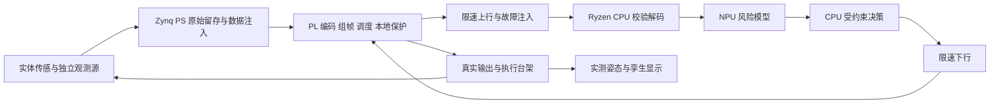

# 矿脉深瞳项目计划书与分阶段任务书 B 机评审稿

矿脉深瞳拟完成一套面向随钻场景的窄带感知与风险响应实验系统：PYNQ-Z2 负责确定性采集处理、可核验压缩和本地执行保护；AMD Ryzen AI PC 负责风险推理与慢速决策；真实传感和执行台架与数字孪生共同展示闭环。核心成果是能被独立复算和实测复现的“观测、传输、判断、执行、反馈”因果链。

本文是 B 独立五案融合后的完整建议任务书。**外部 A/B/C 三案融合尚未完成，本文不能冒充最终任务书。** 数值除已完成板测外均是候选配置、公式结果或开发验收目标。正式实现前由 A 汇总三机独立结果，冻结需求、接口、文件归属和任务版本。B 可立即完成的本轮范围是计划与预算验证，任务 `PLAN-20261013-B/v1`。

## 1 目标与范围

参赛目标为用户指定的 AMD Ryzen AI PC 与 AMD FPGA 协同方向。项目主题保持随钻感知与地质风险响应，校园版本完成低压实验台与硬件在环，不宣称矿用合格、真实含水层定位或已具备下井条件。

核心交付包含：可独立解码的压缩 Overlay、受限带宽双向协议、本地停止与限幅逻辑、Ryzen NPU 模型、传感执行台架、可解释演示界面、统一复现包和验收报告。扩大字典、学习式压缩、两轴复杂运动、真实煤矿数据和井下封装属于扩展，不能阻塞核心交付。

最新真人补充已固定：板卡为 AMD PYNQ-Z2，项目于 2026 年 11 月 4 日提交；所需实物可按方案配置，后续准备。因此器材当前是否在手不再阻塞设计，B 应给出具体清单；到货和可用性仍是对应实物测试的前置条件。

现场要回答四个可检验的问题：

1. FPGA 实际做了哪些 PC 软件无法替代的确定性工作，证据在哪里？
2. NPU 对相同输入实际运行了什么模型，相对规则或 CPU 的任务效果如何？
3. 在带宽下降、噪声增加或失联时，系统怎样保持可解释行为？
4. 断开物理执行或观测路径后，结果是否按设计改变，从而证明不是预制动画？

### 赛事边界

当前取得的 AMD 赛题索引把 AI PC 加 FPGA 归入具身智能方向，强调真实物理任务；其官方归属链尚待确认。建议以真实台架闭环为主交付，单纯 PWM 驱动电脑动画只作开发证据。赛题索引中的权重暂不作为正式评分要求。

真人已确认提交日期为 11 月 4 日。协办企业安路公告所列 18:00 截止时刻仍需以本队提交平台为准；内部安排 11 月 3 日完成最终包，11 月 4 日尽早上交。团队赛道代码和指南版本由 A 核实，不再次询问已确认日期。现有约三周时间应优先完成核心闭环，旧附件十周排期不再采用。[赛事公告](https://www.anlogic.com/support/university/competitions/eda/news1/42.html)

## 2 已有基础与证据状态

| 项目 | 当前可确认内容 | 范围限制 |
| --- | --- | --- |
| 角色 | B 为客机，board_access=false；A 唯一物理板操作者，C 按正式归属独立复核 | B 不连接、上传、复位或烧录板卡 |
| 工具目标 | 新工程以 Vivado 2026.1 为目标；B 现有 2022.1 的用户说明不影响计划书编写 | 本轮静态 preflight 找到 ModelSim，未找到 PATH 内 Vivado；未测试 B 的 2026.1 执行能力 |
| 已完成板测 | PR9 head `692f58bce38ff81d03204e46faf3c3792c5ff8f2`，384 次 MMIO 比较与 16 字恢复读回通过 | 仅 stock base Overlay 的 64 字节窗口，不是新设计、吞吐或整块 BRAM 验收 |
| PR 状态 | 本轮读回 PR9 为 OPEN，未 merge | 已测提交、主分支和实际部署须分开记录 |
| 本轮验证 | 六种候选链路预算与反例已实际计算 | 只属于规划算术，不是 RTL 仿真、综合、实现、NPU 或板测 |
| 尚缺 | A/C 独立方案、正式规则版本、最终接口与归属；实际数据及设备实测证据 | 设备可按本文清单后续准备，不阻塞方案；实物可用才运行对应验收 |

旧板测操作为 `BOARD-20261013-A:B:base-bram-v3-metadata-r1`，request hash 为 `69380c4062746f68bd35d6f1823ad98df6a72927a8a8f010d738319938171e7f`，source 为 `9b618204473c8fda1bffbaf436080d77a34db5fc`，A 证据提交为 `7246b2e0af33840df5f077a725f441c9240740a2`。不重跑旧失败任务或基础验收。[PR9](https://github.com/carolwjade/CarlandFPGA/pull/9)

## 3 两轮择优与最终冻结

B 已独立形成 B1 全曲线无损压缩、B2 事件优先闭环、B3 误差有界遥测、B4 井下推理、B5 学习式编码五案，详见 [独立五案评审](B_FIVE_CANDIDATES.md)。推荐以 B2 为主干，融合 B1 的可追溯编码、B3 的质量标记、B4 的本地保护以及 B5 的任务效果消融。

三机外部轮依次执行：各机冻结至少五案与内部融合结论；交换三份已冻结最佳方案；逐模块寻找最强方案及反例；修改被选主方案的弱项；复算全部变化引入的带宽、资源、延迟和排期；A 发布新版本任务书，B/C 按独立证据复核。不得简单投票后原样采用一份文档。

外部轮的模块决策表必须覆盖传感任务、保真与编码、链路、模型、控制、展示和验收。每行填写 A/B/C 对应主张、支持证据、被选部分、融合改动、剩余风险、owner 和通过条件。A/C 材料未收到前留空，不能代拟他们的“独立最优”。

## 4 系统架构与数据流

井上推理程序只能通过受限链路收到业务观测。开发网络保留给加载、日志和本地原始归档；验收记录业务接口白名单、端口和流量。孪生环境真值只供评价，不进入模型或规划器。用于模拟井下传感器的高速反馈线要标识为台架观测接口，不能成为绕过低速链路的井上数据通道。

推荐实体台架为低速直线进给滑台加单轴伺服转向摆臂，配角度反馈、前进位移/限位和左右两路风险代理探头；低压驱动器承担功率输出，PL 只发逻辑信号。探头可使用左右模拟反射信号读取预制分区板，示意不同方向风险；它是“风险代理信号”，不能称真实煤层电阻率或含水探测。异常后本地停止，PC NPU 判断可行调整，摆臂改变探头位置，产生后续观测。实体因果链用于证明架构，地质模型泛化另报。具体选型与替换规则见下文 BOM，不要求真人先确认所有小器件。

## 5 数据与模型任务

### 数据合同

候选主配置为四通道、每通道 5 Hz、16 bit 有符号整数、每块 16 个时刻。四通道的单位、零点、量程、饱和、缺失码、采样顺序和观测来源须在 G0 冻结。16 bit 量化与降采样发生在压缩之前，其误差单独报告；无损仅指编码前这些整数的精确恢复。

每条记录含来源、场景、run_id、sample_index、单调采集 tick、有效性和实际量程配置。板卡旧日历时间不作为延迟基准；使用单调时钟、映射误差和共同事件号。时钟同步误差必须随跨设备延迟结果报告。

数据采用三层证据：公开真实井数据用于压缩/异常回放基线；台架采集用于实际端到端任务；仿真场景用于可控噪声与稀有故障。三层分别报结果。Petrobras 3W 含真实、模拟和手绘来源，Volve 是油田资料，不能混成煤矿现场数据。[3W](https://github.com/petrobras/3W) [Volve](https://www.equinor.com/energy/volve-data-sharing)

训练/验证/测试按整井或整场景划分，禁止相邻窗口跨集合泄露。建议仿真 100 条完整轨迹按 60/20/20 划分；真实/台架集以实际采集量为准。冻结测试清单、种子、哈希和许可；归一化统计与量化校准只用训练/校准集。测试包含未见几何、噪声、速度和链路条件，不能只选容易压缩的平稳段。

### 任务与推理

第一版模型识别“正常、异常风险、观测不足”，不在缺少标签时硬分“含水层”和“断层”。基线为阈值加滞回与 CPU 浮点 CNN。候选 NPU 网络使用固定形状短窗口时序 CNN，并输入通道有效性与观测年龄；通道级缺失须有对应掩码，不能用单一整帧掩码掩盖局部缺失。

主要卷积子图必须真正上 NPU。固定 ONNX、预处理、形状、SDK/驱动、EP 分区、模型哈希及冷/热启动日志。比较规则、CPU 浮点、量化 CPU、实际 NPU 的事件识别和 P50/P95/最大延迟；小模型可能 CPU 更快，不能预设加速倍数。AMD 文档明确允许 CPU 回落，因此只列出 `VitisAIExecutionProvider` 不足以验收。[AMD 部署流程](https://ryzenai.docs.amd.com/en/latest/modelrun.html)

PC 输出建议角度/模式与引用观测，不直接输出任意 PWM。不确定、输入过期、缺失过多或异常分布时停止推进并显示原因。自动调压缩参数先用确定性统计基线，只有同数据、同保真、同采样率下计入全部线路开销仍有稳定增益，才加入 NPU profile 预测。

### 地质可观测边界

真实接触式曲线只支持当前位置或滞后风险识别，不能自然推导前方危险距离。仿真避让必须公开前视响应模型。必要条件为 `有效前视距离－传感后置距离 > 速度×总反应时间＋转向前进距离＋余量`；条件不满足时合理结果是停车或任务失败，不能偷偷降低速度只给成功录像。评价进程可读取真值，模型进程不允许。

## 6 FPGA 与软件接口建议

### 编码和数据流

候选 PL 数据路为输入 FIFO、按通道差分、ZigZag、Rice/零游程、字节打包、块长度比较、原始旁路、帧队列。每块携带解码需要的首值和配置，块间不继承预测或字典状态。以原始模式为上界，噪声块及时终止长 unary 编码计算，避免极值造成无界循环。16 bit 相邻差分至少使用 17 bit 有符号量，ZigZag 与位长度计算必须覆盖极端交替输入。

先实现 Python 黄金编码/解码和独立向量，再写 RTL。编码器和解码器不能共享一个有缺陷的长度函数后只做往返自证；C 使用独立解码或标准向量复核。Rice 路线借鉴 CCSDS/ESA，而非承诺标准一致性。字典、HLS 迁移与近无损量化放在扩展门槛之后。

### 接口与时钟复位

| 接口 | 候选约定 | G0 需冻结的细项 |
| --- | --- | --- |
| PS 到 PL | AXI DMA simple mode，32 bit AXI Stream，配置 AXI Lite | 通道打包、字节序、TKEEP、TLAST、DMA 最大长度和缓冲对齐 |
| PL 内部 | 候选 100 MHz；串行发送用时钟使能，不创建随意逻辑时钟 | 实际时钟源、频率约束、复位极性与同步释放 |
| 异步外设 | UART RX 同步链及过采样；跨域数据走异步 FIFO | CDC/RDC 报告、FIFO busy、单侧复位、满空契约 |
| 对外执行 | 候选 PWM/步进或方向使能，加独立 RUN/STOP | 引脚、电平、周期、限幅、启动安全态、输出失效态 |
| 原始存储 | PS 写有界记录文件，记录丢样与空间不足 | 最低剩余空间、轮转或停采策略、断电后记录一致性 |

AXI 仅在 VALID 与 READY 同时为真时消费数据，等待时数据和 TLAST/TKEEP 保持稳定。输出按实际编码长度结束；PYNQ DMA 接收依赖 TLAST。复位时输出先到安全态，清理未完成块并报告中断，不拼接复位前后数据。64 bit 计数等跨多个寄存器读取需要锁存快照。[PYNQ DMA](https://pynq.readthedocs.io/en/v3.1/pynq_libraries/dma.html)

寄存器清单至少包括 ID/ABI、状态、影子配置、块边界提交、输入/输出计数、CRC/溢出/丢弃计数、队列水位、最后命令、错误原因和停止锁存。地址由集成 owner 统一分配；B 不自行猜一个地址后编写实板 MMIO。配置提交带版本与生效 sample_index，未知 profile 的数据拒绝解码。

### 协议与命令

必须定义魔数、协议版本、类型、session/启动代次、序号、sample_index/tick 引用、长度、profile、CRC 及异常恢复方式。选择定长槽、长度帧或字节转义时均须复算最坏线路开销。预算暂预留每帧 16 B 固定开销；**这不是完整冻结的字段布局**。字段装不下时加长并重算，不压缩安全语义凑数字。

CRC 校验的多项式、初值、反射和 xorout 必须写明，并保存独立测试向量。CRC 用于检错，不冒充认证。限制帧长与接收超时；长度异常或 CRC 失败后重同步。每帧/块独立恢复，不让一次丢帧破坏全部后续解码。

命令带唯一 ID、会话、有效期、引用观测、风险代次、目标和速率。板端按自己的采样计数判断引用是否新鲜，拒绝重复/乱序/越界/过期/旧会话；重复命令只能重复 ACK，不能再次作用，也不能刷新首次应用时刻、TTL 或看门狗。STOP 可以立即置锁存；普通转向不能清锁存，ENABLE 必须引用风险发生后的新鲜观测并满足本地条件。会话计数回绕、重启、配置回滚和重复 ACK 都有专项测试。

## 7 链路预算与时延边界

以下为工程提案，正式速率由三机冻结。建议以 300 bit/s 双向全双工 UART 8N1 为展示限制工况，同时测 240 bit/s 和更高带宽对照。它模拟受限链路，不声称是特定矿用电缆或泥浆脉冲接口；RS485 半双工另立 profile。SLB 的公开案例说明不同工况速率差异很大，不能把 300 bps 泛化为行业常数。[案例](https://www.slb.com/resource-library/case-study-with-navigation/dr/xboltg2-na-improves-signal-and-eliminates-logging-cs)

四通道 × 5 Hz × 2 B = 40 B/s；16 时刻构成 128 B 块，周期 3.2 s。300 bit/s 的每方向服务率为 30 B/s；240 bit/s 为 24 B/s。假设压缩后全部编码信息为 32 B、帧头尾 16 B、每 10 s 一条 24 B 命令及 16 B ACK、每 30 s 一条 24 B 事件，所得平均值如下。若传感配置、协议或事件频率改变必须重新计算。

| 工况 | 上行需求 B/s | 上行容量 B/s | 占用率 | 80% 平均预算门槛 |
| --- | --- | --- | --- | --- |
| 300 全双工，5 Hz，条件性 4:1 | 17.4 | 30 | 58.0% | 满足 |
| 240 全双工，5 Hz，条件性 4:1 | 17.4 | 24 | 72.5% | 满足 |
| 300 全双工，5 Hz，条件性 8:1 | 12.4 | 30 | 41.3% | 满足，但压缩率未测 |
| 300 全双工，独立 RAW 子块 | 63.65 | 30 | 212.2% | 不满足 |
| 300 半双工，70% 上行，5 Hz，4:1 | 17.4 | 21 | 82.9% | 不满足 |
| 同上，上传选择降为 4 Hz | 14.4 | 21 | 68.6% | 满足平均预算，调度时延未证 |

RAW 按四个子块，每子块 32 B 样本、1 B 描述、16 B 帧头尾，共 196 B/原块。码流模式描述、首值、填充计入算法字节数；再单列帧头、起停位、重传和控制开销。总体压缩比采用总原始字节/总编码字节，不平均各块比例。4:1 和 8:1 只是算例，首版验收以正确性、最坏扩张和实际测量为准。

以上未计握手、profile 更新、重传和字节转义，只能通过平均规划门槛，不能证明队列稳定或闭环 P95。按 RAW 连续输入，32 KiB 纯积压缓冲约 973.79 s 耗尽；实际策略必须更早降级。原始留存还受 SD 空间和写入错误限制，空间不足应明确停采或按已声明策略丢弃，不能承诺无限保存。

队列采用 STOP/执行确认、事件、最新观测/摘要、普通曲线、诊断日志的优先级；已开始的串行帧不可无损抢占。每类有容量、突发额度和最大等待；重复事件合并但保留最高风险与计数，防止事件洪泛饿死状态。过载时减少上传、转摘要并标记缺失，恢复需水位滞回。不能用丢弃消除队列增长后仍声称全量无损送达。

暂定最大线上帧 64 B。在无额外排队、无重传、全双工可立即发下行、处理开销 0.1 s 条件下，事件最不利到达当前最大帧刚开始时，`64 B在发 + 24 B事件 + 24 B指令` 的路径算例为 300 bit/s 下 3.833 s、240 bit/s 下 4.767 s。这既不是绝对下界，也不是一般最坏保证：它是**明确到达相位的条件路径时间**。其他 ACK、下行正在发送、采样、执行到位和重传都会增加延迟。普通 AI 路径还含组块与窗口更新，必须单独测。

年龄判定至少记录最早样本、最新样本、开始发、收全帧、推理结束、命令通过和物理响应。不要照搬旧 2 s 发前淘汰门限；G2 的队列模型先证明健康工况不被该门限系统性误丢，再冻结门限。半双工另测方向时隙与保护间隔，不沿用全双工的延迟门槛。

复算入口：`python docs/competition/deepeye-2026/round1/b/budget_check.py`。运行结果见 [预算结果](evidence/budget-result.json)。

## 8 A B C 分工与文件归属建议

只有本轮 B 草案路径是已认领归属。下表是提交 A 协调的建议；A 在任务账本明确 owner 后才成为实施写入权限。三机是工作节点，不等于已经确认三名学生或三个物理开发板。

| owner 建议 | 工作与接口责任 | 建议文件范围 | 独立复核 |
| --- | --- | --- | --- |
| A | 总任务冻结、板级集成、Vivado 2026.1 构建、接线与全部实板、台架集成 | docs/project-plan/final、hardware/integration、constraints、scripts/board、台架接线与 build manifests | B 核对接口与构建证据，C 核对同 SHA 实测 |
| B | 编码黄金模型、协议规范、压缩/组帧 RTL、队列预算、故障注入与本地回归 | telemetry/codec、telemetry/protocol、rtl/codec、rtl/framing、sim/codec、tests/telemetry | C 用独立解码/向量，A 板上逐样本核对 |
| C | 数据许可与划分、风险模型、NPU 适配、观测/孪生、独立评估脚本 | data/manifests、models/risk、host/ai、host/twin、tests/evaluation | B 查泄露、口径与边界，A 验实际 PC 与执行闭环 |
| A 指定单一 owner | 公共 ABI、任务状态机、集成顶层、控制器、UI 协议适配 | 每文件只定一个 writer，其他节点提 PR | 变更先更新合同，再改两端实现 |

接口变更以 task_version 管理；工作使用 work_id 和精确 ownership，避免共享顶层多人改写。分支、源码 commit、输入与配置哈希进入 manifest。未取得某机器素材不夺取其任务；可先做自己的独立验证。

## 9 分阶段实施与自验收

排期按 11 月 4 日提交倒排，G3 的最小 Overlay 和 G4 的最小 NPU 适配尽早并行。建议日历：10 月 14 至 15 日完成 G0 与 G1 最小合同；15 至 18 日完成参考模型、队列模型、最小 Overlay/NPU；18 至 22 日完成 RTL 与首个新板测；20 至 25 日接通实体闭环；25 至 29 日做消融与故障回归；30 日至 11 月 1 日冻结版本；11 月 2 至 3 日交叉复现、视频与提交包；11 月 4 日提交。不能因赶日期跳过核心门槛。下表 T0 取 10 月 14 日作为排期建议；若 G0 延后，优先缩扩展范围，不能把截止顺延。

| 门槛与参考时间 | 前置输入与工作 | 主责建议 | 可保存产物与自验收标准 | 未通过处理 |
| --- | --- | --- | --- | --- |
| G0 T0至1日 | 三机各五案和融合、官方赛道、已有器材、截止、数据与 ABI | A 汇总，B/C复核 | 三份先冻结后交换的证据；最终逐模块取舍；接口 v1、BOM 与任务 ownership；每项指标有测法 | 缺 PC/器材明确阻塞并缩 scope，不能假定已采购 |
| G1 T1至3日 | 观测合同、整数范围、块与帧语法、CRC、命令状态机 | B；C独立向量 | 黄金编解码与拒绝用例；至少百万样本、极值/噪声/复位切块；逐样本一致；恶意长度有界拒绝 | 改协议版本再生成双方向量，不修日志 |
| G2 T2至4日 | 协议冻结、事件速率、容量、模式切换 | B | 离散事件调度回放；正常、突发、5%丢帧、断链、不可压缩；30min队列/年龄/丢弃统计，不能饿死 STOP/状态 | 降采样/摘要须显式声明；改速率与门限后重算 |
| G3 T3至7日 | 黄金模型、AXI约定、Vivado2026.1环境 | B RTL，A集成构建 | RTL对独立向量一致；背压下不丢重；synthesis/implementation日志、DRC、CDC/RDC、无未约束关键路径、WNS/TNS达标 | 先删字典和多时钟，保留基础编码；工具不足记 blocked |
| G4 T1至7日并行 | Ryzen SKU、数据划分、固定 CNN | C | 先项目最小模型编译和实际NPU执行；再训练/量化对照；EP分区日志、模型/输入哈希、冷启动和1000次热推理 | 无NPU只交CPU开发基线，NPU门槛保持未通过 |
| G5 T6至10日 | G3通过的配对bit/hwh、单次操作清单 | A实板，B准备，C复核 | 新Overlay DMA编码逐样本与黄金相同；真实UART位宽与双向帧；边界/CRC/丢包测试；原始日志及完整清理 | 失败绑定原op，恢复后新版本修复，不自动重烧 |
| G6 T8至13日 | 实体传感执行器、状态机、NPU最小模型 | A台架，C上位机，B协议 | 观测改变→NPU决策→PL输出→实际姿态→新观测；至少20次动作；拔物理路径应进入失效态，软件旁路不得维持任务 | 硬件在环可保留开发，但实体任务验收仍未完成 |
| G7 T12至17日 | 冻结测试集、所有核心链路 | C评估，A采集，B复算 | 原始/固定编码/自适应、规则/CPU/NPU消融；≥100风险事件、≥20未见场景、30min连续运行；失败样本全部留存 | 删除不能证明收益的扩展；不得只报告最佳片段 |
| G8 T18至20日 | G0至G7证据与可恢复发布版本 | A整合，B/C交叉复核 | 冷启动复现3次；一键演示、接线图、BOM、版本清单、视频与提交包；所有核心门槛逐项签收 | 明确未完成项、阻塞与竞赛提交影响 |

G1 是软件一致性验证，G3 是 RTL/工具验证，G5/G6 才涉及新实板。一个门槛通过不自动让其余门槛通过。阶段 task_id 由 A 建立，版本内每个 work_id 不重复执行相同副作用。

### 指标与测量口径建议

| 指标 | 核心门槛或建议目标 | 测法及边界 |
| --- | --- | --- |
| 无损一致性 | 必须逐位一致，百万整数样本用于软件/RTL；板上样本数据执行时间明确 | 固定输入SHA、独立黄金、错误索引；不同阶段分别报数 |
| 无死锁与背压 | 随机/长背压后全部已接收样本有唯一去向；超时有可解释终态 | 固定种子、持续VALID、边界TLAST、复位前后、FIFO满空 |
| 编码效率 | 必须报告总体/分场景/最差块；4:1为平稳集候选目标，8:1为扩展 | 原始/编码/全线路三种口径；不把选择丢弃算成无损压缩 |
| 时序与资源 | 候选100MHz，所有时序约束满足；LUT/FF/BRAM各60%为预留目标 | 布局布线后WNS≥0、TNS=0；报告例外与CDC/RDC；不能只看综合估计 |
| PL处理延迟 | 无背压块尾到输出就绪≤10μs为候选；超出可讨论但必须实测 | 同一PL时钟计数，分开组块、排队和下游阻塞 |
| 链路位速率 | 冻结速率误差≤1%候选；所有业务过受限路径 | 逻辑分析仪统计位宽和帧字节；记录桥固件/驱动和时隙 |
| 队列与恢复 | 正常30min有界；坏CRC被拒；下一独立有效块恢复；丢弃可追溯 | 不可压缩、突发、断链、错序、重复、会话变化；容量不得靠隐式无限队列 |
| NPU | 主要计算子图实际运行于NPU；P95≤100ms为候选，不保证优于CPU | 同输入batch1，1000热调用，EP分区/分析；冷编译分开 |
| 风险识别 | 未见场景事件召回≥90%、误报≤1次/10min为候选；量化召回下降≤2百分点 | 事件级计数，至少100事件与足够无事件时长；报告样本量、区间和混淆矩阵 |
| 普通AI响应 | 先测采样到动作各段分布；待G2冻结总延迟门槛 | 旧7s不自动采用，组块/窗口/链路年龄都算入；半双工另测 |
| 本地失效保护 | 候选本地故障到RUN拉低≤1个控制周期；控制周期目标10ms | 故障注入到引脚边沿实测，不依赖远端NPU；看门狗阈值由台架动态决定 |
| 实体任务 | ≥20次物理动作，冻结未见场景建议成功率≥90% | 达到目标且不越界；持续停车不算避让成功；所有失败保留 |

90%、2百分点和100ms是候选开发目标，不是当前性能或官方评分阈值。若指标未冻结，就提交实际值与影响，不能用“通过”隐藏边界缺失。安全停止与“最终任务成功”分别统计；风险消失后的恢复也须测。

## 10 A 执行的新板测步骤与恢复

每次新设计板测由 A 按以下顺序执行，B 只提交材料和核对反馈：

1. 确认 task/version/work/ownership、PR frozen head、source SHA、operation_id 和 request_hash；对全部脚本、输入和配对 bit/hwh 检查原始字节 SHA256。不得用旧 BRAM 通过替代新 Overlay。
2. A 记录真实板卡/镜像/PYNQ/解释器、当前 Overlay、驱动、外接电源和执行器状态。先停台架并置 RUN 安全态，明确加载新 Overlay 会改变原状态，不能许诺自动恢复旧 Overlay。
3. 准备超时、只写哪些寄存器/缓冲、访问宽度与范围。对可恢复数据或配置保存原值；对不可读输出锁存记录“未知”，不伪造快照。新设计不得沿用旧 stock base 的 0xFC00 地址。
4. 加载同次构建 bit/hwh，核 metadata 与预期 IP 身份/地址；先最小DMA向量，再功能向量，最后协议与物理输出。DMA等待和总脚本均有有限超时；未通过基本核对不继续写入。
5. 采集 stdout/stderr 原始字节、退出码、计数、波形、输入/输出哈希、板端与主机时间。实测从当前加载设计返回，不能以host mock充当实板。
6. 正常和异常均先回安全输出，再恢复已定义可恢复状态并读回；仅清理本次创建的资源。清理失败保持停止态，保存错误与快照，非零退出。不要自动重试未知状态操作。
7. A 在同一PR反馈 tested_commit、operation_id/request_hash、工具版本、范围与结果；C独立读回，B逐项核对。后来代码新提交使旧实测仅适用于旧SHA；修正另建版本和操作。

默认恢复目标为“执行器不动作、输出安全、现场和证据可检查”。恢复到旧 Overlay 只有在 A 另行明确所需文件、状态和步骤后才计入本次计划。无板权不妨碍 B 准备这些边界，但 B 不能代执行。

## 11 风险与缩减顺序

| 风险或依赖 | 触发/发现节点 | 处置与剩余限制 |
| --- | --- | --- |
| 官方赛道版本未落实 | G0 | A核对赛道代码和最新指南；11月4日提交已由真人确认，不重复询问 |
| Ryzen设备或具体模型不可用 | G0/G4 | 先最小支持算子网络；CPU链路可独立开发，最终NPU项保持blocked |
| 只有动画，无实际物理任务 | G6 | 优先补单轴台架与反馈；删复杂3D，不以动画替代执行证据 |
| 正式数据不足 | G1/G4 | 仿真/台架指标单列；去掉具体含水准确率承诺，保留风险代理任务 |
| 噪声压缩失败/链路拥塞 | G2 | RAW上界、本地留存、摘要与停止；报告丢弃和数据年龄 |
| FPGA工具与版本差异 | G3 | 工程以2026.1 Tcl/XDC/IP版本交付；B未升级期间做黄金/RTL验证，A或授权C构建；不改用2022.1声称过2026.1 |
| 输出/复位失控 | G3/G6 | 上电安全态、独立STOP、本地看门狗、限幅；A逐线核接线 |
| 无法如期完成 | 每门槛 | 依次取消字典、AI调codec、两轴、复杂三维、真实ADC；保留真实FPGA/NPU、物理反馈、完整证据 |

按真人允许配置实物的要求，推荐准备如下 BOM。数量与接口作为设计输入，具体品牌可替换，只要满足相同电平、时序和功能合同；采购价格未调查，本文不执行购买。

| 实物 | 数量 | 选型要求与用途 |
| --- | --- | --- |
| AMD PYNQ-Z2 | 1 | 真人已固定，xc7z020clg400-1；保留现有镜像作为兼容性起点 |
| AMD Ryzen AI PC | 1 | 优先 XDNA2 代际、实际 SDK 支持的 Ryzen AI 300 或更新兼容型号；Windows11；最终SKU到手先跑项目最小NPU模型 |
| 低速直线滑台与步进驱动 | 1套 | 行程足够放置多段风险分区，限位输入，独立低压供电；速度可在闭环延迟允许范围内限制 |
| 单轴伺服摆臂与反馈 | 1套 | PWM或等价位置指令，角度可实测，带机械限位；负载独立供电 |
| 左右风险代理探头与位置传感 | 2路加反馈 | 模拟反射/位置等可重复刺激；不冒充实际地质传感；定义量程和校准 |
| 多通道ADC与电平适配 | 1套 | 至少4通道，SPI或并行受控接口，数字侧3.3V兼容；优先16bit，实际有效位数单列；AD7606可选但先核模块原理图 |
| 低速链路桥与独立捕获MCU | 1至2块 | 可配置240/300bit/s并记录原始帧；捕获PWM/STEP/RUN与反馈；双用途须独立记录并禁止绕路 |
| 逻辑分析仪与急停/限位 | 1套 | 可测UART、输出、反馈的共同时间基准；急停切断执行使能 |
| 供电、MicroSD、线材及固定底板 | 1套 | 板卡、执行器分开供电；共地与电平由A核接线，禁止PL引脚直接驱动负载 |

器材未到时 B/C 继续黄金、RTL、数据与上位机开发，A 的对应实物验收记等待物料；不因此停止全部计划。低有效位宽ADC转换成16bit容器时，压缩报告必须同时注明有效信息位数，不能用高位填零人为制造优势。

## 12 产物与证据管理

最终交付包括需求/架构/ABI、五案与三机融合记录、RTL/仿真/黄金模型、构建 Tcl/XDC/IP 清单、bit/hwh、板端驱动、主机协议服务、模型与数据清单、台架固件/接线、测试脚本、原始日志/波形/失败案例、演示说明和正式验收矩阵。

每个阶段分别标记 `not_run / blocked / failed / passed`。passed 必须有日志和可复现输入。公开 PR 不提交配置凭据、私密设备标识、SQLite 或受限数据；大文件按项目现有策略交付并记录哈希。版本管理不清空主目录、不重装协作入口、不重启常驻服务。

当前 B 的实际阶段状态：规划预算通过；RTL simulation、synthesis、implementation、hardware 均未在本轮执行。待 A/C 外部方案及 G0 关键输入到齐，A 冻结最终任务后再逐项实施。本轮生成的 `budget_check.py` 是计划书复算工具，不是新硬件设计。

## 13 一次集中确认清单

完成 B 独立首轮并冻结提交后，只以正式 peer 向 A 提交封存结果并集中确认，等待 A 开启第二轮后再与 C 交流：

1. 当前正式任务ID/version/work及B写入归属；是否已有A/C独立五案冻结件，先封存再交换。
2. 适用赛道代码、官方指南及评分版本；具身智能是否要求实体物理任务。已知真人固定PYNQ-Z2和11月4日提交，不重复询问。
3. 按上述BOM配置实物并安排准备；设备到手记录实际SKU/NPU/OS/驱动。无需以现有库存限制独立方案。
4. 最小物理任务与地质观测假设，数据来源/许可，最终器件、接口、采样、链路双工/速率、时钟复位、验收门槛。
5. 同意的分工和输出格式、2026.1构建负责人、首个新板测的具体输入/写入范围/恢复要求。

这些信息阻塞最终冻结、生产RTL和新板测，不阻塞 B 的独立方案、技术来源核查、预算反例和任务书草案。消息排队或传输ACK仅证明递送状态；最终冻结需要真实回复和验收记录。
