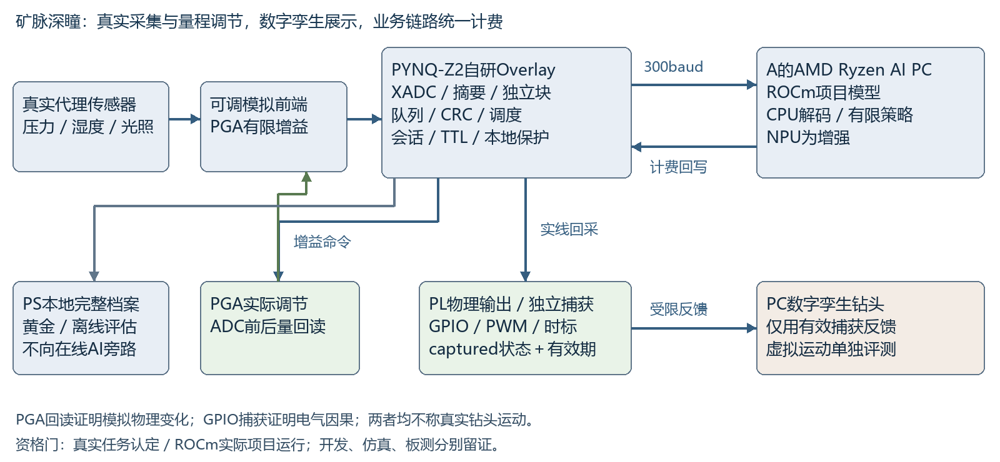

# 矿脉深瞳 FPGA参赛项目任务书

基于Ryzen AI与PYNQ Z2的低带宽随钻感知及数字孪生闭环

任务COMP-20261013-DEEPEYE，版本3修订1，统筹A。计划期2026年10月14日至11月4日；11月4日12时冻结交付包，18时为官方提交截止。

## 1 最终目标与作品范围

本项目参加2026全国大学生嵌入式芯片与系统设计竞赛FPGA创新设计赛道AMD Ryzen AI PC＋任意AMD FPGA方向；对应当前官件3.2，应用自主选题。采用真实传感输入、PYNQ-Z2自研数据处理和通信逻辑、AMD本地AI与PC数字孪生，实现“采集→压缩与选择→受限上传→判断→参数回写→FPGA实际确认→孪生推进”的可验证闭环。工程目标是通过同条件对比、真实板级证据、清楚的演示和可复现交付争取奖项。

本届不配置真实电机、舵机或钻头执行机构。为兼顾真实物理任务，推荐增加传感前端真实自动量程调节：AI依据窄带观测选择有限增益，PL控制可编程模拟放大器，ADC独立测得实际增益和输出变化；这是测量仪器调节，不是实物钻头运动。其赛道认定须按R01核已有赛事资料，未获明确依据时不得宣称资格门已通过。虚拟钻头在PC软件中运动，运动必须使用FPGA返回的实际捕获控制状态，不能直接用PC刚生成的期望指令。传感器实采、公开井日志回放、数字场景真值和FPGA实板结果各自标记来源。校内传感器和软件模拟含水区不构成煤矿含水层识别、现场超前探测或矿用安全认证证据。

最终融合采用“事件优先多速率遥测、独立可逆块与RAW退化、本地完整档案、受限AI参数决策、FPGA确认驱动数字孪生”。基础层保证正确工程；参赛标准层首先关闭ROCm与真实物理任务两资格门，再增加可选真实NPU、误差受限档位和完整消融；强化层按预算余量加入渐进细节和更复杂场景。学习式编码器、复杂字典、压缩感知及强化学习不进入本届关键路径。

现有三机协作程序提供开发和交接能力，参赛产品单独放competition/deepeye/。已有协作平台或旧BRAM验收不能替代本产品新Overlay的验证。

## 2 官方规则与人类约束

官方AMD指南共28页，原始SHA256为c6ad82acd4f7bdcd13bd412e232ed85d05f2a87dd5e2cdd04f9d219f88b569fc；第一轮通知7页，SHA256为c17611b45a66121cd93f421e7fdee50f1743b1eb0cb5d9f930c57578d480ef9f。A从官方列表取得原件依据，再独立获取同字节文件核对。源文件和provenance.json保存在本研究目录sources/，正式引用入口为[赛事官方下载中心](http://www.fpgachina.cn/?page=download)。

最新人类原话明确“AMD Ryzen AI PC＋任意AMD FPGA，无进一步细分和分组，按该赛道自主选题”。这与官件文件页13至21的3.2节对应；此前把“应用自主选择”理解成3.3是版本2研究判断，现纠正。3.3另有学历分组，其权重和豁免不用于本终版。保留首轮与第二轮冻结原件，防止把事后修订写成事前已知。

3.2必须采用AMD Ryzen AI PC及AMD FPGA/Zynq，板卡须承担真实硬件功能；AI本地参与感知/决策；至少一项真实物理任务，机械可简化，但AI到物理执行必须完整。软件栈须ROCm7.14.0或以上；必须实板跑通并提供五类核心指标、至少两类专项指标、完整工程与原始证据。PYNQ-Z2允许；NPU不是单独硬门槛，Ryzen AI Software不能替代ROCm。R01登记已完成报名/资格资料，不重新报名或替人类改方向。

|3.2官方评价项|权重|本作品对应证据|
|---|---:|---|
|具身智能系统完整度|20|传感前端真实调节闭环、成功率和物理响应；虚拟导向单列|
|AI PC端侧AI能力|20|ROCm实际项目推断、岩性/代理任务、batch1分段时延与离线运行|
|FPGA/Zynq设计质量|25|同步采集、编码仲裁、安全逻辑、真实IO及资源/时序/吞吐|
|AI PC与FPGA/Zynq协同|20|受限双向通信、实物调节回读、同步误差与异常恢复|
|工程完成度与创新|15|同条件消融、稳定性、演示、复建与可复用Skill|

有两个资格风险必须独立关闭：现有8845H的实际ROCm项目路径尚未验证；仅传感、GPIO回采和数字孪生不能自动算真实物理执行。推荐最小实际任务是传感器自动量程；该任务的赛事认可属于规则判断，物理成功属于实测，两者分别登记。若坚持完全不改变任何真实物理量且无正式允许依据，本作品可完成工程展示，但不得宣称已满足3.2完整闭环或保证获奖。不得悄悄换成3.3，也不再向已休息的人类追问细节。

人类的工程约束为PYNQ-Z2、11月4日提交、传感器输入加数字孪生、物料由三机自主选择、适度预算、基础至强化分级、全工作链路尽量由agent执行。只在真实接线、无法代办的账号/管理员交互或正式提交等必须人类参与时集中报告。

## 3 两轮择优和最终取舍

三机第一轮各形成五套完整架构，在分享设计前分别封存。A本地两项研究子代理只负责官方规则和技术取证，均有reserve/validate/complete；它们归A，不计为B/C。原始候选中的赛道及实物假设保留为版本1历史，版本3按最新已核对人类赛道更新统一调整，不回改初轮原件。

|节点|五套完整候选|内部融合骨架|封存证据|
|---|---|---|---|
|A|无损预测、有界趋势、多分辨率、摘要事件、学习式编码|定长摘要事件加独立无损块及本地保护|16:23:34 UTC；best d9716026…11416；commit1412d6d70985848fff1332479c98a8be54f15e87|
|B|全曲线无损、双时间尺度事件、近无损、本地模型监督、学习式遥测|事件优先与独立无损块、命令时效及恢复状态机|16:12:22 UTC；best6088bb2d…439c8；PR13 head ec0675dfb2f1f86c6201b2d1e2ea27d3f5a04ff8|
|C|事件多速率、关键点渐进、任务驱动AI、无损档案、压缩感知|多速率事件、有界Rice、包络/年龄/缺失与置信门控|16:05:55 UTC；best5243500c…1889af；commitab527e20eb7bc8a0cdeab0409943ec17510830fe|

A封存前仅检查收件身份和消息类型，封存后才读取B设计摘要。A独立核验B的17项清单及六工况预算；C五案/最佳正文哈希匹配，预算JSON的Git LF与原CRLF有字节差异，换行定位和只读数值复算一致，分别记录。C采用不同内部权重，三机内部总分不能直接排名。B第二轮PR16 head43068749dc62435aadd94724064b08985dc2420c、C第二轮PR15 head11ecdc42cf1aad66624eb37c301700599cb9e62a均已实际完成；A逐项核对封存15/8项哈希，并读完B针对根稿的三处P0反馈。版本3闭合接口并更新赛道，属于A统筹的最终工程选择，未声称B/C已联合签署本终版。第二轮按以下模块重新评析和融合，不简单取一个总分最高方案。

|模块|原方案的不足|融合采用的优点|最终处理及重验|
|---|---|---|---|
|实时观测|A摘要不足以完整重建；B全曲线遇噪声超额|C多速率与事件；A固定预算|核心定长状态，选择性独立样本块；原始全量留PS；线上缺段显式标记|
|编码|字典/学习式硬件成本高，固定压缩比无依据|B独立块/RAW；C闭环量化与Rice界|无损E=0为基础，E=1/2/4/8为标准档；各档独立黄金及任务损失测试|
|调度|单方向或平均预算漏ACK、换向、洪泛|A共享线速；C滑窗、短帧；B有限重传|双向统一记账，事件优先不饿死状态；容量/丢弃/年龄均回读|
|模型|NPU解码不合适；低维摘要和原曲线分布不同|C因果窗口、mask、分井；B真实落点日志|CPU解码，ROCm小CNN与可选NPU；按实际回传信息训练，CPU同条件保留|
|控制|旧命令、重复包或PC崩溃使状态不一致|B会话/TTL/幂等；A边界生效|新会话、观察序号、TTL、影子配置；重复包不续期；断链保持停止，显式重新使能|
|孪生|按期望指令画动画可能绕开FPGA|C真值隔离和反例；B物理因果思路|GPIO/PWM经独立捕获后返回；主机有效期保守截止；断输出/TTL/失联反例必须停止，不能主机旁路|
|资源|A/B初轮默认新PC，机械台架额外拖期|A实际设备盘点；人类无执行器约束|复用A的Ryzen8845H/32GB；传感和可编程输入夹具，去除机械执行器|
|交付|仅成功展示无法复现|三机原始证据、C盲场景、B恢复步骤|全链路流水线、故障矩阵、三级交付、通用PYNQ Skill和交互自纠错记录|

最终选择A内部A6的任务信息优先骨架，形成融合版F2；用B的独立块和可靠命令状态机替换薄弱模块，用C的多速率、误差/缺失/年龄语义及模型评估改进数据路径。移除不符合人类范围的现实执行器；保留真正FPGA采集、编码、仲裁、物理测量量程调节和独立输出回采；钻头运动仍是孪生。获奖主张只使用后续真实测量结果。

## 4 硬件 软件和三级交付

A实际设备为MECHREVO Yilong15Pro，AMD Ryzen7 8845H、约32GB内存、Radeon780M、Windows11 Home build26200；NPU设备present/OK，驱动32.0.203.240。优先复用此机作为AMD主站。另有NVIDIA显卡可用于开发训练，但不能把其训练/推断成绩冒充AMD NPU效果。B为Lenovo82WM、Ryzen9 7945HX、16GiB、RTX4060，无已识别AMD NPU；C为i7-14650HX、16GB、RTX4050，无AMD AI PC。B/C承担开发与训练，正式AMD执行优先A。

主栈选择ROCm7.14.1的官方支持组合，先在A只读核SKU/OS/驱动及磁盘，再隔离安装并用项目CNN实际推断。AMD当前矩阵列Radeon780M/gfx1103及相应OS，但系列列表未直接逐名保证8845H；不能只凭同gfx认定整机兼容。R02实测是复用A的必要退出条件，失败优先借用/短租受支持HX370/32GB整机，不默认购买Max+395；具体OS/驱动按官方矩阵锁定，不直接升级现有系统。本轮未见RyzenAI1.7.x/1.8.0安装目录，未跑项目模型。优先验证[AMD Ryzen AI1.7.1的PHX/HPT X1流程](https://ryzenai.docs.amd.com/en/1.7.1/inst.html)，固定形状INT8 CNN使用X1及对应phoenix xclbin；当前驱动低于所查SDK要求，R02准备OEM/AMD签名驱动升级及可审阅安装方案，再实测。版本与算子分配以实际成功运行后锁定；不因一个quicktest或NPU硬件存在宣称模型已在NPU运行。1.8的默认quicktest针对较新设备，不直接套到HPT。

FPGA使用xc7z020clg400-1；Vivado2026.1为主构建工具，PYNQ沿用实际兼容的3.1.1环境。PYNQ4.0移除Z2支持，不升级到该版本。bit/hwh同次构建。A唯一准备、加载和运行板卡，B/C提交脚本和哈希，通过A获取真实输出。

|层级|工时参考 机器工作日|必含内容|新增外设规划上限 不含已有PC和板卡|
|---|---|---|---|
|基础|7至10|真实传感/XADC、无损Overlay、限速、CPU基线、2D孪生、自动验证；资格门未通过仅称开发基础|800元|
|标准 参赛主交付|14至18|实际ROCm项目AI、物理量程调节与回读、受限反馈、3D孪生、盲测/消融/Skill；NPU可选|1500元|
|强化|18至21及后续|有界趋势/渐进细节、更多数据域、功耗测量与复用案例|2500元；增购PC须单独有理由与授权|

金额为设计支出上限，不是商家报价；脚本采购清单先核实际含税/到货条件再选同规格常见模块。增加人力和工时优先提高测量、鲁棒性和可复现性，不无限叠加功能。基础层也需完整FPGA实板证据；NPU失败可删增强，ROCm或物理任务资格门失败须明确阻塞参赛完整交付。

|物料|选型和数量|用途与核对|
|---|---|---|
|PYNQ-Z2与MicroSD|现有1套|兼容镜像、512MB DDR、实际板卡修订和电源|
|模拟传感器|FSR402压力、3.3V电容式土壤湿度、TEMT6000光照各1；第4通道前端调节前参考输入|XADC A0至A3，板卡允许0至3.3V的具体电路和接线先核；标明代理单位|
|传感可调前端|MCP6S21或同规格SPI PGA1块，3.3V供电，基础增益1/2/4/8|物理量程调节，A0放大后、A3同源放大前；输入保护、滤波和负载稳定性由R04实测；不驱动钻头|
|自动输入夹具|MCP4728四路DAC或等价3.3V可编程源1套|给ADC产生可重放阶跃/斜坡/噪声，不是钻头执行器；实传感与DAC模式分别标记|
|串行链路|3.3V逻辑兼容RS485收发模块2块、PC USB-RS485适配器1|A核电平、方向和终端；实测300/1200/9600baud；无高速业务旁路|
|逻辑分析仪|现有优先，否则常见8通道USB款1|统一测串口位宽、换向、PL调试标记和反馈时刻|
|接线和固定|共地、限流保护、线材/底板1套|不直接接超过允许电平，ADC分辨率、实测ENOB和容器位宽分别记录|

外设最初接线必须由能接触实物的人完成；之后校准、DAC激励、采集、回归、构建、加载、测量和报告均交agent脚本。需要管理员确认的驱动交互集中一次处理，不要求人类逐条执行普通命令。

## 5 数据与AI任务

三种模式必须分开。sensor_live记录实际压力/湿度/光照等代理信号及12bit XADC原码；geo_replay将有许可的GR、RHOB、NPHI、RDEP井曲线经PS/DMA送入实际PL，用于编码和岩性任务；twin_fixture通过独立场景生成器及DAC/数据入口产生模拟工况，评测数字矿井导向。界面和每条日志都带source_mode。

FORCE数据锁定具体文件、井列表、SHA和许可。按井划分训练/验证/测试；插补、缩放、对数变换、量化校准只拟合训练井。同一井或同一完整模拟运行的原始、压缩及增广版本不得跨集合；模型窗口只读当前及历史。真实传感器数据按采集批次/日期隔离。公开岩性标签不直接生成含水层或断层真值。

候选小CNN固定输入[1,8,128,1]，四通道值与四mask；Conv2D小核、ReLU、池化、Flatten/Gemm，先冻结ROCm/PyTorch支持的固定图，再训练；NPU增强另核X1算子。CPU规则/轻量树、ROCm浮点CNN、INT8 CPU和NPU分别对照。在线模型只读取真正经过受限链路的信息，禁止从调试以太网读取全量或未来曲线；必要时训练摘要模型与稀疏曲线模型两个明确profile，不能向原曲线模型悄悄灌不同分布。

摘要profile固定[1,13,32,1]，四均值、四极差、四valid mask和归一化age；曲线profile使用上述[1,8,128,1]。两profile分别训练/校准并绑定模型哈希，启动历史不足用mask标记。事件峰值经同通道特征适配器进入当前窗口，不生成未来样本。基础实时传感任务用摘要profile；公开岩性主指标用曲线profile，摘要岩性另报效果，不将两种分布混算。物理量程profile以传感采集批次及完整扰动场次独立划分，输出gain_code与风险置信；标签由独立标定规则生成，不用未见场次训练。AI只有建议权，PL禁止非法增益并保留本地过量程降至1倍。

主指标为公开岩性Macro-F1、每类Recall、压缩相对原始信息的损失；模拟风险另列事件Recall、误报及盲场景任务成功率。FORCE原始Macro-F1目标0.60，回传信息下降不超过0.03；模拟危险Recall目标90%、误报不超过每10分钟1次。未达标时先修数据/输入与任务，不删失败样本。NPU不保证比CPU更快；报告相同batch1条件的效果、时延、冷编译及1000次热推断。

## 6 采样 编码与低带宽守恒

基础采样为4通道100Hz、uint16容器，XADC标称转换分辨率12bit；公开日志量化16bit另标。实际ENOB须测量，未测不宣称12位有效精度。每帧带来源/质量/序号和采样tick。4×100×16=6400bps是容器速率，12位打包4800bps另列，不是源熵测量。8倍容器压缩仍800bps，超过300baud8N1的30byte/s，不能保证全量实时上传。PL/PS保存完整原值；低速曲线是明确选择后的在线信息。

核心编码采用独立锚点的差分ZigZag/Rice，k按块选择，unary有长度上限，不如RAW时整块旁路。E=0逐位无损；标准层闭环预测量化步长Δ=2E+1，编码器以自己的重建值更新预测，E取1/2/4/8。差分中间位宽至少17bit有符号，饱和/极端跳变均测。每块从绝对锚点开始，坏块不污染下一块。

E只保证已编码且完整收到的点。未发区间另显示包络、GAP和年龄，不用平滑插值冒充真实曲线。码率不足时降低趋势选择率、暂停历史细节、合并最新事件，同时保留原始历史及合并计数。FIFO仅吸收有限突发，PS环形区初始16MiB，容量与覆盖策略在运行日志中核算，不作为无限断连承诺。

## 7 统一接口与调度预算

最终协议abi_v2；替代所有v1候选字段，双方不得混用。多字节小端，帧为magic2、version1、type1、payload_len1、config_epoch1、seq2、tick_ms4、payload、CRC2；固定14B，payload≤32B、普通帧≤46B。magic线字节A5 5A，version=2。CRC16/CCITT-FALSE，poly0x1021、init0xFFFF、不反射、xorout0；覆盖version起至payload尾，CRC小端。ASCII123456789测试向量0x29B1。解析器对长度、噪声、坏CRC和魔数重同步都有有界运行向量。

|类型|总长|负载 字节数 与意义|
|---|---:|---|
|TELEM 0x01|32B|四均值8、四极差8、quality_flags2；来源/profile由当前epoch固定表确定|
|EVENT 0x02|20B|bitmap2、channel1、severity1、peak2|
|CONTROL 0x03|28B|session4、cmd_id2、action1、yaw_q2、speed_code1、ttl_ms2、observed_seq2|
|ACK 0x04 控制|32B|session4、request_seq2、request_type1、phase1、captured_yaw2、captured_speed1、remaining_ttl_ms2、fault_flags1、capture_seq2、control_epoch1、capture_quality1；共18|
|CONFIG 0x05|24B|session4、profile1、E1、rate1、threshold2、apply_block1；request_seq使用头seq|
|HELLO 0x06|18B|session4；新会话握手，未完成不得ENABLE|
|TRACE 0x07|≤46B|独立块、锚点、时间偏移、样本与padding全部计入≤32B负载|
|STATE 0x08|32B|session4、last_control_seq2、captured_yaw2、captured_speed1、phase1、remaining_ttl_ms2、fault_flags2、capture_seq2、control_epoch1、capture_quality1；共18|
|CONFIG_ACK 0x09|32B|session4、request_seq2、request_type1、phase1、profile1、E1、rate1、threshold2、apply_block1、quality1、applied_epoch1、first_sample_index_low2；共18|
|GAIN 0x0a|24B|session4、gain_code1、channel1、ttl_ms2、observed_seq2；request_seq使用头seq|
|GAIN_ACK 0x0b|32B|session4、request_seq2、request_type1、phase1、gain_code1、measured_ratio_q8_8两字节、remaining_ttl_ms2、fault_flags2、capture_seq2、quality1；共18|
|BOOT 0x0c / BOOT_ACK 0x0d|41B|session4、mode1、slot_profile_sha128共16、guard_total_ms2、primary_slot_ms2、config_slot_ms2；共27，仅停止阶段握手/匹配回读|

所有请求唯一键为(session_id,request_type,header.seq)。CONTROL的cmd_id必须等于header.seq；相同seq不同type不混认。CONFIG_ACK须给实际profile/E/rate/threshold、applied_epoch和首个生效采样序号，不能借控制ACK伪装配置确认；低16位采样序号仅在明确小于半周期关联范围内比较。同键同负载只缓存事务结果与首次应用时刻，不缓存含旧remaining_ttl的整帧重发；每次应答重新采当前phase/capture/fault/剩余TTL，重写发送tick与CRC。同键不同负载拒绝，已被更新命令覆盖的旧请求回rejected及superseded标志；TTL已过回stopped。重复不重复应用、不刷新TTL；旧会话拒绝，seq/epoch回绕前停止、换新会话并清理旧关联。影子配置在块边界原子生效，phase=applied仅在当前实读一致后发送；phase取accepted/applied/captured/rejected/stopped，数值由interface.json冻结。

控制yaw_q按0.1度/秒，±15度/秒；speed_code0–20对应0–2mm/s虚拟推进，TTL≤12000ms。GPIO/PWM由PL输出，经物理短线到独立输入捕获逻辑测周期/计数并映射captured值；ACK的captured阶段不能只回读写寄存器。capture_quality无效不得推进。真实PGA控制另用GAIN，不把其增益和虚拟yaw混为一字段。GAIN_ACK的measured_ratio来自调节前后ADC校准读数，不仅是SPI寄存器；刺激无效或接近零时ratio置无效。GPIO回采只证电气因果，不证明钻头位置；PGA实测才是物理调节证据。

TTL从PL首次应用起计。ACK/STATE头tick表示第一字节发出时刻，remaining_ttl也是此次发送的当前剩余值。主机保存每请求第一次发送前的first_send_monotonic与原TTL，重试不重置；有效截止为min(first_send_monotonic＋original_ttl, receipt_monotonic＋max(0,current_remaining_ttl−frame_serial_time−USB/处理延迟上界−时钟误差界))。每次STATE也受该首次请求上界约束。USB/处理与时钟误差上界须R02/B04实测，无法建立时停止显示。首次ACK丢失而旧命令很晚重试、其后STATE/EVENT也丢失时，主机仍不能重开租期。每个渲染步检查截止/会话/capture，过期暂停；新TELEM、重复或重编码ACK不能突破原截止。STATE至少8秒一次，TTL/fault也触发20B EVENT；同步、发送tick、捕获及物理发生时间分报。

300baud8N1共享半双工固定8秒窗：TELEM32一次、STATE32一次、CONTROL28及ACK32一组、EVENT20一次，共144B；144/30＋0.2guard=5秒，占62.5%。物理量程模式以GAIN24及GAIN_ACK32替换CONTROL/ACK槽，不额外叠加，140B占60.833%；虚拟运动先hold，不假定同时两种控制仍有此时延。每16秒可有CONFIG24＋CONFIG_ACK32一组，最坏有配置窗200B、占85.833%；无配置重试窗加CONTROL28＋ACK32共204B、占87.5%。配置窗与重传窗互斥，TRACE及额外事件在这些窗禁发；普通窗余量按实际字节账分配。事件洪泛合并最新值/计数并停止虚拟推进，先延期低优先事务，不无限排队。不把“每16秒”折算成半包来证明最坏窗口。

单次EVENT重传只在无CONFIG、无主请求重试的正常窗预留20B，合计164B占70.833%；优先延期未开始的配置/TRACE。6秒告警重传目标仅验这一包络，已开始高负载事务或多种错误进入故障组另报，不套正常承诺。

FPGA为调度主站。grant使用已计费TELEM的quality_flags：bit15主请求槽、bit14配置槽、bit13同窗一次重试预授权，低13位固定质量语义；不新增免费业务帧。bit15授权“TELEM末字节＋guard”起的一个≤28B主请求槽，mode决定CONTROL或GAIN；bit13只能与bit15同时置位且bit14为0，预授权第二个≤28B槽及对应≤32B应答槽。第二槽仅当首应答超时/损坏时发送完全相同请求键和负载，每槽最多一次；首应答有效则第二槽不发。其偏移由BOOT锁定slot表中的primary_slot、response_slot、retry_offset和超时边界给定，不能依赖已经丢失ACK的末字节定位。无bit13则重试延期至下一合法主槽，该故障路径不继承正常8秒响应目标。bit14授权“STATE末字节＋guard”起的≤24B CONFIG槽。迟到、无授权或本槽已发送即不发；已授槽不被EVENT抢占。204B最坏窗明确包含两组CONTROL/ACK，物理GAIN重试窗最多196B；未回应槽的空等也占保留时间，另报实际字节与槽占用。

各槽按最长帧加实测USB余量冻结。HELLO后停止阶段BOOT/BOOT_ACK回读mode、参数及slot_profile_sha128（完整规范slot表SHA256前16字节），表含响应/重试偏移；与本地表不一致不得ENABLE。这82B握手单独计费，不藏入普通窗。R03/B04验证无PC响应、迟到、坏CRC、授权丢失、bit13超时重试及首ACK成功后禁止第二次发送。0.2秒是累计换向规划值，实测guard/空等超规划则重算并降发送率。

固定窗及任意滑动8秒账均由B04模拟和上板检查；窗口边界不会免费增加发送机会。HELLO/重连/诊断在停止阶段或显式余量计费。常规最坏不可抢占TRACE46B占1.533秒，EVENT20B再占0.667秒。事件P99≤3秒及一次重传≤6秒只针对冻结正常包络：独立告警之间≥8秒、无事件洪泛、有限grant槽及无错/单次错误。一个窗口再次出现同风险只合并计数；新种类或更严重风险先在PL保守处理并标STOP，进入故障工况单报到达/停止/恢复，不声称第二个事件仍满足3秒。正式试验同时报告真实事件总数、合并/延期数，不将合并降低分母。正常端到端P99≤12秒/max≤16秒用于无丢帧和此有界工况，故障另报，不承诺任意丢包仍满足。

曲线profile的128点是128个实际选择点，不代表128个100Hz连续点。TRACE仅离线/余量回传，携带选择tick和mask；等待慢曲线积累时不得声称高频岩性实时分类。主闭环用TELEM摘要profile，TELEM周期8秒明确进入观测年龄；随机采样相位还需加下一授权槽及双向串行耗时，不能据8秒刷新推出8秒闭环，因此系统/物理任务目标为P99≤12秒、max≤16秒，R03离散调度先证可行；曲线与原始对照用于独立慢传/公开回放指标。首版策略删除queue输入，使用实际回传quality、age和主机可测丢包/响应；本地AXI queue仅用于A测量，不走调试网提供给AI。

寄存器以实际HWH为地址依据：0x00 ID、04 ABI、08 CTRL、0C STATUS、10 shadow_cfg、14 apply_req、18 sample_rate、1C E、20 profile、24 queue、28 overflow_merge、30 applied_yaw、34 applied_speed、38 applied_req、3C session、40/44 sample_tick、48/4C捕获周期、50 capture_seq、54 capture_quality、58 gain、5C measured_ratio。R03生成registers.csv/向量。CTRL上电未使能、stop优先，clear_fault和enable分离；不向旧Overlay地址试写。

## 8 数字孪生与因果验收

标准层采用本地WebGL或等价桌面3D界面，基础可用2D。显示钻头、分层/模拟禁入区、原始来源曲线、实际回传点/包络、AI置信、期望与已应用参数、线速/队列/age/GAP。模拟推进最大2mm/s，默认前视50mm；16秒最大正常延迟对应32mm推进，至少留18mm用于模型/几何/误差余量，不足则降速或停止，场景据实际误差重新核算；不能用未来几何真值替模型提前避障。

孪生积分器只消费从板卡实际返回、合法会话和序号匹配且capture有效的captured状态；板写寄存器、accepted或pending不能作为动作完成证据。目标指令显示为pending，ACK丢失或数据老化时暂停推进。场景真值只供评估器和生成器，控制进程不可访问；只提供当前位置及历史应有观测。高级回放倍速必须显示倍率，正式指标用真实速率。

必跑反例包括拔掉GPIO输出回采线、在通信仍通时触发板端TTL到期/本地fault、拔掉板通信、暂停PC模型、改坏CRC、过期/重复命令、错误epoch及FPGA复位。原板反馈消失时孪生不能照着期望命令继续完成任务；虚拟场景安全停止不计为目标到达。真实传感/PGA调节、电气回采与虚拟钻头运动分开报告，动画截图不能证明FPGA结果。

## 9 分工与文件归属

所有路径相对competition/deepeye/；每文件单一writer，公共接口由A维护，B/C提交PR建议。A是唯一板卡操作者，AMD主站实测也由A集成执行。

|节点|独占路径|职责|独立复核|
|---|---|---|---|
|A|docs/、hardware/、integration/、tools/pipeline/、evidence/system/|接口/资源、编排器、唯一实板、整合和终验|B审协议预算，C审模型输入及测量口径|
|B|fpga/、golden/codec/、tests/rtl/、evidence/rtl/；tools/verify_codec.py、run_rtl.py、verify_link.py、check_build.py|采样、编码、FIFO/复位、串口调度、配置/控制状态机、构建|C在tests/ai/codec_oracle.py独立解码，A板上复测|
|C|ai_pc/、data/、twin/、tests/ai/、evidence/ai/；tools/verify_data.py、verify_policy.py|数据与模型、NPU适配、PC协议、孪生与盲测统计|B查字节互操作，A查实际设备/板反馈|

三机各自分支提交，源码commit、输入哈希和测试证据进入清单；A接受精确PR head后反馈，发送方读回。共享top/接口/状态机不并行改写。纯status不提交模型、不升级版本、不夺权。

其他tools检查脚本由A唯一维护，调用B/C模块；表中仅简写文件名的工具仍位于tools/。根目录README、依赖锁文件和公共任务清单由A维护。每个阶段运行前pipeline将上述ownership展开为精确文件列表后做冲突检查。

execution_plan_v3.json提供20卡owner、stage及依赖DAG，全部初始not_run；它是可机读计划，不会自行执行。R01规则收集与资格认定分开：资格门尚未确定时可继续无依赖开发，标准层交付仍需关闭该门。automation_contract.md只定位本书规范，不另设冲突标准。

## 10 自动化执行契约

工具入口为python tools/pipeline.py。plan/status只读取阶段和证据；run --stage s1 --task-version 3 --work-id stable-id创建有界执行；verify重算证据；resume首先核对暂停、任务版本、租约和原操作回执。每次合法stage都完成“检查先决条件→预订唯一文件/板资源→执行固定命令→独立黄金比较→收集原始输出→质量主会话签收→更新ledger→启动已具备条件的后继”。等待由原常驻程序和外部进程回调承担，不使用模型轮询。

执行优先DeepSeek Flash/max；需要原生浏览、工具上下文或视觉能力时按reserve/validate/complete使用Native，reason具体、ownership不重叠。决策、疑难修复和验收由质量主会话最高可用深度完成。日志记录实际provider/model/effort，不用配置名替代完成回合证据。

pipeline的ledger.json每任务记录task/version/work_id、owner、输入/源码/配置哈希、状态、命令/退出码、证据、已验证提交与下一依赖。状态为not_run/running/passed/failed/blocked；失败保留，未知板副作用只查原operation，不自动重烧。恢复失败保持停止状态并报告一次真实阻塞。新版本只重跑受影响任务，不能改变旧测量分母或原错误。

板卡加载和采集使用现有A单机工具，完整绑定operation_id/request_hash/tested_commit和bit/hwh哈希，覆盖准备、加载、运行和清理。不因任务书加入自动化就打开hardware_enabled队列、建立第二常驻服务、改凭据或新增云scope。资料下载/解包先哈希和许可检查；模型和工具安装使用隔离依赖及签名来源。

自动化可直接完成资料清单、黄金/仿真、Tcl构建、上传与实测、DAC激励、训练/量化/部署、盲场景、图表、报告与打包。包准备并通过校核后，agent可在本人账号和工具可用、已有明确提交授权时完成上传并读回回执。人类最少参与是首次接线/上电确认、必须由账号本人完成的交互或考核、购买审批；这些是物理/账号事实依赖，不把普通命令逐步交回人类。

## 11 日程与分步自验收

|阶段|最迟完成日|核心产出|退出条件|
|---|---|---|---|
|S0|10月15日|3.2规则/ROCm/物理任务门、ABI与任务登记|资格条件有依据；资源和许可清楚；无钻头执行器|
|S1|10月17日|黄金、协议、信道模型、采集输入、CPU/2D基线|基础路径和独立向量通过|
|S2|10月21日|采样/编码/调度/状态Overlay|仿真、实现及模块实板分别通过|
|S3|10月23日|因果模型、ROCm、可选NPU、PC与孪生|数据隔离、实际落点和互操作通过|
|S4|10月26日|传感/回放与实际板反馈闭环|冻结盲场景和因果反例通过|
|S5|10月30日|消融、可靠性、资源和原始指标|核心目标通过，增强去留明确|
|S6|11月2日|工程包、报告、视频、海报、Skill|冷启动3次及独立环境复建通过|
|S7|11月4日12时|最终字节包与提交准备|最终版本重测；agent有既有提交授权及账号时18时前提交并读回回执，人类仅必要本人交互|

以下命令是由各任务必须创建并验证的入口契约，当前不是已实现脚本。全部从competition/deepeye/运行；成功输出structured.json和原始日志，失败非零退出，不删失败样本。

### R01 规则 数据与既有报名登记

A执行读取sources原件和人类已确认报名资料，登记AMD Ryzen AI PC＋任意AMD FPGA方向、模板/考核状态、许可证及对应产物。输出docs/rules.json、requirements_trace.csv；python tools/check_rules.py要求每条3.2约束有来源/页码和责任任务，五核心/至少二专项指标完整，ROCm与真实物理任务认定单独标not_run/passed/blocked，不拿3.3权重代替，路径合规。已有资格只归档，不代改。任何最新规则变化形成版本差异记录。

### R02 设备和采集夹具

A只读预检各机CPU/OS/NPU及现有板环境，复用8845H；核四通道电平、传感、DAC/PGA及GPIO捕获接线，记录实际ADC精度。输出hardware/bom.csv、wiring.pdf、calibration.json与environment.json。python tools/preflight.py不得启动模型/烧板；python integration/input_calibrate.py --levels 8要求每通道至少8点标定、越界与饱和可识别、模式、标称分辨率和ENOB实测状态明示。ROCm7.14.1先核平台组合并实际跑项目图，训练/推理日志须显示真实HIP/GPU设备与版本；只有包版本或CPU结果不通过。NPU驱动/SDK另留增强证据，缺项不伪造通过。

### R03 协议 寄存器和编排器

A维护ABI和pipeline，B/C独立互操作。输出docs/interface.json、registers.csv、tests/vectors及tools/pipeline.py。python tools/check_interface.py核abi_v2长度/CRC/端序/会话/请求type＋seq关联/逐窗与滑窗预算；python tools/pipeline.py verify --selftest核status不发模型、重复work_id不重排、文件冲突拒绝、failed/unknown不重放。错误格式、有界长度、seq/epoch回绕全部有向量。

### R04 最小真实任务和传感前端

A选型与标定，B实现SPI增益控制和独立ADC前后回读，C决定有限gain_code。输入[MCP6S21数据手册DS21117B](https://ww1.microchip.com/downloads/en/DeviceDoc/21117B.pdf)、传感分压/保护电路、R02实际量程。采用3.3V、G=1/2/4/8，对应器件gain_code=0/1/2/4（码3为5倍，禁止误用）；MCP6S21无SO读回，不假造SPI寄存器实读。A0调节后、A3同源调节前，目标有效ADC码20%–80%量程。python integration/gain_calibrate.py --gains 1,2,4,8 --levels 8要求各档至少8个不饱和点、测得模拟增益误差≤5%、越界可检测，负载稳定及接线记录完整。AI不控制刺激源，不偷读夹具真值。输出hardware/gain_calibration.json、真实波形/ADC字节。只有GPIO或寄存器变更不通过此卡；真实任务规则依据与工程证据由R01和本卡分别签收。失败保留基础开发，不称完成3.2参赛完整闭环。

### B01 编码和独立回解

B编码，C独立解码，A签收；输入固定uint16向量及ABI。覆盖静态/斜坡/窄峰/极值/随机噪声、E=0/1/2/4/8、RAW、块重启和饱和。python tools/verify_codec.py --samples 1000000 --seed 20261014要求E=0逐位一致、已编码点误差违规0、unary长度有界、不可压缩块无死锁；原始、编码及全线字节分别统计。输出golden/codec和反例日志。

### C01 因果数据和模型输入

C锁定FORCE版本、井/运行划分、许可和缩放；实传感、公开回放与孪生数据分域。python tools/verify_data.py要求井/整次运行交叉0、未来标签访问0、同轨迹增强不跨集合、预处理只拟合训练集。输出data/manifest.json、splits.json、label_schema.json、dataset_card.md与许可。没有真值的水害不建立真实性能指标。

### A01 自动激励和传感基线

A执行可编程源阶跃/斜坡/噪声及传感静态采集，不连接执行器。python integration/input_fixture.py --trials 100要求刺激种子/量程/回读同trace_id、DAC与sensor_live清楚区分、采集值有标定依据、全过程超时有停止输出/现场保留。输出原始ADC字节、校准曲线和接线照片；软件回放不当实传感pass。

### B02 实际采样与时间戳

B实现XADC/输入流、通道顺序、sample_id/tick/quality、DMA与PS原始记录。python tools/run_rtl.py --suite acquisition覆盖100Hz/通道、输入无效、饱和和重启；A运行python integration/board_acquisition.py --duration 600，通道错位、重复和静默丢样0。实际采样时序/偏斜与理想档位分报，12bit数据不能称16bit测量精度。

### B03 流水线 FIFO和复位

B实现独立编码块、有限队列、背压与跨域同步释放；明确单侧复位/停钟契约。python tools/run_rtl.py --suite stream_reset --seed 20261014覆盖满空、TLAST/长度、长背压、停止时钟、半帧复位、所有合法释放顺序；接收样本唯一去向、溢出计数一致。保存CDC/RDC和时序例外，仿真不能证明亚稳态可靠性。

### B04 线速 调度与恢复

B实现Q0事件/控制、Q1当前趋势、Q2历史；C对端独立收发。python tools/verify_link.py --baud 300 --duration 1800覆盖正常、事件洪泛、5%损坏/丢帧、噪声RAW和断链；长期队列有界、坏CRC拒绝、错误长度重同步、无静默历史丢失。A逻辑分析仪核真实8N1/换向/所有业务计费，含guard和重传；事件P99≤3s无错、≤6s一次重传。

### B05 控制确认与保守状态

B实现session/观察seq/TTL、影子配置、stop优先和上电未使能。python tools/run_rtl.py --suite control_state覆盖重复、旧会话、超范围、TTL、epoch回绕、首次ACK丢失后延迟重试且STATE/EVENT丢失、重启；重复不续期，重发应答的剩余TTL按当前值重算。A运行python integration/board_control.py --trials 100核GPIO/PWM捕获、CONFIG_ACK、GAIN_ACK及TTL反例，非法应用0，迟到旧ACK不得重开租期。已识别数字fault至PL停止标记≤2ms；100Hz模拟异常至识别/保守状态≤20ms，恢复新握手和enable。此为逻辑保护，非矿用安全认证。

### B06 实现和模块板测

B构建、A加载。vivado -mode batch -source fpga/build.tcl固定2026.1、xc7z020clg400-1、目标100MHz；python tools/check_build.py要求实现后WNS≥0/TNS=0、关键未约束0、错误DRC0，LUT/FF/BRAM/DSP各目标≤75%。A运行python integration/board_modules.py，配对bit/hwh、真实黄金一致，报告每模块周期/吞吐/背压影响。不用综合估计替实现，不用旧BRAM替新设计。

### C02 模型与公平基线

C先做规则/树模型、原始CNN，再做基于实际回传信息的CNN/摘要模型。python ai_pc/evaluate.py --split test --batch 1输出Macro-F1、每类Recall、混淆矩阵与置信区间；FORCE目标≥0.60，回传下降≤0.03。模拟风险至少100事件及30分钟无事件输入，Recall≥90%、误报≤1/10min。模型固定后再盲测，不以更易样本或相邻窗口泄漏达标。

### C03 ROCm主栈和NPU增强

C准备包，A在8845H执行。ROCm7.14.1项目CNN为参赛标准，须真实HIP设备/项目算子/离线1000次分布；同条件CPU对照。NPU为增强：先验证X1支持的小INT8图，再部署冻结项目模型；保存SDK/驱动/模型/输入和EP分配日志，核心CNN算子实际落NPU，CPU回退数量明示。python ai_pc/benchmark.py --batch 1 --warmup 100 --runs 1000目标P95≤100ms，报告P50/P95/P99/max、冷编译、CPU同条件与数值差异。不用INT8不支持的Analyzer功能作不存在的必交证据；NPU未通过可退出增强；ROCm项目运行未通过须登记标准交付blocked并执行R02的受支持借机备选，不能用CPU/NPU结果代替ROCm通过。

### C04 受约束反馈策略

C只在有限动作/通信档位内决策；输入为实际接收的信息、age、quality和置信；本地queue不进入首版在线模型，不读真值。python tools/verify_policy.py覆盖低置信/OOD、缺段、旧观察、参数越界、配置未ACK；所有非法回写拒绝。策略不能改硬限和TTL，E/采样/发送率在块边界生效。输出ai_pc/policy及独立决策轨迹，正常与退化分开计任务结果。

### C05 孪生和故障显示

C构建twin及PC界面。python twin/verify_causality.py --scenario disconnect_reject_reset_ttl_capture要求只凭有效捕获积分、pending不冒充执行、断板/错误ACK/重启暂停。增加首次ACK丢失、原TTL12秒、8秒后重试且STATE/EVENT持续丢失反例：即使此时首次收到应答，也必须在first_send＋12秒前暂停，不能重新给12秒。GAP和误差阴影不伪造连续曲线。标准3D≥30FPS仅为界面指标。输出同trace录像和反例。

### A02 盲场景全链路

A统测，C评估、B核字节。场景生成器真值与控制进程隔离，冻结30个布局/扰动种子、每配置重复3次，共90次；此为虚拟导向评测。目标到达且禁入区不侵入、无人工干预为成功，停在原地不算成功。python integration/system_trials.py --layouts 30 --repeats 3 --seed 20261014要求成功率≥90%、侵入0；正常采样至捕获反馈及首个对应渲染帧P99≤12s/max≤16s，另至少1000自动事件测尾延迟；90场次区间按30布局聚类，不能按重复样本独立假定。原始/帧/AI/下行/板反馈/孪生同trace_id，全部失败保留。

### A05 真实自动量程任务

A以独立DAC/人工传感变化激励，C运行真实AMD项目模型，B核PL及字节；R04通过后运行python integration/physical_trials.py --layouts 30 --repeats 3。冻结0.1–2.0V或实测可实现的输入包络，生成可达/不可达/饱和/噪声/断探头分组。成功定义：无人工干预，在16秒内经真实PGA调节达到ADC20%–80%量程且连续至少3个有效样本；输入反推误差≤5%，调节后饱和比例≤1%，非法档应用0。可达30工况各3次目标≥90%成功，全部失败及不可达组分别保存；不可达须在目标时限内标观测不足并退1倍，不删去。至少1000阶跃记录从实际输入变化至ADC测得物理响应的P50/P95/P99/max，目标正常P99≤12s/max≤16s。同逻辑分析仪触发/ADC标记测量或声明同步误差界；不能以ACK/渲染帧代替物理响应。断SPI或模拟输出线各10次，不能只因命令accepted判成功。成果不宣称井下钻进或真实水害控制。

### A03 消融 故障与持续运行

同一数据/场景/线速比较RAW低频保底、固定编码、事件优先、自适应；比较规则/CPU/NPU和原始/回传信息。物理量程另比较固定1倍、阈值量程规则、AI策略，初始状态/激励/信息/链路预算相同，报告成功率、饱和率、输入反推误差和恢复时延；传统AGC完成不能称AI增益，未优于规则就如实说明。python integration/ablation.py --trials-per-mode 30分别报任务效果/年龄/线字节/资源，不同时改条件归因。python integration/endurance.py --duration 7200要求2小时无未处理崩溃/无界队列/静默丢失/人工重启。坏CRC、重复、乱序/过期、断链、PC崩溃、FPGA复位各20次，100%符合预定义保守状态，恢复不自动执行旧动作。

### A04 复现 Skill与提交包

A整合，B/C在独立环境复核。python tools/verify_release.py核需求覆盖100%、证据哈希/源码/bit一致、英文小写路径、许可和无凭据/SQLite/私人板标识。冷启动3次均复现；第二环境软件重建与A实板重建分别留证。skill/至少含通用Overlay校验、黄金/指标采集、DMA/metadata错误定位和已验证复用例；report/含真实大模型提示/回答/纠错及两轮择优。11月4日12时冻结包；agent在既有明确提交授权、本人账号及工具可用时18时前代办提交并读回回执，人类仅必要本人认证/尚未授权动作。无该授权时仍先备齐可审阅包和提交操作卡，不擅自正式提交；上传文件不等于提交成功。

## 12 指标 失败与变更规则

metrics/summary.csv每项记录名称/值/单位、型号/模型/精度/输入、软件/时钟/功耗、起终点与同步误差、次数/时长、原日志、tested_commit和status。P99采用nearest-rank，1000样本取升序第990项；超时/错误不能静默剔除。成功率附二项比例区间，90场景不能夸为工业可靠率。

|项目|本版目标|证据|
|---|---|---|
|核心编码|100万样本E=0逐位一致；各E已编码点误差违规0|原始/码流/独立回解、最坏块|
|真实链路|300baud8N1共享预算，30min队列有界|位宽/换向波形、字节账、age和丢弃计数|
|FPGA实现|100MHz，WNS≥0/TNS=0，关键未约束0，DRC错误0|布局布线/CDC/RDC报告、配对bit/hwh|
|告警到达|无错P99≤3s；一次重传≤6s|同仪器时标或有同步误差界的trace|
|逻辑保护|已识别数字fault≤2ms；100Hz模拟异常至保守状态≤20ms，100次|真实PL标记/寄存器及异常用例|
|公开岩性|raw Macro-F1≥0.60，回传降幅≤0.03|分井盲集、类别/缺失统计|
|模拟危险|≥100事件Recall≥90%，误报≤1/10min|固定生成器/种子，控制无真值访问|
|AMD本地AI|ROCm≥7.14项目图真实运行；batch1 P95≤100ms；NPU可选|HIP设备/版本/项目算子，1000次分布和CPU对照；NPU另留EP证据|
|真实物理任务|量程90试次≥90%成功；真实输出误差≤5%；1000响应P99≤12s|max和失败保留、输入/输出ADC与PGA关联，赛事认定另核|
|孪生闭环|90试次≥90%成功，侵入0；P99≤12s/max≤16s|板确认到孪生积分因果trace、全部失败|
|持续/恢复|2小时无未处理异常，每类故障20次全符合契约|完整日志、窗口账、恢复会话与状态|
|复现/协作|3次冷启动、独立软件环境、Skill复用及真实交互记录|构建和运行证据、需求映射与清单|

这些是工程验收线，不是已测成绩或官方统一门槛。simulation、synthesis、implementation、board、system分别标not_run/failed/blocked/passed。变更输入规格、模型、阈值或硬件须更新版本并重验受影响任务；不得改结果分母来追认通过。

## 13 风险 分级降级与交付

10月23日后不换核心算法；10月30日未通过增强项退出当前参赛包；11月2日后只修可复现阻塞，修后重跑相关验收。队列过载先撤历史和增强，不隐性降低测量口径；NPU失败保留ROCm主栈，ROCm失败保留CPU开发并优先核受支持借机；物理任务认定或实测失败明确标准交付阻塞，不夸作已满足赛道；数据无水害真值就只输出地层变化/模拟风险；3D拖期退2D但仍由实际板反馈驱动。强层级只加测量和鲁棒性，不以新功能掩盖正确性缺口。

最终包包含产品源码、Tcl/XDC、bit/hwh/xsa、模型与许可、数据清单/划分、依赖锁定、BOM/接线/标定、指标原始证据、交互纠错/择优记录、Skill、报告、视频、英文海报与操作册。研究原件按来源存档，受限数据或第三方大包用合法下载清单，不混入凭据。参赛成绩只描述完成实测的能力，模拟和未来拓展标记明确。

任务书后续由pipeline从R01/R02/R03开始推进，B01与C01在接口确定后并行，S2/S3并行，A串行板测后进入系统验收。阶段失败保存证据并自动分派明确归属的修复；每卡默认最多3轮确定性修复，超出后质量主定位根因、记录blocked及下一依赖，其他无依赖卡继续，不模型空转；只有必须人类参与的真实依赖才提出集中请求。

## 14 原始案例和技术来源

|来源|本项目采用的经验|适用边界|
|---|---|---|
|[CCSDS121.0-B-3](https://ccsds.org/Pubs/121x0b3.pdf)和[120.0-G-4](https://ccsds.org/Pubs/120x0g4.pdf)|预测残差、Rice、分块/RAW及有限缓冲|自研协议不宣称CCSDS合规，不保证固定压缩比|
|[NASA Rice原报告](https://ntrs.nasa.gov/citations/19790014634)|整数源编码与自适应思想|不能把其他硬件吞吐当Z2实测|
|[AMD Vitis压缩库](https://xilinx.github.io/Vitis_Libraries/data_compression/2022.1/source/overview.html)|L1模块和移植参考|Alveo Overlay不是Z2即用；许可证随实际借鉴模块保留|
|[TUL Z2手册](https://dpoauwgwqsy2x.cloudfront.net/Download/PYNQ_Z2_User_Manual_v1.1.pdf)和[UG480 XADC](https://docs.amd.com/r/en-US/ug480_7Series_XADC/Analog-to-Digital-Converter)|电平、共享引脚、ADC真实精度|以实物修订和实际XDC验证，不裸接超限电压|
|[FORCE官方仓库](https://github.com/bolgebrygg/Force-2020-Machine-Learning-competition)和[作者数据](https://zenodo.org/records/4351156)|分井岩性、缺失/置信与许可|北海油气日志不是煤矿现场，也没有自动水害真值|
|[SDT原论文](https://xk.sia.cn/en/article/id/2635)和[两阶段测井压缩研究](https://www.mdpi.com/1424-8220/25/14/4512)|趋势与下游任务保真评估|只借鉴思路，增强另测，不能套论文成绩|
|[SLB MWD案例](https://www.slb.com/-/media/files/oilfield-review/p44-54)|低速遥测与本地档案分层|特定油气泥浆脉冲，不证明所有煤矿线缆300bps|
|[Ryzen AI1.7.1部署](https://ryzenai.docs.amd.com/en/1.7.1/inst.html)和[模型分区](https://ryzenai.docs.amd.com/en/1.6/modelrun.html)|HPT X1、小CNN、CPU回退/实际落点日志|设备存在不等于本模型NPU执行，不以TOPS换算响应|
|[MCP6S21与官方传感应用](https://www.microchip.com/en-us/product/MCP6S21)和[AN990](https://www.microchip.com/en-us/application-notes/an990)|SPI可调增益、测量前端与光学/桥式传感调理的已有案例|只支持电路思路，不证明本项目AI增益或赛道认定|
|[ROCm7.14.1官方矩阵](https://rocm-handbook.amd.com/projects/amd-rocm-programming-guide/en/docs-7.14.1/compatibility/compatibility-matrix.html)|780M/gfx1103组合及对应OS/驱动范围|不从同gfx推断8845H整机已跑通；项目图实际验证后锁定|
|[A冻结源](https://github.com/carolwjade/CarlandFPGA/tree/1412d6d70985848fff1332479c98a8be54f15e87/docs/competition/deepeye-2026/round1/a)、[B PR13](https://github.com/carolwjade/CarlandFPGA/pull/13)、[C冻结源](https://github.com/Alan-xuan/CarlandFPGA/tree/ab527e20eb7bc8a0cdeab0409943ec17510830fe/docs/competition/mine_plan_20261013/c)|真实三机五案、内部融合、封存及第二轮输入|版本1历史假设不直接升级成版本2要求；新测量按实际提交归档|
